## Overview

**Agent Evaluation** lets you measure how well an agent performs against a repeatable set of test cases, using criteria you define yourself. Instead of judging agent quality by spot-checking a few chat replies, you build a repeatable process. You create a **Dataset** of representative inputs, define **Dimensions** that describe what "good" looks like (tone, accuracy, following instructions, structure, etc.) and combine them into a **Suite**. Running the suite scores the agent against the dataset and produces consistent, comparable results.

This turns agent quality from a subjective impression into something you can track over time:

* **Catch regressions**—re-run the same suite after changing agent instructions or tools, and immediately see whether scores improved or dropped.
* **Combine automated and human judgment**—score responses with an Artificial Intelligence (AI) judge model, a custom validation script, a human reviewer or any mix of the three.
* **Compare instruction changes objectively**—run the same dataset against different agent versions to see which configuration performs best before you adopt it.
* **Build a record of quality**—the platform keeps every run in a searchable history, so you can cite concrete evidence of how an agent behaves, rather than relying on anecdotes.

<CardGroup cols={2}>
<Card title="Dimensions" icon="ruler">
Named criteria used to score responses—via an AI judge, a human reviewer or a custom validation script.
</Card>
<Card title="Datasets and cases" icon="database">
Reusable collections of test inputs (and optionally expected outputs) that a suite runs the agent against.
</Card>
<Card title="Suites" icon="layer-group">
A configured pairing of one agent version, one dataset and one or more dimensions—the unit you actually run.
</Card>
<Card title="Results and history" icon="chart-line">
Per-case, per-dimension scores for every run, plus a full history you can revisit, export or share.
</Card>
</CardGroup>

<Note title="Beta Feature">
Agent Evaluation is currently in Beta. The interface and available options may continue to evolve.
</Note>

## Prerequisites

* You need an existing agent to evaluate. See [Agents](../../menus/agents) if you have not created one yet.
* Your project role determines what you can do in Agent Evaluation:

| Role | Access |
| --- | --- |
| **Viewer** | Read-only. Can view Suites, Dimensions, Datasets, Cases, Results and Run History, but cannot create, edit, run or delete anything. |
| **Editor** | Can create and manage Suites, Datasets, Cases and Runs, and can create, edit and delete Dimensions at the **Agent** or **Project** scope—including Code-evaluated dimensions, which are not restricted to Admins. |
| **Admin** | Everything an Editor can do, plus moving a dimension between the **Agent** and **Project** scopes. |

<Note>
**Platform Dimensions**

Platform-scope dimensions are managed in a separate, platform-wide admin console, not from any project—so they stay read-only here even for project Admins. See [Dimension Scopes](#dimensions) below.
</Note>

## Access Agent Evaluation

1. Open the agent you want to evaluate.
2. Click the **three-dot menu** (⋮) on the agent.
3. Select **Evaluate** (Beta).

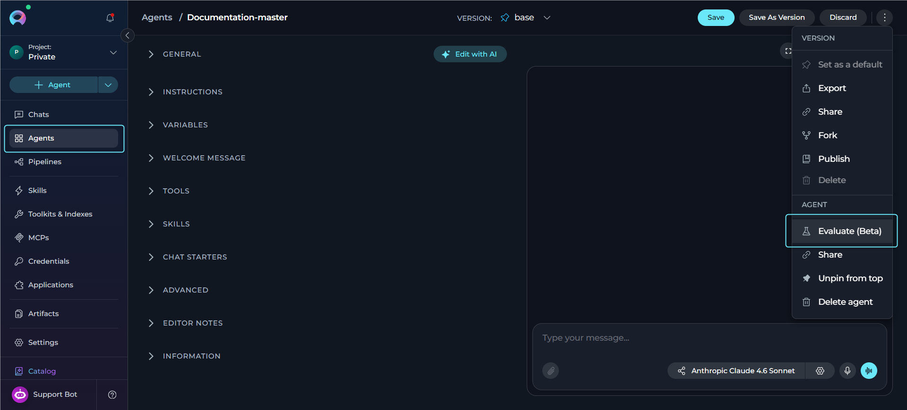

This opens the **Evaluation** workspace for that agent, where you manage Suites, Dimensions, Datasets and the Results History.

<Tip title="Documentation Shortcut">
Inside the Evaluation workspace, click the documentation icon on any page's header to open the [Agent Evaluation FAQ](./agent-evaluation-faq) in a new tab for quick answers to common questions.
</Tip>

<Note>
**Breadcrumb Navigation**

On every evaluation page, the **Evaluation (Beta)** breadcrumb opens a **Navigate to...** dropdown of the agent's suites instead of navigating away—pick one to jump straight to it, no back button needed. The suite you came from (if any) is pinned to the top of the list with a **Previous** badge.
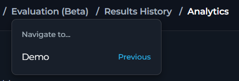

</Note>

## Suites

A **Suite** is what you actually run: it pairs one **agent version**, one **Dataset** and one or more **Dimensions** (via per-suite bindings), plus a **Judge Model** used for any AI-scored dimensions.

<Note>
A dimension **binding** carries suite-specific settings—such as weight, target, engine and evidence scope—without changing the shared dimension definition itself. Binding values override the dimension's own defaults for that suite only. Removing a dimension from a suite only removes the binding; the dimension itself stays in the library for reuse. Deleting a dimension from the library, however, removes every binding to it across every suite that used it—past run results are unaffected, since they keep their own frozen copy of the scoring configuration.
</Note>

**Create a Suite**

The first time you open **Evaluate (Beta)** for an agent, no suites exist yet—the **Suites** panel shows an empty state prompting you to create one, because you need a suite before you can run an evaluation.

1. In the Evaluation workspace, click **New Suite**.
     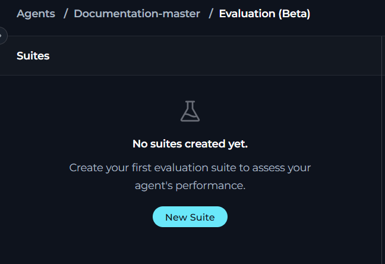
2. In the **Create Suite** dialog, enter a **Suite Name** (required) and an optional **Description**, then click **Save**.

     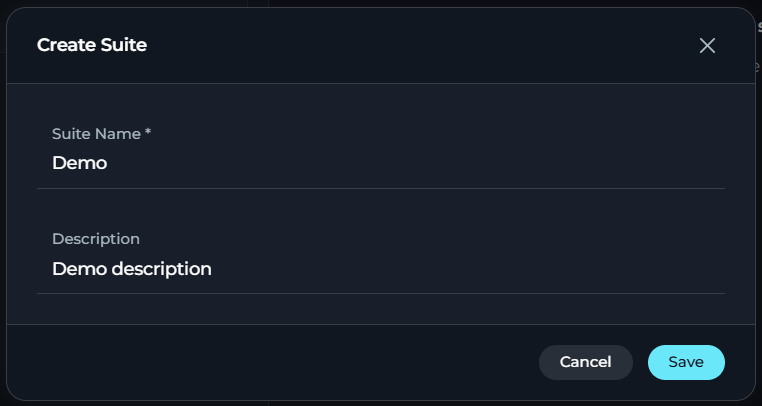

3. Saving creates the suite and opens it for configuration. Under **General**, set the remaining fields:

     | Field | Description |
     | --- | --- |
     | **Judge Model** | The LLM used to score any AI-evaluated dimensions in this suite. Defaults to **Auto**, which uses the project's default model (shown in the Auto option's label when one is configured) and falls back to it any time the field is left unset. |
     | **Version** | The agent version this suite evaluates. Locked while an evaluation run for this suite is in progress, since a run is scoped to one version—otherwise you can change it at any time. |

     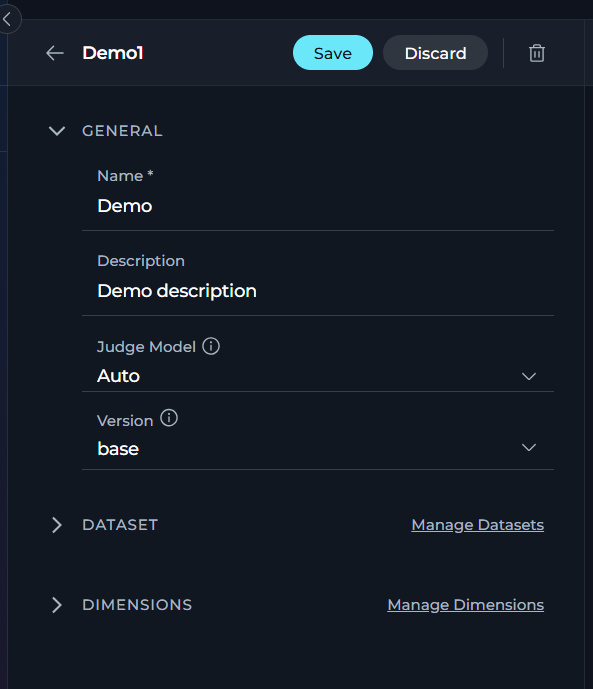

4. Click **Save** to store these changes. Use **Discard** to drop unsaved edits in this section.

<Note>
A new suite starts with no dataset and no dimensions attached. Attach them from the **Dataset** and **Dimensions** sections of the same page (see below)—the **Evaluate** button stays disabled until a version, a dataset with at least one active case, and at least one dimension are all set.
</Note>

<Note>
The agent a suite belongs to can't be changed after the suite is created. A suite is always tied to the agent you opened Evaluation from.
</Note>

### Run Limits

The **Run Limits** section of a suite (collapsed by default) controls how much an evaluation run is allowed to cost the agent under test, in steps, time and tokens:

| Field | Description |
| --- | --- |
| **Steps limit** | The most steps the agent may take on each case, from 1–100. Leave empty to use the agent's own limit (25 by default). |
| **Time limit per case, seconds** | How long the agent may run on a single case before it's treated as timed out, from 10–900 seconds. Defaults to 120 seconds if left empty. A case can override this value individually in the dataset (see [Test Cases](#test-cases)). |
| **Tokens per case** / **Cost per case, USD** | Optional per-case budget. Checked after the run completes—these don't stop a run early. |
| **Tokens per run** / **Cost per run, USD** | Optional budget for the whole run. |
| **When the run token limit is reached** | **Stop the run** or **Only report**. Only enabled once a per-run token limit is set. |
| **Store tool outputs** | On by default. Turn off to exclude tool outputs from the stored trajectory when they might hold sensitive data—tool names and inputs are always kept, and secrets are masked either way. |

      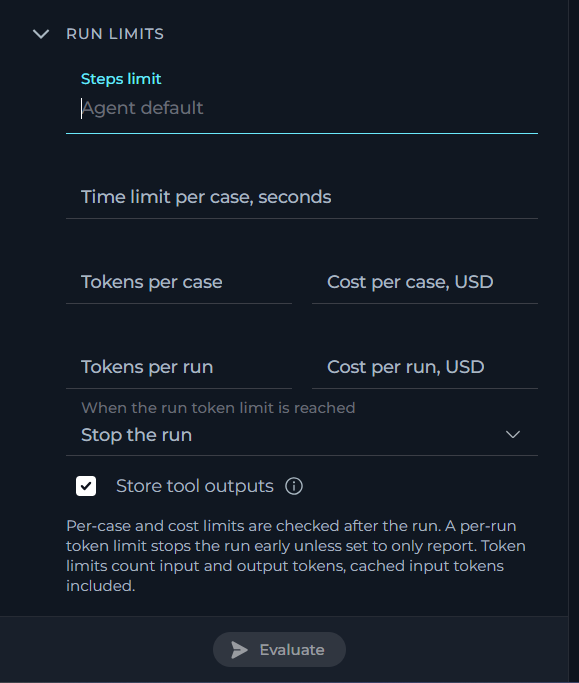

<Note>
Token limits count both input and output tokens, including cached input tokens. Cost limits are checked only after a run finishes; a per-run **token** limit is the only setting that can stop a run early, and only when set to **Stop the run**.
</Note>

<Warning>
**Case Time Limit**

A case that hits its time limit is not treated as a platform error. Every dimension bound to the suite is skipped for that case—except the two built-in latency dimensions, which score it at their worst value—and the run continues normally. The case still counts toward the run's results, flagged as timed out.
</Warning>

### Run Estimate

Once a suite has a dataset with at least one case and a version selected, the **Evaluate** button is preceded by an estimate of what the run is about to cost:

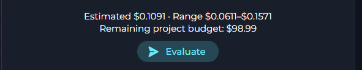

* **Estimated $X.XX · Range $X.XX–$Y.YY** (or a token range, if the historical run wasn't priced)—based on the suite's last finished run on the selected version, scaled to today's case count. If the selected version has no finished run yet, the suite's last finished run on any other version is borrowed instead, and the estimate notes it came from another version.
* **No estimate (first run)**—shown when the suite has never finished any run yet.
* **Remaining project budget: $X.XX** or **Your remaining budget: $X.XX**, whichever budget (project-wide or your own) is tighter.
* **The estimate is over the remaining monthly budget.**—shown in an attention color when the estimate exceeds whichever budget applies.

## Datasets

A **Dataset** is a named collection of test **Cases** that you run the agent against during an evaluation. Datasets belong to an owning agent but can be marked **Available across the project** so other agents' suites can reuse them.

<Note>
Only the owning agent can edit a dataset's cases, rename it, delete it, or promote conversations into it—sharing a dataset grants other agents' suites read access to attach and run it, never write access. A suite borrowing a shared dataset can exclude or include individual cases for its own runs without affecting the original dataset or any other suite using it. Excluding every case is accepted, but a suite left with no active cases cannot be run until at least one is restored.
</Note>

### Create a Dataset

1. In the Evaluation workspace, open **Manage Datasets**.
2. Click **+** to create a dataset.
3. Enter a **Dataset Name** (required) and an optional **Description**.
4. If you want other agents' suites to use this dataset, check **Available across the project**.
5. Click **Save**.
     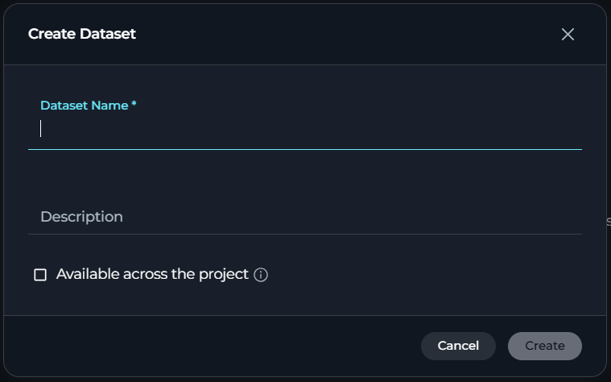

### View the Dataset Page

Selecting a dataset from **Manage Datasets** opens its case list.

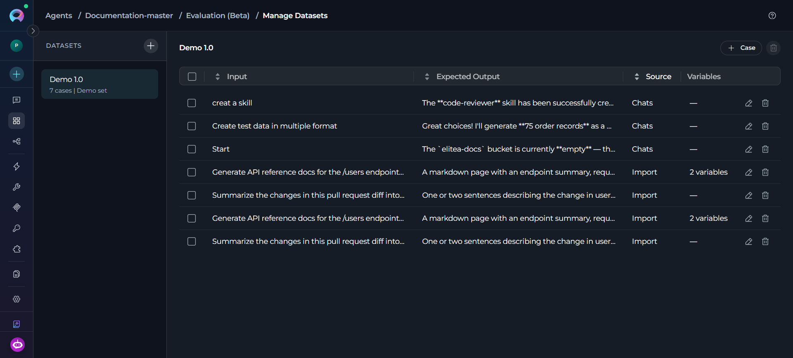

* **Dataset list**—every dataset created for the agent, showing its case count and description, with a badge marking datasets that are **Available across the project**. Click a dataset to view its cases. Click **+** to create another.
* **Case table **—one row per case, with sortable **Input**, **Expected Output**, **Expected Trajectory**, **Source** and **Variables** columns. **Source** shows how you created the case—**Manual**, **Import** or **Chats** (the last for both chats and run history, since both are promoted conversations)—and **Variables** shows how many key-value pairs the case defines, or **—** when it has none.
* **+ Case**—opens the add-case menu.
* **Delete icon** (top right, next to **+ Case**)—deletes the dataset itself.
* **Row actions**—hover a row to reveal its edit (pencil) and delete (trash) icons, for editing or removing that individual case.

## Test Cases

A **Case** is a single test within a dataset: an input (and, optionally, an expected output and variables) that the agent responds to during a run. Each case represents one concrete scenario for evaluating the agent. The dataset stays meaningful only when its cases reflect the situations the agent needs to handle well.

Every dimension bound to the suite scores each case independently, and a run breaks down results per case. Adding, editing or excluding a case changes what the suite evaluates and directly affects its overall score the next time it runs.

<Warning>
**Case Limit**

A dataset can hold at most **10 cases**. Adding a case (manually, via import or from a chat/run) once a dataset is at the limit is rejected. A dataset that already exceeded 10 cases before this limit was introduced keeps its existing cases but cannot add more until some are removed.
</Warning>

### Add a Test Case

With the dataset selected, click **+ Case** to open the add-case menu. Then choose one of the three methods below.

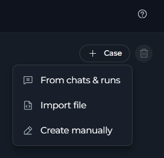

**From Chats and Runs**

Turns a real conversation or a past evaluation run into one or more repeatable test cases, so you can capture actual agent interactions—including ones that previously went wrong—instead of writing an input from scratch.

1. From the add-case menu, select **From chats and runs**.
2. Switch between the **Chats** and **History Runs** tabs to find the conversation or run you want to reuse. Both support selecting multiple entries at once.
3. Select the entries to turn into repeatable test cases in the dataset.
     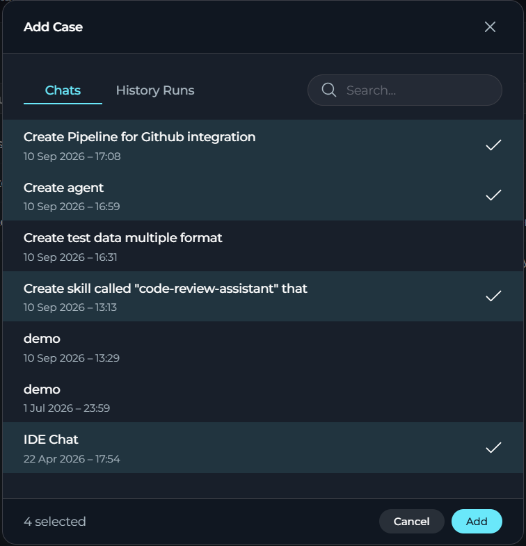

Each case in the dataset shows its Input, Expected Output, Source (marked **Chats** when pulled from a conversation or run) and Variables.

<Info>
Promoting a conversation turns each of your messages into one case's **Input**, and the agent's reply that follows it into that case's **Expected Output**—along with the names of the tools the agent called while generating that reply, captured as the case's **Expected Trajectory** (see [Test Cases](#test-cases)) so future runs can check the agent still calls the same tools.
</Info>

**Import a File**

Adds many test cases at once from a file, useful when you already maintain test data outside of ELITEA or want to bulk-load a large set of inputs instead of entering them one by one.

1. From the add-case menu, select **Import file**.
2. Choose a `.csv` or `.json` file containing your cases.
3. Upload the file. A result banner shows how many cases were imported and how many were rejected.

     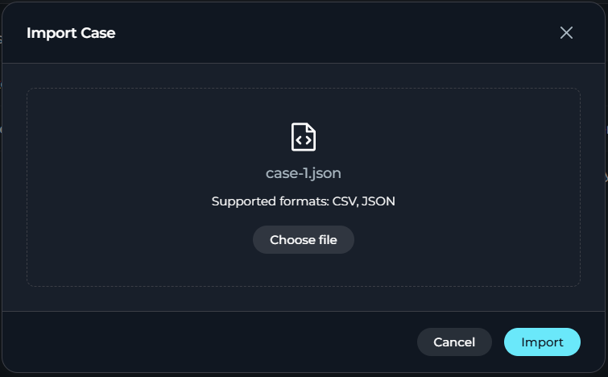

<Note>
**Import Validation**

The platform checks a `.json` file for valid JSON syntax before upload, and a `.csv` file for a header row containing an `input` column. It rejects a malformed file outright and imports no cases from it. Once uploaded, the platform validates each case individually: it adds valid cases to the dataset and skips invalid ones, listing each skipped case in the result banner with the reason for rejection (for example, a missing `input` field, or `variables` that isn't a set of key-value pairs). This way, the rest of the file still imports even when one row is invalid. An import that would push the dataset over the 10-case limit is rejected in full (all-or-nothing)—reduce the file or split it into multiple datasets.
</Note>

**Create a Case Manually**

Builds a single test case field-by-field, giving you full control over the exact input, variables and expected output—the most direct option when you already know precisely what you want to test.

1. From the add-case menu, select **Create manually**.
2. Enter the **Input** (required)—the text sent to the agent.
3. Optionally add **Variables** as key-value pairs.
4. Optionally check the **Expected Output** option and enter the expected response.
5. Optionally define an **Expected Trajectory**—see below.
6. Optionally set a **Time limit, seconds**, to override the suite's per-case time limit for this one case.
7. Click **Save** to add the case to the dataset.

     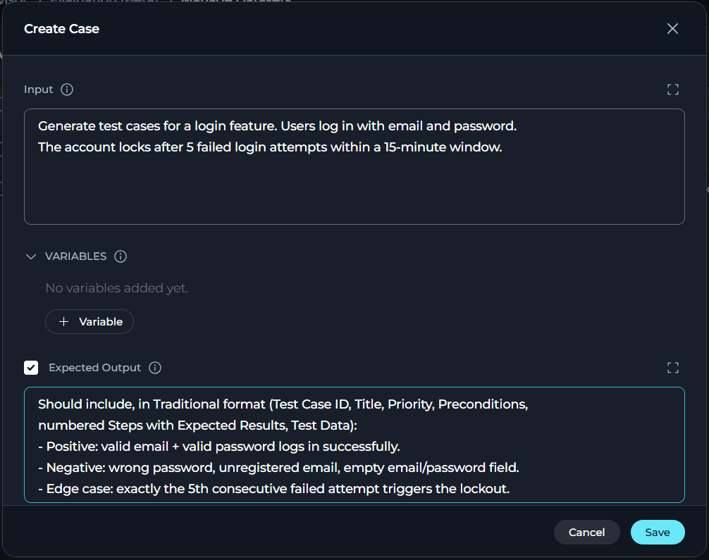

#### Expected Trajectory

An **Expected Trajectory** lets a case check not just what the agent answered, but which tools it called to get there. Enable it on a case to configure:

| Field | Description |
| --- | --- |
| **Match** | How the agent's actual tool calls must relate to the expected list: **Superset** (every expected call was made, extra calls allowed—the default), **Exact** (the same calls, in the same order), **In order** (expected calls appear in order, extra calls allowed), **Subset** (every actual call was expected) or **Any order** (scored by overlap, regardless of order). |
| **Compare with** | Whether to compare against only the agent's own tool calls, or every call including those made by any sub-agent it dispatches. Forbidden tools and the call budget always count every call regardless of this setting. |
| **Expected tool calls** | An ordered list of tools the agent should call, with an optional **Arguments** value and a per-call match mode (**Subset**—the named argument keys must be present, or **Exact**—the full argument set must match). |
| **Forbidden tools** | Tools the agent must never call for this case to pass. |
| **Allowed repeats** | Tools exempt from being flagged as a redundant call when called more than once with identical arguments. |
| **Max tool calls** | An optional cap on the total number of tool calls for this case. |

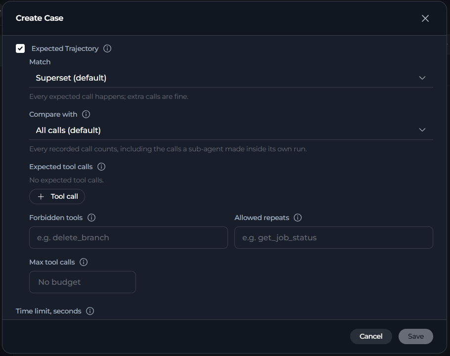

This is scored by the built-in **Tool call match** dimension—see [Dimensions](#dimensions) below.

## Dimensions

A **Dimension** defines one thing you want to measure—for example, "Response is polite and professional" or "Output is valid JSON." Dimensions turn what would otherwise be a subjective impression of quality into a named, repeatable criterion that scores the same way on every case, every time the suite runs. One of three engines scores each dimension. You choose the engine when you create the dimension, and it stays fixed afterward:

| Engine | How it Scores |
| --- | --- |
| **AI** | An AI judge model reads the response (and any other evidence you select) against your written evaluation instructions and produces a score. |
| **Human** | A person reviews the response afterward and enters a score manually. Human scoring lets a run continue without waiting. The platform marks cases as pending until someone reviews them. |
| **Code** | A Python validation script you write inspects the response and sets a `result` value, which becomes the score. |

A dimension lives in a shared library, and you add it to one or more suites through a binding. Editing its evaluation instructions, target or scale affects every suite that includes it the next time that suite runs, not just the suite you were viewing when you made the change.

### Dimension Scopes

Dimensions can be scoped at three levels, shown as tabs on the **Manage Dimensions** page:

* **Agent**—filtered to the agent you are evaluating, as a decluttering convenience. Any Editor or Admin in the project can still use an Agent-scope dimension from a different agent if they know of it.
* **Project**—visible and usable by every agent in the project.
* **Platform**—a built-in catalog shared across the whole platform, managed outside of any project. Read-only here: you can browse and attach a Platform dimension to your project, but you cannot edit or delete it.

A search bar on the **Manage Dimensions** page filters dimensions by name within the active tab.

<Note>
An Admin (or the owner of a personal project) can move a dimension between the **Agent** and **Project** scopes after it's created. Moving a **Project** dimension down to **Agent** scope is blocked if another agent still has a live binding to it—unbind it there first.
</Note>

### Create a Dimension

1. In the Evaluation workspace, open **Manage Dimensions**.
2. Switch between the **Agent**, **Project** and **Platform** tabs to choose the scope for the new dimension (**Platform** is read-only for dimension creation—to use a Platform dimension in your project, attach it from the Platform tab instead of creating a new one).
3. Click **+** to create a new dimension.
4. Fill in the following fields and click **Save**.

     | Field | Description |
     | --- | --- |
     | **Name** | The display name of the dimension. |
     | **Available across the project** | Lets all agents and agent versions in the current project use this dimension (moves it to **Project** scope). |
     | **Evaluator** | **AI**, **Human** or **Code**—sets how you evaluate the dimension. Locks once you save the dimension; to change it later, you must first remove every suite binding currently using the dimension's existing evaluator. |
     | **Evaluation Instructions** *(AI only)* | Describes the qualities, behaviors or examples the judge model should identify. |
     | **Evaluation Guidance** *(Human only)* | Optional guidance to help reviewers score consistently. |
     | **Validation Code (Python)** *(Code only)* | Script written in the built-in editor. Must assign the result to a plain variable named `result`—a boolean for Pass/Fail, or a number for a numeric score—instead of using `return`. Depending on the Evaluation Target, the script can read `input`, `output`, `expected`, `structure`, `trajectory`, `expected_trajectory` and `usage` as plain variables. The script can also set `result = 'na'` to signal the check doesn't apply to this case (for example, no reference was given to compare against)—such cases are excluded from scoring rather than marked pass or fail. |
     | **Evaluation Target** | Which parts of the case and run you show to the judge or script: **Output**, **Input**, **Agent structure**, **Trajectory** (the recorded tool calls, plus the case's Expected Trajectory if set) or **Usage** (the run's token and cost usage)—select one or more. |
     | **Scale Type** | **Score (1-100)**, **Rating (1-5)**, **Pass or Fail** or **Custom** (define your own **Min** and **Max**). Selecting the **Code** evaluator restricts this to **Pass/Fail** or **Score**. |
     | **Polarity** *(hidden for Pass/Fail)* | **Higher is better** or **Lower is better**—tells the platform which direction counts as improvement for this dimension's scale. |
     | **Success Criteria** | **At least (`>=`)**, **At most (`<=`)** or **Exactly (`=`)**—plus the **Target Value** the score must meet to pass. Shown in place of this, a **Pass/Fail** scale instead offers a **Target** of **No target**, **Must pass** or **Must fail**. |
     | **Importance** | **Low**, **Medium**, **High**, **Critical** or **Custom** (with a custom weight value). Controls how much this dimension contributes to the overall score of the suite; a weight of 0 makes a dimension informational-only. |

     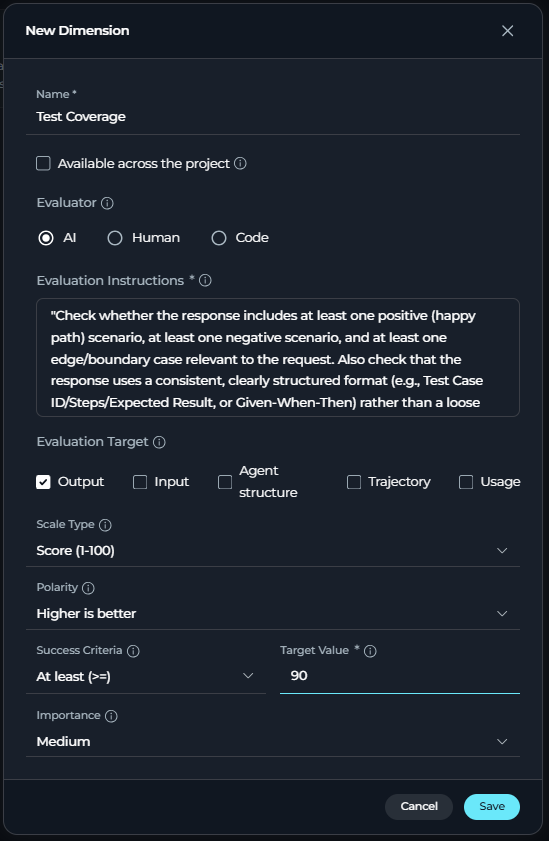

<Info>
**Example of Evaluation Instructions**

For a dimension measuring tone, **Evaluation Instructions** might read: "Score the response from 1-100 based on how polite and professional it sounds. A courteous response that avoids slang, sarcasm or curt phrasing should score above 80. A response that is rude, dismissive or uses inappropriate language should score below 40." Specific, concrete instructions keep scoring by the AI judge more consistent across cases.
</Info>

<Note>
A dimension can only have one evaluator. If you want both an AI score and a human score for the same criterion, create two separate dimensions—one set to AI, one set to Human.
</Note>

<Info>
**Code Validation Safety**

An automatic safety check runs before you can save a validation script. It rejects any import outside a fixed list of safe standard-library modules (such as `math`, `re`, `json`, `datetime` and `hashlib`), calls to unsafe built-in functions (such as `exec`, `eval`, `open` or `getattr`), and any access—direct or through a string—to dunder attributes such as `__globals__` or `__subclasses__`. Any Editor or Admin can create and edit Code-evaluated dimensions; this is not restricted to Admins.
</Info>

### Built-in Platform Dimensions

The **Platform** tab includes a set of ready-made, Code-evaluated dimensions you can attach to your project without writing any validation script yourself. These check the agent's recorded execution trace rather than its final answer:

| Dimension | What it checks |
| --- | --- |
| **Tool call match** | Compares the agent's actual tool calls for a case against that case's **Expected Trajectory** (see [Test Cases](#test-cases)). A case with no Expected Trajectory defined is excluded from this check rather than scored. |
| **Forbidden tools** | Fails if the agent called any tool listed as forbidden on the case. |
| **Tool errors** | Counts tool calls that returned an error. |
| **Redundant calls** | Counts repeated calls to the same tool with the same arguments, excluding any tools the case marks as allowed repeats. |
| **Step budget** | Checks the case's **Max tool calls** limit, if one is set. |
| **Step limit hit** | Passes when the run did not end because the agent hit its step limit. |
| **Guardrail events** | Counts tool calls that were blocked or paused by a guardrail during the run. |
| **Latency** / **Final answer time** | Score based on how much of the case's time limit was consumed. |

Attaching a Platform dimension copies its current definition into your project; you can retune its weight, target and wording through a suite binding like any other dimension, but you cannot edit its underlying script.

### Build a Dimension with AI

If you would rather describe what you want in plain language than complete every field yourself, you can generate a dimension draft:

1. From the dimension creation menu, choose **Build with AI**.
     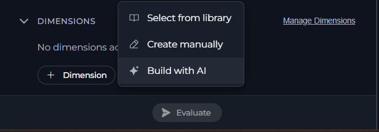
2. Describe the quality you want to measure—for example, a description of a polite and professional tone, or a requirement that output be valid JSON.
3. Click **Generate Draft**.
4. Review the generated candidate dimensions and click one to select it.
     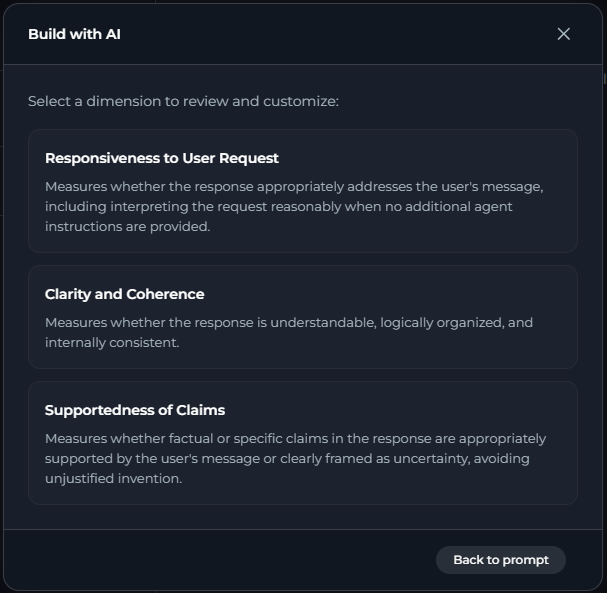
5. The full dimension form opens pre-filled with the generated content. Adjust any field as needed, then click **Create Dimension**.

You can return to the prompt step or the candidate list at any point before creating the dimension.

<Note>
Dimensions generated this way default to **Agent** scope. The generator reads the agent's own instructions and tools, and avoids proposing a dimension that duplicates one already in your project for this agent—but it won't create anything until you save a draft.
</Note>

## Run an Evaluation

Use a completed suite to measure agent performance and review its results.

1. Open the suite you want to run.
2. Confirm that a dataset is attached under the **Dataset** section of the suite.
3. Confirm that at least one dimension is added under the **Dimensions** section of the suite.
4. Click **Evaluate**.
5. A progress indicator labeled **Evaluating...** shows "Preparing cases…" and then how many cases have completed (for example, "3/10 cases") while the run is in progress. You can cancel a run in progress; cancelling keeps the scores for any cases already completed.
6. When the run finishes, the **Results** panel updates automatically with the new scores.

 <video controls>
   <source src="../../img/how-tos/agents-pipelines/agent-evaluation/run-evaluation.mp4" type="video/mp4"/>
 </video>

<Info title="Automatic Batching and Scaling">
When multiple AI dimensions share the same Evaluation Target, the platform automatically batches them into a single AI judge call per test case, rather than one call per dimension. The platform also splits oversized batches and, if needed, trims evidence or rubric text automatically so a call always fits the judge model's context window. This works without configuration, and the run always completes successfully.
</Info>

<Info title="Run Timing and Interruptions">
A run that makes no progress for an extended period (for example, because the process executing it restarted) is automatically marked as errored rather than left stuck; start a new run if this happens. A run also stops automatically, keeping whatever it scored so far, if it runs for several hours straight, if it is cancelled, or if it exhausts a token/cost budget configured in the suite's [Run Limits](#run-limits).
</Info>

### Review Results

The **Results** panel shows the outcome of the most recent run for the selected suite:

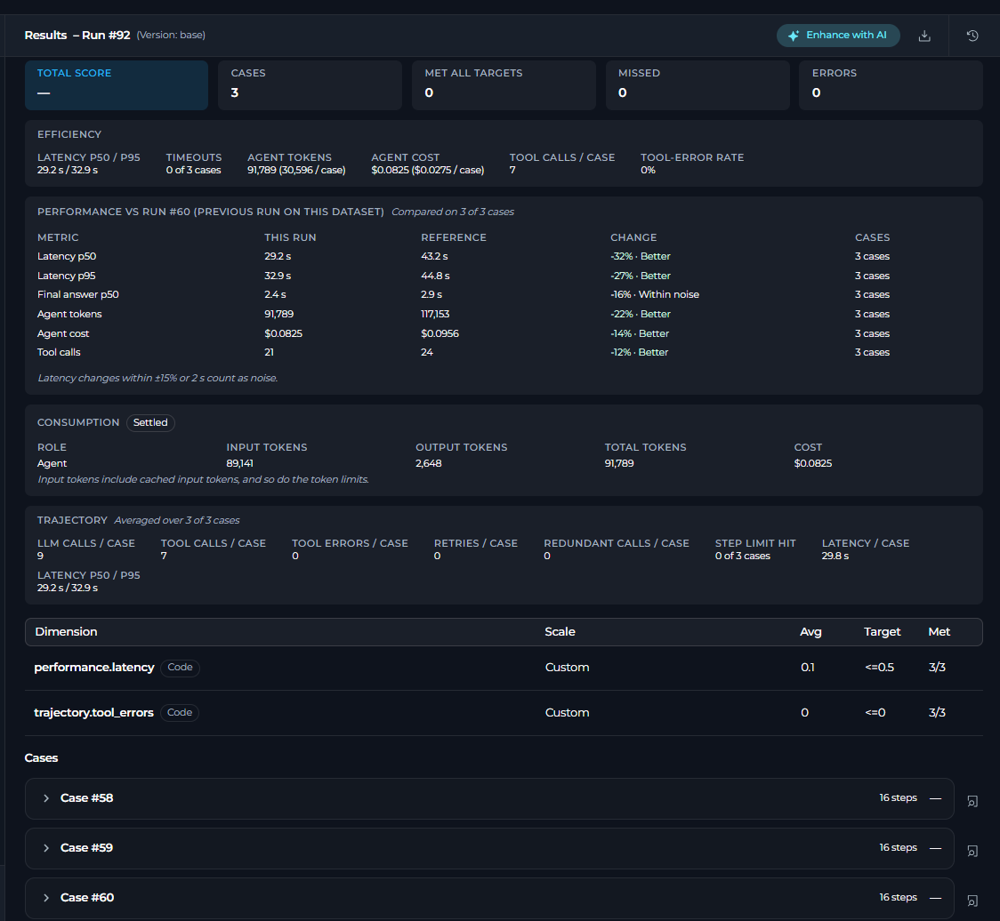

The summary cards show the following information:

| Card | Shows |
| --- | --- |
| **Total Score** | The overall score of the suite for this run. |
| **Cases** | The total number of cases included in the run. |
| **Met all targets** | Cases where the target for every dimension was met. |
| **Missed** | Cases where the target for at least one dimension was missed. |
| **Errors** | Cases where at least one dimension failed to produce a score. |

If cases timed out or are still awaiting a human score, a banner appears below the summary cards: *"1 of 2 cases timed out at 10 s. Scores cover the other 1 case: a timed-out case is left out of every score except the latency checks."* and/or *"Awaiting human evaluation — N result(s) still need a score. Totals update as each one is saved."*

Below the summary cards, a set of rollup cards gives a run-level view before you drill into individual cases (each renders only when the run has the data to support it, so older runs may show fewer of them):

| Card | Shows |
| --- | --- |
| **Efficiency** | Latency (p50/p95), timeouts, agent tokens and cost (total and per case), tool calls per case and tool-error rate. The judge's own cost/tokens are shown separately, never added into the agent's figures. |
| **Performance vs &lt;reference&gt;** | Compares this run's latency, tokens, tool calls and cost against a reference run—the suite's declared baseline, or otherwise the previous finished run on the same dataset—with a **Better** / **Worse** / **Within noise** / **Unchanged** verdict per metric, and notes when a comparison isn't meaningful (for example, too few matched cases, or the dataset or time limit changed). |
| **Consumption** | A token and cost breakdown by role (**Agent**, **Judge**), with a settlement badge (**Settling** / **Settled** / **Partly settled** / **Runtime figures**) showing whether the figures are still provisional, and a verdict against any budget configured in the suite's [Run Limits](#run-limits). |
| **Trajectory** | Averages across cases for LLM calls, tool calls, tool errors, retries, redundant calls, and how many cases hit the suite's step limit. |

* **Dimension table**—for each dimension: its Scale, Average score, Target and whether the target was Met.
* **Case list**—every case in the dataset, expandable to show its per-dimension results, step/tool-error/retry counters, and an **Evaluation required** badge when any of its dimensions are still awaiting a human score. A **View details** button on each case opens its full input/output and recorded trajectory—see [View Case Details](#view-case-details). Each dimension card shows its state along with the rationale from the judge, your own comments, or a note explaining a special state:

     | State | Meaning |
     | --- | --- |
     | **Score: X · Met / Missed** | The dimension was scored and compared against its target. |
     | **Error** | The scoring engine couldn't produce a result for this case (for example, the judge's response didn't match the expected format). |
     | **Skipped** | The check wasn't run for this case—for example, it needs evidence (an Expected Output, a recorded trajectory or usage data) that this case or run doesn't have. |
     | **Exceeded** | A latency check on a case that hit the suite's time limit—scored at its worst value without actually running the check. |
     | **Pending** *(Human only)* | Awaiting human evaluation. Shows an **Evaluate** button if you have permission to score it. |

From the Results panel toolbar you can:

* **Enhance with AI**—analyze this run and generate suggested fixes to the agent's instructions, scoring dimensions and dataset cases.
* **Export to Excel**—download the full results as a spreadsheet, with a summary sheet plus one sheet per dimension and one sheet per case.
* **Results History**—open the full run history for this agent in a separate panel.

### Enhance with AI

Once a run has results, use **Enhance with AI** to get AI-generated suggestions for closing the gap between what the agent produced and what the suite expected—without manually re-reading every missed case yourself.

<Note>
**Permission Required**

Enhance with AI requires permission to update agent versions.
</Note>

1. In the Results panel toolbar, click **Enhance with AI**
2. The platform analyzes the run and walks you through a few steps. **Analysis** always appears; the rest only appear if that run's proposal actually has something to suggest there, so a run with only instruction fixes shows just **Analysis** and **Agent Instructions**:
     * **Analysis**—up to four coverage stats (cases evaluated, targets missed, dimensions with gaps, cases below target), a written diagnosis of why the run missed its targets, and a note on what the following steps contain. If nothing needs changing, this step says so instead ("No changes suggested—the agent and the evaluation look consistent for this run.") and the wizard ends here.
           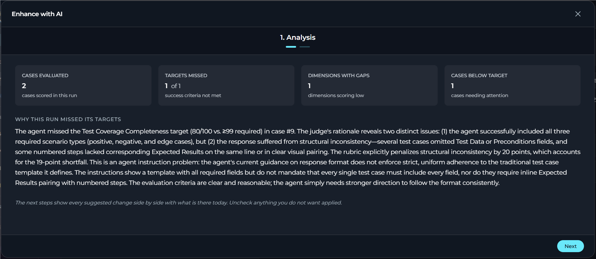
     * **Agent Instructions**—shown only when the proposal includes instruction edits. A side-by-side diff of the agent's current instructions against the proposed rewrite, with each individual suggested edit listed below—labeled "Instructions update N" or "Full instructions rewrite"—as a checkbox you can accept or reject one at a time, along with the rationale behind it.
           
           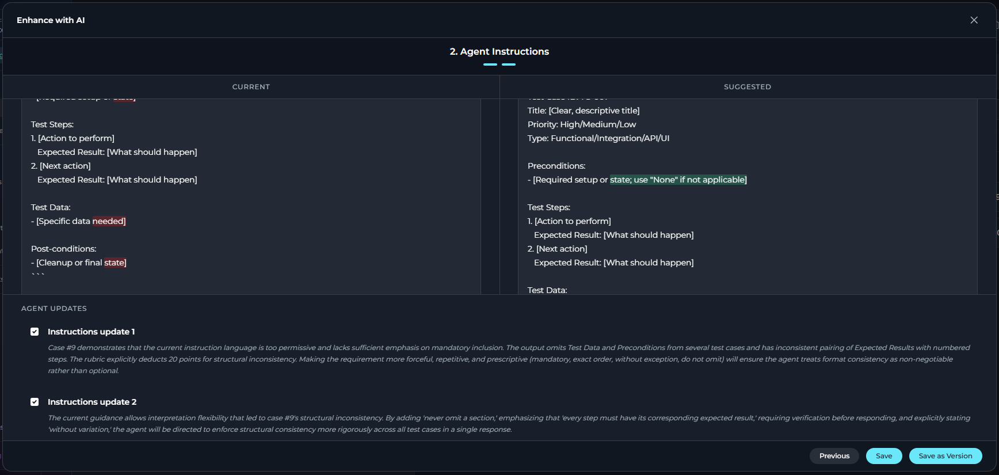

     * **Dimensions**—shown only when the proposal includes dimension fixes. Suggested rubric or target changes for dimensions this run scored, each shown as current vs. suggested value with a rationale and an accept/reject checkbox.
     * **Dataset Cases**—shown only when the proposal includes dataset fixes. Suggested Expected Output corrections for cases in the attached dataset, or a suggestion to add a new case covering a gap the dataset doesn't test yet (new-case suggestions are informational only—add the case yourself in the dataset editor, since they can't be applied automatically).
3. Uncheck any individual suggestion you do not want applied; the Instructions diff updates live as you do. An instruction edit that no longer matches the agent's current instructions—because someone changed them after the proposal was generated—is flagged and can't be applied; uncheck it, or close and reopen Enhance with AI to get a fresh proposal.
4. Click **Save**, or **Save as Version** (shown only when the proposal includes at least one instruction edit):
     * **Save**—applies the accepted instruction edits directly to the agent version the suite is bound to, and applies the accepted dimension and dataset-case fixes immediately.
     * **Save as Version**—name and create a new agent version containing the accepted instruction edits, leaving the suite's current version untouched so the same run can still be compared against the original. The accepted dimension and dataset-case fixes are applied immediately either way.

<Note>
Accepted dimension and dataset-case fixes are applied directly to the shared dimension or dataset case—affecting every suite that uses it—regardless of whether you choose **Save** or **Save as Version** for the instruction edits. Only the agent's instructions are versioned.
</Note>

### View Case Details

Each case in the **Case list** has a **View details** button, separate from expanding the case to see its dimension cards. It opens a **Case #&lt;id&gt; details** window with two tabs:

<Tabs>
  <Tab title="Content">
  Shows the full text the case ran with and produced, in side-by-side columns. Each column has a full-screen expand button for reading long text.

  | Column | Shows |
  | --- | --- |
  | **Input** | The text sent to the agent. |
  | **Actual Output** | The agent's response during this run. |
  | **Expected Output** | The case's reference answer, or "No expected output" when the case doesn't define one. |
  | **Agent Instructions** | The agent's structure/instructions—shown only when the case's structure was in scope for scoring and the run captured it. |

      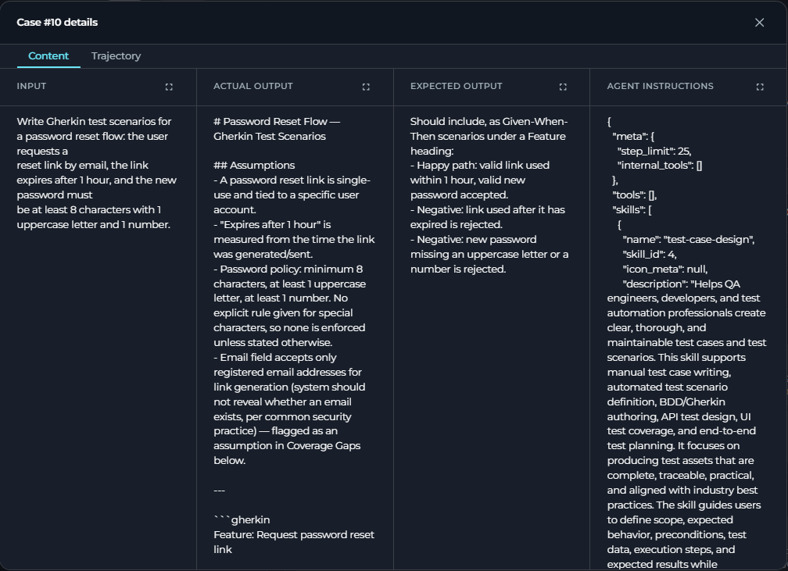

  </Tab>
  <Tab title="Trajectory">
  Shows what the agent actually did while working the case.

  **Usage by role**

  A table with one row for the **Agent** and one for the **Judge**, showing each role's **Input tokens**, **Output tokens**, **Total tokens** and **Cost** for this case. When the agent dispatched sub-agents, a **By agent** table breaks the same figures down per sub-agent instead.

  **Run counters**

  | Counter | Meaning |
  | --- | --- |
  | **LLM calls** | How many model calls the agent made. |
  | **Tool calls** | How many tool calls the agent made. |
  | **Distinct tools** | How many different tools were called. |
  | **Tool errors** | Tool calls that returned an error. |
  | **Retries** | Calls the agent retried. |
  | **Redundant calls** | Repeated calls to the same tool with the same arguments. |
  | **Guardrail events** | Tool calls blocked or paused by a guardrail. |
  | **Step limit hit** | Whether the run ended because the agent reached its step limit. |
  | **Latency** | How long the case took. |

  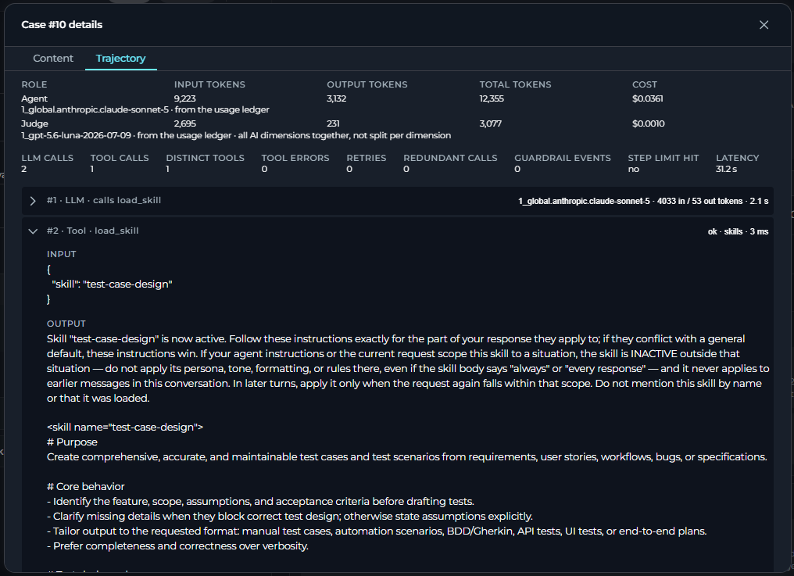

  Only the counters that apply to the case are shown.

  **Expected vs actual**

  Shown when the case defines an [Expected Trajectory](#test-cases): a checklist of whether each expected tool was called, whether any forbidden tool was called, whether the tool-call budget was respected, and which extra tools were called that weren't expected.

  **Steps**

  The ordered list of steps the agent took—each labeled with its kind (**LLM**, **Tool** or, for a pipeline, **Node**) and name, expandable to see that step's detail. A step made by a dispatched sub-agent is nested under the call that started it; a pipeline's node steps are shown in sequence, with the LLM and tool steps each node made nested under it. A note appears if the trajectory was shortened to fit the storage limit, or if the suite's **Store tool outputs** setting was off for this run (only tool names and inputs were kept, not outputs).

  <Note>
  The Trajectory tab only appears when viewing a case from a finished run. If the case has no recorded trajectory at all, it shows a message explaining why (for example, "No trajectory was recorded for this case.") instead of an empty list.
  </Note>
  </Tab>
</Tabs>

### Score a Human Dimension

Human-scored dimensions let a run continue without waiting. The cases appear as pending until someone enters a score.

1. In the case results, find a dimension card for a Human-evaluated dimension and select **Evaluate** to open it.

      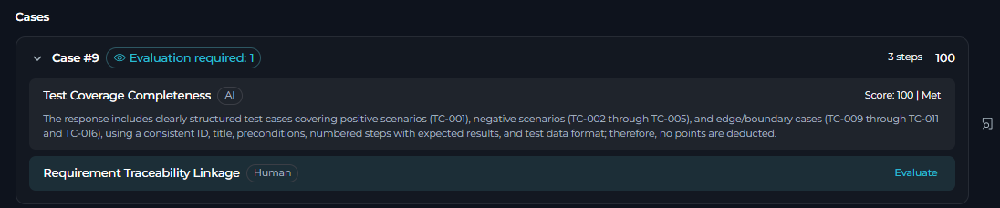

2. Review the case's input, actual output and expected output (as applicable) shown alongside the control, plus any **Evaluation Guidance** written on the dimension.
3. Enter a score using the control shown for the dimension's scale: a **Pass** / **Fail** toggle for a Pass/Fail scale, or a numeric field plus a slider for a Rating or Score scale.
4. Optionally add a **Comment** (up to 2000 characters).
5. Click **Save**, or **Cancel** to close without saving.

      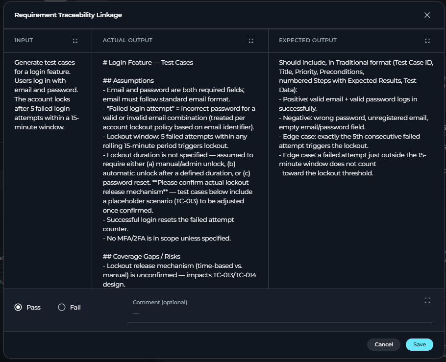

## Review Run History

1. From the Results panel, click the **Results History** icon (or navigate to it directly from the Evaluation workspace).
2. The run history table lists every run for the agent, with columns for **Date**, **Suite**, **Version**, **Tokens** (agent tokens per case), **Steps** (average LLM and tool calls per case), **Guardrails** (guardrail events, if any) and **Score**. A badge on the Score column highlights the change versus the previous *scored* run for the same suite—skipping over any run in between that failed or has no score yet.
3. Select a run to view its full results in the panel beside the table.
4. Use the row actions menu to **Share** (copies a link to the run), **Export to Excel**, open **Analytics** (only shown for runs with analytics data available) or **Delete** a run (deleting requires the appropriate permission).

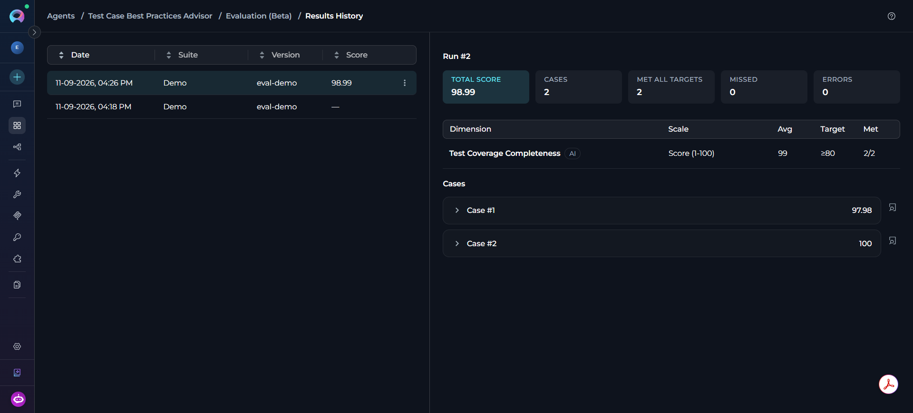

<Note>
Deleting a dimension from the library removes it everywhere it is used going forward, but finished runs keep a frozen snapshot of the dimensions as they were scored at the time. Historical results stay exactly as they were.
</Note>

### Run Analytics

**Analytics** opens a dedicated page for that run, covering both test-case execution and LLM-as-judge scoring for that run only—no other evaluations or ordinary chats are mixed in. The header shows the run's suite, run date and the agent version that was evaluated. **Costs** opens by default; use **Refresh data** or **Export to Excel** (one worksheet per tab) from the page toolbar.

<Tabs>
  <Tab title="Costs">
  Estimated cost cards (total, input, output, cache read/write) plus Cost by User and Cost by Model tables.
  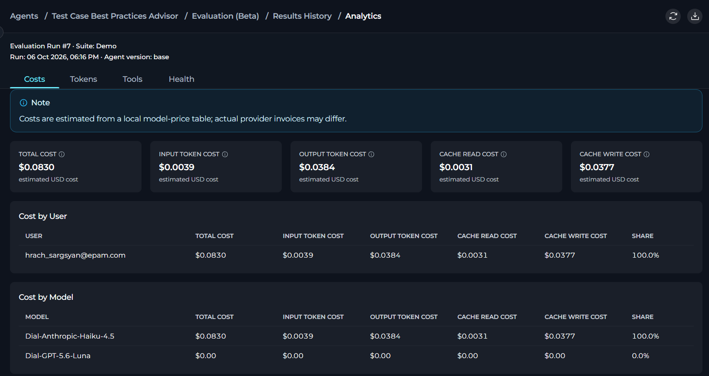
  </Tab>
  <Tab title="Tokens">
  Token count cards (total, input, output, cache read/write) plus Token Usage by User and Token Usage by Model tables.
  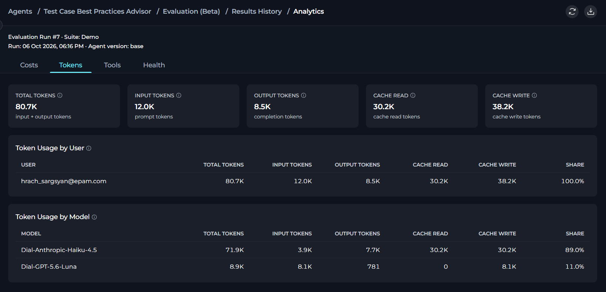
  </Tab>
  <Tab title="Tools">
  A Tool Details table (calls, users, average latency, errors) with search and pagination.
  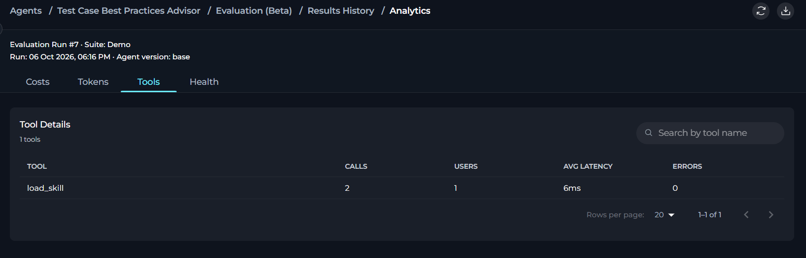
  </Tab>
  <Tab title="Health">
  A Health by Event Type table (total, errors, error rate, average latency).
  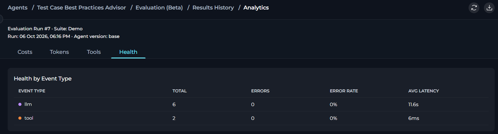
  </Tab>
</Tabs>

<Note>
Analytics is only available for runs recent enough to carry the tracking data it needs—older runs don't show the menu item.
</Note>

## Troubleshoot Evaluation Issues

<Accordion title="Resolve a Dimension Error for a Case">
This means the scoring engine could not produce a valid result for that specific case—for example, the AI judge returned a response that did not match the expected format. The error remains isolated to this dimension and case. Other dimensions and cases in the same run are unaffected. Review the evaluation instructions or evidence scope for the dimension and run the suite again if needed.
</Accordion>

<Accordion title="Resolve a Pending Human Dimension">
Human-scored dimensions require someone to manually enter a score after the run completes—only a person can score them. Open the case and save a score to clear the pending state.
</Accordion>

<Accordion title="Create or Edit a Code Dimension">
Any Editor or Admin can create and edit Code-evaluated dimensions. If saving is blocked, check that your validation script passes the automatic safety check—it rejects imports outside the allowed standard-library modules, unsafe built-ins such as `exec`/`eval`/`open`/`getattr`, and any access (direct or via a string) to dunder attributes such as `__globals__`.
</Accordion>

<Accordion title="Change a Dimension's Evaluator or Scope">
A dimension's **Evaluator** locks after it's created—remove every suite binding that uses it before you can change it. Moving a dimension between **Agent** and **Project** scope requires Admin (or, in a personal project, being its owner), and a **Project** dimension can't be moved down to **Agent** scope while another agent still has a live binding to it. **Platform**-scope dimensions can't be edited or moved at all from a project—they're managed outside any project.
</Accordion>

<Accordion title="Keep an Active Case in a Shared Dataset">
A suite must keep at least one active case from its attached dataset. Include a different case before excluding the one you want removed.
</Accordion>

<Accordion title="Resolve a Dataset Case Limit Error">
A dataset can hold at most 10 cases. Adding one more—manually, via import, or from a chat/run—is rejected with a message naming the dataset's current count and the limit. Remove an existing case first, or (for an import or promoted conversation) split the cases across multiple datasets instead of one.
</Accordion>

<Accordion title="Resolve Rejected Imported Cases">
The platform rejects a `.json` file entirely when it is not valid JSON, and imports no cases from it. Otherwise, it validates each case on its own. Check the reasons listed next to the rejected count in the import result banner, fix those rows in your source file and re-import. Cases that already passed validation stay in the dataset unchanged.
</Accordion>

<Accordion title="Run a Suite">
Before you can evaluate a suite, it needs a **Dataset** attached and at least one **Dimension** added. Open the suite and check both the **Dataset** and **Dimensions** sections. For instructions, see [Run an Evaluation](#run-an-evaluation).
</Accordion>

<Accordion title="Enhance with AI Finds Nothing to Suggest">
This means the analysis found the agent's behavior and the evaluation setup already consistent for that run—there is nothing to fix. This is expected when the run scored well, or when prior fixes already addressed the gaps.
</Accordion>

<Accordion title="Enhance with AI Edit Cannot Be Applied">
An instruction edit that no longer matches the agent's current instructions (because they changed after the proposal was generated) cannot be applied. Uncheck that edit, or close the dialog and reopen **Enhance with AI** to generate a fresh proposal against the current instructions.
</Accordion>

<Accordion title="A Case Shows as Timed Out">
The agent did not finish this case within the suite's (or the case's own) time limit. Its dimensions show **Skipped** except the built-in latency checks, which score it **Exceeded**. Raise the **Time limit per case** in the suite's [Run Limits](#run-limits), or on the case itself, if the agent legitimately needs more time.
</Accordion>

<Accordion title="A Dimension Shows as Skipped">
The dimension needed evidence this case or run doesn't have—most often a **Trajectory** or **Usage** evidence target with nothing recorded for that case, or a **Tool call match** check on a case with no Expected Trajectory defined. This isn't an error; add the missing evidence to the case if you want the dimension scored.
</Accordion>

<Accordion title="No Performance Comparison Is Shown for a Run">
The **Performance vs...** card only appears when the suite has a declared baseline run or a previous finished run on the same dataset to compare against. It also withholds a latency verdict (showing "not comparable") when too few cases matched between the two runs, when the dataset changed, or when the per-case time limit changed between the two runs—raw figures are still shown even then.
</Accordion>

---

## Best Practices

<Accordion title="Start Small and Expand the Dataset">
Begin with a handful of cases that cover the scenarios you care about most, confirm your dimensions score them sensibly, then add more cases—including known failure cases—once the setup is stable.
</Accordion>

<Accordion title="Write Specific, Concrete Evaluation Instructions">
Vague instructions produce inconsistent AI scores. Naming exact qualities, thresholds, or examples such as those in the evaluation instructions example gives the judge model less room for inconsistent scoring between runs.
</Accordion>

<Accordion title="Reuse Project and Platform Dimensions">
Reuse a shared dimension instead of recreating similar criteria for every agent, so scores stay comparable across agents that share the same standards.
</Accordion>

<Accordion title="Turn Real Failures into Cases">
Use the **From Chats and Runs** method in the Add a Test Case section to capture an actual bad response as a permanent case, so the platform automatically catches the same mistake if it appears again.
</Accordion>

<Accordion title="Match the Engine to the Criterion">
Use Code dimensions for objective, deterministic checks (format, required fields), AI dimensions for judged qualities (tone, relevance) and Human dimensions only for what genuinely needs human judgment. Human scoring lets a run continue without waiting, but a person must complete it.
</Accordion>

<Accordion title="Use Case: Catch a Regression After an Instruction Change">
1. Run a suite once to establish a baseline score.
2. Edit the instructions or tools of the agent.
3. Re-run the same suite—same dataset, same dimensions—and compare the new score against the previous one in the Run History section.

A drop in score, especially on cases that previously passed, flags a regression before it reaches users.
</Accordion>

<Accordion title="Use Case: Compare Two Agent Versions">
1. Create two suites that share the same **Dataset** and **Dimensions** but are each locked to a different agent **Version**.
2. Run both suites.
3. Compare their scores in the Run History section to decide which version performs better before deploying it.
</Accordion>

<Accordion title="Use Case: Build a Regression Set from Real Failures">
1. When a chat or a run produces a bad response, open the **From Chats and Runs** method in the Add a Test Case section and add it to a dataset as a case.
2. If you have one, enter the correct **Expected Output** so future runs have something concrete to compare against.
3. Keep the case in the dataset used by your suites, so they automatically catch the same failure if it recurs.
</Accordion>

---

<Info title="Additional Resources">
* [Agent Evaluation FAQ](./agent-evaluation-faq) answers common questions about dimensions, datasets, suites and scoring behavior.
* [Agents](../../menus/agents) provides a complete guide to creating and configuring agents.
</Info>
