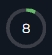
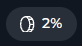
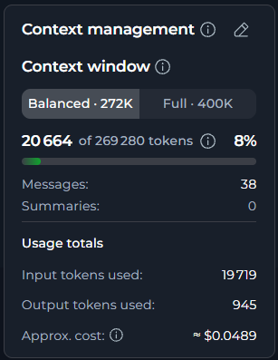
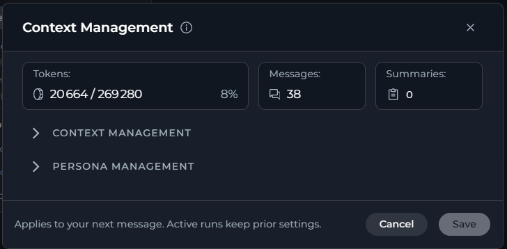
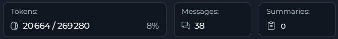
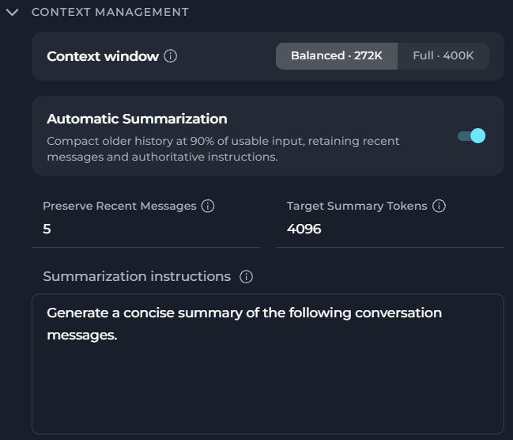
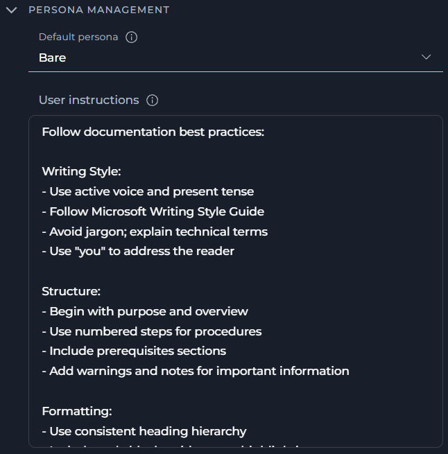

ELITEA provides two related aspects of chat resource management:

<CardGroup cols={2}>
	<Card title="Context Management" icon="gauge" href="#context-management">
		Tracks and controls token usage within a conversation.
	</Card>
	<Card title="Budget Management" icon="sack-dollar" href="#budget-management">
		Tracks and alerts on your project's cost budget.
	</Card>
</CardGroup>

## Context Management

The **Context Management** widget displays real-time token usage for the active conversation, across the chat, agents, pipelines and applications.

**Context management is always on**. The widget appears once the conversation has an active model and at least one message.

### How Context Management Works

ELITEA continuously tracks token usage for the conversation and shows it on the widget in real time. Tokens are counted from whichever source is most accurate and available, in order:

1. The exact usage the model provider reports for the request.
2. An exact count from an injected tokenizer, when one is configured.
3. A character-based estimate (roughly 4 characters per token, adjusted per provider) when neither of the above is available.

As usage approaches the limit:

- At roughly 90% of usable input, the progress bar turns amber and, if enabled, ELITEA begins automatically summarizing older messages — keeping your **Preserve Recent Messages** count and your instructions untouched.
- At 100% of usable input, the bar turns red.
- While usage is high, the widget shows a banner: *"This chat is nearing its context limit. Older messages will be summarized automatically. You can summarize now or consider configuring budget settings."* (when Automatic Summarization is on), or *"This chat is nearing its context limit. Consider configuring budget settings or summarize manually."* (when it's off). Either way, you can select **Summarize now** to trigger a summary immediately; ELITEA asks you to confirm, since this cannot be undone.
- When the model reaches its output token limit before finishing a response, a prompt appears directly in the chat. Select **Continue** to resume and receive the rest of the response. This may occur multiple times for very long outputs.

Context Management has three modes:

<CardGroup cols={3}>
	<Card title="Collapsed" icon="circle-notch" href="#collapsed">
		Percentage of the context window used.
	</Card>
	<Card title="Compact" icon="rectangle-list" href="#compact">
		Token usage, messages, summaries, and usage totals in a compact view.
	</Card>
	<Card title="Configuration" icon="sliders" href="#configuration">
		Settings for the context window, summarization, and persona.
	</Card>
</CardGroup>

### Collapsed Mode

Whether collapsed mode is available, and what it looks like, depends on the surface:

| Surface | Trigger | Behavior |
| --- | --- | --- |
| **Chat**  | A small ring, shown in place of the **PARTICIPANTS panel** when it is collapsed | Displays the percentage of the context window used. Select the ring to open the compact view in a popover. |
| **Agent** and **Pipeline**  | A small pill, shown in the test panel | Displays the percentage used. Select the pill to open the compact view in a popover. |

### Compact Mode

Where the compact view appears depends on the surface:

- In a chat, when the **PARTICIPANTS panel** is expanded, Context Management shows in its compact view directly in the panel.
- In agents and pipelines, Context Management shows as a compact horizontal card above the chat panel instead. In the test panel, where Context Management shows as a pill, select the pill to reach this same compact view in a popover.

The compact view shows:

- **Context window**: a **Balanced** or **Full** choice, each labeled with its token size for the current model (for example, *Balanced · 272K* or *Full · 400K*). This sets the context window for this conversation only, overriding your personal or project default — see [Memory](../../menus/settings/memory.mdx#context-window) for how that default is set.
- A progress bar showing current tokens used, with the percentage. The number it is measured against is not the raw context window size — ELITEA first subtracts a small safety margin and a reserved allowance for the model's output from the window, and shows usage against what is left for input. The bar is green under roughly 90% usage, turns amber at roughly 90%, and turns red at 100%.
- **Messages** and **Summaries** counts.
- **Usage totals**: input tokens used, output tokens used and an approximate cost for the conversation so far.

<Note>
**Context window** changes apply to your next message. A run already in progress keeps the settings it started with.
</Note>

Select the edit icon to open the configuration modal.

### Configuration Mode

The configuration modal shows current usage for the conversation and lets you edit its context and persona settings.

In the configuration modal, you can check current usage while you change settings:

| Stat | Shows |
| --- | --- |
| **Tokens** | Current tokens used out of usable input, with the percentage — the same figures as the compact view's progress bar. |
| **Messages** | Number of messages currently in context. |
| **Summaries** | Number of summaries ELITEA has generated for this conversation so far. |

**Context Management**

Here you can set the context window and automatic summarization for the conversation:

| Setting | Description | Default |
| --- | --- | --- |
| **Context window** | **Balanced** (up to 272,000 tokens, keeps costs down) or **Full** (the model's entire context window, costs more). | Balanced |
| **Automatic Summarization** | Toggle. When on, ELITEA compacts older history at 90% of usable input, retaining recent messages and your instructions in full. | On |
| **Preserve Recent Messages** | Number of most recent messages always kept in full, never summarized. Range 1–99. | 5 |
| **Target Summary Tokens** | Target length, in tokens, for each generated summary. Range 100–4,096. | 4,096 |
| **Summarization instructions** | Custom instructions for how ELITEA generates summaries. | "Generate a concise summary of the following conversation messages." |

<Note>
**Preserve Recent Messages** and **Target Summary Tokens** are disabled while **Automatic Summarization** is off.
</Note>

**Persona Management**

Here you can set the assistant's persona and your custom instructions for the conversation:

| Setting | Description | Default |
| --- | --- | --- |
| **Default persona** | The assistant's behavioral style for this conversation: **Generic**, **QA**, **Nerdy**, **Quirky**, **Cynical**, **None** (no personality overlay) or **Bare** (no ELITEA identity — only your instructions plus tool-required guidance). | Generic |
| **User instructions** | Custom instructions for the assistant in this conversation. | — |

Select **Save** to apply your changes to the next message in the conversation; a run already in progress keeps its original settings.

## Budget Management

Unlike the token-based Context Management above, these alerts track spend against your project's cost budget — the same budget shown in **Settings** > **Usage**.

### Cost Budget Warnings

As your project's cost budget — or your own share of it in a team project — approaches its limit, ELITEA shows a warning banner above the chat input, with three severity levels:

| Level | Appears at |
| --- | --- |
| Warning | 80% used |
| Elevated | 90% used |
| Critical | 95% used (last warning before requests are blocked) |

The banner names the budget that is affected: *"You have used X% of your budget."* (project budget, with a **View usage** link) or *"You have used X% of your budget in this project."* (your own share, with a **View my usage** link). If both are close to their limit, ELITEA shows the one that affects you specifically — your own budget takes priority.

You can dismiss a warning for the rest of the current billing period, but only up to the level you dismissed — crossing into the next level brings the banner back, and it also returns automatically at the start of the next billing period.

<Note>
A platform administrator can turn off dismissing entirely through the **Allow users to dismiss budget warnings** platform setting. When disabled, the banner stays until the budget resets.
</Note>

### Blocked Requests

If a request is blocked because the project's cost budget — or your own share of it — is fully used, ELITEA shows a plain-language message in the chat instead of a generic "Unknown error":

- *"This project's budget has been reached. AI requests are unavailable until the budget resets or a project admin increases the limit."* (project budget, with a **View whole project usage** link)
- *"Your budget for this project has been reached. Your AI requests are unavailable until the budget resets or a project admin increases your limit."* (your own budget, with a **View my usage** link)

This message is saved as part of the conversation, so it is still shown if you refresh the page.

## Best Practices

- **Choose Full only when you need the extra room.** Balanced keeps costs down and covers most conversations; switch to Full only for conversations that genuinely need the model's entire context window.
- **Leave Automatic Summarization on** so long conversations continue without hitting the context limit, while your most recent messages and instructions stay intact. Turn it off only if you need the raw message history preserved instead of a summary.
- **Set Preserve Recent Messages to match your conversation style** — lower (3–5) for quick back-and-forth, higher (10–15) when you refer back to several recent messages at once. Preserved messages are never summarized.
- **Match Target Summary Tokens to how much detail you need** — smaller values produce shorter, more lossy summaries and save tokens; larger values preserve more detail but leave less room for the rest of the conversation.
- **Check your usage before it is blocked.** Dismiss a warning only once you have reviewed it — a dismissed warning stays hidden up to that severity level for the rest of the billing period, so revisit **View usage** or **View my usage** periodically rather than relying on the banner to reappear.
- **Watch your own share, not just the project total.** In a team project, your requests can be blocked by your personal share of the budget even while the project budget overall still has room.

## Troubleshooting

<Accordion title="Context Management widget is not visible">
**Cause:** The conversation has no active model yet, or no message has been sent.

**Solution:** Send at least one message to start the conversation. If the widget still does not appear, refresh the page; if the issue persists, contact your administrator.
</Accordion>

<Accordion title="Token count seems inaccurate">
**Cause:** When an exact count from the model provider or a tokenizer is not available, ELITEA estimates tokens from character count, which can differ slightly from the model's own accounting.

**Solution:** Treat the displayed count as an estimate and focus on whether it is increasing or decreasing, not its exact value.
</Accordion>

<Accordion title="Summarization is not happening">
**Cause:** Either Automatic Summarization is off, or the conversation has not reached the roughly 90% usage threshold yet, or all current messages fall within your Preserve Recent Messages count.

**Solution:** Open the Context Management modal and confirm Automatic Summarization is on. If usage is still below the threshold, summarization will start automatically once it is reached — or select **Summarize now** to trigger one immediately.
</Accordion>

<Accordion title="Earlier messages are no longer visible">
**Cause:** This is expected once Automatic Summarization replaces older messages with a summary. The original messages are not deleted — only replaced in the active context the model sees.

**Solution:** If you want to keep more of the original conversation visible, increase **Preserve Recent Messages**, or switch the **Context window** to **Full** for more room before summarization kicks in.
</Accordion>

<Accordion title="Settings fail to save">
**Cause:** A network or session issue, or an invalid field value (for example, Preserve Recent Messages or Target Summary Tokens outside their allowed range).

**Solution:** Check for a red error message under the field and correct the value. If there is none, check your connection and try again; if the problem persists, contact your administrator.
</Accordion>

<Accordion title="A dismissed budget warning keeps coming back">
**Cause:** Usage crossed into the next severity level (Warning → Elevated → Critical), or the billing period reset — both bring the banner back even though you already dismissed it once.

**Solution:** This is expected. Dismissing only hides the banner up to the level you dismissed; review the new level and dismiss it again if needed.
</Accordion>

<Accordion title="Requests are blocked even though the project still has budget left">
**Cause:** In a team project, your own personal share of the budget is fully used, even though the project's overall budget is not.

**Solution:** Select **View my usage** in the blocked-request message to confirm, then ask a project admin to increase your limit or wait for the budget to reset.
</Accordion>

<Callout icon="book" color="#C9B896" title="See Also">
See also:
- [Memory](../../menus/settings/memory.mdx)
- [Usage](../../menus/settings/usage.mdx)
- [AI Personality](../../menus/settings/ai-personality.mdx)
</Callout>