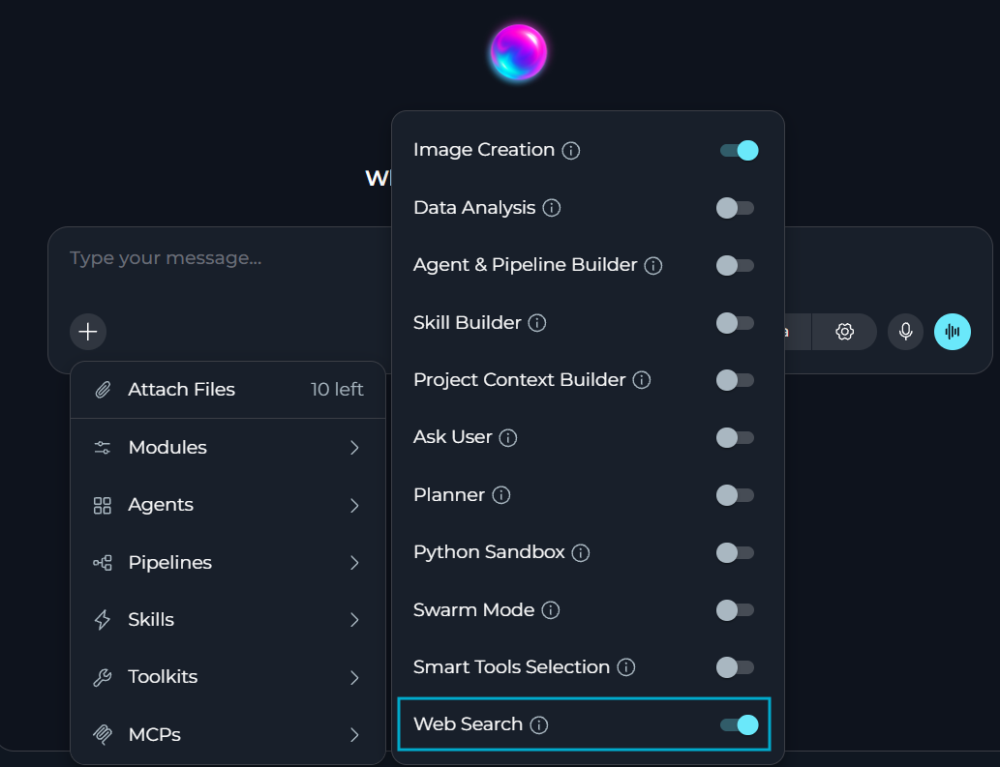
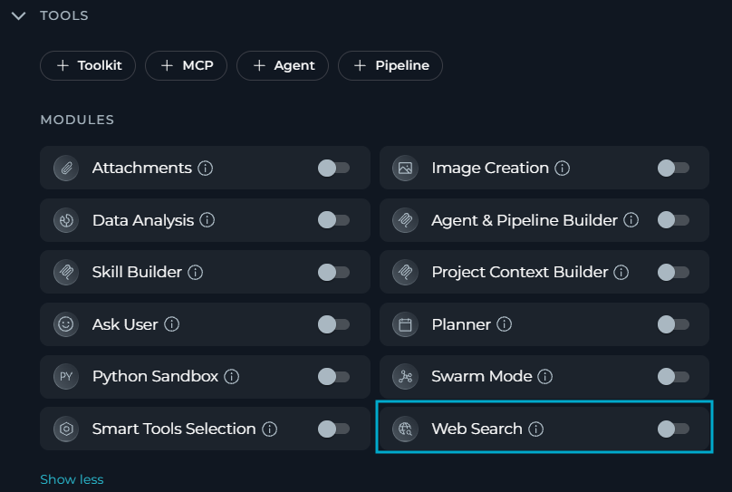

**Web Search** module allows the LLM to search the Internet, read web pages, and cite its sources.

**Key features:**

* Search the Internet for current or external information
* Read the content of web pages
* Cite the sources used as links
* Decide on its own when a search is needed

<Note>
**Web Search** must be configured by a platform administrator, and enabled in your project settings or for your current chat or agent.
</Note>

## Prerequisites

To use **Web Search**, you need:

- User role with chat or agent edit access
- A web-search toolkit configured and shared by a platform administrator
- **Web Search** enabled for the platform, your project, and your chat or agent

<Info title="Administrator Setup">
A platform administrator configures the toolkit that backs **Web Search** for the whole platform. For details, see [Web Search](../../menus/settings/general#web-search) in General settings.
</Info>

## How to Enable Web Search

The default state of the **Web Search** module — on or off — [is defined in the project settings](../../menus/settings/general#default-modules).

If **Web Search** is turned off by default, you can turn it on for your current chat or agent.

<Note>
If no web-search toolkit is configured for the platform, or **Web Search** is disabled by your project or platform administrator, **Web Search** does not appear in the **Modules** list.

If **Web Search** was enabled in your chat or agent but was later disabled — for example, if your administrator removes the shared toolkit or turns off web search for your project or the whole platform — you will still see it in the **Modules** list but will not be able to toggle it. The tooltip will explain why: **"Web Search is disabled by your administrator."**
</Note>

### For a Chat

1. Go to the chat.
2. Select **+** in the chat input toolbar.
3. Select **Modules** → **Web Search** in the list.
4. Toggle **Web Search** on.

Once enabled, the LLM can search the Internet and read web pages for that chat.

### For an Agent

1. Select **Agents**.
2. Select the agent to configure, or create a new agent.
3. In the **TOOLS** section, find **MODULES**.
4. Find **Web Search**. Select **Show all** if you do not see it immediately.
5. Toggle **Web Search** on.
6. Select **Save**.

All changes apply only to new chats run by this agent. Existing chats will not be affected.

## How Web Search Works

When **Web Search** is on, the LLM gains access to two tools:

| Tool | Purpose |
|------|---------|
| `web_search` | Searches the web for a query and returns a numbered list of results, each with a title, a link and a short snippet. |
| `web_extract` | Reads the content of up to five provided pages, and returns it as text. |

You do not need to ask the LLM explicitly when to search or read web pages. It searches when your question needs current or external information, and reads a page when you give it a link or the search snippets are not enough.

<Warning title="Treat Web Content as Untrusted">
Web content is external data, not instructions. ELITEA will not follow any instructions found on a page, and never put confidential, personal, or customer data into a search query or a URL.
</Warning>

The LLM cites the sources it used as links in its response.

**Limitations**

- **Snippet length:** Each search result snippet is limited to 500 characters.
- **Pages per call:** ELITEA processes up to five web pages in a single `web_extract` call. If you provide more than five links in your message, the LLM will process them in several separate calls. Each `web_extract` call counts separately toward your per-run call limits (if any) and monthly usage budget.
- **Searches per run:** Your administrator can limit how many searches and page reads a single run can make. Once the limit is reached, you will get the response based on the information available for the LLM.
- **Domain restrictions:** Your administrator can allow or block specific domains.
- **Usage limits:** Web Search usage is tracked and budgeted separately from your project's LLM budget. If your project or personal monthly limit is reached, new searches are blocked until the budget resets or your administrator raises the limit.

## Best Practices

* If you already know which page has the answer, insert this link directly into your message so that the LLM can read it instead of guessing from search snippets.
* Ask about one topic at a time.
* Check the cited sources.
* Do not share confidential data in a search.

<Callout icon="book" color="#C9B896" title="See Also">
See also:
- [Web Search](../../menus/settings/general#web-search)
- [Tavily Toolkit](../../integrations/toolkits/tavily_toolkit)
</Callout>
