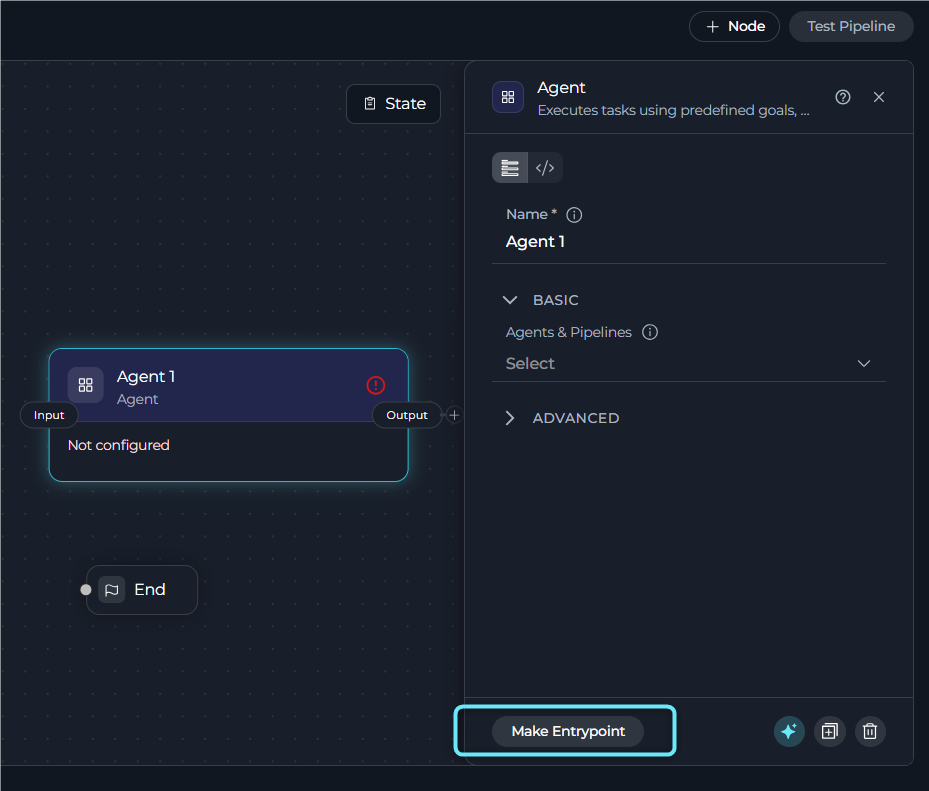
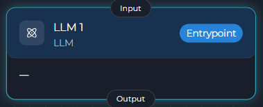
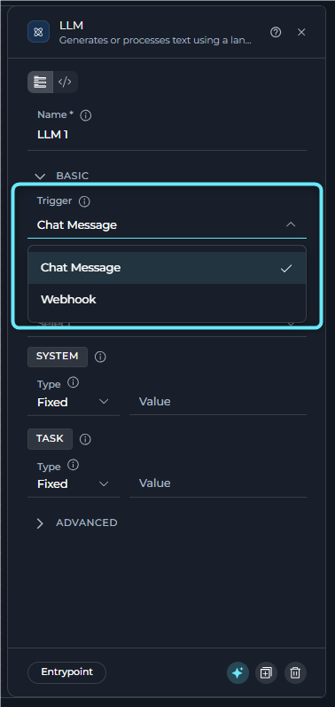
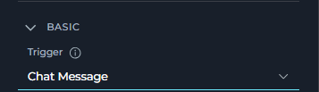
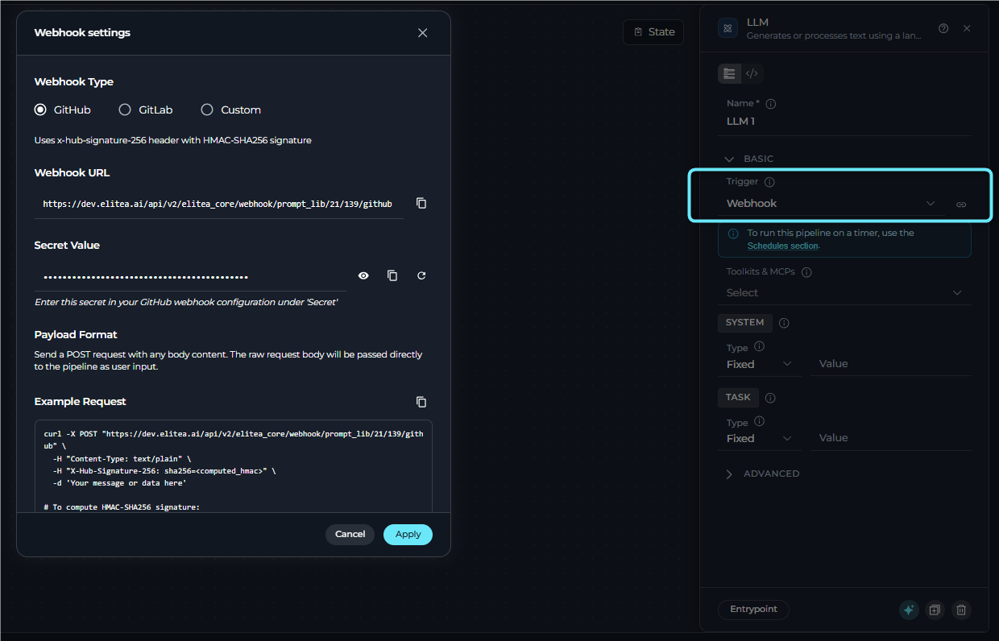
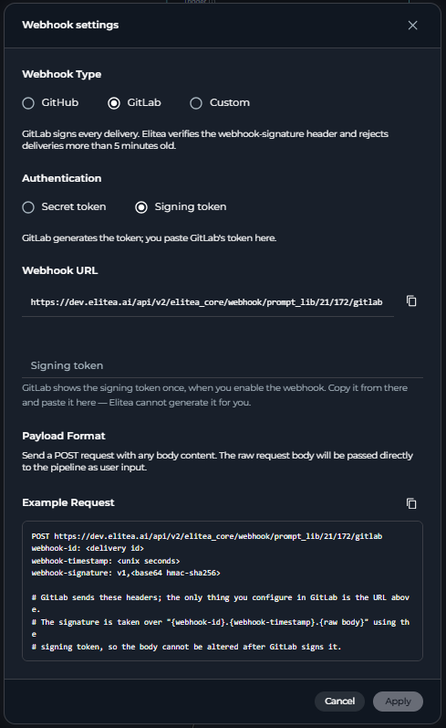
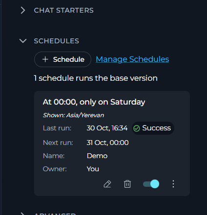
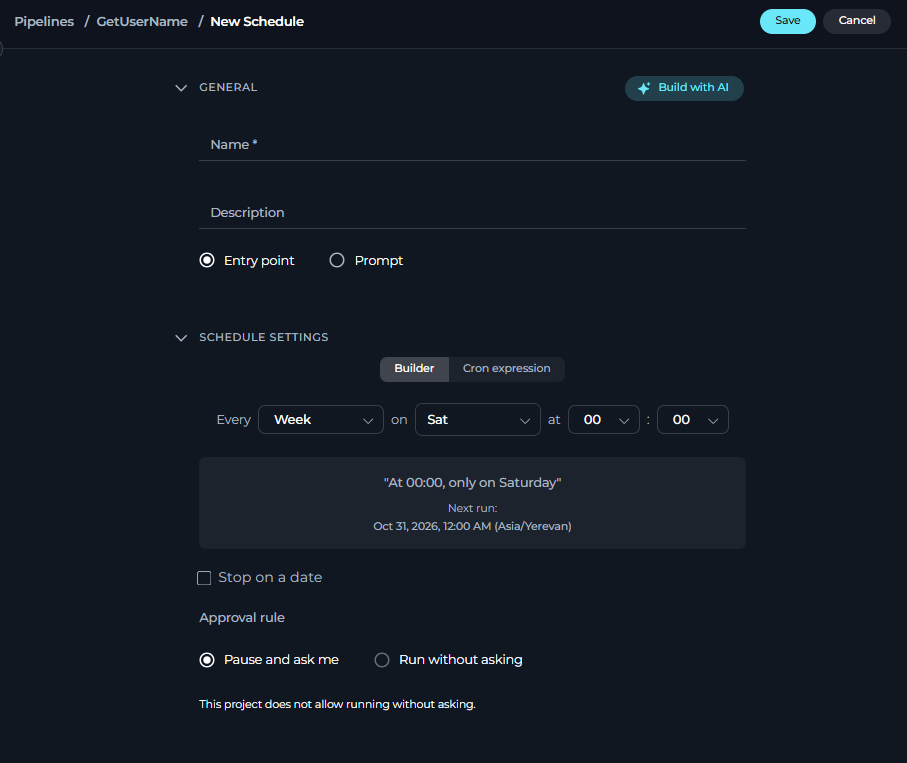
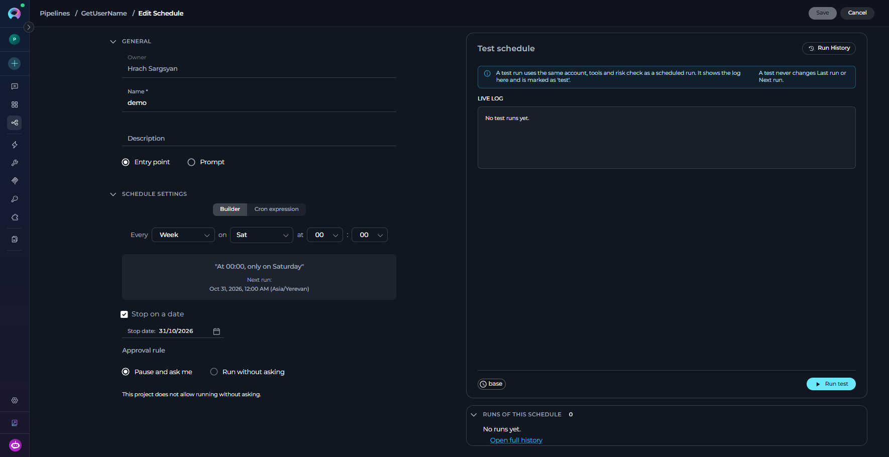
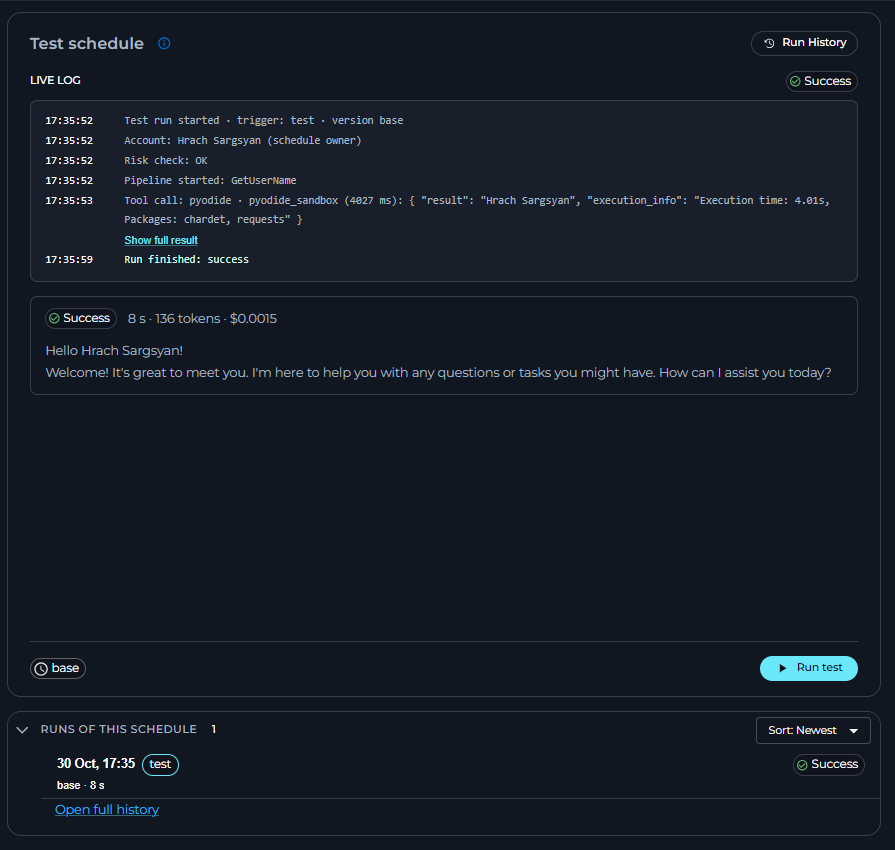

<Warning title="Required Configuration">
Every pipeline must have an entry point. Without one, the pipeline cannot execute.
</Warning>

---

## What is an Entry Point?

The entry point defines which node executes first when your pipeline runs. It also controls **how the pipeline is started from outside a scheduled run**: when a node is designated as the entry point, a **Trigger** selector appears inside its configuration, letting you choose between two trigger modes — `Chat Message` and `Webhook`.

Recurring, timed execution is a separate concept from the entry point's trigger. It is configured per-pipeline in the **Schedules** section of the editor, not here — see [Schedules](#schedules) below.

### Key Rules

<CardGroup cols={2}>
  <Card title="Single Entry Point" icon="flag">
    Exactly one node must be designated as the entry point. Pipeline execution always begins at this node. Setting a new entry point automatically removes the previous designation.
  </Card>
  <Card title="Auto-Assignment" icon="wand-magic-sparkles">
    When the first node is added to an empty pipeline, it is automatically designated as the entry point. Only Condition and End nodes are excluded from auto-assignment.
  </Card>
  <Card title="Can Be Entry Points" icon="circle-check">
    LLM, Agent, Toolkit, MCP, Code, Printer, Router, State Modifier, HITL, Custom
  </Card>
  <Card title="Cannot Be Entry Points" icon="circle-xmark">
    Condition, Decision
  </Card>
</CardGroup>

---

## Setting an Entry Point

### Visual Method (Flow Editor)

1. Open your pipeline in the Flow Editor.
2. Click a node on the canvas to open its configuration in the panel on the right.
3. At the bottom of the panel, click **Make Entrypoint**. The button is hidden once the node is already the entry point, and for Condition and Decision nodes it never appears.

    

Once a node is designated as the entry point, an **Entrypoint** badge appears in its canvas card header and on its configuration panel, and the **Trigger** selector becomes visible at the top of the panel's Basic section.
    


<Tip title="Changing Entry Points">
Making a different node the entry point automatically removes the previous designation.
</Tip>

### YAML Method

In YAML configuration, declare the entry point at the top level using the node's `id`:

```yaml
entry_point: greeting

nodes:
  - id: greeting
    type: llm
```

The YAML key order is: `state` → `entry_point` → `interrupt_after` → `interrupt_before` → `nodes`.

<Note>
Trigger configuration (webhook settings) and schedules are stored server-side and are not part of the pipeline YAML. The YAML only contains the `entry_point` node ID.
</Note>

---

## Trigger Type

When a node is the entry point, a **Trigger** dropdown appears at the top of its configuration panel. This controls how the pipeline starts outside of a scheduled run.

   

<CardGroup cols={2}>
  <Card title="Chat Message" icon="message">
    Default trigger. The pipeline runs each time a user sends a message in a chat session. Required for interactive pipelines with HITL or Printer nodes, or any pipeline using a toolkit that needs an interactive per-user login.
  </Card>
  <Card title="Webhook" icon="webhook">
    Allows external systems to trigger the pipeline via HTTP POST. Supports GitHub, GitLab, and Custom webhook types.
  </Card>
</CardGroup>

<Note>
Webhook is unavailable when the pipeline contains HITL nodes, Printer nodes, or `interrupt_before` / `interrupt_after` configurations — only Chat Message works for interactive pipelines. If an interactive element is added to a pipeline whose trigger is Webhook, the trigger automatically resets to Chat Message and a toast confirms the change.
</Note>

<Warning>
**Delegated OAuth Toolkits Disable Webhook**

If the pipeline includes a toolkit that authenticates through a per-user OAuth login — a remote or pre-built MCP server, or a SharePoint/OpenAPI credential configured with OAuth — the Webhook option is greyed out, because that login's token lives only in the browser session of the person who authorized it and cannot be used in an unattended run. Only Chat Message is available until the toolkit is removed or switched to a non-delegated credential.
</Warning>

### Chat Message

The default trigger. The pipeline runs each time a user sends a message in a chat session.

- Required when the pipeline contains HITL nodes, Printer nodes, any `interrupt_before` / `interrupt_after` configuration, or a toolkit that needs an interactive per-user OAuth login.
- If an interactive element (HITL, Printer) is added while Webhook is active, the trigger automatically resets to Chat Message.

    

### Webhook

The pipeline runs when an external system sends an HTTP POST request to the generated webhook URL.

    

Selecting **Webhook** saves the trigger (generating a secret, if one doesn't exist yet) and opens a configuration modal. Three webhook subtypes are available:

| Type | Auth Header | Signature Method |
|------|-------------|-----------------|
| **GitHub** | `X-Hub-Signature-256` | HMAC-SHA256 (`sha256=<computed_hmac>`) |
| **GitLab** | `X-Gitlab-Token` or `webhook-signature`, depending on the selected authentication method — see below | Secret token, or HMAC-SHA256 |
| **Custom** | `X-Webhook-Token` | Secret token sent directly in the header |

The modal shows:

| Field | Description |
|-------|-------------|
| **Webhook URL** | Read-only, automatically constructed based on the selected type. Use the copy button to copy it. |
| **Authentication** *(GitLab only)* | Choose between **Secret token** and **Signing token** — see [GitLab Authentication Methods](#gitlab-authentication-methods) below. |
| **Secret token** | A 32-byte base64url token generated automatically. Can be shown or hidden, copied, or regenerated. Click **Apply** to save a regenerated token. Not shown when GitLab's **Signing token** method is selected. |
| **Example request** | A ready-to-use example showing the exact headers and payload format for the selected webhook type and authentication method. |

A viewer without edit permission on the pipeline version sees the webhook settings with the secret masked.

**GitHub example:**
```bash
curl -X POST "https://your-elitea-instance/webhook/github" \
  -H "Content-Type: text/plain" \
  -H "X-Hub-Signature-256: sha256=<computed_hmac>" \
  -d 'Your message or data here'
```

**GitLab example (Secret token):**
```bash
curl -X POST "https://your-elitea-instance/webhook/gitlab" \
  -H "Content-Type: text/plain" \
  -H "X-Gitlab-Token: <your_secret>" \
  -d 'Your message or data here'
```

**GitLab example (Signing token):**
```
POST https://your-elitea-instance/webhook/gitlab
webhook-id: <delivery id>
webhook-timestamp: <unix seconds>
webhook-signature: v1,<base64 hmac-sha256>

# GitLab sends these headers itself; the only thing you configure in GitLab is the URL above.
```

**Custom example:**
```bash
curl -X POST "https://your-elitea-instance/webhook/custom" \
  -H "Content-Type: text/plain" \
  -H "X-Webhook-Token: <your_secret>" \
  -d 'Your message or data here'
```

#### GitLab Authentication Methods

Selecting **GitLab** as the webhook type reveals an **Authentication** choice with two methods:



| Method | Who generates the token | Header checked |
|--------|--------------------------|-----------------|
| **Secret token** (default) | ELITEA — you paste ELITEA's generated value into GitLab's "Secret token" field | `X-Gitlab-Token` |
| **Signing token** | GitLab — you paste GitLab's generated value into ELITEA | `webhook-signature` (plus `webhook-id` and `webhook-timestamp`) |

<Note>
Existing GitLab webhooks keep working unchanged — **Secret token** is the default and matches the original behavior. Switching to **Signing token** does not erase the secret-token value; switching back later restores it.
</Note>

With **Signing token** selected, the modal replaces the generated **Secret Value** field with a **Signing token** input: paste the value GitLab displays when you enable the webhook (format `whsec_<base64>` — GitLab shows it only once). ELITEA cannot generate or regenerate this value; it only checks that the pasted value starts with `whsec_` and decodes to a usable key. There is no show/hide or copy control for it, since it is never generated by ELITEA.

ELITEA validates each delivery by checking the `webhook-signature` header (format `v1,<base64 HMAC-SHA256>`, computed over `"{webhook-id}.{webhook-timestamp}.{raw request body}"`) and rejects any delivery whose `webhook-timestamp` is more than 5 minutes away from the current time. `X-Gitlab-Token` is not required or checked in Signing token mode.

<Note title="Credential Governance">
If your project has credential governance turned on (audit or enforce mode), saving a Webhook trigger on a pipeline version that has no active identity binding still saves the trigger, but a warning explains that runs from this trigger will be refused (or recorded as "would deny" in audit mode) until an operator binds the version and approves a mandate for it. This does not affect the editor's test chat.
</Note>

---

## Schedules

Recurring, timed execution of a pipeline is configured in the pipeline editor's **Schedules** section, not through the entry point's Trigger dropdown. A pipeline can have any number of schedules, each running independently of the entry point's Chat Message / Webhook trigger and of each other. This section only appears for users with permission to list schedules.

Open the **Schedules section** link in the Trigger dropdown's hint banner, or scroll to the **Schedules** accordion in the left configuration panel.

Each schedule card shows:

| Field | Description |
|-------|-------------|
| **Name** | A label you give the schedule to identify it. |
| **Owner** | The user the scheduled run executes as. Omitted if the schedule has no owner. |
| **Rule summary** | A plain-English summary of the cron rule (e.g. "At 09:00, only on Monday through Friday"), along with a "Shown: {timezone}" hint indicating the (browser) timezone used to display run times. |
| **Last run** | The timestamp and status (e.g. Success, Failed) of the most recent scheduled execution, or "Never run". |
| **Next run** | The timestamp of the next scheduled execution, or "Paused" if the schedule is currently disabled. |



**Schedule Actions**

| Action | Description |
|--------|-------------|
| **Run now** | Triggers an immediate run outside the regular schedule. |
| **Edit** | Same as the footer Edit icon. |
| **Pause** / **Resume** | Same as the Enabled toggle. |
| **Open run history** | Jumps to this schedule's runs in [Run History](../../menus/pipelines#pipeline-history). |
| **Delete** | Same as the footer Delete icon, with its own typed-name confirmation. |

<Note>
**Change owner** is only available from the three-dot menu on the cross-project **Manage Schedules** table (see below) — it does not appear on the in-editor card.
</Note>

### Create Schedule

Click **+ Schedule** to create a new schedule from this pipeline. This opens a dedicated schedule page — already locked to this pipeline and its version — with the following fields:

| Field | Description |
|-------|-------------|
| **Name** | Required. Identifies the schedule. |
| **Description** | Optional, up to 2304 characters. |
| **Run mode** | **Entry point** (runs the pipeline's normal entry point — the one configured on this page) or **Prompt** (sends a prompt instead). |
| **Prompt** | Shown only when Run mode is **Prompt**. The prompt (and any variables) sent on each run. |
| **Cron rule** | Set via a plain-language **Builder** tab or a **Cron expression** tab, with a live preview and a link to crontab.guru. |
| **Stop on a date** | Optional. Automatically disables the schedule after the chosen date. |
| **Approval rule** | **Pause and ask me** (default, pauses the run for approval each time) or **Run without asking** (requires typing the schedule's name to confirm, and reverts to "Pause and ask me" automatically if the pipeline later gains new sensitive tools). Only relevant if the pipeline uses sensitive tools. |

<Note>
**Generate with AI**: A button next to the page title opens a dialog where you describe the schedule in plain language (what to run, when, and until when). It drafts the fields above from that description — reviewed as a full draft on an empty form, or as a field-by-field diff against your current values if you've already filled some in, with any warnings about fields it couldn't confidently fill. Apply the draft to fill in the form, then review and adjust before saving.
</Note>

<Note>
Creating a schedule directly from the **Settings → Schedules** page (rather than from inside a pipeline) adds an extra **Agent / Pipeline** toggle and an **entity + version** picker up front, since no pipeline is pre-selected there.
</Note>



### Edit Schedule

Click the **Edit** icon on a schedule card (or **Edit** from its three-dot menu) to open the same form pre-filled with its current values. It adds the following, not present when creating:

| Field / Area | Description |
|---------------|-------------|
| **Owner** | Read-only — who the schedule runs as. |
| **Confirmed by** | Shown if this schedule has a prior "Run without asking" confirmation on record — who confirmed it and when. |
| **Runs** | A sortable "Runs of this schedule" list below the Test panel. Click a run to open it in the panel above; **Open full history** jumps to the full [Run History](../../menus/pipelines#pipeline-history). |
| **⋮ More actions (header)** | **Export** (requires the schedules-export permission). |



**How to Test a Schedule:**

1. Open the schedule for editing. A **Test schedule** panel appears to the right of the form.
2. Click **Run test** to trigger an immediate run using the schedule's current settings.
3. Watch the run play out in the panel's **LIVE LOG**.
4. If the run pauses for approval, use the inline **Approve** / **Reject** control to continue it.
5. When the run finishes, its result appears below the log.



<Note>
A test run uses the same account, tools, and risk check as a real scheduled run. It's logged and marked as "test", but never changes **Last run** or **Next run**.
</Note>

### Manage Schedules

Click **Manage Schedules** to leave this pipeline and open the project-wide **Schedules** page under Settings, which lists every schedule across all agents and pipelines in the project — not just this one. It opens pre-filtered to this pipeline, with the filter shown as a removable chip, so you can switch to browsing or managing every schedule in the project from the same place.

<Info>
For full details on the Schedules page — filters, columns, bulk actions, import/export — see the **[Schedules settings guide](../../menus/settings/schedules)**.
</Info>

<Note title="Pipelines Created Before the Schedule Redesign">
A pipeline version that still stores an old, pre-redesign cron trigger shows it as a disabled **Schedule** option in the Trigger dropdown, along with a notice that it is no longer editable there. Create a new schedule in the Schedules section instead; switching the trigger away from the legacy value asks for confirmation, since it deletes that old trigger.
</Note>

---

## <Icon icon="circle-check" size={26} /> Best Practices

<AccordionGroup>
  <Accordion title="Match trigger to workflow type">
    Use `Chat Message` for interactive conversational pipelines and `Webhook` for event-driven integration with external systems. For time-based automation, use a [schedule](#schedules) instead of a trigger.
  </Accordion>
  <Accordion title="Interactive pipelines require Chat Message">
    Any pipeline with HITL or Printer nodes, or a delegated-OAuth toolkit, must use the `Chat Message` trigger. Webhook is automatically disabled or reset for such pipelines.
  </Accordion>
  <Accordion title="Match entry_point value to a node id">
    In YAML configuration, ensure the `entry_point` value exactly matches a node `id` defined in the `nodes` list.
  </Accordion>
  <Accordion title="Protect webhook secrets">
    Regenerate the secret if it is ever exposed. Always copy it immediately after generation — it cannot be retrieved once the modal is closed without regenerating. For GitLab's **Signing token** method, there is no regenerate option in ELITEA — generate a new signing token in GitLab itself and paste the new value in.
  </Accordion>
  <Accordion title="Prefer GitLab's Signing token method">
    GitLab's **Secret token** method sends the token in a plain header on every delivery; **Signing token** instead has GitLab sign each delivery with HMAC-SHA256 and includes replay protection (deliveries older than 5 minutes are rejected). Prefer **Signing token** for new GitLab webhooks when your GitLab instance supports it.
  </Accordion>
</AccordionGroup>

---

<Info title="Related Documentation">
- **[Node Connectors](./nodes-connectors)** - Connect nodes to create workflows
- **[State Management](./states)** - Understand state in pipelines
- **[Flow Editor](./flow-editor)** - Visual pipeline building
- **[Control Flow Nodes](./nodes/control-flow-nodes)** - Router and Decision nodes
- **[YAML Configuration](./yaml)** - Complete YAML syntax reference
- **[Schedules settings guide](../../menus/settings/schedules)** - Manage schedules across all agents and pipelines in the project
</Info>
