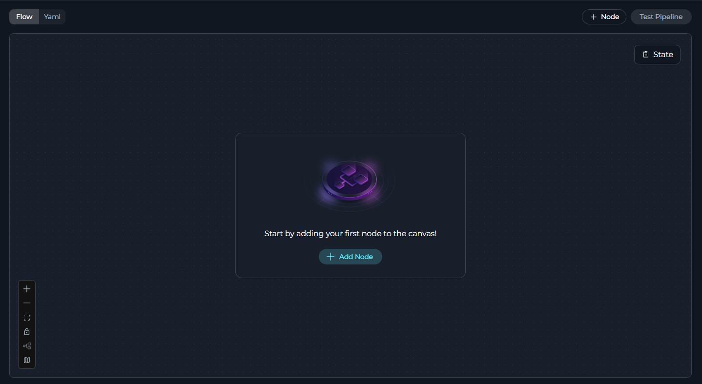
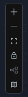
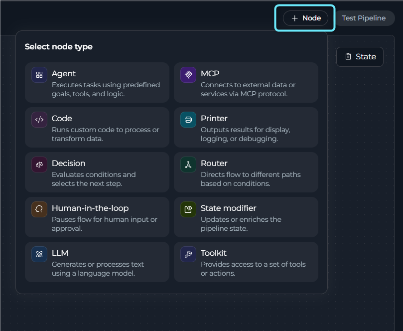
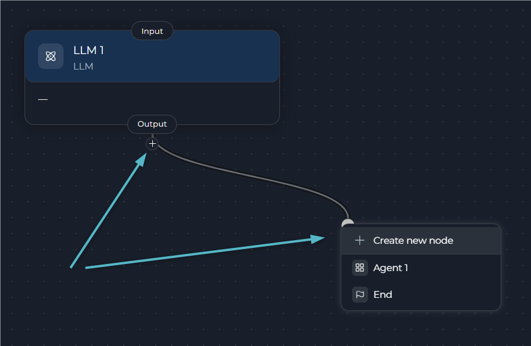
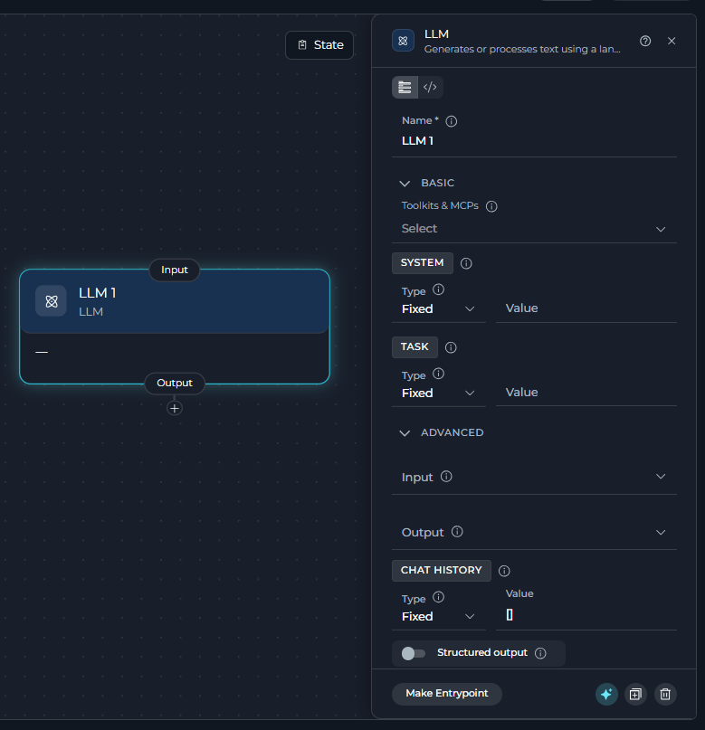
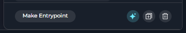
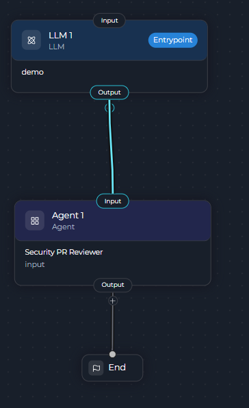
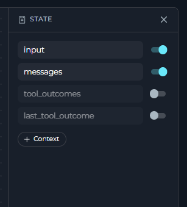
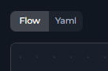
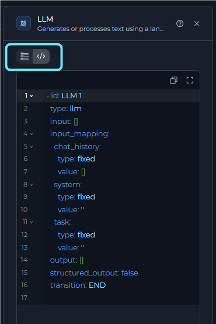

## What is Flow Editor?

The **Flow Editor** is a visual workspace for building pipelines. It provides:

* **Drag-and-drop interface** for adding and arranging nodes
* **Visual connections** between nodes showing execution flow
* **Vertical (top-to-bottom) layout** optimized for easy configuration
* **Instant YAML sync**: changes in Flow appear immediately in YAML, and vice versa
* **Interactive configuration**: click a node to open its configuration panel

---

## Accessing Flow Editor

1. Navigate to the **Pipelines** menu.
2. Open an existing pipeline or create a new one.
3. In the pipeline editor, use the **Flow** tab or **Yaml** tab at the top of the canvas to switch to **Flow** mode. **Flow** mode is the default.

<Info title="Flow and YAML Sync">
Whatever you configure in Flow automatically appears in YAML format, and vice versa. Both views stay synchronized.
</Info>

---

## Flow Editor Interface

The Flow Editor consists of several key areas:

**Main components**

| Component | Location | Purpose |
| --- | --- | --- |
| **Canvas** | Center | Main workspace for arranging and connecting nodes |
| **Canvas controls** | Bottom-left | Zoom, fit view, lock, auto-arrange, and minimap controls |
| **Flow** tab or **Yaml** tab | Top | Switch between the visual canvas and the YAML editor |
| **Node** button | Top, next to the toggle | Open the node palette to add a new node |
| **State** button | Floating, top-right of canvas | Open the State drawer |

**Canvas controls**

| Control | Action |
| --- | --- |
| **Zoom in** / **Zoom out** | Adjust the canvas zoom level |
| **Fit view** | Center and fit all nodes in view |
| **Lock canvas** or **Unlock canvas** | Prevent or allow moving nodes and editing the canvas |
| **Auto-arrange** | Open a menu with **Arrange top to bottom** and **Arrange left to right** to reposition nodes into a clean layout |
| **Show minimap** or **Hide minimap** | Toggle a small overview map of the canvas |

      

<Note>
Node cards automatically shrink to a compact mini-card view when you zoom out past a certain level and expand again as you zoom in. There is no manual collapse or expand toggle.
</Note>

---

## Adding Nodes

You can add nodes from the toolbar or while creating a connection.

### Method 1: Node Button

1. Click the **Node** button at the top of the canvas (or **Add Node** on an empty canvas).
2. A node palette opens. It shows a flat, alphabetically sorted grid of every available node type, each with an icon and short description. There is no category grouping or search box.
3. Click a node type to place it directly on the canvas. Its configuration panel opens automatically.

      

The following table lists the available node types.

| Node type |
| --- |
| Agent |
| Code |
| Decision |
| HITL (Human-in-the-Loop) |
| LLM |
| MCP |
| Printer |
| Router |
| State Modifier |
| Toolkit |

<Note>
An **End** node is always present automatically to mark where a path terminates. It is never added from the node palette, and it stays hidden on an empty canvas until you place your first node.
</Note>

### Method 2: Add a Node from a Connection

You can also add a node while you create a connection, without returning to the **Node** button:

1. Drag a connector from an existing node's output handle.
2. Release it in empty space on the canvas (or click the **+** next to an output handle directly).
3. A dropdown opens. It offers **Create new node** and any existing eligible nodes.
4. Select **Create new node** to open the same node-type palette. The editor creates the new node with the connection already attached.

     

---

## Working with Nodes

The Flow Editor lets you configure nodes and manage node actions.

### Configure a Node

Click any node card to open its configuration panel. Each node type has specific fields. Common options include:

* **Node name**
* **Input** and **Output** state variables
* **Node-specific settings** (prompts, toolkits, conditions, etc.)
* **Structured output** toggle, where applicable
     
      

### Use Node Actions

Open the node configuration panel to access its actions in the panel footer:

      

| Action | Description |
| --- | --- |
| **Make Entrypoint** | Set this node as the pipeline entry point. Disabled for Condition and Decision nodes. After you set it, the editor replaces the button with an "Entrypoint" indicator. |
| **Duplicate** | Create a copy of this node. Disabled for deprecated node types. |
| **Delete** | Remove the node from the pipeline after a confirmation prompt. |

<Warning title="Deleting Nodes">
Deleting a node also removes all of its connections. Reconnect the remaining nodes afterward if needed.
</Warning>

<Note title="Moving Nodes">
Click and drag a node card to reposition it on the canvas. This action is disabled while the canvas is locked. The Flow Editor favors a **vertical (top-to-bottom) layout** for readability, with nodes executing from top to bottom following the connections. Use **Auto-arrange** to clean up the layout after moving or adding several nodes.
</Note>

---

## Connecting Nodes

Connect nodes to define the execution flow. For more information, see [Node Connectors Guide](./nodes-connectors).

To create a connection:

* **Drag and drop**: Click and hold a node's output handle, drag the connector line to another node's input handle, and release.
* **From an output handle's "+"**: Click the **+** next to an expanded node's output handle to open a dropdown of eligible target nodes, or create a new one.
* **Drop on empty canvas**: Drag a connector and release it on empty space. The same dropdown appears, letting you pick an existing node or create a new one to complete the connection.

      

To delete a connection:

Click the connection line to select it, then press **Delete** on your keyboard. A confirmation prompt appears before it's removed.

---

## State Management

To open the **State** drawer, click the **State** button at the top-right of the canvas.

In the **State** drawer, you can:

* View all pipeline state variables, including the built-in defaults (`input`, `messages`, `tool_outcomes`, `last_tool_outcome`).
* Click **+ Context** to add a new custom state variable.
* Set each variable's data type using its type-select icon: **String**, **Number**, **List**, or **Json**.
* Set an optional default value for custom variables.

For more information, see [States Guide](./states).

---

## Flow & YAML Synchronization

The Flow Editor keeps the YAML view in sync with the visual canvas.

Use the **Flow** tab or **Yaml** tab at the top of the canvas to switch the entire editor between the visual canvas and a YAML view of the whole pipeline.

    

1. Add or modify nodes in **Flow** mode.
2. Switch to **Yaml** mode to see the updated YAML immediately.
3. Edit the YAML directly if you prefer. Changes sync back to the Flow canvas the same way.

<Info title="Two-Way Sync">
Edits in YAML update the Flow view immediately, and vice versa. Work in whichever mode you prefer.
</Info>

Each node configuration panel also has its own **Flow view** tab and **YAML view** tab. Use them to edit only that node's settings as raw YAML, without leaving Flow mode for the rest of the canvas.

---

## Best Practices

<Tip>
* **Use Descriptive Node Names**: Use names such as `Validate User Input` instead of the default `LLM 1`
* **Organize Vertically**: Place the entry point at the top, processing in the middle, and the End node at the bottom
* **Use Auto-arrange**: Keep the layout clean after adding or moving several nodes
* **Test Incrementally**: Build step by step and test with **Test Pipeline** after adding each node
* **Save Frequently**: Save often to avoid losing changes
</Tip>

---

## Troubleshooting

<Accordion title="Nodes Not Connecting">
**Problem**: Cannot create a connection between two nodes.

**Solutions**:

* Check that the node types are compatible with each other (e.g., some node types have specific output routes)
* Make sure you're dragging from an output handle to an input handle, not the reverse
* Try **Auto-arrange** if nodes are overlapping and hard to target
</Accordion>

<Accordion title="Canvas is Blank">
**Problem**: Flow Editor shows an empty canvas.

**Solutions**:

* Switch to **Yaml** mode to check whether the pipeline actually has nodes defined
* Click **Fit view** to re-center the nodes
* Reload the page
</Accordion>

<Accordion title="Changes Not Saving">
**Problem**: Edits disappear after closing the pipeline.

**Solutions**:

* Click **Save** before navigating away
* Check for error messages at the top of the screen
* Verify your network connection
</Accordion>

<Accordion title="Node Configuration Not Opening">
**Problem**: Clicking a node doesn't show its configuration panel.

**Solutions**:

* Click directly on the node card, not on a connection line
* Unlock the canvas if it's currently locked
* Check whether **Esc** was pressed recently, closing the panel
</Accordion>

---

## See Also

For more information, see [Node Connectors Guide](./nodes-connectors).

For more information, see [States Guide](./states).

For more information, see [YAML Configuration](./yaml).

For more information, see [Nodes Overview](./nodes/overview).

For more information, see [Entry Point Guide](./entry-point).
