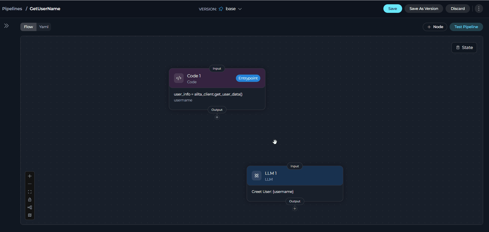
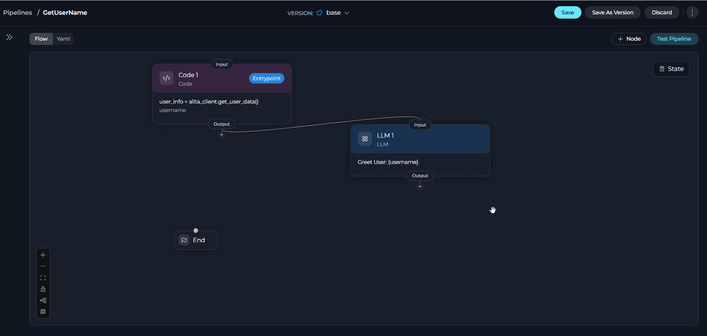
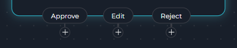
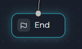

## Overview

A pipeline connects nodes with a `transition` (or, for Router, Decision, and HITL, a routing field) from one node's output to another node's input. Every path must eventually reach `END`, and every pipeline needs exactly one entry point to start from — see **[Entry Point](./entry-point)**.

<Info>
**Essential Elements**

Every pipeline needs:
 1. An entry point to start execution
 2. Transitions connecting its nodes
 3. A path from every branch to `END`
</Info>

---

## Connecting Nodes Visually

In Flow mode, connect two nodes by dragging from a node's **output handle** (bottom of the card) to another node's **input handle** (top of the card).



Releasing the drag on empty canvas — or clicking the **+** beside an output handle — opens a dropdown instead, where you can pick an existing node to connect to, create a new node, or choose **END**.



<Note>
The dropdown only lists nodes the connection is actually allowed to reach — it hides nodes already connected from that output, and (per the rules below) Router/Decision/HITL outputs can't target each other or a Condition/Decision node directly.
</Note>

---

## Editing and Deleting Connections

**Edit a connection** by dragging its endpoint: grab either end of the connector line and drop it on a different node to retarget it, without deleting and recreating the edge.

**Delete a connection** by clicking it to select it, then pressing **Delete** — or select it along with other nodes/edges for a bulk delete. Either way, a confirmation dialog shows what's about to be removed before it happens.

<Note>
Deleting a node automatically cleans up any dangling reference to it elsewhere in the pipeline — clearing it from another node's `transition`, `default_output`, or HITL `routes` — so you don't end up with a connection pointing at a node that no longer exists.
</Note>

---

## Single-Output vs. Multi-Output Nodes

### Single Output


LLM, Agent, Toolkit, MCP, Code, State Modifier, Printer, and Custom nodes each lead to exactly **one** next node (or `END`). Once such a node has an outgoing connection to anything other than `END`, its output handle stops accepting new connections — reconnect or delete the existing edge first to change it.

```yaml
- id: Process Data
  type: code
  transition: Display Results
```

### Multi-Output: Router, Decision, HITL

Three node types can lead to more than one destination, each choosing a different one at runtime:



| Node | Chooses by | Destinations configured in |
|------|------------|------------------------------|
| **Router** | Evaluating a Jinja2 `condition` against state | `routes` (a flat list of node IDs) + `default_output` |
| **Decision** | An LLM's judgment against a natural-language `description` | `nodes` (a flat list of node IDs) + `default_output` |
| **HITL** | The human's button choice (Approve / Edit / Reject) | `routes.approve`, `routes.edit`, `routes.reject` |

Each is covered in full — fields, YAML, and routing behavior — in **[Control Flow Nodes](./nodes/control-flow-nodes)**. The short version:

```yaml
# Router: condition renders to a route name, or falls through to default_output
- id: Route Request
  type: router
  condition: |
    
    Priority Handler
    
    Standard Handler
    
  input:
    - request_type
  routes:
    - Priority Handler
    - Standard Handler
  default_output: Error Handler
```

```yaml
# Decision: an LLM picks one of `nodes`, or default_output if it can't decide confidently
- id: Classify Intent
  type: decision
  description: "Route by user intent: publish → ArticlePublisher, review → ContentModerator."
  input:
    - messages
  nodes:
    - ArticlePublisher
    - ContentModerator
  default_output: ContentModerator
```

```yaml
# HITL: the user's Approve/Edit/Reject choice picks the route — no transition or condition needed
- id: Review_ticket
  type: hitl
  routes:
    approve: Create_ticket
    edit: Create_ticket
    reject: END
  edit_state_key: ticket_description
```

<Warning>
HITL's **Edit** route can never target `END` — the Flow Editor blocks that connection, since editing implies the pipeline continues with the corrected value. `edit_state_key` is also required whenever an Edit route is set.
</Warning>

---

## Connection Rules

<CardGroup cols={2}>
  <Card title="Multiple Inputs Allowed" icon="arrows-to-dot">
    Any number of nodes can transition into the same target node — useful for merging branches back together.
  </Card>
  <Card title="No Special-to-Special Connections" icon="ban">
    Decision and Condition nodes can't connect to each other, or to another special node (including Router and HITL outputs), directly or by creating one from an existing special node's output. The dropdown filters these options out automatically.
  </Card>
  <Card title="One Path to END" icon="flag-checkered">
    A node can only connect to `END` if it has no other transition, condition, or decision configured — connect it elsewhere first if you need to change its target.
  </Card>
  <Card title="Entry Point Restriction" icon="circle-xmark">
    Decision and (legacy) Condition nodes cannot be the entry point. Every other node type, including Router, can be — see **[Entry Point](./entry-point)** for the complete rule set.
  </Card>
</CardGroup>

---

## The END Node

`END` terminates a path — it isn't a node you add from the node picker. It appears automatically once your pipeline has its first node, and every branch must eventually reach it (directly or through `default_output` / a route).

```yaml
transition: END
```



---

## Interrupts

`interrupt_before` and `interrupt_after` pause a pipeline before or after specific nodes run, so a person can review state before it continues:

```yaml
interrupt_before:
  - Critical Processing Node
interrupt_after:
  - Data Extraction Node
```

<Warning>
There is no toggle for this in a node's configuration panel — set `interrupt_before` / `interrupt_after` directly in the pipeline's YAML. The canvas still marks an affected connection with an "interrupt" label, so the effect is visible even though the edit happens in YAML. See **[YAML Configuration → Interrupts](./yaml#interrupts)**.
</Warning>

A pipeline using `interrupt_before`, `interrupt_after`, HITL, or Printer nodes is restricted to the **Chat Message** trigger — see **[Entry Point → Trigger Type](./entry-point#trigger-type)**.

---

## Common Patterns

<Accordion title="Linear flow">
```yaml
entry_point: Step 1
nodes:
  - id: Step 1
    type: code
    transition: Step 2
  - id: Step 2
    type: llm
    transition: Step 3
  - id: Step 3
    type: code
    transition: END
```
</Accordion>

<Accordion title="Converging paths">
Different branches merging back into one node before it continues:
```yaml
entry_point: Route Input
nodes:
  - id: Route Input
    type: decision
    description: "Route by request type."
    nodes:
      - Process Type A
      - Process Type B
    default_output: Process Type A
  - id: Process Type A
    type: toolkit
    transition: Generate Report
  - id: Process Type B
    type: toolkit
    transition: Generate Report
  - id: Generate Report
    type: toolkit
    transition: END
```
</Accordion>

<Accordion title="Human approval gate">
```yaml
entry_point: Generate_draft
nodes:
  - id: Generate_draft
    type: llm
    transition: Review_draft
  - id: Review_draft
    type: hitl
    routes:
      approve: Publish
      edit: Publish
      reject: END
    edit_state_key: draft
  - id: Publish
    type: toolkit
    transition: END
```
</Accordion>

---

## Best Practices

<Accordion title="Give every path a default_output">
A Router or Decision node without `default_output` has no fallback if its condition never matches or the LLM can't decide — always set one.
</Accordion>

<Accordion title="Reconnect, don't stack, single-output transitions">
Since LLM/Agent/Toolkit/MCP/Code/etc. nodes only ever lead to one place, changing a node's next step means replacing its existing edge, not adding a second one.
</Accordion>

<Accordion title="Use descriptive node IDs">
`Validate User Input` is easier to read in `routes`, `nodes`, and `transition` lists than `Node1` — and it's what you'll see on the canvas and in Run History.
</Accordion>

<Accordion title="Make sure every branch reaches END">
A path that never reaches `END` can leave the pipeline (or a loop) hanging. Trace each branch, including Router/Decision fallbacks, to confirm it terminates.
</Accordion>

---

<Info title="Related">
- **[Entry Point](./entry-point)** - Set the pipeline's starting node and its trigger
- **[Control Flow Nodes](./nodes/control-flow-nodes)** - Full Router, Decision, and HITL reference
- **[Pipeline States](./states)** - How data moves between connected nodes
- **[Flow Editor](./flow-editor)** - Visual pipeline design
- **[YAML Configuration](./yaml)** - Complete YAML syntax, including Interrupts and Connections
</Info>
