## Overview

There are three control flow nodes. Unlike most other node types, none of them use `transition` — each chooses its next node through its own routing field instead. Each node reads from pipeline state through `input`. For more information, see [Pipeline States](../states).

<CardGroup cols={3}>
  <Card title="Router" icon="code-branch" href="#router-node">
    Branches to one of several named paths by evaluating a Jinja2 condition against state.
  </Card>
  <Card title="Decision" icon="brain" href="#decision-node">
    Lets an LLM pick the next node from a list, based on natural-language routing criteria.
  </Card>
  <Card title="Human-in-the-Loop" icon="user-check" href="#human-in-the-loop-node">
    Pauses and lets a person Approve, Edit, or Reject before the pipeline continues.
  </Card>
</CardGroup>

---

## Router Node

The Router node evaluates a Jinja2 condition against state and routes execution to whichever named path the condition resolves to, falling back to a default when nothing matches.

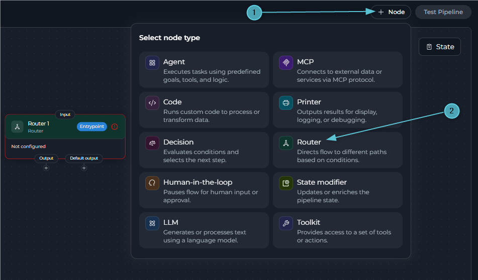

Use the Router node in these cases:

* You know the routing logic upfront and can express it as a condition — status checks, keyword matching, numeric comparisons.
* You need fast, deterministic routing with no LLM overhead.
* You're building a loop: a Router can route back to an earlier node, controlled by a state variable like a counter.

### Configuration

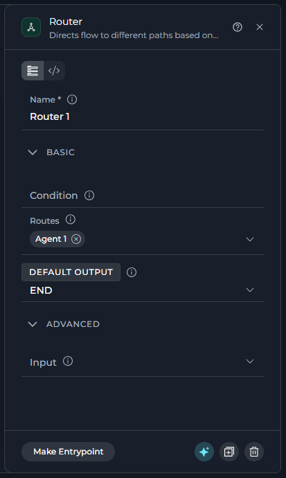

The following table describes the Router node fields.

| Field | Section | Purpose | Example |
| --- | --- | --- | --- |
| **Name** | Panel header | The node `id`. Required and unique across the pipeline; renaming it updates every reference to this node. | `Check_approval` |
| **Condition** | Basic | A Jinja2 template. Its rendered output must match a name in **Routes**, or execution falls through to **Default Output**. | See the syntax examples below. |
| **Routes** | Basic | The node IDs this Router can send execution to. Editing this list and dragging a connection on the canvas do the same thing — adding a route here draws the connection, and vice versa. | `ArticlePublisher`, `END` |
| **Default Output** | Basic | The fallback node ID, used when the condition's output doesn't match any route. | `ContentModerator` |
| **Input** | Advanced | State variables the condition can read. | `input`, `status` |

<Note>
A Router node has no `output` or Structured Output field — it only routes; it doesn't write to state itself.
</Note>

<Warning title="Route Name Matching">
The condition's rendered output must **exactly match** a node ID in Routes. Case sensitivity matters: `ArticlePublisher` ≠ `article_publisher`.
</Warning>

### YAML View for Router Nodes

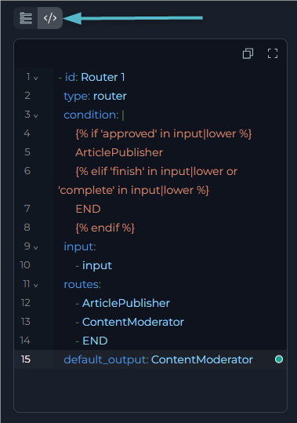

Every node configuration panel has **Flow view** and **YAML view** tabs at the top. In YAML view, the panel shows only this node, not the whole pipeline, as plain YAML. Changes stay synchronized in both directions. If you edit the `id` here, the editor renames the node everywhere it is referenced. You cannot change `type` in this view.

```yaml
  - id: Router 1
    type: router
    condition: |
      
      ArticlePublisher
      
      END
      
    input:
      - input
    routes:
      - ArticlePublisher
      - ContentModerator
      - END
    default_output: ContentModerator
```

<Accordion title="Jinja2 Condition Examples">
**String matching:**
```jinja

NodeA

```

**Multiple conditions with elif:**
```jinja

UrgentHandler

NormalHandler

DefaultHandler

```

**Logical operators:**
```jinja

FastTrackPublisher

ReviewQueue

```

**Numeric comparisons:**
```jinja

HighQualityPath

MediumQualityPath

LowQualityPath

```
</Accordion>

<Tip title="Router Node for Loops">
A Router can route back to a node that already ran, creating a loop. Combine it with:

- A counter or flag in state, updated by an earlier node each time through the loop.
- A condition that checks that counter and routes back while it's below a limit, or forward/to `END` once it isn't.

This is the current, non-deprecated way to build iteration — the Loop and Loop from Tool node types are deprecated in favor of this pattern. See **[Deprecated Nodes](./overview#deprecated-nodes)**.
</Tip>

### Best Practices for Router Nodes

<Accordion title="Always set a Default Output">
Without one, a condition that renders to nothing or an unmatched value leaves the pipeline with nowhere to go.
</Accordion>

<Accordion title="Normalize strings before comparing them">
Use `|lower` or `|upper` on both sides of a string comparison so casing differences in the input don't cause a false non-match.
</Accordion>

<Accordion title="Order conditions from most to least specific">
An early, broad `` can shadow a more specific one that should have matched first.
</Accordion>

<Accordion title="Keep Routes in sync with the condition">
Every route name the condition can render to must also be listed in Routes — add it in either the Routes field or by connecting it on the canvas.
</Accordion>

---

## Decision Node

The Decision node uses an LLM to pick the next node from a list, based on a natural-language description of the routing criteria — for logic too nuanced to express as a Jinja2 condition.

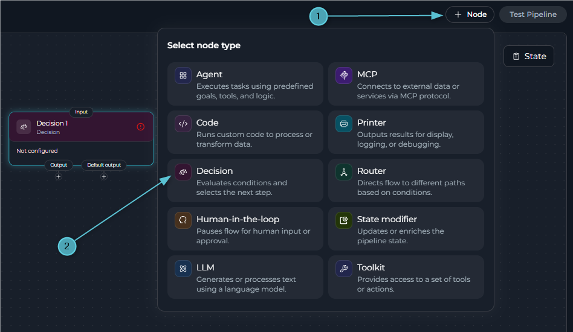

Use the Decision node in these cases:

* The routing criteria depend on meaning, intent, or sentiment — not a value you can compare directly.
* Writing the logic as a Jinja2 condition would be awkward or fragile.
* You can describe the routing rule clearly in a sentence or two, with examples.

<Warning>
**LLM Overhead**

A Decision node is slower than a Router, since it calls an LLM. Use it for routing that genuinely needs semantic judgment, not for logic a simple condition could express.
</Warning>


### Configuration

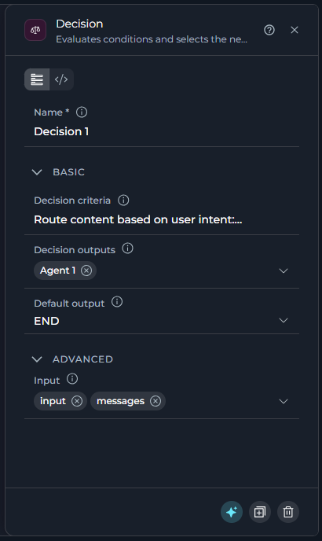

The following table describes the Decision node fields.

| Field | Section | Purpose | Example |
| --- | --- | --- | --- |
| **Name** | Panel header | The node `id`. Required and unique across the pipeline; renaming it updates every reference to this node. | `Classify_intent` |
| **Decision Criteria** | Basic | Natural-language instructions telling the LLM how to choose between the outputs. | *"Route by intent: publish → ArticlePublisher, review → ContentModerator."* |
| **Decision Outputs** | Basic | The node IDs the LLM can choose between. Editing this list and dragging a connection on the canvas do the same thing. | `ArticlePublisher`, `ContentModerator` |
| **Default Output** | Basic | The fallback node ID, used when the LLM can't decide confidently. | `ContentModerator` |
| **Input** | Advanced | State variables the LLM reads to make its decision. | `input`, `messages` |

<Note>
A Decision node has no `output` or Structured Output field — it only routes; it doesn't write to state itself.
</Note>

### YAML View for Decision Nodes

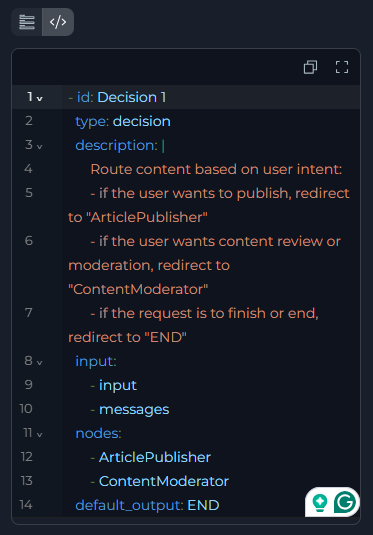

Every node configuration panel has **Flow view** and **YAML view** tabs at the top. In YAML view, the panel shows only this node, not the whole pipeline, as plain YAML. Changes stay synchronized in both directions. If you edit the `id` here, the editor renames the node everywhere it is referenced. You cannot change `type` in this view.

```yaml
  - id: Decision 1
    type: decision
    description: |
      Route content based on user intent:
      - if the user wants to publish, redirect to "ArticlePublisher"
      - if the user wants content review or moderation, redirect to "ContentModerator"
      - if the request is to finish or end, redirect to "END"
    input:
      - input
      - messages
    nodes:
      - ArticlePublisher
      - ContentModerator
    default_output: END
```

<Info title="How the Decision Is Made">
1. The LLM reads the state variables listed in `input`.
2. It evaluates them against `description`.
3. It selects one node ID from `nodes`.
4. Execution routes to that node — or to `default_output` if the LLM can't decide confidently.
</Info>

### Limitations

<CardGroup cols={1}>
  <Card title="Can't Chain Directly" icon="link-slash">
    A Decision node's own outputs can't include another Decision node. To make two decisions in sequence, put another node type — Router, LLM, Code — between them.
  </Card>
  <Card title="Can't Be the Entry Point" icon="flag">
    A Decision node can never be set as the pipeline's entry point — **Make Entrypoint** doesn't appear for it. Every other node type, including Router and HITL, can be. See **[Entry Point](../entry-point)**.
  </Card>
</CardGroup>


### Best Practices for Decision Nodes

<Accordion title="Write concrete, example-backed criteria">
A description with a specific example per outcome routes more reliably than an abstract rule.
</Accordion>

<Accordion title="Always set a Default Output">
Without one, an uncertain LLM decision leaves the pipeline with nowhere to go.
</Accordion>

<Accordion title="Keep Decision Outputs in sync with the description">
Every outcome the description names must also be listed in Decision Outputs — add it in either the field or by connecting it on the canvas.
</Accordion>

<Accordion title="Reach for Router first if a condition would do">
Decision adds LLM latency and cost. If the routing rule is really a value comparison, a Router node does the same job faster and for free.
</Accordion>

---

## Human-in-the-Loop Node

The HITL node pauses the pipeline and waits for a person to choose **Approve**, **Edit**, or **Reject**, then routes based on that choice.

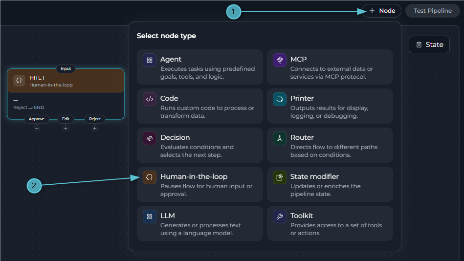

Use the HITL node in these cases:

* You need a human sign-off before an irreversible action — a production publish, a database write, an email send.
* The AI-generated content is usually right but benefits from a quick human correction before it's used.
* You need an auditable human decision point in an otherwise automated workflow.

### Configuration

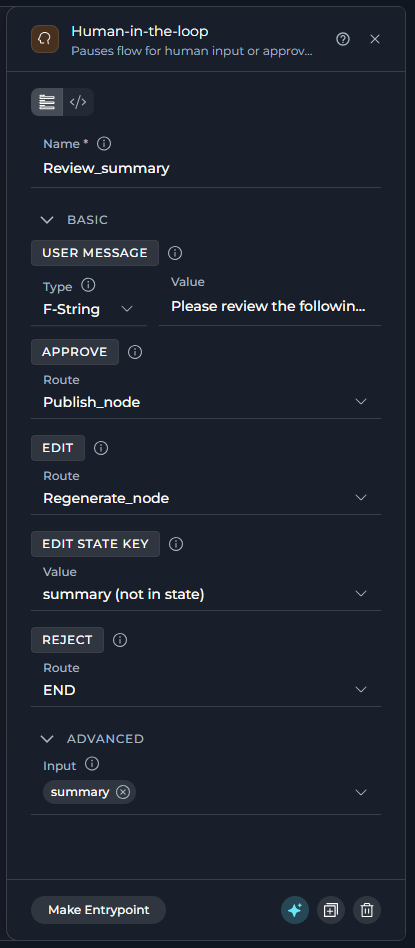

The following table describes the HITL node fields.

| Field | Section | Purpose | Example |
| --- | --- | --- | --- |
| **Name** | Panel header | The node `id`. Required and unique across the pipeline; renaming it updates every reference to this node. | `Review_draft` |
| **User Message** | Basic | The message shown to the person. **Fixed**, **F-String**, or **Variable** — see **[Value Types](./interaction-nodes#value-types)**. | F-String: `Review this draft:\n\n{draft}` |
| **Approve** | Basic | The node to route to when the person clicks **Approve**. | `Publish` |
| **Edit** | Basic | The node to route to when the person clicks **Edit**. Can never be `END`. Requires **Edit State Key** to be set. | `Publish` |
| **Edit State Key** | Basic | The state variable updated with the person's edited text. Shown once an Edit route is picked; required for Edit to work. | `draft` |
| **Reject** | Basic | The node to route to when the person clicks **Reject**. | `END` |
| **Input** | Advanced | State variables available to interpolate into **User Message**. Only enabled when User Message's type is **F-String**. | `draft` |

<Note>
A HITL node has no `output` or Structured Output field. Approve and Reject don't modify state at all; Edit is the only action that writes to state, and only to the single variable named in Edit State Key.
</Note>

<Warning title="Edit Route Constraints">
The **Edit** button only appears once both are true: **Edit State Key** is set to a valid state variable, and the **Edit** route is configured to something other than `END`. If either is missing, Edit is unavailable — even if a route is picked.
</Warning>

### How It Works

1. The node builds the user-facing message from **User Message**.
2. Execution pauses, using LangGraph's dynamic interrupt mechanism.
3. The chat UI shows the message with a button for each configured route — only routes that are actually set appear.
4. The person picks an action:

    | Action | State Change | Behavior |
    |--------|--------------|----------|
    | **Approve** | None | Resumes and routes to **Approve**'s target. |
    | **Reject** | None | Resumes and routes to **Reject**'s target — typically `END`, or a node that starts over. |
    | **Edit** | **Edit State Key** is updated with the person's input | A text field opens, pre-filled with the current value; after they submit, the pipeline updates that variable and routes to **Edit**'s target. |

5. Execution continues from the target node.

    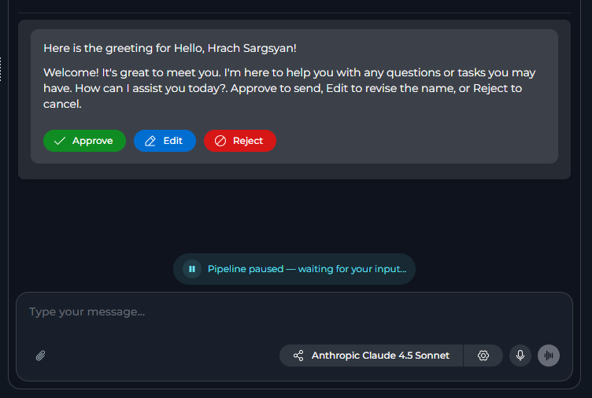

<Info title="Route Handling">
HITL resumes via LangGraph's `Command(goto=target_node)` (Approve/Reject) or `Command(goto=target_node, update={edit_state_key: value})` (Edit) — there's no `transition` field or conditional edge involved. Every route's target node must exist in the pipeline.
</Info>

<Warning title="Limitations">
* The Edit route can never target `END`.
* HITL's dynamic interrupt requires the pipeline to be running with checkpoint/memory support (an active `thread_id`) for resume to work.
* Each HITL node holds only one pending interrupt at a time.
* Approve and Reject never modify state; only Edit does, and only the one variable in Edit State Key.
</Warning>

### YAML View for HITL Nodes

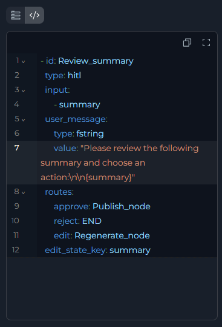

Every node configuration panel has **Flow view** and **YAML view** tabs at the top. In YAML view, the panel shows only this node, not the whole pipeline, as plain YAML. Changes stay synchronized in both directions. If you edit the `id` here, the editor renames the node everywhere it is referenced. You cannot change `type` in this view.

```yaml
  - id: Review_summary
    type: hitl
    input:
      - summary
    user_message:
      type: fstring
      value: "Please review the following summary and choose an action:\n\n{summary}"
    routes:
      approve: Publish_node
      reject: END
      edit: Regenerate_node
    edit_state_key: summary
```

### Best Practices for HITL Nodes

<Accordion title="Gate irreversible actions, not every step">
Put a HITL node right before a publish, a write, or a send — not in front of every intermediate step, which would make the pipeline tedious to run.
</Accordion>

<Accordion title="Show the person exactly what they're approving">
Use an F-String User Message that includes the actual content under review, not just a generic prompt.
</Accordion>

<Accordion title="Route Edit back through reprocessing when the edit needs it">
If the edited value should be re-run through an earlier step (e.g., reformatting), route Edit to that step instead of straight to the final action.
</Accordion>

<Accordion title="Always configure Reject">
Without a Reject route, a person has no way to decline. Point it at `END` or a recovery node.
</Accordion>

### Troubleshooting HITL Nodes

<Accordion title="The Edit button doesn't appear">
Confirm both conditions: **Edit State Key** has a valid state variable selected, and **Edit**'s route is set to something other than `END`.
</Accordion>

<Accordion title="The pipeline doesn't resume after a person responds">
Confirm the pipeline is running with checkpoint/memory support — HITL's interrupt-and-resume depends on an active `thread_id`.
</Accordion>

<Accordion title="A route button is missing">
Only configured routes show a button. If Approve, Edit, or Reject doesn't appear, that route hasn't been set for this node.
</Accordion>

---

## Value Types

The HITL node's **User Message** field lets you pick how its value is produced. All three value types read only from the variables listed in that node's **Input**.

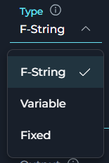

The following table describes the available value types.

| Type | What it does | Use it when |
| --- | --- | --- |
| **F-String** | Uses the text you typed as a template and fills in `{variable_name}` placeholders from state, the same way Python `str.format()` works. | Most of the message is static, but one or more state values must be shown. Example: `Review this draft:\n\n{draft}`. |
| **Variable** | Ignores the text in the field and uses the full value of the single state variable that you name. | The whole message already exists in state and does not need templating. |
| **Fixed** | Uses exactly the text that you typed, with no substitution. | The message does not need to change between runs. |

<Warning title="A missing placeholder doesn't fail the run">
If an F-String references a variable that is not in **Input**, or if the variable is empty, the platform searches the rest of state for it. If it still cannot find a match, the placeholder remains as literal text, such as `{draft}`, and the node does not fail. Make sure every `{variable}` that you reference is listed in **Input**.
</Warning>

<Tip title="Switching types keeps your text">
Switching between **Fixed** and **F-String** keeps the text that you typed. This is useful when you add or remove `{variable}` placeholders without retyping the rest. Switching to or from **Variable** replaces the field content, because **Variable** does not store free-form text.
</Tip>

<Note>
Router's **Condition** and Decision's **Decision Criteria** are not Fixed/F-String/Variable fields — both are always a raw Jinja2 template or a plain description, respectively.
</Note>

---

## Node Panel Buttons

Every node configuration panel footer has the same row of actions. This includes Router nodes, Decision nodes, HITL nodes, and all other node types.

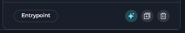

The following table describes the node panel buttons.

| Button | What it does |
| --- | --- |
| **Make Entrypoint** | Set this node as the pipeline entry point. This button appears only when the node is not already the entry point. After you set it, the editor replaces the button with an **Entrypoint** badge. It is not available on Decision nodes or legacy Condition nodes. |
| **Build with AI** | Reserved for a future feature. It is currently always disabled. |
| **Duplicate** | Copy this node as `<name>_copy` or `<name>_copy_2` if that name is already taken. The copy starts disconnected. The editor clears its outgoing connection and routing fields, including `transition`, `routes`, `nodes`, and `default_output`, so you can reconnect it yourself. |
| **Delete** | Remove this node. Any other node reference to it, including `transition`, `default_output`, or a HITL route, is cleared automatically. |

<Note>
**Making a Node the Entry Point**

After a node becomes the pipeline entry point, a **Trigger** field appears at the top of its configuration panel. The **Chat Message** and **Webhook** options control how the pipeline starts. For more information, see [Entry Point](../entry-point).

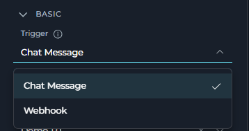

<Warning>
Decision nodes and legacy Condition nodes cannot be made the entry point — **Make Entrypoint** doesn't appear for them.
</Warning>

</Note>

---

## Control Flow Nodes Comparison

The following table compares the three control flow nodes.

| | Router Node | Decision Node | HITL Node |
| --- | --- | --- | --- |
| **Chooses by** | A Jinja2 condition evaluated against state | An LLM's judgment of natural-language criteria | A person's button choice |
| **LLM involved** | No | Yes | No |
| **Routing fields** | `condition`, `routes`, `default_output` | `description`, `nodes`, `default_output` | `routes.approve`/`edit`/`reject`, `edit_state_key` |
| **Can modify state** | No | No | Only via Edit |
| **Speed** | Fast | Slower (LLM call) | Depends on the person |
| **Best for** | Known, explicit conditions | Routing that needs semantic understanding | A required human checkpoint |

### When to Use Each Node

<Accordion title="Router Node">
Choose Router when you can express the routing rule as a condition — status checks, priority levels, keyword matches, score thresholds, or loop control via a counter.
</Accordion>

<Accordion title="Decision Node">
Choose Decision when the routing rule depends on meaning or intent that's hard to express as a condition — classifying a request, reading sentiment, or routing based on context.
</Accordion>

<Accordion title="HITL Node">
Choose HITL when a person, not logic, needs to make the call — approving generated content, signing off before an irreversible action, or correcting AI output inline.
</Accordion>

---

## Deprecated Control Flow Nodes

The following control flow node is deprecated and hidden from the node picker. Existing nodes of this type keep working, but build new steps with their replacement instead.

<Accordion title="Condition Node">
Superseded by **Router** (for expression-based routing) or **Decision** (for AI-powered routing).

**Migration Guide:** [Condition Node Migration](../../../migration/v2.0.1/condition-node-migration)
</Accordion>

---

<Info title="Related">
- **[Nodes Overview](./overview)** - Understand all available node types
- **[Pipeline States](../states)** - Manage data flow through pipeline state
- **[Node Connectors](../nodes-connectors)** - Link nodes together
- **[YAML Configuration](../yaml)** - Complete node syntax reference
</Info>
