## Overview

There are three execution nodes. None of them involve an LLM — the tool, parameters, or code are exactly what you configure, every run. Each node reads from and writes to pipeline state through `input` and `output`. For more information, see [Pipeline States](../states).

<CardGroup cols={3}>
  <Card title="Toolkit" icon="screwdriver-wrench" href="#toolkit-node">
    Calls one tool from an ELITEA toolkit, with its parameters mapped explicitly.
  </Card>
  <Card title="MCP" icon="plug" href="#mcp-node">
    Calls one tool from a Model Context Protocol server, with its parameters mapped explicitly.
  </Card>
  <Card title="Code" icon="code" href="#code-node">
    Runs custom Python in a sandbox, for logic no toolkit or MCP covers.
  </Card>
</CardGroup>

---

## Toolkit Node

The Toolkit node calls one tool from one ELITEA toolkit, with its parameters mapped explicitly. It executes deterministically and without LLM overhead — useful when you already know exactly which tool to call and what to pass it.

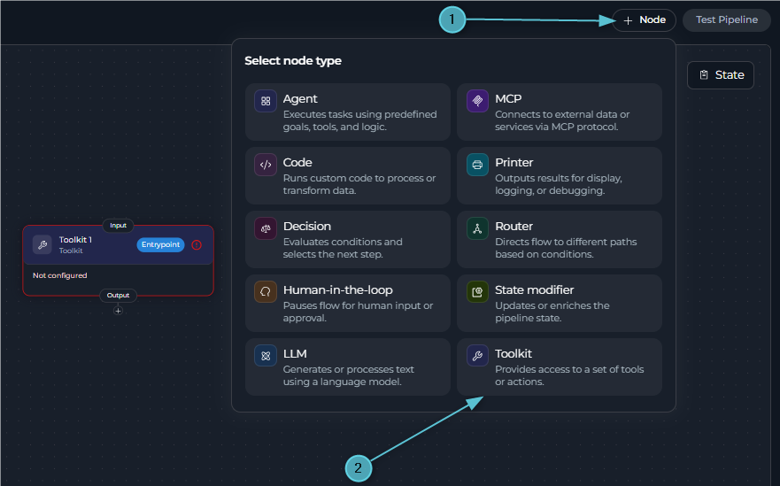

Use the Toolkit node in these cases:

* You know exactly which toolkit and tool to call, and what its parameters should be.
* You need fast, deterministic execution — no LLM reasoning about which tool to pick.
* You're chaining several known API calls (e.g., create a ticket, then notify a channel) and want explicit control over each step.

<Info title="Toolkit Node Scope">
A Toolkit node can only call an ELITEA toolkit's tools, not an MCP server's — its toolkit picker filters MCP servers out. For an MCP server's tools, use the **[MCP Node](#mcp-node)**.
</Info>

### Configuration

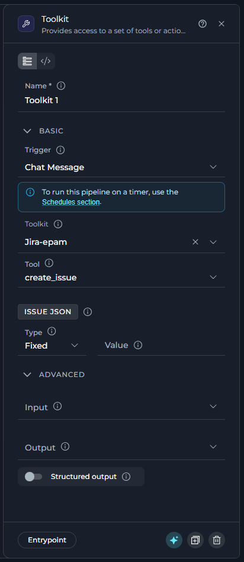

The following table describes the Toolkit node fields.

| Field | Section | Purpose | Example |
| --- | --- | --- | --- |
| **Name** | Panel header | The node `id`. Required and unique across the pipeline; renaming it updates every reference to this node. | `Create_jira_ticket` |
| **Toolkit** | Basic | The ELITEA toolkit this node calls. | `jira_toolkit` |
| **Tool** | Basic | The specific tool to run, from the selected toolkit. Appears once a toolkit is picked. | `create_issue` |
| *(the tool's required parameters)* | Basic | Appears once a tool is picked — one field per parameter the tool requires, each with its own **Fixed** / **F-String** / **Variable** type. See **[Value Types](#value-types)**. | Fixed: `projectelitea` |
| *(the tool's optional parameters)* | Advanced | Click **Add optional parameter** to reveal any of the tool's optional parameters, mapped the same way as required ones. | Fixed: `main` |
| **Input** | Advanced | State variables this node can read. | `input`, `project_id` |
| **Output** | Advanced | State variables the tool's result is parsed into, in addition to `last_tool_outcome`/`tool_outcomes` — see **[Tool Outcome](#tool-outcome)**. | `jira_ticket_id` |
| **Structured Output** | Advanced | Toggle on to have the result parsed directly into the variables listed in `output`, instead of appended to `messages`. | `true` |

<Warning title="One Toolkit, One Tool">
Each Toolkit node calls exactly one tool from one toolkit. To call a second tool, add a second Toolkit node and connect them in sequence.
</Warning>

### YAML View for Toolkit Nodes

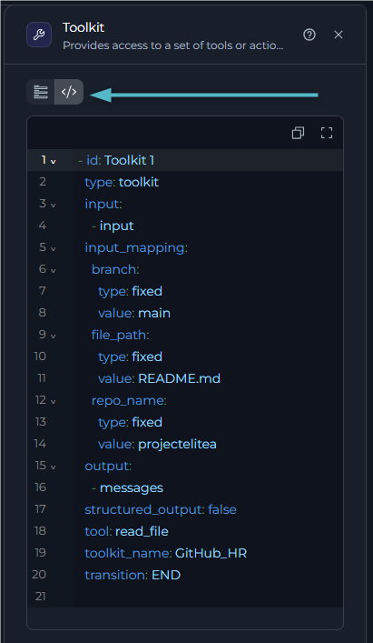

Every node configuration panel has **Flow view** and **YAML view** tabs at the top. In YAML view, the panel shows only this node, not the whole pipeline, as plain YAML. Changes stay synchronized in both directions. If you edit the `id` here, the editor renames the node everywhere it is referenced. You cannot change `type` in this view.

```yaml
  - id: Toolkit 1
    type: toolkit
    toolkit_name: GitHub_HR
    tool: read_file
    input:
      - input
    input_mapping:
      repo_name:
        type: fixed
        value: projectelitea
      branch:
        type: fixed
        value: main
      file_path:
        type: fixed
        value: README.md
    output:
      - messages
    structured_output: false
    transition: END
```

### Best Practices for Toolkit Nodes

<Accordion title="Map every required parameter before leaving the node">
A tool with an unmapped required parameter fails at run time. The Basic section lists only required parameters, so check it's complete before moving on.
</Accordion>

<Accordion title="Reach for Variable or F-String, not a re-typed Fixed value">
If a parameter's value already exists in state, map it with **Variable** — typing the same value again as **Fixed** means updating two places when it changes.
</Accordion>

<Accordion title="Chain Toolkit nodes for multi-step API work">
Since each node calls exactly one tool, a multi-step integration (create, then notify, then log) is a short chain of Toolkit nodes, each with a clear single purpose.
</Accordion>

<Accordion title="Give output its own name">
Capture a toolkit's result in a specific state variable (`jira_ticket_id`) rather than leaving `output` empty and relying on `messages` — it's easier for the next node to consume.
</Accordion>

---

## MCP Node

The MCP node calls one tool from one Model Context Protocol server, with its parameters mapped explicitly — the same deterministic, no-LLM execution as the Toolkit node, scoped to MCP servers instead of ELITEA toolkits.

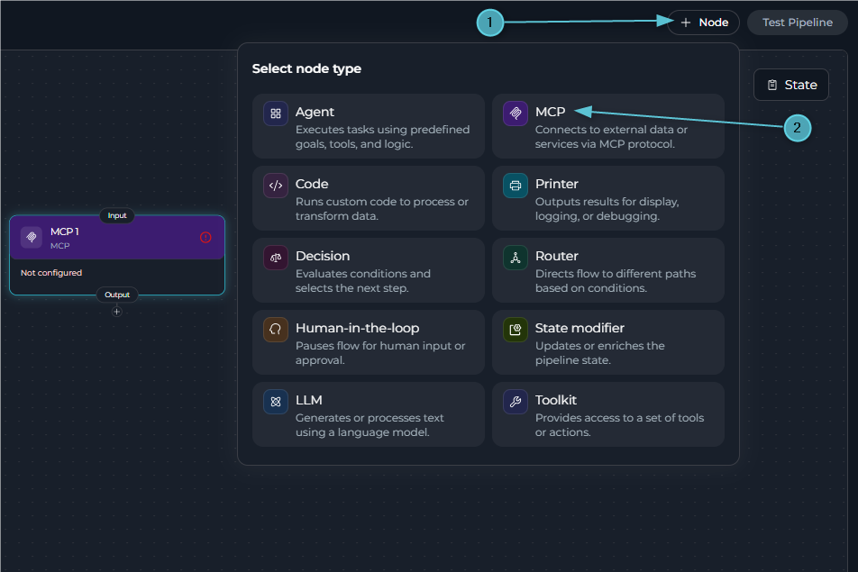

Use the MCP node in these cases:

* You need to call a tool exposed by an MCP server already connected to the project.
* You know exactly which MCP tool to call and what its parameters should be.
* You need fast, deterministic execution without LLM overhead.

### Configuration

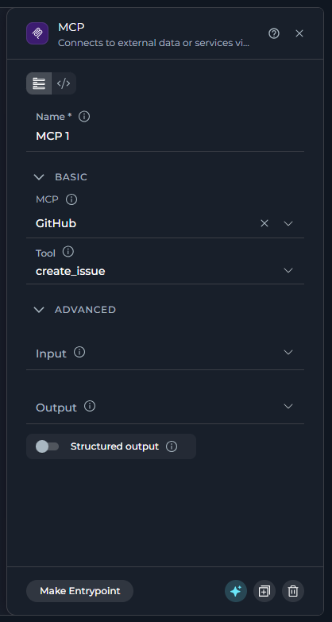

The following table describes the MCP node fields.

| Field | Section | Purpose | Example |
| --- | --- | --- | --- |
| **Name** | Panel header | The node `id`. Required and unique across the pipeline; renaming it updates every reference to this node. | `Get_readme` |
| **MCP** | Basic | The MCP server this node calls. | `MCP-GitHub` |
| **Tool** | Basic | The specific tool to run, from the selected MCP server. Appears once an MCP server is picked. | `get_file_contents` |
| *(the tool's required parameters)* | Basic | Appears once a tool is picked — one field per parameter the tool requires, each with its own **Fixed** / **F-String** / **Variable** type. See **[Value Types](#value-types)**. | Fixed: `Projectelitea` |
| *(the tool's optional parameters)* | Advanced | Click **Add optional parameter** to reveal any of the tool's optional parameters, mapped the same way as required ones. | Variable: `file_content` |
| **Input** | Advanced | State variables this node can read. | `input` |
| **Output** | Advanced | State variables the tool's result is parsed into, in addition to `last_tool_outcome`/`tool_outcomes` — see **[Tool Outcome](#tool-outcome)**. | `file_content` |
| **Structured Output** | Advanced | Toggle on to have the result parsed directly into the variables listed in `output`, instead of appended to `messages`. | `false` |

<Warning title="One MCP Server, One Tool">
Each MCP node calls exactly one tool from one MCP server. To call a second tool, add a second MCP node and connect them in sequence.
</Warning>

### YAML View for MCP Nodes

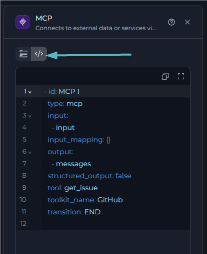

Every node configuration panel has **Flow view** and **YAML view** tabs at the top. In YAML view, the panel shows only this node, not the whole pipeline, as plain YAML. Changes stay synchronized in both directions. If you edit the `id` here, the editor renames the node everywhere it is referenced. You cannot change `type` in this view.

<Note>
An MCP node's YAML stores its server under `toolkit_name`, the same field a Toolkit node uses — not a separate `mcp_name` key.
</Note>

```yaml
  - id: Get_readme
    type: mcp
    toolkit_name: MCP-GitHub
    tool: get_file_contents
    input:
      - input
    input_mapping:
      owner:
        type: fixed
        value: Projectelitea
      repo:
        type: fixed
        value: projectelitea.github.io
      branch:
        type: fixed
        value: main
      path:
        type: variable
        value: file_content
    output:
      - file_content
    structured_output: false
    transition: END
```

### Best Practices for MCP Nodes

<Accordion title="Confirm the MCP server is connected before building on it">
A node pointed at a disconnected or unreachable MCP server fails at run time — verify the server in its own settings before wiring pipeline nodes to it.
</Accordion>

<Accordion title="Map every required parameter before leaving the node">
A tool with an unmapped required parameter fails at run time. The Basic section lists only required parameters, so check it's complete before moving on.
</Accordion>

<Accordion title="Give output its own name">
Capture an MCP tool's result in a specific state variable rather than leaving `output` empty and relying on `messages` — it's easier for the next node to consume.
</Accordion>

---

## Tool Outcome

Every Toolkit and MCP node writes a typed outcome into pipeline state beside its normal output, so a pipeline can branch on a structured status instead of parsing message text.
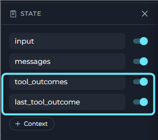

### New Pipeline State Keys

| Key | Shape | Meaning |
|-----|-------|---------|
| **last_tool_outcome** | One outcome object | The most recent tool node's outcome |
| **tool_outcomes** | `{ node_id: outcome }` | One entry per node that ran, merged across the run |

<Warning title="Add These State Variables Manually">
Unlike `input` and `messages`, `last_tool_outcome` and `tool_outcomes` are not added to the pipeline's `state` section automatically. Add them yourself before referencing them elsewhere in the pipeline. See **[Pipeline States](../states)** for how to manage state variables.

```yaml
state:
  last_tool_outcome:
    type: dict
    value: {}
  tool_outcomes:
    type: dict
    value: {}
```
</Warning>

<Note>
Both keys are cleared at the start of every turn, so a previous turn's failure cannot leak into a condition. Re-entering a node (a loop) overwrites that node's entry.
</Note>

### Outcome Object

| Field | Values | Use It For |
|-------|--------|------------|
| **status** | `success` \| `error` \| `truncated` | The one field to branch on |
| **error_class** | `infrastructure` \| `input` \| `tool_internal` \| `policy` \| `null` | What kind of failure occurred |
| **retriable** | `true` \| `false` | `true` only for infrastructure failures — retrying identical input could work |
| **retry_after** | Number \| `null` | Seconds to wait before retrying, when the tool supplied one |
| **message** | Prose | The same human/LLM-facing text as before (capped at 4000 characters) |
| **tool_name**, **toolkit_type** | String \| `null` | Which tool failed |
| **exception_type** | Class name \| `null` | For example, `ReadTimeout`, `ValueError` — never a traceback |
| **truncated**, **original_size** | Present when the raw tool *result* exceeded its size limit | A data-completeness signal: the result itself was cut, separate from the next pair |
| **message_truncated**, **message_original_size** | Present only when the **message** text was capped at 4000 characters | The envelope's own `message` field was shortened — unrelated to whether the tool's result was |

<Note title="Blocking a sensitive tool does not produce a tool outcome">
If a user blocks a sensitive tool call on a Toolkit or MCP node, the pipeline simply stops with a descriptive message — it does not populate `last_tool_outcome` or `tool_outcomes`.
</Note>

**Example: Routing on Tool Outcome**

```yaml
nodes:
  - id: call_api
    type: toolkit
    # ...
    transition: check_outcome

  - id: check_outcome
    type: router
    condition: |
      
      retry_call
      
      continue_flow
      
    input:
      - last_tool_outcome
    routes:
      - retry_call
      - continue_flow
    default_output: continue_flow
```

<Tip title="Branch on status and error_class, not on message text">
Use `last_tool_outcome.status` and `last_tool_outcome.error_class` to route pipeline logic. Avoid matching on `message` text, since prose wording can change between tool versions.
</Tip>

---

## Code Node

The Code node runs custom Python in a sandbox (Pyodide, Python compiled to WebAssembly), for logic no toolkit or MCP tool covers — data transformation, calculations, or calling an API directly.

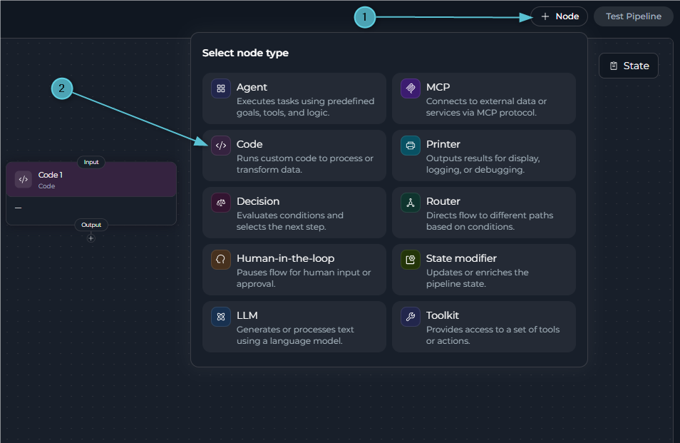

Use the Code node in these cases:

* The logic is custom — a calculation, transformation, or business rule no toolkit exposes.
* You need to call an external API directly, with full control over the request.
* You need a Python package from the sandbox's standard library, or installable via `micropip`.

### Configuration

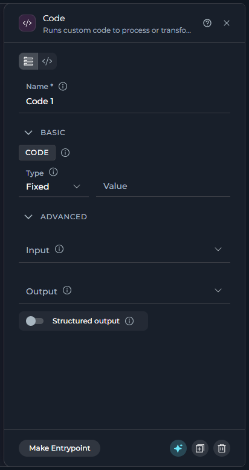

The following table describes the Code node fields.

| Field | Section | Purpose | Example |
| --- | --- | --- | --- |
| **Name** | Panel header | The node `id`. Required and unique across the pipeline; renaming it updates every reference to this node. | `process_data` |
| **Code** | Basic | The Python code to run. **Fixed** (a static block), **F-String** (a template with `{variable}` placeholders), or **Variable** (code stored in a state variable). See **[Value Types](#value-types)**. | Fixed: `elitea_state.get('value', 0) * 2` |
| **Input** | Advanced | State variables the code can read, via `elitea_state`. | `raw_data`, `min_score` |
| **Output** | Advanced | State variables to populate with the result. If omitted, or if it includes `messages`, the result is appended to `messages` instead. | `processed_data`, `count` |
| **Structured Output** | Advanced | Toggle on to require the code return a dictionary, with each key matching a name in `output` updating that variable. | `true` |

<Note title="debug is YAML-only">
`debug: true` has no Flow-view control — add it directly in the node's YAML view. See **[Debug Mode](#debug-mode)** below.
</Note>

<Tip title="elitea_state and elitea_state">
Inside the sandbox, state is available as `elitea_state`. `elitea_state` is the current, primary name for the same dictionary; `elitea_state` is kept as an alias for existing code, and either name works.
</Tip>

### YAML View for Code Nodes

Every node configuration panel has **Flow view** and **YAML view** tabs at the top. In YAML view, the panel shows only this node, not the whole pipeline, as plain YAML. Changes stay synchronized in both directions. If you edit the `id` here, the editor renames the node everywhere it is referenced. You cannot change `type` in this view.

```yaml
  - id: calculate_total
    type: code
    code:
      type: fixed
      value: |
        numbers = elitea_state.get('numbers', [])
        total = sum(numbers)
        {"total": total}
    input:
      - numbers
    output:
      - total
    structured_output: true
    transition: END
state:
  input:
    type: str
  messages:
    type: list
  numbers:
    type: list
    value: []
  total:
    type: number
    value: 0
```

<Info title="Output Handling: With or Without Output Variables">
**Without output variables (or `output` includes `messages`):** the result is appended to `messages`.

```yaml
- id: simple_code
  type: code
  code:
    type: fixed
    value: |
      "Hello, World!"
  # No output specified - result goes to messages
```

**With specific output variables:**

```yaml
- id: calculate
  type: code
  code:
    type: fixed
    value: |
      12345
  output:
    - calculation_result
```

**With structured output, returning a dict to update multiple variables:**

```yaml
- id: structured_code
  type: code
  code:
    type: fixed
    value: |
      {
        "user_name": "John Doe",
        "user_score": 95
      }
  output:
    - user_name
    - user_score
  structured_output: true
```
</Info>

### Debug Mode

Use debug mode when you need to inspect the exact Python source ELITEA sent to the sandbox.

<Note title="What debug mode does">
When `debug: true` is set on a Code node, ELITEA saves a timestamped standalone Python snapshot to the `code-debug` artifact bucket before execution. The saved file includes a generated sandbox-client preamble, the injected state payload, and your code wrapped so it can be run locally in standard Python.
</Note>

**How it works**

1. Add `debug: true` to the Code node's YAML — there is no Flow-view toggle for it.
   
   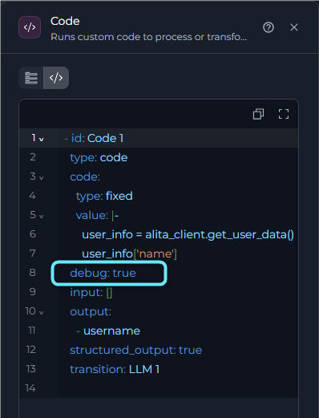

2. Run the pipeline normally.
3. Open the `code-debug` artifact bucket and download the generated `.py` file.

    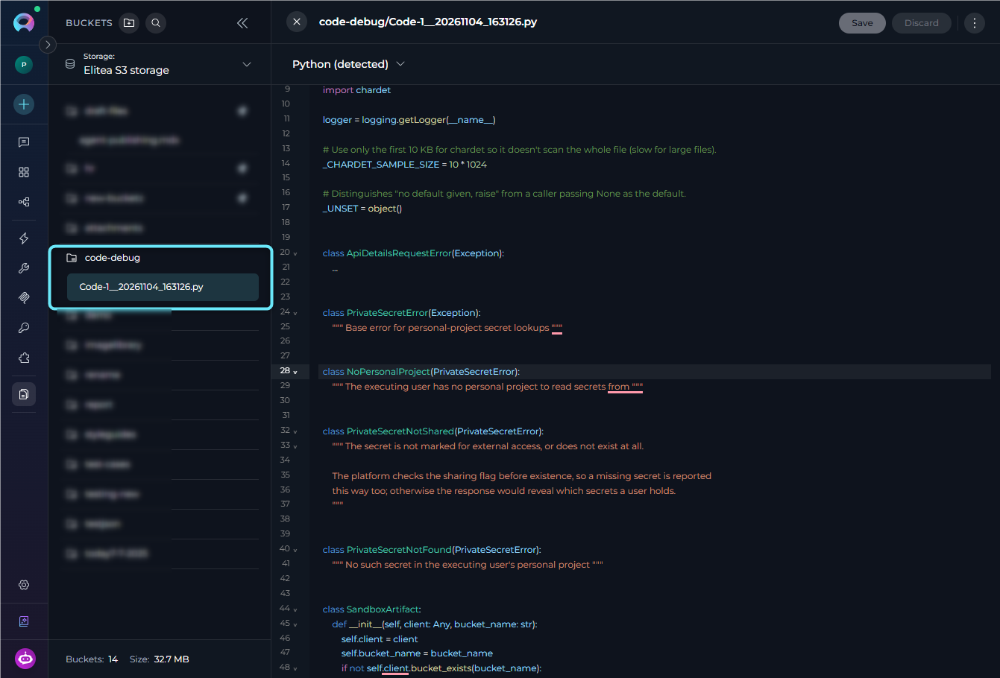

4. Replace the auth token placeholder if your code uses `elitea_client`.
5. Run the file locally to reproduce the exact execution context.

**Debug mode example**

```yaml
nodes:
  - id: process_data
    type: code
    debug: true
    code:
      type: fixed
      value: |
        data = elitea_state.get('raw_input', '')
        result = data.strip().upper()
        {"processed_result": result}
    input:
      - raw_input
    output:
      - processed_result
    structured_output: true
    transition: END
state:
  input:
    type: str
  messages:
    type: list
  raw_input:
    type: str
    value: ''
  processed_result:
    type: str
    value: ''
```

When this node runs, ELITEA creates a file such as `process_data__20260702_153045.py` in the `code-debug` artifact bucket.

<Info title="Debug Artifact Contents">
When `debug: true`, the saved artifact contains these parts in order:

- A simplified `SandboxClient` implementation so the file can run outside the ELITEA SDK
- An `elitea_client = SandboxClient(...)` initialization block with an auth token placeholder
- The generated state preamble that restores `elitea_state` and `elitea_state`
- Your Code Node logic wrapped in an async runner so top-level `await` also works in standard CPython

Debug artifact creation is best-effort only. If upload to the `code-debug` bucket fails, pipeline execution continues and the failure is logged as a warning.
</Info>

### Working with the Sandbox Client

<Tip title="State Access and the Sandbox Client">
**State access:** Read pipeline state via `elitea_state.get('variable_name', default_value)`.

**The sandbox client:** When available, `elitea_client` is automatically injected into the Code node's sandbox. It provides:

**Artifact operations** (`elitea_client.artifact(bucket_name)`):
- `.create(artifact_name, artifact_data, bucket_name=None, check_if_exists=False)` - Create/upload an artifact
- `.get(artifact_name, bucket_name=None, ...)` - Download/read an artifact's content
- `.delete(artifact_name, bucket_name=None, check_exists=True)` - Delete an artifact
- `.list(bucket_name=None, prefix='', delimiter='/', return_as_string=True)` - List artifacts in a bucket
- `.append(artifact_name, additional_data, bucket_name=None, create_if_missing=True)` - Append data to an existing artifact
- `.get_content_bytes(artifact_name, bucket_name=None)` - Get an artifact as raw bytes

**Bucket and direct artifact operations:**
- `elitea_client.bucket_exists(bucket_name)` - Check if a bucket exists
- `elitea_client.create_bucket(bucket_name, expiration_measure='months', expiration_value=1)` - Create a new bucket
- `elitea_client.list_artifacts(bucket_name)` - List artifacts in a bucket
- `elitea_client.create_artifact(bucket_name, artifact_name, artifact_data)` - Create an artifact
- `elitea_client.download_artifact(bucket_name, artifact_name)` - Download an artifact
- `elitea_client.delete_artifact(bucket_name, artifact_name)` - Delete an artifact

**Application operations:**
- `elitea_client.get_app_details(application_id)` - Get an application's configuration
- `elitea_client.get_list_of_apps()` - List all available applications
- `elitea_client.get_app_version_details(application_id, application_version_id)` - Get a specific app version's details

**MCP tool operations:**
- `elitea_client.get_mcp_toolkits()` - List available MCP toolkits
- `elitea_client.mcp_tool_call(params)` - Call an MCP tool with parameters

**Secrets:**
- `elitea_client.unsecret(secret_name)` - Retrieve a secret value from the pipeline's current project (shared across every user who runs it)
- `elitea_client.get_private_project_secret(secret_name, default=None)` - Retrieve a secret from the **executing user's own Private project** instead — see **[Private Project Secrets](#private-project-secrets)** below

**User operations:**
- `elitea_client.get_user_data()` - Get current user information

**Example usage:**
```python
# Create and manage artifacts
bucket = elitea_client.artifact('my-bucket')
bucket.create('report.txt', 'Analysis results...')
content = bucket.get('report.txt')
bucket.list()

# Direct artifact operations
elitea_client.create_artifact('my-bucket', 'data.json', '{"key": "value"}')
data = elitea_client.download_artifact('my-bucket', 'data.json')

# Access secrets (shared project — same value for every user)
api_key = elitea_client.unsecret('my-api-key')

# Access a per-user secret from the executing user's own Private project
user_token = elitea_client.get_private_project_secret('my-api-key', default=None)

# Get application details
app = elitea_client.get_app_details(application_id=123)
```
</Tip>

### Private Project Secrets

In a shared (team) project, `elitea_client.unsecret(secret_name)` always reads the secret stored in that shared project — every user who triggers the pipeline gets the same value. Use `elitea_client.get_private_project_secret(secret_name, default=None)` instead when each user running the Code node should supply their **own** credential: User A and User B calling the same node with the same `secret_name` resolve two different values, each read from their own **Private** project.

<Note>
**The secret owner must opt in**

There is deliberately no fallback to a same-named secret in the shared project. For `get_private_project_secret` to succeed, the secret must exist in the executing user's own Private project secrets, and that user must turn on the per-secret **Share with other projects** toggle (**[Secrets](../../../menus/settings/secrets)**, visible only while viewing your own Private project's Secrets table). The toggle is unavailable for platform-managed (default) secrets.

   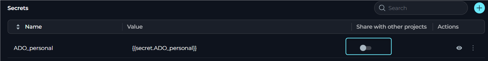

</Note>

**Signature:** `elitea_client.get_private_project_secret(secret_name: str, default: Any = <unset>)`

* Called with no `default`, a failed lookup **raises** an exception (see table below).
* Called with an explicit `default` (including `default=None`), a failed lookup **returns that default** instead of raising — useful when the secret is optional for some users.

| Exception | Raised when |
|-----------|-------------|
| `NoPersonalProject` | The executing run has no resolvable user — e.g., a schedule or webhook trigger with no user to resolve. Unattended runs cannot use this function. |
| `PrivateSecretNotShared` | Either the secret exists but **Share with other projects** is off, or no secret with that name exists at all in the user's Private project. The platform intentionally returns the same error for both cases, so a failed lookup can't be used to probe which secret names a user holds. |
| `PrivateSecretNotFound` | No secret with that name exists in the executing user's Private project. |
| `PrivateSecretError` (base class) | Any other refusal — e.g., an invalid secret name, or the requested name is one of the platform's reserved/default secrets. |

<Warning title="Error message wording">
The exception raised for `PrivateSecretNotShared` currently reads *"...enable 'Allow external access' on it"* — the control is actually labeled **Share with other projects** in the Secrets table. If you see this error, look for that toggle rather than the "Allow external access" wording.
</Warning>

**Example: per-user credential in a shared pipeline**

```python
# Running in a shared/team project's Code Node.
# Each user who triggers this pipeline supplies their own value for 'personal_api_token'
# in their own Private project's Secrets, with "Share with other projects" turned on.
try:
    token = elitea_client.get_private_project_secret('personal_api_token')
except Exception as e:
    # NoPersonalProject, PrivateSecretNotShared, PrivateSecretNotFound, or PrivateSecretError
    token = None

if token is None:
    {"status": "skipped", "reason": "no personal token available for this user"}
else:
    # Use token for a per-user authenticated call
    {"status": "success"}
```

Or suppress the error entirely with a default:

```python
token = elitea_client.get_private_project_secret('personal_api_token', default=None)
{"has_token": token is not None}
```

### YAML Configuration Examples

<Accordion title="Data Processing with Error Handling">
```yaml
nodes:
  - id: process_user_data
    type: code
    code:
      type: fixed
      value: |
        raw_data = elitea_state.get('raw_data', [])
        min_score = elitea_state.get('min_score', 50)

        try:
            processed = []
            for item in raw_data:
                score = item.get('score', 0)
                if score >= min_score:
                    processed.append({
                        'id': item['id'],
                        'name': item['name'],
                        'grade': 'Pass',
                        'score': score
                    })

            {
                "processed_data": processed,
                "count": len(processed),
                "status": "success"
            }
        except Exception as e:
            {
                "error": str(e),
                "status": "failed",
                "count": 0
            }
    input:
      - raw_data
      - min_score
    output:
      - processed_data
      - count
      - status
    structured_output: true
    transition: END
```
</Accordion>

<Accordion title="External HTTP Calls">
```yaml
nodes:
  - id: fetch_api_data
    type: code
    code:
      type: fixed
      value: |
        query = elitea_state.get('search_query', '')
        api_url = f"https://api.example.com/search?q={query}"

        try:
            # Use httpx for async HTTP calls (Pyodide compatible)
            async with httpx.AsyncClient() as client:
                response = await client.get(api_url, timeout=10.0)
                data = response.json()

            {
                "api_results": data.get('results', []),
                "result_count": len(data.get('results', [])),
                "status": "success"
            }
        except Exception as e:
            {
                "error": str(e),
                "status": "failed",
                "result_count": 0
            }
    input:
      - search_query
    output:
      - api_results
      - result_count
      - status
    structured_output: true
    transition: END
```
</Accordion>

<Accordion title="Using Packages via micropip">
```yaml
nodes:
  - id: data_analysis
    type: code
    code:
      type: fixed
      value: |
        import micropip
        await micropip.install('numpy')
        import numpy as np

        values = elitea_state.get('values', [])

        if not values:
            {"error": "No values provided", "status": "failed"}
        else:
            data = np.array(values)
            {
                "mean": float(np.mean(data)),
                "median": float(np.median(data)),
                "std_dev": float(np.std(data)),
                "status": "success"
            }
    input:
      - values
    output:
      - mean
      - median
      - std_dev
      - status
    structured_output: true
    transition: END
```
</Accordion>

<Accordion title="Accessing Artifacts via elitea_client">
```yaml
nodes:
  - id: list_artifacts
    type: code
    code:
      type: fixed
      value: |
        try:
            bucket_name = elitea_state.get('bucket_name', 'test')
            artifacts = elitea_client.list_artifacts(bucket_name=bucket_name)
            {
                "artifacts": artifacts,
                "count": len(artifacts),
                "status": "success"
            }
        except Exception as e:
            {
                "error": str(e),
                "status": "failed",
                "count": 0
            }
    input:
      - bucket_name
    output:
      - artifacts
      - count
      - status
    structured_output: true
    transition: END
```
</Accordion>

### Best Practices for Code Nodes

<Accordion title="Return structured data for structured_output">
When using `structured_output: true`, always return a dictionary whose keys match the variables listed in `output`.
</Accordion>

<Accordion title="Handle errors gracefully">
Wrap risky logic in try/except and return the error as part of the structured output, rather than letting the node fail outright.
</Accordion>

<Accordion title="Validate state before using it">
Use `elitea_state.get('var', default)` rather than assuming a variable exists and has the expected type.
</Accordion>

<Accordion title="Use descriptive output variable names">
`total_revenue` and `average_score` are clearer than `result1` and `result2` to the next node's author.
</Accordion>

<Accordion title="Keep each Code node focused">
One clear purpose per node — split unrelated operations into separate Code nodes rather than combining them.
</Accordion>

<Accordion title="Use httpx, not requests, for HTTP calls">
`requests` is not Pyodide-compatible. Use `httpx.AsyncClient` with `await` instead.
</Accordion>

<Accordion title="Install packages sparingly">
Package installation via `micropip` adds latency on every run — install only what the node actually needs.
</Accordion>

<Accordion title="Return only JSON-serializable values">
Native Python types (str, int, float, bool, list, dict, None) only — classes and other objects can't be serialized back into state.
</Accordion>

<Accordion title="Enable debug only while investigating">
Turn on `debug: true` for a node you're actively debugging, then turn it back off — each run with it on writes a new file to the `code-debug` bucket.
</Accordion>

### Troubleshooting

<Accordion title="Error: Deno is required for PyodideSandbox but is not installed">
**Cause:** The Deno JavaScript runtime is missing.

**Solution:** Install Deno and ensure it's on your system PATH.
```powershell
# Windows (PowerShell)
irm https://deno.land/install.ps1 | iex
```
</Accordion>

<Accordion title="Error: Object is not serializable">
**Cause:** The code returns a non-JSON-serializable object (a class instance, function, etc.).

**Solution:** Return only JSON-serializable types.
```python
# Bad
return {"result": MyClass()}

# Good
return {"result": {"name": "value", "count": 42}}
```
</Accordion>

<Accordion title="Error: ModuleNotFoundError: No module named 'package'">
**Cause:** The package isn't available in the Pyodide environment by default.

**Solution:** Install it with micropip first — not all packages (especially those with C extensions) are compatible.
```python
import micropip
await micropip.install('numpy')
import numpy as np
```
</Accordion>

<Accordion title="Output variables aren't updating">
**Cause:** The variables aren't listed in `output`, or `structured_output` is false.

**Solution:** Enable `structured_output: true`, list every target variable in `output`, and return a dict with matching keys.
</Accordion>

<Accordion title="Debug mode is enabled but no debug artifact appears">
**Cause:** Debug artifact capture is best-effort — the node saves the file only when `debug: true` is set and the runtime has access to the artifact client; upload failures don't stop pipeline execution.

**Solution:** Confirm `debug: true` is in the node's YAML, check the `code-debug` artifact bucket for `<node_id>__<YYYYMMDD_HHMMSS>.py`, and review runtime logs for upload warnings.
</Accordion>

<Accordion title="The downloaded debug file doesn't run locally">
**Cause:** The saved file contains an auth token placeholder and may depend on packages not installed locally.

**Solution:** Replace the auth token placeholder in the generated `SandboxClient(...)` block if your code uses `elitea_client`, and install any local dependencies the code needs.
</Accordion>

<Accordion title="Error: NoPersonalProject / PrivateSecretNotShared / PrivateSecretNotFound">
**Cause:** `elitea_client.get_private_project_secret(secret_name)` failed to resolve a secret from the executing user's Private project.

**Solution:**
1. **`NoPersonalProject`** — the run has no resolvable user (triggered by a schedule or webhook, not a signed-in user). Use `elitea_client.unsecret()` with a shared-project secret instead, or pass a `default`.
2. **`PrivateSecretNotShared`** — the secret isn't marked shared, or doesn't exist for that user. Have the user create it in their own **[Secrets](../../../menus/settings/secrets)** (Private project) and turn on **Share with other projects**.
3. **`PrivateSecretNotFound`** — no secret with that name exists in the user's Private project; check the spelling.
4. To avoid raising, call with an explicit `default`, e.g. `elitea_client.get_private_project_secret(secret_name, default=None)`.
</Accordion>

<Accordion title="Error: httpx or network requests failing">
**Cause:** Using `requests` (not Pyodide-compatible) instead of `httpx`.

**Solution:**
```python
import httpx

async with httpx.AsyncClient() as client:
    response = await client.get(url)
    data = response.json()
```
</Accordion>

---

## Value Types

Most text fields on these three nodes let you pick how their value is produced. These fields include each tool's input-mapping parameters on Toolkit and MCP nodes, and the **Code** field on Code nodes. All three value types read only from the variables listed in that node's **Input**.

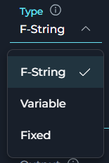

The following table describes the available value types.

| Type | What it does | Use it when |
| --- | --- | --- |
| **F-String** | Uses the text you typed as a template and fills in `{variable_name}` placeholders from state, the same way Python `str.format()` works. | Most of the text is static, but one or more state values must be inserted. Example: `projectelitea.github.io/{repo_name}`. |
| **Variable** | Ignores the text in the field and uses the full value of the single state variable that you name. | The full field content already exists in state and does not need templating. |
| **Fixed** | Uses exactly the text that you typed, with no substitution. | The text does not need to change between runs. |

<Warning title="A missing placeholder doesn't fail the run">
If an F-String references a variable that is not in **Input**, or if the variable is empty, the platform searches the rest of state for it. If it still cannot find a match, the placeholder remains as literal text, such as `{file_path}`, and the node does not fail. Make sure every `{variable}` that you reference is listed in **Input**.
</Warning>

<Tip title="Switching types keeps your text">
Switching between **Fixed** and **F-String** keeps the text that you typed. This is useful when you add or remove `{variable}` placeholders without retyping the rest. Switching to or from **Variable** replaces the field content, because **Variable** does not store free-form text.
</Tip>

---

## Node Panel Buttons

Every node configuration panel footer has the same row of actions. This includes Toolkit nodes, MCP nodes, Code nodes, and all other node types.

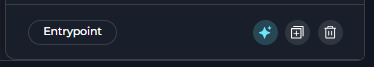

The following table describes the node panel buttons.

| Button | What it does |
| --- | --- |
| **Make Entrypoint** | Set this node as the pipeline entry point. This button appears only when the node is not already the entry point. After you set it, the editor replaces the button with an **Entrypoint** badge. It is not available on Decision nodes or legacy Condition nodes. |
| **Build with AI** | Reserved for a future feature. It is currently always disabled. |
| **Duplicate** | Copy this node as `<name>_copy` or `<name>_copy_2` if that name is already taken. The copy starts disconnected. The editor clears its outgoing connection and routing fields, including `transition`, `routes`, `nodes`, and `default_output`, so you can reconnect it yourself. |
| **Delete** | Remove this node. Any other node reference to it, including `transition`, `default_output`, or a HITL route, is cleared automatically. |

<Note>
**Making a Node the Entry Point**

After a node becomes the pipeline entry point, a **Trigger** field appears at the top of its configuration panel. The **Chat Message** and **Webhook** options control how the pipeline starts. For more information, see [Entry Point](../entry-point).

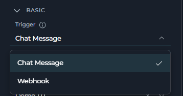

</Note>

---

## Execution Nodes Comparison

The following table compares the three execution nodes.

| | Toolkit Node | MCP Node | Code Node |
| --- | --- | --- | --- |
| **Calls** | One ELITEA toolkit's tool | One MCP server's tool | Custom Python |
| **Tool/parameter selection** | Manual, explicit mapping | Manual, explicit mapping | Written in code |
| **LLM involved** | No | No | No |
| **Structured output** | Supported | Supported | Supported |
| **Flexibility** | Medium — whatever the tool exposes | Medium — whatever the tool exposes | High — full Python |
| **Best for** | A known toolkit call | A known MCP server call | Logic no toolkit or MCP covers |

---

## Deprecated Execution Nodes

The following execution nodes are deprecated and hidden from the node picker. Existing nodes of these types keep working, but build new steps with their replacement instead.

<Accordion title="Function Node">
Superseded by **Toolkit** (for ELITEA toolkits) or **MCP** (for Model Context Protocol servers) — both execute the call directly instead of an LLM choosing the tool and arguments.

**Migration Guide:** [Function Node Migration](../../../migration/v2.0.1/function-node-migration)
</Accordion>

<Accordion title="Tool Node">
Superseded by **Toolkit**, which executes the same call directly with explicit parameter mapping instead of an LLM selecting the tool and generating its parameters from a natural-language task.

**Migration Guide:** [Tool Node Migration](../../../migration/v2.0.1/tool-node-migration)
</Accordion>

<Accordion title="Custom Node">
Hidden from the node picker, with no single replacement and no dedicated migration guide. For new nodes, pick the specific type that matches what you need (**Toolkit**, **MCP**, **LLM**, **Code**, etc.).
</Accordion>

---

<Info title="Related">
- **[Nodes Overview](./overview)** - Understand all available node types
- **[Pipeline States](../states)** - Manage data flow through pipeline state
- **[Node Connectors](../nodes-connectors)** - Link nodes together
- **[YAML Configuration](../yaml)** - Complete node syntax reference
</Info>
