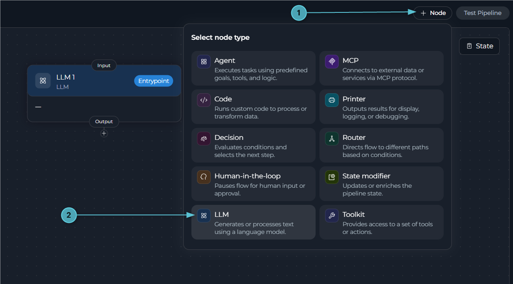
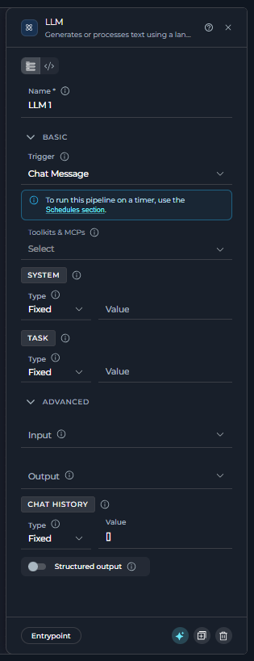
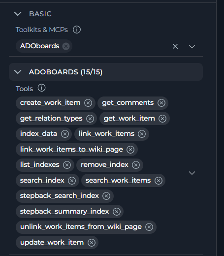
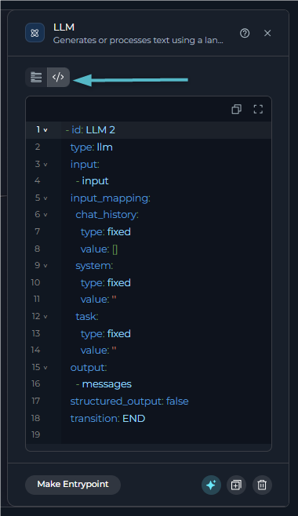
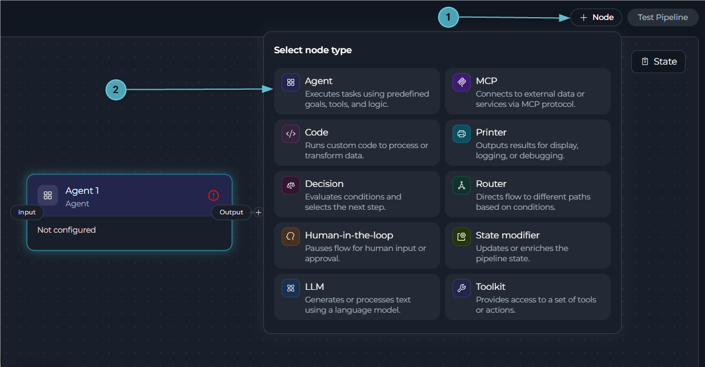
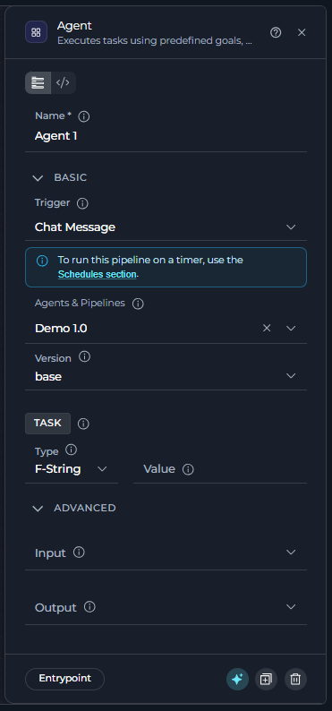
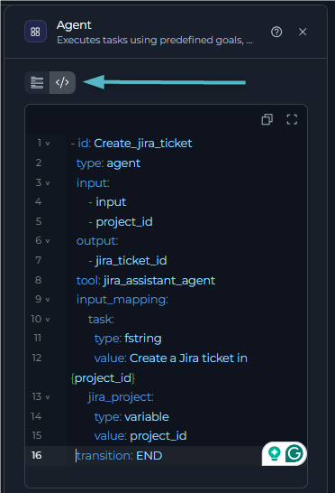
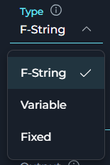
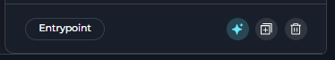
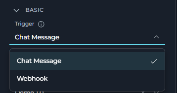

## Overview

There are two interaction nodes. Both read from and write to pipeline state through `input` and `output`. For more information, see [Pipeline States](../states).

<CardGroup cols={2}>
  <Card title="LLM" icon="brain" href="#llm-node">
    Calls a model directly with a prompt that you write.
  </Card>
  <Card title="Agent" icon="user-robot" href="#agent-node">
    Delegates the step to an agent or another pipeline that already exists in the project.
  </Card>
</CardGroup>

---

## LLM Node

The LLM node calls a model directly for text generation, analysis, extraction, or tool calling. It gives you full control over the system prompt, task, and bound tools.



Use the LLM node in these cases:

* You need full control over the system prompt, task, and which specific tools are bound — not an agent's pre-built behavior.
* The interaction is one-off or specific to this pipeline, not something worth reusing elsewhere.
* You want the model to extract structured data straight into state (`structured_output`), rather than free-form text.

### Configuration



The following table describes the LLM node fields.

| Field | Section | Purpose | Example |
| --- | --- | --- | --- |
| **Name** | Panel header | The node `id`. This value is required and unique across the pipeline. If you rename it, the editor updates every reference to this node. | `Analyze_feedback` |
| **Toolkits & MCPs** | Basic | Pick a toolkit or MCP server in the project to bind to this node. Then pick the tools that the model can call. If the toolkit is not already attached to the pipeline, the editor attaches it. | `jira_toolkit` with `create_issue`, `update_issue` |
| **System** | Basic | The system prompt. Choose **Fixed** for static text, **F-String** for `{variable}` placeholders, or **Variable** for a full state variable. This field is required. | Fixed: `You are a helpful assistant` |
| **Task** | Basic | The task or user request sent to the model. It supports the same three types as **System**. This field is required. | F-String: `Analyze {user_context} and extract requirements.` |
| **Input** | Advanced | State variables this node can read. | `input`, `user_context` |
| **Output** | Advanced | State variables that receive the parsed model response, in addition to `messages`. | `extracted_title` |
| **Chat History** | Advanced | The conversation history passed to the model. It supports the same three types as **System** and **Task**. | Variable: `messages` |
| **Structured Output** | Advanced | Turn this option on to parse the response directly into the variables listed in `output`, instead of free-form text. | `true` |

<Info title="Toolkit Selection">
When you select a toolkit or MCP, the editor opens a tool picker for that toolkit. Choose the tools that the model can call. Repeat this step for any other toolkit. Each attached toolkit has its own tool list.


</Info>

<Note>
`messages` is always updated with the exchange, regardless of `output` or `structured_output`. You do not need to add it to `output` for the conversation to continue.
</Note>

<Tip title="AI Assistant">
When **System** or **Task** is set to **Fixed** or **F-String**, the sparkle icon next to the field opens the **AI Assistant**. It drafts or refines the field text from a plain-language instruction. For more information, see [AI Assistant in Pipeline Nodes](../ai-assistant-in-nodes).
</Tip>

### YAML View for LLM Nodes



Every node configuration panel has **Flow view** and **YAML view** tabs at the top. In YAML view, the panel shows only this node, not the whole pipeline, as plain YAML. Changes stay synchronized in both directions. If you edit the `id` here, the editor renames the node everywhere it is referenced. You cannot change `type` in this view.

The following YAML example shows an LLM node.

```yaml
  - id: Analyze_feedback
    type: llm
    input:
      - input
      - user_context
    output:
      - extracted_title
    structured_output: true
    input_mapping:
      system:
        type: fixed
        value: You are a helpful assistant
      task:
        type: fstring
        value: Analyze {user_context} and extract requirements.
      chat_history:
        type: variable
        value: messages
    tool_names:
      jira_toolkit:
        - create_issue
        - update_issue
    transition: END
```

### Best Practices for LLM Nodes

<Accordion title="Match prompt type to the content">
Use **Fixed** for static instructions, **F-String** when you need to interpolate specific state variables, and **Variable** when the whole prompt is itself produced by an earlier node.
</Accordion>

<Accordion title="Add only the tools this step needs">
A long, unrelated tool list makes the model less reliable at picking the right one. Attach the toolkit and select only the specific tools this node should be able to call.
</Accordion>

<Accordion title="Give structured output its own state variables">
When `structured_output` is on, name `output` variables after what you extract, such as `jira_project_id` or `epic_id`, instead of reusing a generic name. This keeps downstream `input` lists self-explanatory.
</Accordion>

<Accordion title="Set Chat History on purpose">
Map `messages` into **Chat History** when conversation context matters. Leave it as a fixed empty value for a single-turn, stateless request.
</Accordion>

### Troubleshooting LLM Nodes

<Accordion title="The model is confused or calls the wrong tool">
Check how many tools are bound. A long, loosely related tool list makes tool selection less reliable. Attach fewer, more specific tools, or split the step across two LLM nodes.
</Accordion>

<Accordion title="Structured output comes back empty or wrong">
Confirm that `structured_output` is enabled and that `output` lists exactly the variables you expect to populate. The declared state types must match what the model is asked to return.
</Accordion>

<Accordion title="System or Task won't save">
Both fields are required. The node will not run without them. Give **System** and **Task** a value, even a short one, before you leave the node.
</Accordion>

---

## Agent Node

The Agent node delegates a step to an agent or another pipeline that already exists in the project. It reuses the prompt, toolkits, and behavior instead of rebuilding them in an LLM node.



Use the Agent node in these cases:

* An existing agent or pipeline already does what this step needs — reuse it instead of recreating its prompt and toolkits in an LLM node.
* You want the same step to stay in sync across multiple pipelines — update the agent once, and every Agent node that delegates to it picks up the change.
* The step is itself a multi-node workflow worth keeping as its own pipeline, called here as one step.
* You need this step to run against a specific, pinned version of an agent or pipeline, independent of that agent's own latest changes.

### Configuration



The following table describes the Agent node fields.

| Field | Section | Purpose | Example |
| --- | --- | --- | --- |
| **Name** | Panel header | The node `id`. This value is required and unique across the pipeline. If you rename it, the editor updates every reference to this node. | `Create_jira_ticket` |
| **Agents & Pipelines** | Basic | Pick an agent or pipeline in the project to handle this step. If it is not yet attached to the pipeline, the editor attaches it. | `jira_assistant_agent` |
| **Version** | Basic | The version of the selected agent or pipeline that runs. This field defaults to **Latest** and appears after you pick an agent or pipeline. | `Latest` |
| **Task** | Basic | The task instruction sent to the agent. Choose **Fixed**, **F-String**, or **Variable**. This field is required. | F-String: `Create a Jira ticket in {project_id}` |
| **Input** | Advanced | State variables this node can read. | `input`, `project_id` |
| **Output** | Advanced | State variables that receive the parsed agent result, in addition to `messages`. | `jira_ticket_id` |
| **Chat History** | Advanced | This field appears for persisted-pipeline compatibility, but it has no effect. The delegated agent or pipeline does not receive this value. | Fixed: `[]` |
| The agent custom variables | Advanced | If the selected agent declares custom variables, each one appears here for mapping. Some may be required, depending on the agent schema. | Variable: `project_id` to `jira_project` |

<Note>
`messages` is always updated with the agent's result, in addition to any custom `output` you configure.
</Note>

<Note title="Required Mappings">
`Task` is always required. If the attached agent marks any custom variables as required, the node canvas card shows "Not configured" and lists the required inputs until you map a value to each one.
</Note>

<Info title="Custom Variable Field Types">
Each agent custom variable renders a control that matches its declared data type. Examples include a dropdown for a fixed set of values, a number field, a checkbox for a Boolean, or a JSON editor for an object or list. Each variable also uses the same **Fixed**, **F-String**, or **Variable** type selector as **Task**.
</Info>

### YAML View for Agent Nodes

Every node configuration panel has **Flow view** and **YAML view** tabs at the top. In YAML view, the panel shows only this node, not the whole pipeline, as plain YAML. Changes stay synchronized in both directions. If you edit the `id` here, the editor renames the node everywhere it is referenced. You cannot change `type` in this view.



<Warning title="Don't retype tool by hand">
The delegated agent is stored in the `tool` field. If you type a different agent name here, the editor does not attach it. You must pick it from **Agents & Pipelines** in Flow view. If you edit `tool` to a name that is not already attached to the pipeline, the node becomes unresolved and shows the same "Agent not found" state as a removed agent.
</Warning>

The following YAML example shows an Agent node.

```yaml
  - id: Create_jira_ticket
    type: agent
    input:
      - input
      - project_id
    output:
      - jira_ticket_id
    tool: jira_assistant_agent
    input_mapping:
      task:
        type: fstring
        value: Create a Jira ticket in {project_id}
      jira_project:
        type: variable
        value: project_id
    transition: END
```

### Best Practices for Agent Nodes

<Accordion title="Write a specific Task">
A clear, specific Task instruction (what to do, with which inputs) gives the delegated agent better context than pointing it at a raw, unprocessed state variable.
</Accordion>

<Accordion title="Map the agent's custom variables deliberately">
If the attached agent declares custom variables, map each one to a specific pipeline state variable instead of leaving defaults. The agent logic depends on these values.
</Accordion>

<Accordion title="Reuse the same agent across pipelines instead of rebuilding its logic">
Use an Agent node for this reuse. Point multiple pipelines to the same agent instead of duplicating its prompt and toolkits in separate LLM nodes.
</Accordion>

<Accordion title="Pin a version deliberately when stability matters">
The version defaults to **Latest**, which tracks the newest changes in the agent or pipeline automatically. Pin a specific version if this pipeline needs that dependency to stay stable across future edits.
</Accordion>

### Troubleshooting Agent Nodes

<Accordion title="&quot;Agent not found&quot; warning">
The agent or pipeline this node pointed to was removed from the project. Open the node and pick a replacement, or delete the node if it's no longer needed.
</Accordion>

<Accordion title="The selected version no longer exists">
The **Version** field shows an error if the pinned version was deleted from the agent or pipeline. Pick another version from the list.
</Accordion>

<Accordion title="A mapped custom variable doesn't seem to do anything">
Confirm that the key you mapped matches a key that the attached agent actually declares. The **Advanced** section lists only the variables exposed by that specific agent schema, so a stale or renamed variable has no effect.
</Accordion>

<Accordion title="Canvas card shows &quot;Not configured&quot;">
`Task`, or one of the required custom variables, is still empty. Open the node and check the field names listed in the card issue text. Fill in each one before you run the pipeline.
</Accordion>

---

## Value Types

Most text fields on these two nodes let you pick how their value is produced. These fields include **System**, **Task**, **Chat History**, and the Agent custom variables. All three value types read only from the variables listed in that node's **Input**.



The following table describes the available value types.

| Type | What it does | Use it when |
| --- | --- | --- |
| **F-String** | Uses the text you typed as a template and fills in `{variable_name}` placeholders from state, the same way Python `str.format()` works. | Most of the text is static, but one or more state values must be inserted. Example: `Analyze {user_context} and extract requirements.` |
| **Variable** | Ignores the text in the field and uses the full value of the single state variable that you name. | The full field content already exists in state and does not need templating. |
| **Fixed** | Uses exactly the text that you typed, with no substitution. | The text does not need to change between runs. |

<Warning title="A missing placeholder doesn't fail the run">
If an F-String references a variable that is not in **Input**, or if the variable is empty, the platform searches the rest of state for it. If it still cannot find a match, the placeholder remains as literal text, such as `{user_context}`, and the node does not fail. Make sure every `{variable}` that you reference is listed in **Input**.
</Warning>

<Tip title="Switching types keeps your text">
Switching between **Fixed** and **F-String** keeps the text that you typed. This is useful when you add or remove `{variable}` placeholders without retyping the rest. Switching to or from **Variable** replaces the field content, because **Variable** does not store free-form text.
</Tip>

---

## Node Panel Buttons

Every node configuration panel footer has the same row of actions. This includes LLM nodes, Agent nodes, and all other node types.



The following table describes the node panel buttons.

| Button | What it does |
| --- | --- |
| **Make Entrypoint** | Set this node as the pipeline entry point. This button appears only when the node is not already the entry point. After you set it, the editor replaces the button with an **Entrypoint** badge. It is not available on Decision nodes or legacy Condition nodes. |
| **Build with AI** | Reserved for a future feature. It is currently always disabled. |
| **Duplicate** | Copy this node as `<name>_copy` or `<name>_copy_2` if that name is already taken. The copy starts disconnected. The editor clears its outgoing connection and routing fields, including `transition`, `routes`, `nodes`, and `default_output`, so you can reconnect it yourself. |
| **Delete** | Remove this node. Any other node reference to it, including `transition`, `default_output`, or a HITL route, is cleared automatically. |

<Note>
**Making a Node the Entry Point**

After a node becomes the pipeline entry point, a **Trigger** field appears at the top of its configuration panel. The **Chat Message** and **Webhook** options control how the pipeline starts. For more information, see [Entry Point](../entry-point).



</Note>

## LLM vs. Agent

The following table compares the LLM node and the Agent node.

| | LLM Node | Agent Node |
| --- | --- | --- |
| **Prompt** | You write **System** and **Task** in the node | Inherited from the agent. Only **Task** is mapped per use |
| **Toolkits** | You pick toolkits/MCPs and tools per node | Pre-configured on the agent itself |
| **Reusability** | Configuration lives in this node only | The same agent can be reused across many pipelines |
| **Chat History** | Actually used by the model | Accepted but has no effect on the delegated agent |
| **Best for** | A custom, one-off interaction with full control | Reusing an agent or another pipeline existing behavior |

---

<Info>
**See Also**

- **[Nodes Overview](./overview)** - Understand all available node types
- **[Pipeline States](../states)** - Manage data flow through pipeline state
- **[Node Connectors](../nodes-connectors)** - Link nodes together
- **[AI Assistant in Pipeline Nodes](../ai-assistant-in-nodes)** - Draft or refine System/Task content with AI
- **[YAML Configuration](../yaml)** - Complete node syntax reference
</Info>
