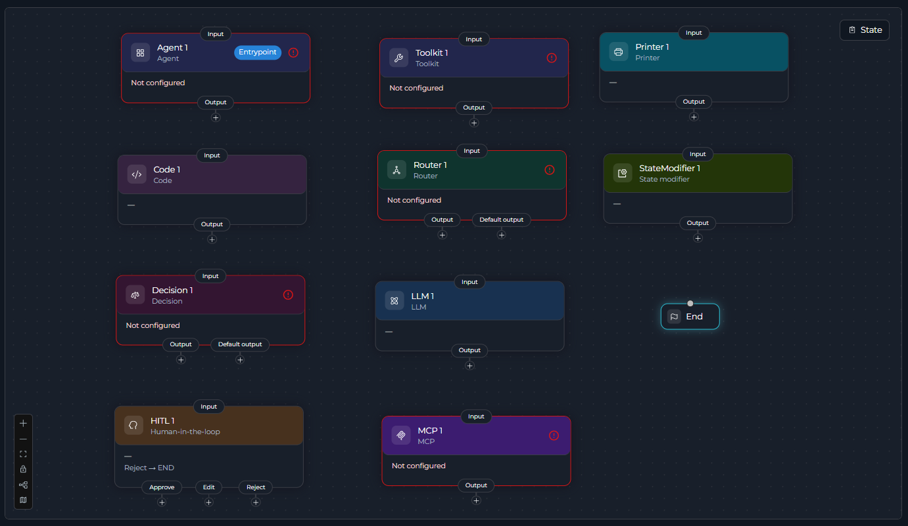

## Overview

Every node reads from pipeline state as `input`, does its one job, and writes the result back to state as `output`. Connecting nodes together is how a pipeline moves from one step to the next — see **[Pipeline States](../states)** for how data flows between nodes, and **[Node Connectors](../nodes-connectors)** for how the connections themselves work.

<Tip>
State is shared. Data written by one node is immediately available to every node after it — there's no need to pass it along explicitly.
</Tip>

---

## Common Attributes

Every node has an `id` (unique within the pipeline) and a `type`. Everything else depends on the node:

* **`input`** / **`output`** — most node types read and write state through these two fields; see each type's own guide for its exact shape. A few types don't have both: Router and Decision read `input` but route instead of writing `output`; HITL optionally reads `input` (for an f-string message) and writes through `edit_state_key` instead of `output`; Printer has neither.
* **`transition`** — the single next node ID, used by every type *except* Router, Decision, and HITL, which choose their next node through a routing field instead (`routes`/`default_output`, `nodes`/`default_output`, or `routes.approve/edit/reject`, respectively). A node never has both `transition` and a routing field.

<Info>
For LLM and Agent nodes, state's `messages` is always updated with the exchange, in addition to any custom `output` you configure — so you don't need to add `messages` to `output` yourself for that to happen. Toolkit, MCP, and Code nodes have no such default: without an `output`, their result isn't stored anywhere.
</Info>

---

## Node Types

ELITEA Pipelines currently have **9 node types**, grouped into 4 categories.

### Interaction

<CardGroup cols={2}>
  <Card title="LLM" icon="brain" href="./interaction-nodes#llm-node">
    Call a model directly — generate text, analyze content, extract structured data, or bind tools for function calling.
  </Card>
  <Card title="Agent" icon="user-robot" href="./interaction-nodes#agent-node">
    Delegate the step to a pre-built, specialized agent and use its result.
  </Card>
</CardGroup>

### Execution

<CardGroup cols={2}>
  <Card title="Toolkit" icon="screwdriver-wrench" href="./execution-nodes#toolkit-node">
    Call an ELITEA toolkit function directly, with explicit parameter mapping — no LLM in the loop.
  </Card>
  <Card title="MCP" icon="plug" href="./execution-nodes#mcp-node">
    Call a tool on a Model Context Protocol server.
  </Card>
  <Card title="Code" icon="code" href="./execution-nodes#code-node">
    Run custom Python in a sandbox for logic no toolkit or MCP covers.
  </Card>
</CardGroup>

### Control Flow

<CardGroup cols={2}>
  <Card title="Router" icon="code-branch" href="./control-flow-nodes#router-node">
    Branch to one of several named paths by evaluating a Jinja2 condition against state.
  </Card>
  <Card title="Decision" icon="brain" href="./control-flow-nodes#decision-node">
    Let an LLM pick the next node from a list, based on natural-language routing criteria.
  </Card>
  <Card title="Human-in-the-Loop" icon="user-check" href="./control-flow-nodes#human-in-the-loop-node">
    Pause and let a person Approve, Edit, or Reject before the pipeline continues.
  </Card>
</CardGroup>

### Utility

<CardGroup cols={2}>
  <Card title="State Modifier" icon="wand-magic-sparkles" href="./utility-nodes#state-modifier-node">
    Transform, combine, or clear state variables with a Jinja2 template.
  </Card>
  <Card title="Printer" icon="comment-dots" href="./utility-nodes#printer-node">
    Show the user a formatted message mid-run and wait for their acknowledgment.
  </Card>
</CardGroup>

<Note>
A Printer node always pauses for the user to acknowledge it, independent of any `interrupt_before` / `interrupt_after` configuration — see **[Entry Point](../entry-point)** for how that affects available triggers.
</Note>

### END

`END` terminates a path — it isn't one of the 9 types above and isn't added from the node picker. It appears automatically once your pipeline has its first node, and every branch must eventually reach it, directly (`transition: END`) or through a Router/Decision/HITL route.

---

## Deprecated Nodes

These node types are hidden from the node picker. Existing nodes of these types keep working — there's no removal deadline — but build new steps with their replacement instead.

| Deprecated Node | Superseded By | Migration Guide |
|------------------|----------------|------------------|
| **Condition** | **Router** (expression-based routing) or **Decision** (AI-powered routing) | [Condition Node Migration](../../../migration/v2.0.1/condition-node-migration) |
| **Function** | **Toolkit** (ELITEA toolkits), **MCP** (Model Context Protocol servers), or **Agent** (delegate to an AI agent) | [Function Node Migration](../../../migration/v2.0.1/function-node-migration) |
| **Tool** | **Toolkit** — executes the same call directly with explicit parameter mapping instead of an LLM choosing the tool and its arguments | [Tool Node Migration](../../../migration/v2.0.1/tool-node-migration) |
| **Loop** | A **[Router node looping back on itself](./iteration-nodes#router-node-for-loops)**, with state variables controlling iteration | [Loop Node Migration](../../../migration/v2.0.1/loop-node-migration) |
| **Loop from Tool** | The same **[Router-based looping pattern](./iteration-nodes#router-node-for-loops)** as the Loop node | [Loop Node Migration](../../../migration/v2.0.1/loop-node-migration) |
| **Pipeline (Subgraph)** | **Agent** — delegates to a specialized agent in place of a nested pipeline | [Pipeline Node Migration](../../../migration/v2.0.1/pipeline-node-migration) |
| **Custom** | No single replacement — pick the specific type that matches what you need (**Toolkit**, **MCP**, **LLM**, **Code**, etc.) |  |

---

<Info title="Related Documentation">
- **[Pipeline States](../states)** - How nodes read from and write to state
- **[Node Connectors](../nodes-connectors)** - How nodes link together
- **[Entry Point](../entry-point)** - Where a pipeline begins, and its trigger
- **[Flow Editor](../flow-editor)** - Build pipelines visually
- **[YAML Configuration](../yaml)** - Complete node definition syntax
</Info>
