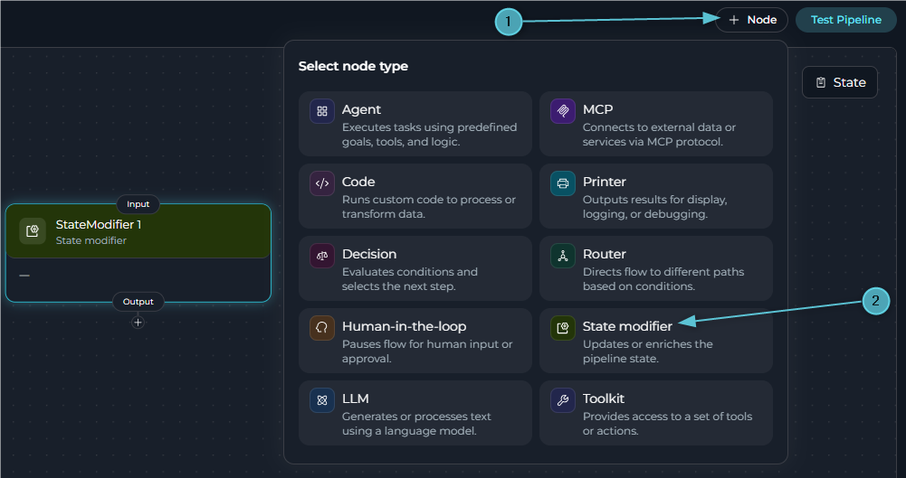
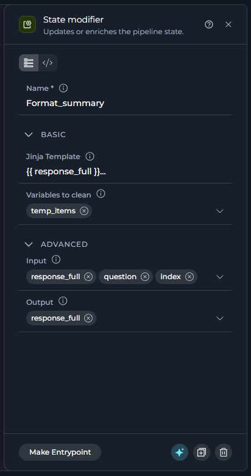
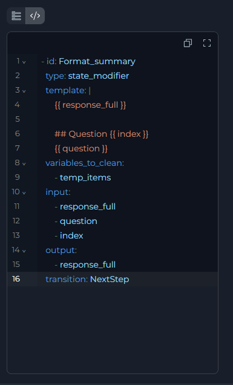
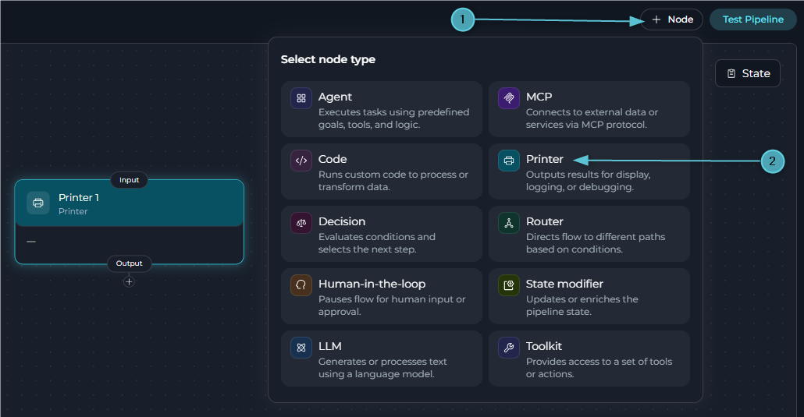
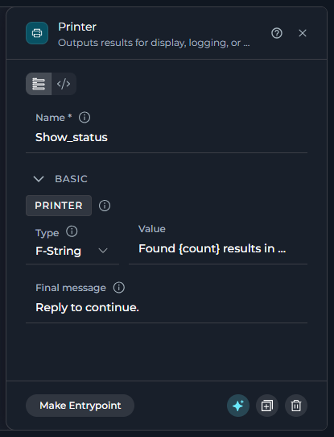
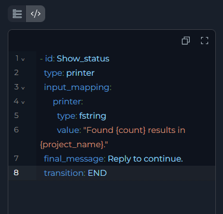
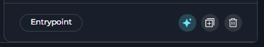
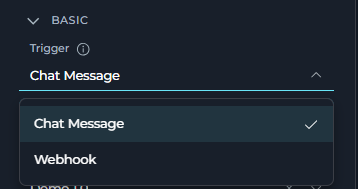

## Overview

There are two utility nodes. Neither calls a model or an external tool.

<CardGroup cols={2}>
  <Card title="State Modifier" icon="wand-magic-sparkles" href="#state-modifier-node">
    Renders a Jinja2 template against state and writes the result back, optionally clearing other variables.
  </Card>
  <Card title="Printer" icon="comment-dots" href="#printer-node">
    Shows the user a message mid-run and pauses until they acknowledge it.
  </Card>
</CardGroup>

---

## State Modifier Node

The State Modifier node renders a Jinja2 template against pipeline state and writes the rendered result into a state variable. It runs no model and calls no tool — it only transforms data that is already in state.



Use the State Modifier node in these cases:

* You need to combine several state variables into one formatted string, such as a report or a message.
* A value needs reformatting — case conversion, trimming, extracting part of a string, parsing JSON — before another node reads it.
* You need to reset one or more state variables to empty once their value is no longer needed.

### Configuration



The following table describes the State Modifier node fields.

| Field | Section | Purpose | Example |
| --- | --- | --- | --- |
| **Name** | Panel header | The node `id`. This value is required and unique across the pipeline. If you rename it, the editor updates every reference to this node. | `Format_summary` |
| **Jinja Template** | Basic | The Jinja2 template. There is no Fixed/F-String/Variable selector here — this field is always a raw template, rendered with every state variable listed in **Input** available by name. | `Hello, {{ user_name }}! Score: {{ score + 10 }}` |
| **Variables to Clean** | Basic | Pick state variables to reset to empty once the template renders. A list resets to `[]`, a dict to `{}`, a number to `0`, a string to `""`. | `temp_items`, `cache_data` |
| **Input** | Advanced | State variables the template can reference by name. A variable not listed here is not available inside the template. | `user_name`, `score` |
| **Output** | Advanced | The single state variable that receives the rendered result. Only the first variable listed is used. | `greeting_message` |

<Info title="Output Type Conversion">
If **Output** already has a declared type in `state` — `int`, `float`, `bool`, `list`, or `dict` — the node converts the rendered string to that type before writing it. A template that renders `"1"` into an `int` output produces the integer `1`, not the string `"1"`. If the conversion fails, the node falls back to writing the raw rendered string.
</Info>

<Warning title="Only Input variables are visible to the template">
Referencing a variable in the template that isn't listed in **Input** renders as empty rather than its actual value. Keep **Input** in sync with every `{{ variable }}` your template uses.
</Warning>

### YAML View for State Modifier Nodes



Every node configuration panel has **Flow view** and **YAML view** tabs at the top. In YAML view, the panel shows only this node, not the whole pipeline, as plain YAML. Changes stay synchronized in both directions. If you edit the `id` here, the editor renames the node everywhere it is referenced. You cannot change `type` in this view.

The following YAML example shows a State Modifier node.

```yaml
  - id: Format_summary
    type: state_modifier
    template: |
      {{ response_full }}

      ## Question {{ index }}
      {{ question }}
    variables_to_clean:
      - temp_items
    input:
      - response_full
      - question
      - index
    output:
      - response_full
    transition: NextStep
```

### Template Filters

Beyond standard Jinja2 filters (`|upper`, `|lower`, `|length`, `|default('value')`, `|trim`), the template supports four custom filters.

| Filter | Purpose | Example |
| --- | --- | --- |
| **`from_json`** | Parses a JSON string into an object you can access with dot notation. | `{{ (api_response\|from_json).status }}` |
| **`base64_to_string`** | Decodes a base64-encoded string. | `{{ encoded_value\|base64_to_string }}` |
| **`split_by_words(n)`** | Splits text into chunks of `n` words each, returned as a list. | `{{ long_text\|split_by_words(50) }}` |
| **`split_by_regex(pattern)`** | Splits text using a regex pattern, returned as a list. | `{{ raw_text\|split_by_regex(',\\s*') }}` |

### Best Practices for State Modifier Nodes

<Accordion title="List every variable the template uses">
A variable missing from **Input** renders as empty, not as an error. Double-check **Input** whenever you add a new `{{ variable }}` to the template.
</Accordion>

<Accordion title="Trust the automatic type conversion">
When **Output** already has a declared type other than string, don't manually cast inside the template — the node converts the rendered text to match. Write the template to produce readable text; let the node handle the type.
</Accordion>

<Accordion title="Clean up right after you no longer need a value">
Reset short-lived variables with **Variables to Clean** as soon as the template that consumes them has run, instead of leaving stale values for a later node or loop iteration to accidentally read.
</Accordion>

<Accordion title="Use a State Modifier instead of repeating a format in several prompts">
If more than one LLM or Agent node needs the same formatted string, render it once here into its own state variable and reference that variable everywhere else.
</Accordion>

---

## Printer Node

The Printer node shows the user a message mid-run and pauses the pipeline until they acknowledge it. It calls no model and has no `output` — its only job is to display something and wait.



Use the Printer node in these cases:

* You want to show the user a progress update, a status, or a completed result partway through a multi-step pipeline.
* You need the run to pause at a specific point so the user can read something before the pipeline continues.

### Configuration



The following table describes the Printer node fields.

| Field | Section | Purpose | Example |
| --- | --- | --- | --- |
| **Name** | Panel header | The node `id`. This value is required and unique across the pipeline. If you rename it, the editor updates every reference to this node. | `Show_status` |
| **Printer** | Basic | The message shown to the user. Choose **Fixed** for static text, **F-String** for `{variable}` placeholders, or **Variable** for a full state variable. This is the only input field, and it is required — YAML calls it `input_mapping.printer`. | F-String: `Found {count} results.` |
| **Final message** | Basic | Optional note appended after the printer content. Defaults to *"How to proceed? To resume the pipeline - type anything…"* if left empty. | `Reply to continue.` |

<Note>
The Printer node has no **Input**/**Output** selectors. It reads whichever state variables you reference inside **Printer**'s F-String or Variable value, and writes nothing back to state.
</Note>

<Warning title="Printer requires its one field">
If **Printer** has no value, the node raises an error when the pipeline runs. There's no way to configure a Printer node with an empty message.
</Warning>

### YAML View for Printer Nodes



Every node configuration panel has **Flow view** and **YAML view** tabs at the top. In YAML view, the panel shows only this node, not the whole pipeline, as plain YAML. Changes stay synchronized in both directions. If you edit the `id` here, the editor renames the node everywhere it is referenced. You cannot change `type` in this view.

The following YAML example shows a Printer node.

```yaml
  - id: Show_status
    type: printer
    input_mapping:
      printer:
        type: fstring
        value: "Found {count} results in {project_name}."
    final_message: Reply to continue.
    transition: END
```

<Info title="Automatic Pause">
A Printer node always pauses for the user to acknowledge it, regardless of the pipeline's `interrupt_before`/`interrupt_after` configuration — see **[Entry Point](../entry-point)** for how that affects available triggers. The pipeline resumes once the user sends any reply.
</Info>

### Best Practices for Printer Nodes

<Accordion title="Match the type to what you're showing">
Use **Fixed** for a message that never changes, **F-String** to weave one or more state values into surrounding text, and **Variable** to show a single variable's full value with no extra text around it.
</Accordion>

<Accordion title="Give Final message a reason to continue">
The default final message is generic. A specific one — "Reply 'approve' to continue" — tells the user exactly what unblocks the pipeline.
</Accordion>

<Accordion title="Keep the printed content short">
Printer joins any list value into a comma-separated string before displaying it. For a long report, format it first with a State Modifier node, then show the result here.
</Accordion>

---

## Value Types

**Printer** uses the same Fixed/F-String/Variable selector as LLM, Agent, and other node fields. **Jinja Template** on the State Modifier node does not use this selector — it is always a raw Jinja2 template evaluated against **Input**.

| Type | What it does | Use it when |
| --- | --- | --- |
| **F-String** | Uses the text you typed as a template and fills in `{variable_name}` placeholders from state, the same way Python `str.format()` works. | Most of the text is static, but one or more state values must be inserted. |
| **Variable** | Ignores the text in the field and uses the full value of the single state variable that you name. | The full field content already exists in state and does not need templating. |
| **Fixed** | Uses exactly the text that you typed, with no substitution. | The text does not need to change between runs. |

---

## Node Panel Buttons

Every node configuration panel footer has the same row of actions. This includes State Modifier nodes, Printer nodes, and all other node types.



The following table describes the node panel buttons.

| Button | What it does |
| --- | --- |
| **Make Entrypoint** | Set this node as the pipeline entry point. This button appears only when the node is not already the entry point. After you set it, the editor replaces the button with an **Entrypoint** badge. State Modifier and Printer nodes can both be the entry point. |
| **Build with AI** | Reserved for a future feature. It is currently always disabled. |
| **Duplicate** | Copy this node as `<name>_copy` or `<name>_copy_2` if that name is already taken. The copy starts disconnected. The editor clears its outgoing connection and routing fields so you can reconnect it yourself. |
| **Delete** | Remove this node. Any other node reference to it, including `transition`, is cleared automatically. |

<Note>
**Making a Node the Entry Point**

After a node becomes the pipeline entry point, a **Trigger** field appears at the top of its configuration panel. The **Chat Message** and **Webhook** options control how the pipeline starts. For more information, see [Entry Point](../entry-point).


</Note>

---

## State Modifier vs. Printer

The following table compares the two utility nodes.

| | State Modifier Node | Printer Node |
| --- | --- | --- |
| **Purpose** | Transform state data | Show a message and pause |
| **Reads state** | Through `input` | Through the F-String/Variable value in `input_mapping.printer` |
| **Writes state** | Through `output` | No — `output` doesn't exist on this node |
| **Pauses the run** | No | Always |
| **Routing** | `transition` | `transition` |

---

## Deprecated Utility Nodes

The following utility node is deprecated and hidden from the node picker. Existing nodes of this type keep working, but build new steps with their replacement instead.

<Accordion title="Pipeline (Subgraph) Node">
Superseded by **Agent**, which delegates to a specialized agent or another pipeline in place of a nested pipeline.

**Migration Guide:** [Pipeline Node Migration](../../../migration/v2.0.1/pipeline-node-migration)
</Accordion>

---

<Info title="Related">
- **[Nodes Overview](./overview)** - Understand all available node types
- **[Pipeline States](../states)** - Manage data flow through pipeline state
- **[Node Connectors](../nodes-connectors)** - Link nodes together
- **[YAML Configuration](../yaml)** - Complete node syntax reference
</Info>
