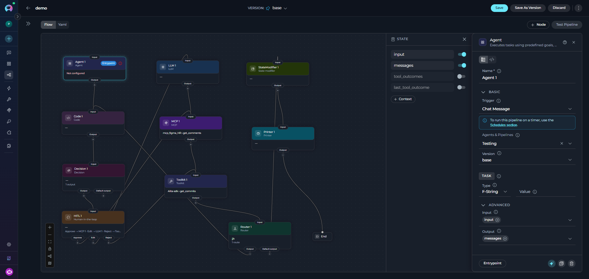

## What are ELITEA Pipelines?

ELITEA Pipelines are customizable, automated workflows that help you streamline repetitive tasks and complex processes. Think of a pipeline as a **step-by-step recipe** that guides the system through a series of actions to achieve a specific goal.

Unlike traditional automation tools that require programming knowledge, ELITEA Pipelines can be created visually using a drag-and-drop interface, making powerful automation accessible to everyone—from business analysts to project managers.

### Key Characteristics

<CardGroup cols={2}>
  <Card title="Visual Design" icon="diagram-project">
    Create workflows by connecting nodes in a flow diagram—no coding required. The Flow Editor provides an intuitive interface for designing even the most complex processes.
  </Card>
  <Card title="Flexible Automation" icon="arrows-split-up-and-left">
    Handle everything from simple linear tasks to sophisticated multi-step processes with conditional logic, loops, and integrations with external tools.
  </Card>
  <Card title="Smart Integration" icon="plug">
    Connect seamlessly with toolkits, external services like Jira, GitHub, Confluence, and use AI agents to enhance your workflows.
  </Card>
  <Card title="Data-Driven" icon="database">
    Pipelines maintain their own memory (called "state") to track information as they execute, ensuring data flows smoothly between steps.
  </Card>
</CardGroup>

## How Do Pipelines Work?

A pipeline operates by executing a sequence of **nodes**, where each node represents a specific action or decision. Here's how it works:

1. **Start at the Entry Point**: Every pipeline begins at a designated starting node
2. **Execute Nodes Sequentially**: The pipeline moves from one node to the next, performing actions and making decisions
3. **Manage State**: Information collected during execution is stored in the pipeline's state and can be used in subsequent steps
4. **Follow Connections**: Nodes are linked together, with the pipeline following these connections based on conditions or simple transitions
5. **Complete or Loop**: The pipeline ends when it reaches an END transition or continues looping based on your design

## Real-World Use Cases

Pipelines excel at automating workflows that involve multiple steps, decisions, and integrations:

| Use Case | What It Does |
|----------|--------------|
| **User Story Creation** | Gathers requirements via chat, pulls context from Confluence, drafts acceptance criteria with AI, gets user approval, then creates the formatted story in Jira |
| **Manual Test Case Generation** | Analyzes requirements, generates step-by-step test scenarios with expected results, and files them in TestRail or Jira, linked back to the source requirement |
| **Code Documentation** | Analyzes a code repository and generates comprehensive documentation automatically |
| **Data Processing** | Extracts, transforms, and loads data from multiple sources with validation and error handling |
| **Approval Workflows** | Routes requests through multiple approvers with conditional logic based on criteria |
| **Report Generation** | Collects data from various systems, analyzes it, and produces formatted reports |
| **Scheduled Automation** | Runs on a recurring schedule (e.g. daily, weekly) with no user triggering it—such as syncing data, sending digest reports, or running routine maintenance tasks |

## Pipelines vs Agents: When to Use Which?

Both Pipelines and Agents are powerful automation tools in ELITEA, but they serve different purposes:

| ✔️ Use Pipelines When | ✔️ Use Agents When |
|------------------------|----------------------|
| **Structured Workflows**: You have a clear, defined sequence of steps that need to happen in order | **Conversational Interactions**: You want a more free-form, chat-based interaction with users |
| **Multiple Integrations**: Your workflow requires connecting to several external tools or services (Jira, GitHub, Confluence, etc.) | **Single-Purpose Tasks**: The task is focused and doesn't require complex branching or orchestration |
| **Conditional Logic**: You need to make decisions and branch the workflow based on specific conditions | **Exploratory Work**: Users need to ask questions and explore information dynamically |
| **Data Processing**: You're handling data transformation, validation, or aggregation across multiple steps | **Simple Automation**: The workflow is straightforward without complex conditional logic |
| **Orchestration**: You need to coordinate multiple agents, tools, or sub-processes as part of a larger workflow | |

<Tip title="Combining Both">
Pipelines can include Agents as nodes! Use Agents for specific tasks within a larger Pipeline workflow to get the best of both approaches.
</Tip>

## Pipeline Building Blocks

Understanding pipelines requires familiarity with their core components. Each building block serves a specific purpose in creating effective workflows:

| Building Block | Description | Purpose | Key Topics |
|----------------|-------------|---------|------------|
| **[States](./states)** | Pipeline's memory system for storing and managing data | Track information collected during execution and pass data between nodes | State variables, data types, input vs messages, state initialization |
| **[Nodes](./nodes/overview)** | Individual actions or steps in your pipeline workflow | Perform specific tasks like interacting with users, calling services, making decisions, or processing data | 10 different node types organized into 4 categories (Interaction, Execution, Control Flow, Utility) |
| **[Connections](./nodes-connectors)** | Links between nodes that control execution flow | Define how the pipeline moves from one step to the next, including conditional branching | Simple transitions, conditional edges, decision edges, router outputs, data mapping |
| **[Entry Point](./entry-point)** | Designated starting node of your pipeline | Define where execution begins when the pipeline is triggered | Entry point syntax, validation rules, using different node types as starting points |
| **[Flow Editor](./flow-editor)** | Visual interface for designing pipelines graphically | Build complex workflows using drag-and-drop without writing code | Creating nodes visually, connecting nodes, configuring parameters, debugging |
| **[YAML Configuration](./yaml)** | Text-based format for defining pipelines programmatically | Enable advanced customization, version control, and programmatic pipeline generation | YAML schema, syntax rules, node configuration, complete examples |

---

## Where to Go Next

Explore the building blocks in this order:

1. **[States](./states)** - Understand how pipelines store and manage data
2. **[Nodes](./nodes/overview)** - Learn about the different actions and components available
3. **[Connections](./nodes-connectors)** - Discover how to control the flow between nodes
4. **[Entry Point](./entry-point)** - Define where your pipeline begins
5. **Choose your interface**: [Flow Editor](./flow-editor) for visual design, or [YAML Configuration](./yaml) for programmatic control

