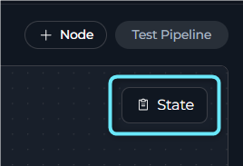
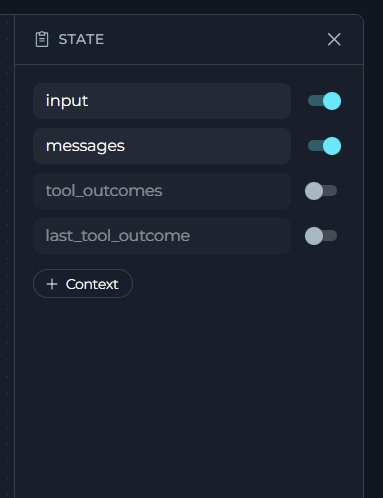
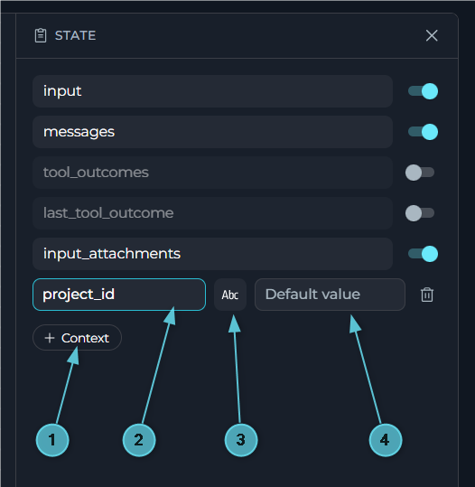
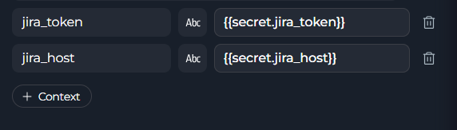
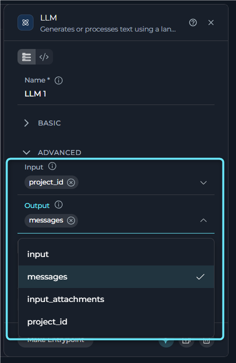
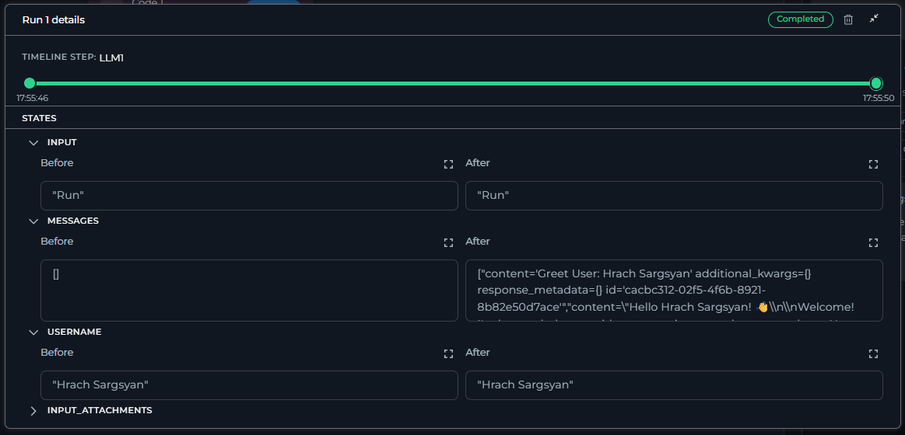

## Overview

Any node can read a state variable as `input` and write to it as `output`. This is how data moves from one node to the next. Examples include extracted values, tool results, counters, and any other data that must remain available after a node finishes.

<Info>
**Default State Variables**

Every pipeline includes built-in state variables. Most are **off by default** in a new pipeline. Add them to `state` or turn them on in the sidebar before a node uses them.

* `input`: The most recent message from the user
* `messages`: The complete conversation history
* `tool_outcomes`: One entry for each Toolkit or MCP node that ran in the current turn, keyed by node ID
* `last_tool_outcome`: The most recently written tool outcome
* `input_attachments`: Added and removed automatically when file attachments are enabled or disabled

If you block a sensitive tool call, the pipeline does not populate `tool_outcomes` or `last_tool_outcome`. The pipeline stops with a message.
</Info>

<Tip>
Use `input` for the current message only. Use `messages` when prior turns matter. Use both when you need both sources.
</Tip>

---

## Managing State

Manage state in the **State** sidebar in Flow mode or under `state:` in YAML. Both views edit the same data, so a state that you add in one view appears in the other immediately.

1. Click the **State** button in the top-right corner of the canvas to open the sidebar.

    

2. The sidebar lists every state variable in the pipeline. `input` and `messages` appear first, each with an enable or disable toggle. `tool_outcomes` and `last_tool_outcome` appear next. Any custom states that you add appear after them.

    

3. Click **+ Context** to add a custom variable.
4. Type a **name** for the variable.
5. Pick its **type**: String, Number, List, or Json.
6. Optionally set a **default value**.

  

    

<Note>
There is no separate save step for state changes. When you add, rename, change the type of, or delete a variable, the pipeline YAML updates immediately.
</Note>

<Info title="Naming Rules">
The editor validates state names as you type. Use letters, numbers, and underscores only. A name must start with a letter and cannot duplicate an existing name.

Valid examples: `user_story_title`, `jiraProjectId`, `epic_id_123`

Invalid examples: `user-story-title` (hyphen), `123_epic` (starts with a number), `epic id` (space)
</Info>

---

## State Variable Types

The following table lists the available state variable types.

| Type | YAML key | Empty default | Typical use |
| --- | --- | --- | --- |
| **String** | `str` | `""` | Titles, descriptions, status text |
| **Number** | `number` | `0` | Counters, scores, IDs |
| **List** | `list` | `[]` | Search results, batch items, file listings |
| **Json** | `dict` | `{}` | API responses, structured metadata |

The following YAML example shows these types.

```yaml
state:
  jira_project_id:
    type: str
    value: ''
  epic_id:
    type: number
    value: 0
  file_listing:
    type: list
    value: []
  api_response:
    type: dict
    value: {}
```

<Warning>
`messages` is a list of LangChain message objects, not plain strings. Do not write to it as if it were an ordinary `list` state.
</Warning>

<Note>
Older pipelines may use the short form `variable_name: type` with no `value`, or the legacy `int` type. The editor reads both formats correctly on import. The sidebar always writes new numeric states as `number`.
</Note>

---

## Defaulting a State to a Project Secret

A state's default `value` can reference a project secret instead of holding a literal value. Set it to `{{secret.secret_name}}`, where `secret_name` is the **Name** of an existing secret under **Settings → Secrets** in the same project:

 

```yaml
state:
  api_token:
    type: str
    value: "{{secret.jira_token}}"
  api_base_url:
    type: str
    value: "https://{{secret.jira_host}}.example.com"
```

The platform resolves `{{secret.*}}` references against the project's secret store right before the pipeline run starts, replacing the placeholder with the secret's actual value — the reference can be the whole value or embedded inside a longer string. This saves you from hardcoding a credential in the pipeline's YAML or re-entering it in every pipeline that needs it; see **[Secrets](../../menus/settings/secrets)** for how to create and manage project secrets.

<Warning>
This only moves *where* the credential is typed in, not how it's handled once the pipeline runs. The resolved value is ordinary state data from that point on: it is sent to any node that reads it, and, if you open the **Run Details** dialog on a test run, it appears in plain text in that variable's Before/After value — see [Using State in Nodes](#using-state-in-nodes) below. Treat a state holding a resolved secret the same as any other sensitive value in your pipeline.
</Warning>

---

## Using State in Nodes

Most node types have **Input** and **Output** fields in their configuration panel. These multi-select dropdowns list every state variable that is currently defined in the pipeline. In **Input**, select the variables that a node should read. In **Output**, select the variables that a node should write.

   

Every node that uses state does so through the same two fields:

* `input`: The state variables the node is allowed to read
* `output`: The state variables that receive the node result

How a node produces that result depends on the node type.

* LLM, Agent, Toolkit, MCP, and Loop nodes map their result directly into `output`.
* State Modifier nodes render a Jinja2 `template` against `input` and write the resulting string to `output`. They can also clear other variables through `variables_to_clean`.
* Code nodes read state through the `alita_state` dictionary and write state by returning a matching dictionary.
* Toolkit and MCP nodes also write a typed result into `tool_outcomes` and `last_tool_outcome` automatically, in addition to any `output` mapping.

The following example shows a Code node that reads and writes state.

```yaml
- id: process_data
  type: code
  code:
    type: fixed
    value: |
      raw_data = alita_state.get('raw_data', [])
      processed = [item.upper() for item in raw_data]
      {"processed_data": processed, "status": "completed"}
  input:
    - raw_data
  output:
    - processed_data
    - status
  structured_output: true
```

While you test a pipeline, open the **Run Details** dialog to see the actual state values at each step.

* The **States** section lists every state variable as an expandable accordion.
* Each accordion shows the **Before** and **After** value of that variable for the selected step in the timeline.
* The full-screen view button opens a longer value, such as a list, JSON object, or long string, for closer inspection.

   

This is the fastest way to confirm what a node read and wrote without adding an `interrupt_before` or `interrupt_after` pause.


---

## Best Practices

<Accordion title="Give States Descriptive Names">
`jira_project_id` and `extracted_requirements` are easy to trace to their origin. `data`, `temp`, and `x` are not.
</Accordion>

<Accordion title="Initialize States That Other Nodes Depend On">
If a downstream node reads a variable before any node writes to it, define a default value in `state`. Otherwise, the read returns nothing.
</Accordion>

<Accordion title="Keep State Minimal">
Only add the variables a pipeline actually needs. Unused state adds clutter and makes debugging the data flow harder.
</Accordion>

<Accordion title="Branch on `last_tool_outcome`, Not on Message Text">
`last_tool_outcome.status` and `.error_class` are stable. Prose wording in `message` can change between tool versions.
</Accordion>

<Accordion title="Reuse Formatting with a State Modifier Instead of Repeating It">
If more than one prompt needs the same variable formatting, format it once into a new state variable with a State Modifier node. Then reference that variable everywhere else.
</Accordion>

<Accordion title="Clean Up State You No Longer Need">
Use a State Modifier node's `variables_to_clean` to reset variables after they are consumed. This prevents later nodes or loop iterations from reading a stale value.
</Accordion>

<Accordion title="Debug with Run Details, Not Interrupts">
Use the **Run Details** dialog in a test run to inspect state instead of adding an `interrupt_before` or `interrupt_after` pause. Reserve interrupts for pausing a live run for approval.
</Accordion>

---

## Troubleshooting

<Accordion title="A node fails because a state variable doesn't exist">
Confirm that the variable is defined in `state` or enabled in the sidebar for `input` and `messages`. Confirm that a prior node writes to it through `output` and that the variable has a default value. In Code nodes, guard the read with `alita_state.get('var', default_value)`.
</Accordion>

<Accordion title="A node receives the wrong type (e.g. a string instead of a list)">
Check that the declared state type matches the value written to it and that the writing node's `output` configuration is correct. Use a State Modifier node to convert types if needed.
</Accordion>

<Accordion title="Conversation history is lost between nodes">
Make sure `messages` is in `state` and enabled in the sidebar. Also make sure every node that should see or extend the conversation includes `messages` in both `input` and `output`.
</Accordion>

<Accordion title="A default value isn't being applied">
Verify that the default syntax matches the state type. Use valid JSON for List and Json. Also verify that no earlier node overwrites the value with an empty value before a node reads it.
</Accordion>

---

## See Also

For more information, see [Nodes Overview](./nodes/overview).

For more information, see [Execution Nodes](./nodes/execution-nodes).

For more information, see [State Modifier Node](./nodes/utility-nodes#state-modifier-node).

For more information, see [Entry Point](./entry-point).

For more information, see [Pipeline Runs](./pipeline-runs).

For more information, see [YAML Configuration](./yaml#state-configuration).

For more information, see [Secrets](../../menus/settings/secrets).
