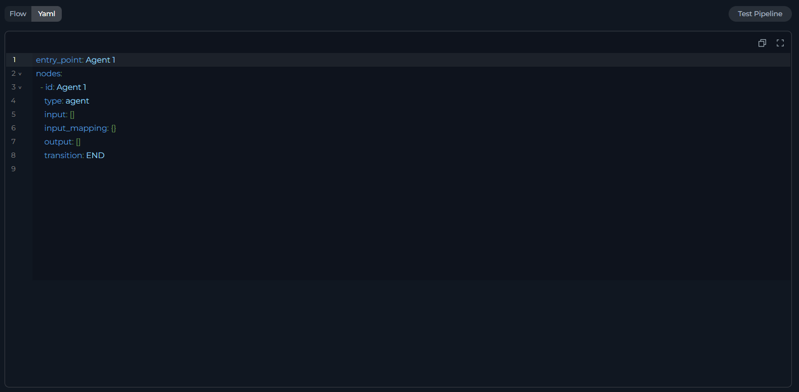
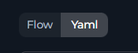

<Info title="Target Audience">
For advanced users who prefer code editing or need version-controlled pipeline definitions.
</Info>

## YAML View

YAML view is a code-based way to edit a pipeline, built on the CodeMirror editor. Instead of placing and connecting nodes on the canvas, you edit the pipeline's underlying YAML definition directly.

YAML view provides:

* **Syntax highlighting** for YAML structure
* **Real-time validation** - invalid YAML is flagged in the gutter as you type
* **Find & Replace** - press `Ctrl+F` (Windows) or `Cmd+F` (Mac) to search and replace text
* **Line numbers** and **auto-indentation** for nested structures



<Note title="Two YAML Views">
There are two places to use YAML view:

* **Whole-pipeline YAML**: Select the **Yaml** toggle at the top of the canvas to edit the entire pipeline definition.
* **Single-node YAML**: Open a node's configuration panel and select its own **Flow view / YAML view** switch to edit just that node, without leaving Flow mode for the rest of the canvas.
</Note>

---

## Open YAML View

1. Open a pipeline in the pipeline editor.
2. At the top of the canvas, select the **Flow / Yaml** toggle, then select **Yaml**.

    

<Info title="Flow & YAML Sync">
Changes you make in Flow mode appear in the YAML text immediately. Changes you make in YAML mode take effect in the Flow canvas when you select the **Flow** toggle again.
</Info>

---

## Schema Structure

Every pipeline definition has these top-level fields:

| Field | Type | Required | Description |
|-------|------|----------|-------------|
| `entry_point` | String | Required | ID of the starting node |
| `nodes` | Array | Required | Node configurations |
| `state` | Object | Optional | State variable definitions. Defaults to an empty object |
| `interrupt_before` | Array | Optional | Node IDs to pause before. See the Interrupts section |
| `interrupt_after` | Array | Optional | Node IDs to pause after. See the Interrupts section |

```yaml
entry_point: <node_id>
state: {...}
nodes: [...]
```

---

## State Configuration

State variables are the pipeline's memory. Each variable has a data type and an optional default value.

### State Variable Syntax

```yaml
state:
  <variable_name>:
    type: <data_type>
    value: <default_value>  # Optional
```

<Info title="Default Variables">
Default variables like `input` and `messages` do not require initial values. The pipeline populates them during execution.
</Info>

### Data Types

| Type | Example |
|------|---------|
| `str` | `"Hello"` |
| `number` | `42`, `3.14` |
| `list` | `[]`, `["a", "b"]` |
| `dict` | `{}`, `{"key": "value"}` |

```yaml
state:
  input:
    type: str
  counter:
    type: number
    value: 0
  qna_list:
    type: list
    value: []
  metadata:
    type: dict
    value: {}
```

<Tip title="Guidelines">
* Use descriptive names, such as `user_query` rather than `q`.
* Initialize accumulators with an empty value, such as `''`, `[]`, or `0`.
* See the [States Guide](./states) for complete state configuration details.
</Tip>

---

## Node Configuration

The `nodes` array holds every node in the pipeline. Each node has a type-specific set of fields plus these common fields:

| Field | Type | Required | Description |
|-------|------|----------|-------------|
| `id` | String | Required | Unique node identifier. There is no separate name field. The `id` value also labels the node |
| `type` | String | Required | Node type. See the Node Type Reference section |
| `input` | Array | Optional | State variables the node reads. Defaults to `[messages]` for most node types |
| `output` | Array | Optional | State variables the node writes. Defaults to an empty array for most node types |
| `transition` | String | Conditional | ID of the next node, or `END`. Not used by router, decision, or HITL nodes, which route through their own fields instead |

---

## Node Type Reference

ELITEA supports 10 node types. Each has its own configuration fields in addition to the common fields above. See [Nodes Overview](./nodes/overview) for what each type does in the Flow Editor.

<Accordion title="LLM Node">
Calls a language model with a system prompt and a task prompt.

| Field | Type | Required | Description |
|-------|------|----------|-------------|
| `input_mapping.system` | Object | Required | System prompt mapping |
| `input_mapping.task` | Object | Required | Task prompt mapping |
| `input_mapping.chat_history` | Object | Optional | Chat history mapping |
| `tool_names` | Object | Optional | Toolkits and tools the model can call, grouped by toolkit name |
| `structured_output` | Boolean | Optional | Return structured output. Defaults to `false` |

```yaml
- id: Summarizer
  type: llm
  input: [article_text]
  output: [messages]
  structured_output: false
  transition: NextNode
  input_mapping:
    system:
      type: fixed
      value: "You are an expert summarizer."
    task:
      type: fstring
      value: "Summarize: {article_text}"
    chat_history:
      type: fixed
      value: []
  tool_names:
    toolkit_name:
      - tool1
```
</Accordion>

<Accordion title="Agent Node">
Runs a configured agent. The `tool` field holds the agent's name.

| Field | Type | Required | Description |
|-------|------|----------|-------------|
| `tool` | String | Required | Name of the configured agent to run |
| `input_mapping.task` | Object | Required | Task prompt mapping |
| `input_mapping.chat_history` | Object | Optional | Chat history mapping |

```yaml
- id: DraftReviewer
  type: agent
  input: [input]
  output: [metadata]
  transition: END
  tool: Documentation Agent
  input_mapping:
    task:
      type: fstring
      value: "Review this draft: {input}"
    chat_history:
      type: fixed
      value: []
```
</Accordion>

<Accordion title="Toolkit Node">
Calls a single tool from a connected toolkit, such as Jira or GitHub.

| Field | Type | Required | Description |
|-------|------|----------|-------------|
| `tool` | String | Required | Name of the tool to call |
| `toolkit_name` | String | Optional | Name of the toolkit the tool belongs to |
| `input_mapping` | Object | Optional | Defaults to passing `messages` through unchanged |

```yaml
- id: CreateJiraTicket
  type: toolkit
  tool: create_issue
  toolkit_name: Jira
  input: [ticket_summary]
  output: [messages]
  transition: END
```
</Accordion>

<Accordion title="MCP Node">
Calls a tool exposed by a connected MCP server.

| Field | Type | Required | Description |
|-------|------|----------|-------------|
| `tool` | String | Required | Name of the tool to call |
| `toolkit_name` | String | Optional | Name of the MCP server the tool belongs to |
| `input_mapping` | Object | Optional | Defaults to passing `messages` through unchanged |

```yaml
- id: FetchRecord
  type: mcp
  tool: get_record
  toolkit_name: Internal CRM
  input: [record_id]
  output: [record_data]
  transition: NextNode
```

<Note>
If a connected MCP server requires authorization the user has not granted, the pipeline routes to an authorization step instead of calling the tool.
</Note>
</Accordion>

<Accordion title="Code Node">
Runs Python code in a sandbox.

| Field | Type | Required | Description |
|-------|------|----------|-------------|
| `code` | Object | Required | Code mapping. Defaults to a placeholder that returns a fixed string |
| `structured_output` | Boolean | Optional | Merge a returned dict's keys into state as named output variables |

```yaml
- id: DataProcessor
  type: code
  code:
    type: fixed
    value: |
      input_text = alita_state.get('input')
      return {"processed": input_text.upper()}
  input: [input]
  output: [processed_data]
  structured_output: true
  transition: END
```

<Info title="Code Node Rules">
Use `alita_state.get('var')` to read a state variable. Return a dict and set `structured_output: true` to write its keys back to state.
</Info>
</Accordion>

<Accordion title="Router Node">
Routes to the next node using a Jinja2 template instead of a model call.

| Field | Type | Required | Description |
|-------|------|----------|-------------|
| `condition` | String | Required | Jinja2 template that resolves to a node ID |
| `routes` | Array | Required | Node IDs the condition can resolve to |
| `default_output` | String | Optional | Fallback node ID. Defaults to `END` |

```yaml
- id: CategoryRouter
  type: router
  default_output: DefaultNode
  routes: [ProcessA, ProcessB, END]
  input: [category]
  condition: |
    
      ProcessA
    
      ProcessB
    
      END
    
```
</Accordion>

<Accordion title="Decision Node">
Routes to the next node using a model's judgment instead of a fixed condition.

| Field | Type | Required | Description |
|-------|------|----------|-------------|
| `decision.description` | String | Required | Instructions the model uses to pick a route |
| `decision.nodes` | Array | Required | Candidate target node IDs |
| `decision.decisional_inputs` | Array | Optional | State variables considered. Defaults to the node's `input` |
| `decision.default_output` | String | Optional | Fallback node ID. Defaults to `END` |

```yaml
- id: SmartRouter
  type: decision
  input: [user_input]
  output: [classification]
  decision:
    description: "Route to SaveNode if the user wants to save, otherwise END."
    decisional_inputs: [user_input]
    nodes: [SaveNode]
    default_output: END
```
</Accordion>

<Accordion title="HITL Node">
Pauses the pipeline and waits for a human to approve, edit, or reject before continuing.

| Field | Type | Required | Description |
|-------|------|----------|-------------|
| `user_message` | Object | Required | Message shown to the user. See the message types below |
| `routes.approve` | String | Optional | Node ID for the Approve action |
| `routes.reject` | String | Optional | Node ID for the Reject action, or `END` |
| `routes.edit` | String | Optional | Node ID for the Edit action. Cannot be `END` |
| `edit_state_key` | String | Conditional | State variable updated on Edit. Required when `routes.edit` is set |

**User message types:**

| Type | Description |
|------|-------------|
| `fixed` | Static text shown as-is |
| `fstring` | Template with `{state_key}` placeholders resolved from state |
| `variable` | Reads the entire message from a named state variable |

```yaml
- id: Review_summary
  type: hitl
  input: [summary]
  user_message:
    type: fstring
    value: "Please review the following summary and choose an action:\n\n{summary}"
  routes:
    approve: Publish_node
    reject: END
    edit: Regenerate_node
  edit_state_key: summary
```

<Note title="Route Rules">
Only the actions with a configured route appear as buttons in the UI. The `routes` field accepts only `approve`, `reject` and `edit` as keys, and the HITL node does not use `transition`. Routing is handled entirely by `routes`.
</Note>
</Accordion>

<Accordion title="State Modifier Node">
Transforms state using a Jinja2 template, without calling a model.

| Field | Type | Required | Description |
|-------|------|----------|-------------|
| `template` | String | Required | Jinja2 template |
| `variables_to_clean` | Array | Optional | State variables to reset to an empty value after the node runs |

```yaml
- id: AggregateResponse
  type: state_modifier
  template: |
    {{ response_full }}

    ## Question {{ index }}
    {{ question }}

    ## Answer {{ index }}
    {{ messages[-1].content }}
  variables_to_clean: []
  input: [response_full, messages, question, index]
  output: [response_full]
  transition: NextStep
```

<Info title="Template Filters">
Beyond standard Jinja2, the template field supports the custom filters `from_json`, `base64_to_string`, `split_by_words` and `split_by_regex`.
</Info>
</Accordion>

<Accordion title="Printer Node">
Shows a message to the user and pauses the pipeline for acknowledgment.

| Field | Type | Required | Description |
|-------|------|----------|-------------|
| `input_mapping.printer` | Object | Required | Message mapping shown to the user |
| `final_message` | String | Optional | Message shown after the pipeline completes |

```yaml
- id: ShowResult
  type: printer
  input_mapping:
    printer:
      type: fstring
      value: "Here is your result: {result}"
  transition: END
```

<Note>
A printer node always pauses for user acknowledgment after it runs, even without an entry in `interrupt_after`.
</Note>
</Accordion>

---

## Entry Point

`entry_point` names the single node where the pipeline starts. It must reference an existing node ID, and decision nodes (along with legacy condition nodes) cannot be set as the entry point. See the [Entry Point Guide](./entry-point) for complete rules.

```yaml
entry_point: StartNode

nodes:
  - id: StartNode
    type: llm
```

---

## Interrupts

`interrupt_before` and `interrupt_after` pause the pipeline before or after the listed node IDs run, so a person can review state before execution continues. Set them directly in YAML. The Flow Editor does not have a dedicated toggle for interrupts, though affected connections are still marked on the canvas. See the [Nodes Connectors Guide](./nodes-connectors#interrupts) for how interrupts affect connections.

```yaml
interrupt_after:
  - ReviewNode
  - ApprovalCheck
```

---

## Connections

Nodes connect through fields on the node itself: `transition` for a simple next step, `condition` for a router, `decision` for a decision node and `routes` for a HITL node. See the [Node Connectors Guide](./nodes-connectors) for complete details on transitions, conditions, and the End node.

---

## YAML Syntax & Validation

A pipeline definition is standard YAML, so general YAML syntax rules apply, along with a few pipeline-specific checks.

### Syntax Rules

**Indentation** uses spaces, not tabs:

```yaml
nodes:
  - id: Node1
    type: llm
    input:
      - var1
```

**Strings with special characters** need quotes:

```yaml
template: '{{ index + 1 }}'
description: "Route: urgent"
value: |
  Multi-line
  content
```

**Lists** read more clearly in block style:

```yaml
routes:
  - NodeA
  - NodeB
```

**Booleans and null values** are lowercase:

```yaml
structured_output: true
structured_output: false
value: null
```

### Common Errors

Common mistakes and how to fix them:

| Error | Fix |
|-------|-----|
| An unquoted Jinja2 expression, such as `condition: ` | Quote the value: `condition: ''` |
| A `transition` pointing to a node ID that does not exist | Confirm the target ID exists in `nodes` |
| `type: custom` | `custom` is a UI-only placeholder for editing a node as raw JSON. Set one of the 10 node types described in Node Type Reference instead |
| A node missing `input` or `output` when its type requires them | Add the missing field. See Node Type Reference for the per-type requirements |

### Validation Checklist

Before saving, confirm:

* `entry_point` references an existing node ID
* Every node ID is unique
* Every `transition` references an existing node ID or `END`
* State variables used by a node are defined in `state`
* `input` and `output` arrays use valid variable names
* Node-specific fields are complete, such as `input_mapping` for an LLM node
* No syntax errors remain in the gutter
* Indentation uses spaces

---

## Best Practices

<Tip>
* **Use descriptive IDs**: `FetchUserData` instead of `Node1`.
* **Initialize defaults**: `counter: {type: number, value: 0}` instead of `counter: {type: number}`.
* **Keep multi-line templates on their own block**: Use a `|` block for a Jinja2 template with conditionals, rather than a single quoted line.
* **Group related nodes with comments**: A `# Data Loading` comment above a batch of nodes helps readers scan the file.
* **Do not hardcode secrets**: Store an API key as a credential instead of a fixed value in YAML.
* **Avoid unreachable nodes**: Confirm every node is reachable from the entry point through a `transition`, `condition`, `decision` or `routes` chain.
* **Always terminate a path**: Every path through the pipeline should reach a node with `transition: END` or an equivalent route.
</Tip>

---

<Info title="Related Documentation">
* **[Flow Editor](./flow-editor)**: Build the same pipeline visually
* **[States Guide](./states)**: Configure state variables for data flow
* **[Nodes Overview](./nodes/overview)**: Understand all 10 node types
* **[Nodes Connectors](./nodes-connectors)**: Connection patterns between nodes
* **[Entry Point Guide](./entry-point)**: Set up pipeline starting points and triggers
</Info>
