## Before You Start

Before you begin, make sure you have:

<CardGroup cols={2}>
  <Card title="Python Installed" icon="code">
    Version 3.11 or newer on your computer. [Download Python](https://www.python.org/downloads/)
  </Card>
  <Card title="Node.js Installed" icon="terminal">
    Required for most MCP servers like Playwright, GitHub, Figma. [Download Node.js](https://nodejs.org/)
  </Card>
  <Card title="Your Elitea Project ID" icon="folder-open">
    Find this in Elitea **Settings** > **General** > [AI Configurations](../../menus/settings/general#ai-configurations).
  </Card>
  <Card title="Your Elitea Authentication Token" icon="key">
    Create one in Elitea Settings → [Personal Tokens](../../menus/settings/personal-tokens).
  </Card>
  <Card title="Your Elitea Deployment URL" icon="globe">
    Example: `https://next.elitea.ai`
  </Card>
</CardGroup>

<Info>
**Additional Dependencies**

Some MCP servers may require additional dependencies beyond Python and Node.js. Check the specific MCP server documentation for any additional requirements before installation.
</Info>

---

## What is an MCP Client and Why Do I Need It?

**MCP Client** means Elitea can connect to external tools that follow the Model Context Protocol (MCP) standard.

**Why it matters to you:** Your Elitea agents can use powerful external tools like:
- **Playwright** - Automate web browsers, take screenshots, test websites
- **GitHub** - Create issues, manage pull requests, read repositories
- **And many more** - Any tool that supports MCP can be connected

This means your agents become much more powerful without you writing any code!

---

## Step-by-Step Setup

### Install the Elitea MCP Client

The client is a program that connects Elitea to external MCP tools.

1. **Open PowerShell**
     - Press `Windows key`, type "PowerShell", and press Enter

2. **Install pipx** (a tool that helps install Python programs)
     - Copy this command and paste it into PowerShell, then press Enter:
       ```powershell
       python -m pip install --user pipx
       ```
     - Wait for it to finish

     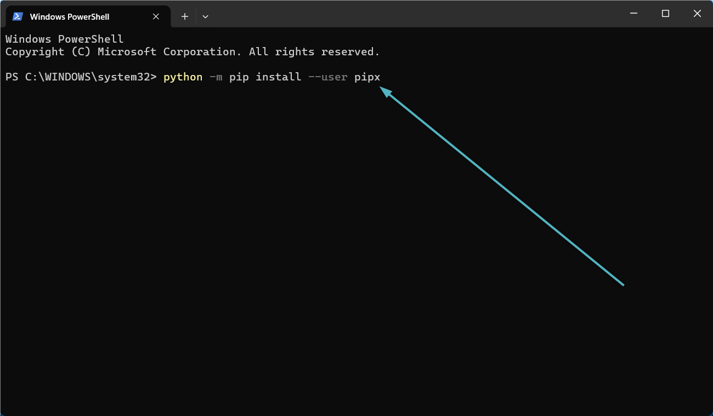

3. **Set up pipx's path**
     - This makes sure your computer can find pipx. Copy and run:
       ```powershell
       python -m pipx ensurepath
       ```
     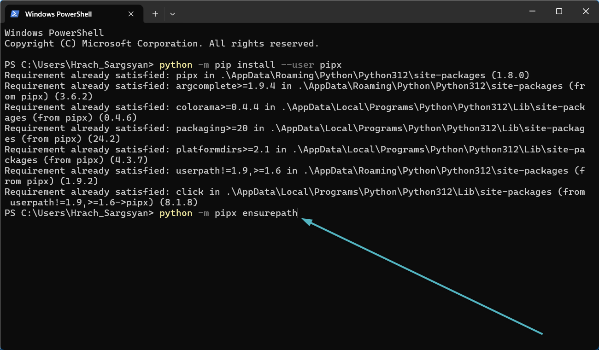

4. **Install elitea-mcp**
     - This is the actual client program. Copy and run:
       ```powershell
       pipx install elitea-mcp
       ```
     - Wait for installation to complete

     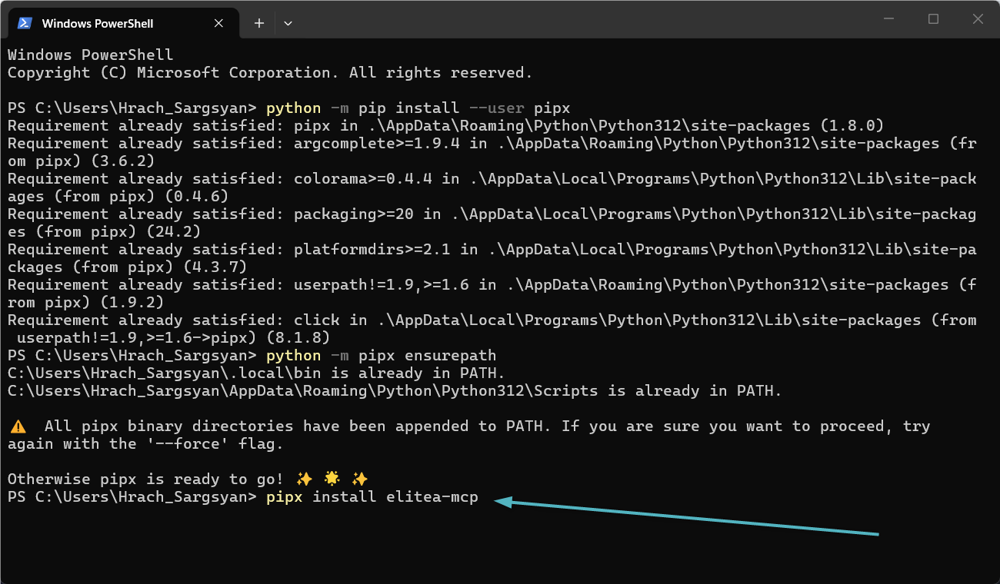

5. **Close and reopen PowerShell**
     - This refreshes your environment so the new program is recognized

---

### Configure the Client

In this part, you set up the connection to your Elitea account and add external tools. The client saves everything in a `config.json` file. You can configure it in two ways: with the `elitea-mcp bootstrap` setup wizard in a terminal, or with the **Settings…** window in the tray. 

Select the tab for the option you want to use.

<Tabs>
<Tab title="Bootstrap">
The setup wizard asks for the connection and then for your MCP servers, so you can finish the whole configuration in one run.

1. **Run the setup wizard**
     - In PowerShell, enter:
       ```bash
       elitea-mcp bootstrap
       ```
     - Press Enter

2. **Answer the basic prompts**
     - **Deployment URL:** Enter your Elitea URL (example: `https://next.elitea.ai`) and press Enter. The URL must start with `http://` or `https://`.
     - **Authentication token:** Paste your token (the one you copied earlier) and press Enter
     - **Host:** Press Enter to accept the default (`0.0.0.0`)
     - **Port:** Press Enter to accept the default (`8000`)
      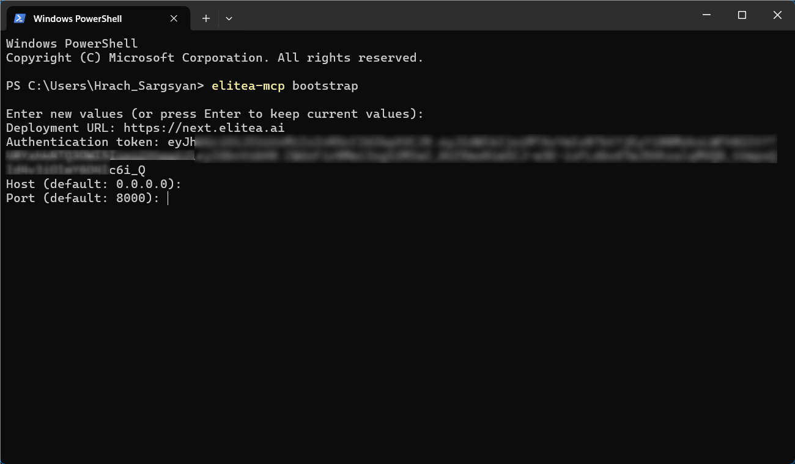

3. **Add an MCP server**
     - **Project ID:** When prompted to enter a Project ID to add MCP servers, enter your Project ID number (find it in Elitea **Settings** > **General** > **AI Configurations**). Press Enter without a value to skip adding servers.
     - **Server Name:** Enter a name such as `Playwright` and press Enter. The name must start with a letter and contain only letters, digits and underscores.
     - **Server Type:** Enter `2` for `stdio` (enter `1` for `sse`)
     - **Command:** Enter `npx` (or `npx.cmd` on Windows if needed) and press Enter
     - **Args:** Enter `@playwright/mcp@latest` and press Enter. To pass several arguments, enter them on one line separated by spaces.
     - **Keep connection alive between tool calls:** Enter `y` (recommended for browser automation). The default is `n`.

     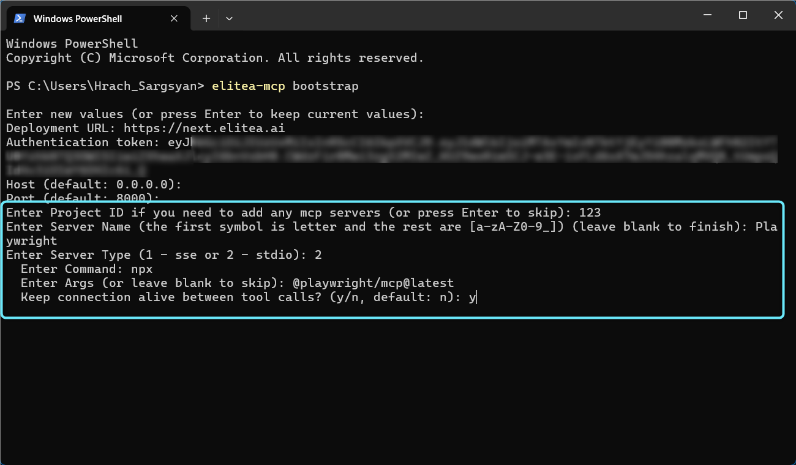

4. **Add more servers** (optional)
     - You can add GitHub, Figma, or other MCP servers by repeating the process at the **Server Name** prompt
     - **For GitHub:**
       ```
       Command: npx
       Args: @modelcontextprotocol/server-github
       Keep connection alive: y
       ```
     - **For Figma:**
       ```
       Command: npx
       Args: @modelcontextprotocol/server-figma
       Keep connection alive: y
       ```

5. **Finish setup**
     - When you are done adding servers, press Enter at the **Server Name** prompt without a value
     - The wizard shows where it saved the servers

Running `elitea-mcp bootstrap` again keeps the servers you already configured and only adds or replaces the ones you enter.
</Tab>
<Tab title="Settings Window">
The **Settings** window sets the connection in a form, so you do not answer questions in the terminal. It does not add MCP servers, so you add them to `config.json` afterward.

1. **Open the Settings window**
     - In PowerShell, enter `elitea-mcp settings` and press Enter

   <Tip>
   **Open the Window from the Tray Menu**

   You can also open the same window from the tray:

    Select the Elitea icon in the system tray, then select **Configuration** > **Settings…**

        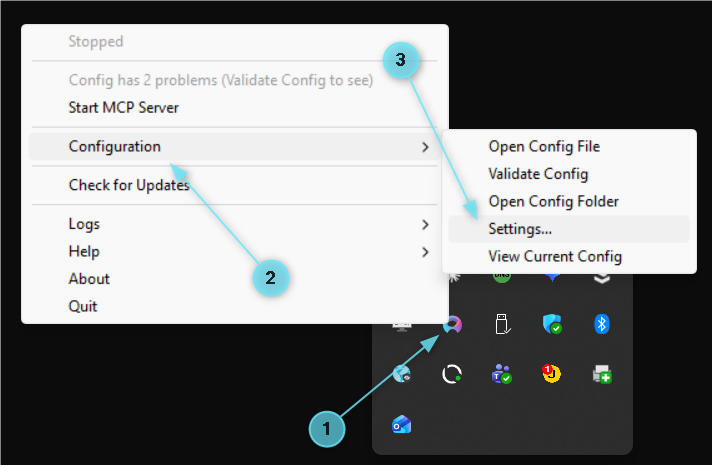
   </Tip>

2. **Enter the connection details, test and save**

     The **ELITEA MCP Client Settings** window has these fields and options:

     | Field | Required | Description |
     |---|---|---|
     | **Deployment URL** | Yes | The base address of Elitea, for example `https://next.elitea.ai`. It must start with `http://` or `https://`, and it cannot contain spaces, a user name or a password. |
     | **Token** | Yes | Your Elitea token. The field is masked. If a token is already saved, you can leave the field empty to keep it. |
     | **Project ID** | Yes | The number of your Elitea project, for example `456`. It must be a positive number. |
     | **Test connection** | No | Button that checks the values you entered. The window lists the result of each check with `✓` (passed) or `✗` (failed): **Deployment URL**, **Project ID**, **Platform reachable**, **Token** and **Project access**. A failed check shows what to fix. |
     | **Restart the MCP servers if they are running** | No | Checkbox, selected by default. Keep it selected to apply the change at once when the servers are running. |

     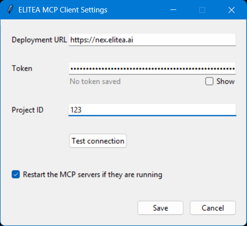

     After you enter the values and test the connection, select **Save**.

3. **Add MCP servers**
     - Open `config.json`. In the tray, select **Configuration** > **Open Config File**. Without the tray, open the file in `%APPDATA%\elitea-mcp-client`.
     - Add each server under `servers`, as in the example, and save the file

     ```json
     "servers": {
       "Playwright": {
         "type": "stdio",
         "command": "npx",
         "args": [
           "@playwright/mcp@latest"
         ],
         "stateful": true
       }
     }
     ```

</Tab>
</Tabs>

<Tip>
**Check the Configuration**

Run `elitea-mcp validate` to list every problem in `config.json`, each with its path (for example `servers.github.args`) and what to change. In the tray, select **Configuration** > **Validate Config** for the same check.
</Tip>


<Info>
**Common MCP Servers**

Use these values for the **Command** and **Args** prompts, or for `command`, `args` and `env` in `config.json`:

| Server | Command | Args |
|---|---|---|
| Playwright | `npx` | `@playwright/mcp@latest` |
| GitHub | `npx` | `@modelcontextprotocol/server-github` | 
| Figma | `npx` | `@modelcontextprotocol/server-figma` |
</Info>

---

### Start the MCP Client

After you configure the client, start the tray, start the MCP servers from it and check the status. The tray menu also gives you every other action you need to run the client. The next section describes each menu item.

1. **Start the tray application**
     - In PowerShell, enter:
       ```powershell
       elitea-mcp tray
       ```
     - Press Enter
     - The Elitea icon appears in your system tray. If you do not see it, select the small arrow (^) in the system tray to show hidden icons.

     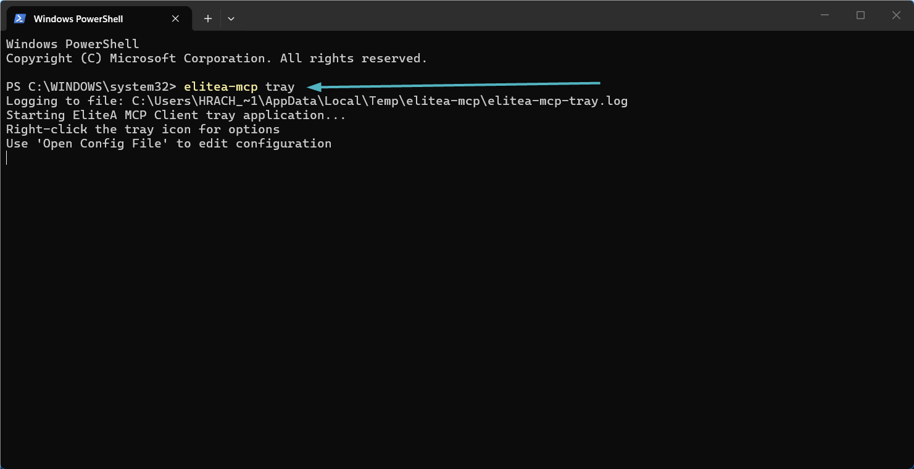

2. **Start the MCP server from the tray**
     - Select the Elitea icon in the system tray, in the bottom-right corner of your screen
     - Select **Start MCP Server**

     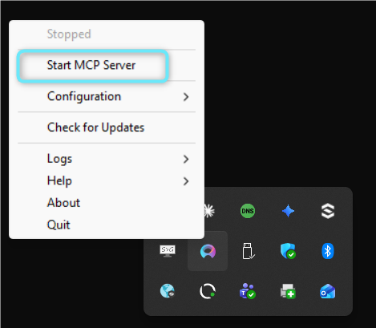

3. **Verify the client is running**
     
     The dot on the tray icon shows the state of the client, and the tooltip and the first line of the tray menu show the same status text. Hover over the icon to read it.

     | Icon | Status text | Meaning |
     |---|---|---|
     | No dot | `Stopped` | The client is not running. |
     | Yellow dot | `Connecting…` | The client is connecting or reconnecting to Elitea. |
     | Green dot | `Connected (3 servers)` | The client is connected and its servers are registered in Elitea. |
     | Red dot | `Error: <last error>` | The client could not start or lost its connection. The last error is shown, so you do not need to open the log. |

Before the client connects, it checks your **Deployment URL**, **Project ID**, token and project access. If a check fails, the tray notification, the tooltip and the log show a specific message instead of `Connected`. If you enter a URL with a page path, such as a link copied from the Elitea address bar, the client uses only the base address.

<Note>
**Background Mode Is Not Available on Windows**

The `--daemon` option (`elitea-mcp tray --daemon`) works only on macOS and Linux. On Windows, the command fails with `Daemon mode is only supported on Unix systems (Linux, macOS)`. Run `elitea-mcp tray` instead and keep the tray application running.
</Note>

<Tip>
**Start the Tray at Sign-In on Windows**

To start the tray automatically, press `Win+R`, enter `shell:startup`, and copy the `launch-tray-windows.bat` script from the `scripts` folder of the [elitea-mcp-client repository](https://github.com/EliteaAI/elitea-mcp-client) into the folder that opens.
</Tip>


<Info>
**Example of correct configuration**

```json

{
  "deployment_url": "https://dev.elitea.ai",
  "auth_token": "your-token-here",
  "host": "0.0.0.0",
  "port": 8000,
  "servers": {
    "Playwright": {
      "type": "stdio",
      "command": "npx",
      "args": [
        "@playwright/mcp@latest"
      ],
      "stateful": true
    }
  },
  "timeout": 30,
  "ssl_verify": false,
  "project_id": 123
}

```
</Info>

---

### Use the Tray Menu

Select the Elitea icon in the system tray to open the menu. The menu changes with the state of the client. For example, **Start MCP Server** shows only while the client is stopped, and **Servers** shows after the first start. The table lists every menu item, and the sections below describe each one in the order the menu shows them.

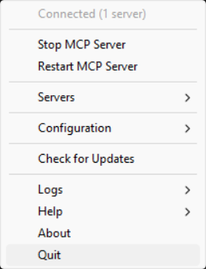

| Main menu | When it shows | What it does |
|---|---|---|
| Status row | Always | Shows the status of the client. It cannot be selected. |
| **Start MCP Server** | The client is stopped and `config.json` has a **Deployment URL** and a token | Starts the client and the servers. |
| **Stop MCP Server** | The client is running | Stops the servers and disconnects the client. |
| **Restart MCP Server** | The client is running | Restarts the servers with the current `config.json`. It reads **Restart MCP Server to Apply Changes** when the file changed. |
| **Servers** | After the first start | Shows one row per server with its tool count: `✓` registered with its tools, `⚠` declined (name already in use) or `✗` failed. Select a declined or failed row to open its error file. **Retry Failed Servers** reloads only the failed servers. |
| **Configuration** | Always | Opens and checks `config.json`, opens the **Settings…** window and shows the current settings. |
| **Check for Updates** | Update checks are on | Checks for a later version of the client. |
| **Update to x.y.z and Restart** | An update is available | Upgrades the client and restarts the tray. |
| **Logs** | Always | Opens the tray log and the logs folder, and turns detailed logging on or off. |
| **Help** | Always | Runs the diagnostics and exports a support bundle for a bug report. |
| **About** | Always | Opens a window with the version and the licence of the client. |
| **Quit** | Always | Stops the servers, if they are running, and removes the tray icon. To use the client again, run `elitea-mcp tray`. |


#### Configuration

The **Configuration** submenu has these items:

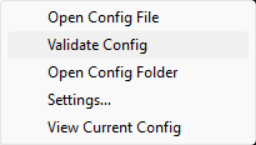

| Item | What it does |
|---|---|
| **Open Config File** | Opens `config.json` in your default text editor and creates the file if it does not exist. After you save a change, the tray detects it and offers a restart. |
| **Validate Config** | Reads `config.json` again and checks it. A notification shows `Config Valid` with the file path, or `Config Has Problems` with a summary. A JSON error is reported with its line and column and a hint to fix it. To see every problem, run `elitea-mcp validate` in a terminal. |
| **Open Config Folder** | Opens the folder with `config.json` in your file manager. On Windows, it is `%APPDATA%\elitea-mcp-client`. |
| **Settings…** | Opens the **ELITEA MCP Client Settings** window, where you set the **Deployment URL**, **Token** and **Project ID** and test the connection. For the steps, see the **Settings Window** tab in the configuration part above. If the window is already open, the tray tells you so. If `config.json` has a JSON error, the tray shows the error and opens the file instead. |
| **View Current Config** | Shows a notification with the **Deployment URL**, the token (masked: eight asterisks and its last four characters), the host, the port, the **Project ID**, and the number and names of the first three servers. |


#### Logs

The **Logs** submenu has these items:


| Item | What it does |
|---|---|
| **Open Log File** | Opens the tray log. |
| **Open Logs Folder** | Opens the folder with the logs, the `<server>-error.txt` files and the diagnostics report. On Windows, it is `%TEMP%\elitea-mcp\`. On macOS and Linux, it is `~/.local/var/log/elitea-mcp/`. |
| **Enable Debug Logging** | Adds more detail to the logs at once, without a restart. A check mark shows that it is on. The tray saves the choice as `"log_level"` in `config.json`. The item is unavailable while `config.json` has errors. |

The logs replace your token and the `env` and `headers` values of your servers with `****`. They never contain tool arguments, tool results or agent conversations, not even with debug logging on.

#### Help

The **Help** submenu has these items:


| Item | What it does |
|---|---|
| **Run Diagnostics** | Runs the same checks as `elitea-mcp doctor`: the client version, `config.json`, the connection to Elitea (URL, SSL, token and project access) and every local server. The tray saves the report as `elitea-mcp-diagnostics.txt` next to the logs, opens it and copies it to the clipboard, so you can paste it into a support request. The item reads `Running Diagnostics…` and is unavailable while the checks run. |
| **Export Support Bundle** | Saves a zip file next to the logs and opens that folder. The zip has the diagnostics report, `config.json` with every secret replaced by `****`, the newest logs and the versions of the client and its libraries. The item reads `Exporting Support Bundle…` and is unavailable while the export runs. |

<Warning>
**Check the Support Bundle Before You Share It**

The bundle masks the token, the `env` and `headers` values and URLs, but a secret that is not in `config.json` and has no known prefix can still appear in an old log. Look through the zip file before you attach it to a bug report.
</Warning>

---

## Connect Tools in Elitea

Now you make the tools from your local client available to your Elitea agents. Each server that the client registers appears as a local MCP that you create in Elitea.

1. **Open the MCPs menu**
     - In the main navigation, select **MCPs**
     - Select **+ MCP**
     - Select the local MCP server that the client registered, such as "Playwright"

2. **Enter the details**
     - **Name:** Enter a clear name, such as "Playwright Browser Automation"
     - **Description:** Optional. Describe what the MCP does.
     - **Tools:** Review the list of tools and clear the ones you do not need. Enable only the tools your use case requires.
     - Select **Save** to finish. The new MCP card appears in the **MCPs** menu with its connection status.

Check the connection status on the MCP card in the **MCPs** menu:

* **Connected** (grey): the MCP is connected, and its tools are available for use.
* **Disconnected** (orange): the MCP cannot reach the server, so its tools are unavailable. Check the tray for the cause.

      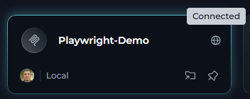

Now you can add the MCP to your agents, pipelines, or use it directly in chat.

### In Agents:

1. **Navigate to Agents:** Open the sidebar and select **[Agents](../../menus/agents)**.
2. **Create or Edit Agent:** Either create a new agent or select an existing agent to edit.
3. **Add MCP:**
     * In the **"Tools"** section of the agent configuration, select the **+MCP** button
     * Select your MCP, such as "Playwright", from the dropdown list
     * Select **Save** to save the agent

      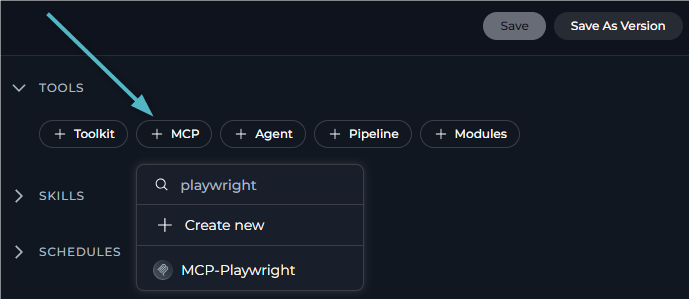


Your agent can now use the tools of the MCP.

---
### In Pipelines:

Pipelines have a dedicated **MCP** node on the flow canvas, separate from the **Toolkit** node.

1. **Navigate to Pipelines:** Open the sidebar and select **[Pipelines](../../menus/pipelines)**.
2. **Create or Edit Pipeline:** Either create a new pipeline or select an existing pipeline to edit.
3. **Add an MCP Node:** On the flow canvas, add an **MCP** node from the node picker.
4. **Pick the MCP:**
     * In the **MCP** field, select your MCP, such as "Playwright", from the list. You may need to log in first.
     * In the **Tool** field, select the MCP tool this node runs.

      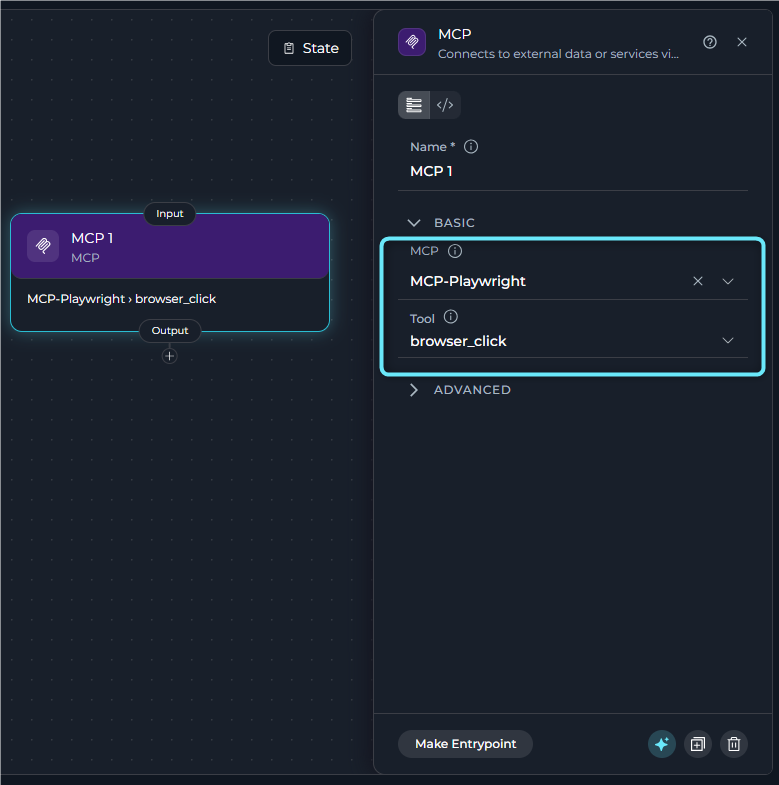

---
### In Chat:

1. **Navigate to Chat:** Open the sidebar and select **[Chat](../../menus/chat)**.
2. **Start New Chat:** Select **+ Chat** or open an existing conversation.
3. **Add MCP to Chat:**
   - Select the **`+`** icon in the chat input toolbar 
   - Hover over **MCPs** in the popup menu
   - Search for your MCP by name
   - Enable the MCP to add it to your conversation
4. **Verify MCP Added:** The MCP appears in the **PARTICIPANTS** panel on the right side under the **MCPs** section.
5. **Use MCP in Chat:** Ask a question or request an action that triggers the MCP tools.

      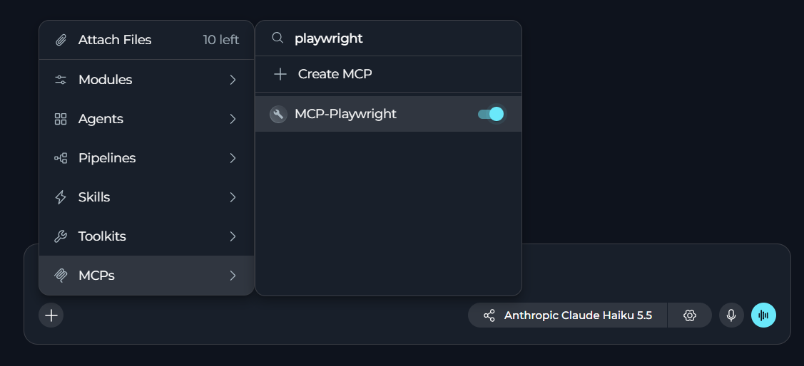

<Tip>
You can also add an MCP by typing **`#`** in the chat input box and searching for it by name.
</Tip>


---

## Command Reference

The `elitea-mcp` command has the subcommands below. Run `elitea-mcp --help` to list them, `elitea-mcp <command> --help` for the options of one command, and `elitea-mcp --version` to print the installed version.

| Command | What it does |
|---|---|
| `elitea-mcp bootstrap` | Sets the **Deployment URL** and token, asks for the **Project ID** and your MCP servers, and saves them in `config.json`. Without options, it asks questions in the terminal. To skip the questions, give both `--deployment_url` and `--auth_token`. |
| `elitea-mcp tray` | Starts the system tray application. This is the recommended way to run the client. |
| `elitea-mcp tray --daemon` | Starts the system tray application in the background, so you can close the terminal. It works only on macOS and Linux. The default PID file is `~/.local/var/run/elitea-mcp/elitea-mcp-tray.pid`, and the default log is `~/.local/var/log/elitea-mcp/elitea-mcp-tray.log`. |
| `elitea-mcp serve` | Connects to Elitea and runs your MCP servers without the tray, for example on a server with no desktop. |
| `elitea-mcp serve --daemon` | Runs the servers in the background, so you can close the terminal. It works only on macOS and Linux. The default PID file is `~/.local/var/run/elitea-mcp/elitea-mcp-serve.pid`, and the default log is `~/.local/var/log/elitea-mcp/elitea-mcp-serve.log`. To stop it, run `kill $(cat ~/.local/var/run/elitea-mcp/elitea-mcp-serve.pid)`. |
| `elitea-mcp settings` | Opens the **ELITEA MCP Client Settings** window, where you set the **Deployment URL**, **Token** and **Project ID**. It is the same window as **Configuration** > **Settings…** in the tray. |
| `elitea-mcp validate` | Checks `config.json` and lists every problem with its path. Exits with code `1` when there is an error and `0` otherwise. To check another file, add `--config <path>`. |
| `elitea-mcp doctor` | Checks the client version, the configuration, the connection to Elitea and every local server, one line per check. Exits with code `1` when a check fails. To check another file, add `--config <path>`. |
| `elitea-mcp support-bundle` | Saves a zip file for a bug report: the doctor report, `config.json` with every secret replaced by `****`, the newest logs and the versions. It writes to the current folder. To choose a folder or a `.zip` file, add `--output <path>`. |
| `elitea-mcp about` | Opens a window with the version and the licence of the client. Prints them when no window can open. |

<Note>
**Options for Running in the Background**

`--daemon` runs the command in the background. It works only on macOS and Linux, and on Windows the command fails with `Daemon mode is only supported on Unix systems (Linux, macOS)`. `--pid-file` and `--log-file` set where a daemon writes its process ID and its log. `--allow-multiple` starts an extra copy while another tray or `serve` runs. The extra copy starts the same servers, so Elitea declines each server whose name the other copy has already registered.
</Note>

---

## Troubleshooting

Find the message that matches your problem, then follow its steps. The tray shows most of these messages in its **Servers** submenu, its notifications or its tooltip. If your problem is not here, run the diagnostics described in the last entries.

<Accordion title="The elitea-mcp command is not recognized">

The folder that holds the `elitea-mcp` command is not on your `PATH`.

1. Run `python -m pipx ensurepath` in PowerShell.
2. Close and reopen PowerShell so the new `PATH` is loaded.
3. Run `elitea-mcp --version` to check that the command works.
</Accordion>

<Accordion title="The Start MCP Server item is missing from the tray menu">

The tray shows **Start MCP Server** only when `config.json` can be read and has a **Deployment URL** and a token.

1. Read the first row of the menu. If it says `Config File Has Errors`, follow the entry for that message below.
2. Otherwise, select **Configuration** > **Settings…**, enter the **Deployment URL**, **Token** and **Project ID**, and select **Save**.
3. If you start the client without these values, the tray shows a `Configuration Required` message with the same instruction.
</Accordion>

<Accordion title="The tray says 'Config File Has Errors' or 'Config has N problems'">

1. In the tray, select **Configuration** > **Validate Config**. A JSON error shows its line, column and a hint, such as removing a trailing comma or using double quotes. Any other problem shows its path, such as `servers.github.args`.
2. Fix the problem in `config.json`, then select **Validate Config** again.
3. In a terminal, `elitea-mcp validate` lists every problem and exits with code `1` when there is an error.

`Config File Has Errors` means the file cannot be read, so **Start MCP Server** and **Restart MCP Server** stay hidden until you fix it. `Config has N problems` means the file can be read. The client keeps working, and a server whose configuration cannot work is skipped.
</Accordion>

<Accordion title="The Settings window does not open">

1. If the tray says that the **Settings** window needs Tk, your Python has no Tk. The message shows the command for your system. For example, on Windows, run the Python installer again, select **Modify**, and select **tcl/tk and IDLE**. On Debian and Ubuntu, run `sudo apt install python3-tk`.
2. If the tray says that the window needs a graphical display, you are not in a desktop session.
3. In both cases, the tray opens `config.json` instead. Enter `deployment_url`, `auth_token` and `project_id` there, or run `elitea-mcp bootstrap` in a terminal.
4. If the tray says that **Settings** is already open, find the existing window instead of opening another one.
</Accordion>

<Accordion title="The tray shows an error about the URL, token, project or connection">

Match the message to the cause:

- `Deployment URL "..." is not a valid URL` - Enter the base address of Elitea, such as `https://next.elitea.ai`, starting with `http://` or `https://`.
- `Cannot reach <URL>: ... Check the URL, VPN or proxy.` - Check the **Deployment URL**, your VPN and your proxy.
- `<URL> responded, but it is not an ELITEA platform` - The URL points to another site. Enter the base address of Elitea.
- `SSL certificate verification failed` - This appears only when `"ssl_verify": true` is set in `config.json`. If you are behind a corporate proxy, set it to `false` or configure your CA certificates.
- `Authentication failed: the token is invalid or expired` - Create another token in Elitea **Settings** > **Tokens** and save it in the tray **Settings…** window.
- `"auth_token" is not set` - Enter the **Token** in the tray **Settings…** window, or run `elitea-mcp bootstrap`.
- `Your token has no access to project <ID>, or the project does not exist` - Check the **Project ID** in the tray **Settings…** window.
- `"project_id" is not set` or `"project_id" must be a number` - Enter the **Project ID**, a number, in the tray **Settings…** window.
- `Cannot connect to platform ... retrying (attempt 2/3)` - The client tries three times. If the last attempt fails, the tray shows `Could not connect to <URL> after 3 attempts`. Check the **Deployment URL**, your network and that Elitea is running, then select **Start MCP Server** again.
- `The platform did not confirm the registration within 30 seconds` - Elitea is slow or unreachable. Select **Restart MCP Server**. If it keeps happening, run the diagnostics.
- `Too many registrations from this client; try again in a minute` - Wait a minute, then select **Restart MCP Server**.
- `Connection lost, reconnecting...` or `Disconnected from platform` - The client reconnects by itself. If the tray stays red, select **Restart MCP Server**.
</Accordion>

<Accordion title="No tools showing up in Elitea">

1. Check the tray icon. The dot must be green, and the **Servers** submenu must show `✓` for each server you need.
2. A row such as `0 tools, registered` means the server started but lists no tools. Check the server's own configuration.
3. If a server shows `✗` or `⚠`, follow the matching entry in this section.
4. In the **MCPs** menu, check the card of your MCP. If it shows **Disconnected**, the client is not connected or the server failed.
5. Check that your **Project ID** is correct in **Configuration** > **Settings…**. The MCP appears only in the project that the client is connected to.
</Accordion>

<Accordion title="A server shows 'command not found' for npx or uvx">

The server's program is not installed, or it is not on your `PATH`. The failed row reads, for example, `✗ confluence — failed: command "uvx" not found`.

1. For `npx`, install [Node.js](https://nodejs.org/). For `uvx`, install [uv](https://docs.astral.sh/uv/).
2. Close and reopen PowerShell so the new program is found.
3. If the command is still not found, set `"command"` to the full path of the program in `config.json`. On Windows, `npx` can also be `npx.cmd`.
4. In the tray, select **Servers** > **Retry Failed Servers**.
</Accordion>

<Accordion title="A server shows 'exited during start'">

The server's program was found, but it stopped while the client started it.

1. In the tray, select the failed row in the **Servers** submenu. It opens a `<server>-error.txt` file with the reason, a hint and the last output of the server.
2. Check the `command`, `args` and `env` of that server in `config.json`. Run the same command in a terminal to see the error yourself.
3. Fix the cause, then select **Servers** > **Retry Failed Servers**.
</Accordion>

<Accordion title="A server shows 'did not respond' or 'did not list its tools' within N s">

The server took too long. There are two timeouts, and each has its own setting in `config.json`:

- `did not respond within N s` - The server did not finish starting. This often happens the first time an `npx` package downloads. Run the command once in a terminal, or add a larger `"startup_timeout"`, in seconds, such as `120`. You can set it for one server or at the top level for all servers. The default is `30`.
- `did not list its tools within N s` - The server started but did not list its tools in time. Add a larger `"timeout"`, in seconds. The default is `30`.

After you save the file, select **Restart MCP Server to Apply Changes** in the tray.
</Accordion>

<Accordion title="A remote server shows an authentication, connection or HTTP error">

This applies to servers with `"type": "http"` or `"type": "sse"`.

- `401` or `403` - The token is wrong. Check the token in `headers`.
- `cannot reach <URL>: connection refused` - Check the `url` and that the server is running.
- `<URL> answered <status>` - Check the `url`. If the status is `429` or `503`, the server is busy, and the client waits as long as the server asks before it tries again.
- `a name or value in "headers" is not valid in HTTP` - Remove spaces and line breaks around the header name and value in `config.json`.

After you fix the cause, select **Servers** > **Retry Failed Servers**.
</Accordion>

<Accordion title="A server shows 'declined'">

- `declined (name already registered)` - Another running client, or a session that has not timed out yet, holds this server name in the project. Stop the other client, or rename the server in `config.json`. Wait for the old session to time out if you restarted the client a moment ago. Then select **Servers** > **Retry Failed Servers**.
- `declined (invalid name)` - The server name must start with a letter and contain only letters, digits and underscores. Rename the server in `config.json` and select **Restart MCP Server to Apply Changes**.
</Accordion>

<Accordion title="Tools work but give errors">

1. Check the tool's own requirements, such as its authentication and permissions.
2. Select the tray icon, then **Logs** > **Open Log File** to see the error. Each tool call writes one line with the server, the tool, the result and the time it took.
3. To add more detail to the logs without a restart, select **Logs** > **Enable Debug Logging**.
4. Tool arguments and results are never written to the logs, so the log shows only names, the result and sizes.
</Accordion>

<Accordion title="An agent gets 'Server is not running in this MCP client'">

The MCP in Elitea points to a server name that is not in the client's current `config.json`, or the server is marked failed.

1. In the tray, open the **Servers** submenu and check the names and the status of each server.
2. If the server is missing, add it to `config.json` and select **Restart MCP Server to Apply Changes**.
3. If the server shows `✗`, fix the cause and select **Retry Failed Servers**. A tool call to a server that cannot start is answered at once with a named error, and after two such failures in a row the client marks the server failed.
</Accordion>

<Accordion title="The tray says 'Restart Needed' or 'Restart Refused'">

- `Restart Needed` - `config.json` changed, so the running servers still use the old configuration. Select **Restart MCP Server to Apply Changes**.
- `Restart Refused` - The changed file has no **Deployment URL** or token, or no server in it can start. The servers keep running with the previous configuration. Select **Configuration** > **Validate Config** to see why, fix the file, and restart again.
</Accordion>

<Accordion title="The tray icon is not visible">

1. Check that the tray app is running. Run `elitea-mcp tray` in PowerShell.
2. On Windows, select the small arrow (^) in the system tray to show hidden icons, and check that tray icons are turned on in the taskbar settings.
3. On Linux, check that your desktop environment supports system tray icons.
4. On macOS, the icon appears in the menu bar at the top right of the screen.
</Accordion>

<Accordion title="The diagnostic report says 'Port ... in use'">

The port only matters when you run `elitea-mcp run --transport sse`. The tray and `elitea-mcp serve` do not use it.

1. If you use SSE, change `"port"` in `config.json` to a free port, such as `8001`, and restart the client.
2. To find the program that holds the port, run `netstat -ano | findstr :8000` in PowerShell as Administrator, then run `tasklist | findstr <PID>` with the PID from the last column.
</Accordion>

<Accordion title="'ELITEA MCP Client is already running' error">

1. Only one tray or `elitea-mcp serve` copy can run for each user.
2. Quit the running copy (select **Quit** in the tray), or use the PID in the message to find it.
3. Start the client again.

To run an extra copy on purpose, start it with `--allow-multiple`. The extra copy starts the same servers, so Elitea declines each server whose name the other copy already registered.
</Accordion>

<Accordion title="Not sure what is wrong - need a diagnostic report">

1. In the tray, select **Help** > **Run Diagnostics**, or run `elitea-mcp doctor` in a terminal.
2. The report checks the client version, the configuration, the connection to Elitea (URL, SSL, token and project access) and every local server, one line per check. A `✓` means passed, `⚠` means worth a look and `✗` means broken.
3. The tray opens the report and copies it to the clipboard, so you can paste it into a support request.
4. To attach more detail to a bug report, select **Help** > **Export Support Bundle** (or run `elitea-mcp support-bundle`). The zip has the report, the configuration and the logs with every secret replaced by `****`. Look through the zip before you share it.
</Accordion>

<Accordion title="The client is outdated or an update failed">

1. In the tray, select **Check for Updates**. If an update is available, select **Update to x.y.z and Restart**.
2. If the tray says `Update Manually`, it cannot upgrade by itself. It copies a command to the clipboard. Run it in PowerShell. Or upgrade with the tool you used to install the client:
   ```powershell
   pipx upgrade elitea-mcp
   ```
   If you installed with pip, use `pip install --upgrade elitea-mcp` instead.
3. If the tray says `Update Failed`, open `elitea-mcp-update.log` in the logs folder. Select **Logs** > **Open Logs Folder** to find it.
4. Run `elitea-mcp --version` to check the installed version.
</Accordion>

---

<Info>
**Helpful Resources**

- [MCPs Menu](../../menus/mcps)
- [MCP Protocol Official Docs](https://modelcontextprotocol.io/)
- [Playwright MCP Server](https://github.com/microsoft/playwright-mcp)
- [GitHub MCP Server](https://github.com/github/github-mcp-server)
</Info>

---

