## Before You Start

Before you begin, make sure you have:

<CardGroup cols={2}>
  <Card title="VS Code Installed" icon="laptop-code">
    Version 1.99 or newer.
  </Card>
  <Card title="GitHub Copilot" icon="robot">
    Installed and configured in VS Code.
  </Card>
  <Card title="Python Installed" icon="code">
    Version 3.11 or newer on your computer. [Download Python](https://www.python.org/downloads/)
  </Card>
  <Card title="Your Elitea Project ID" icon="folder-open">
    Find this in Elitea **Settings** > **General** > [AI Configurations](../../menus/settings/general#ai-configurations).
  </Card>
  <Card title="Your Elitea Authentication Token" icon="key">
    Create one in Elitea **Settings** > [Personal Tokens](../../menus/settings/personal-tokens).
  </Card>
  <Card title="Your Elitea Deployment URL" icon="globe">
    Example: `https://next.elitea.ai`
  </Card>
</CardGroup>

---

## What is MCP and Why Do I Need It?

**MCP** stands for Model Context Protocol. It is a way for different AI tools to talk to each other.

**Why it matters to you:** By setting up an MCP server, you can use your Elitea agents directly inside VS Code while you code. You do not need to switch windows or copy and paste between apps.

**How it works:** VS Code starts the `elitea-mcp` program as a local MCP server. The server looks up the agents in your Elitea project that have the `mcp` tag and offers each one to Copilot as a tool.

---

## Step-by-Step Setup

### Install the Elitea MCP Client

The client is a small program that handles communication between VS Code and Elitea.

1. **Open PowerShell**
     - Press the `Windows` key, enter "PowerShell" and press Enter
     - This opens a window where you enter commands

2. **Install pipx** (a tool that installs Python programs)
     - Copy this command, paste it into PowerShell and press Enter:
       ```powershell
       python -m pip install --user pipx
       ```
     - Wait for it to finish

     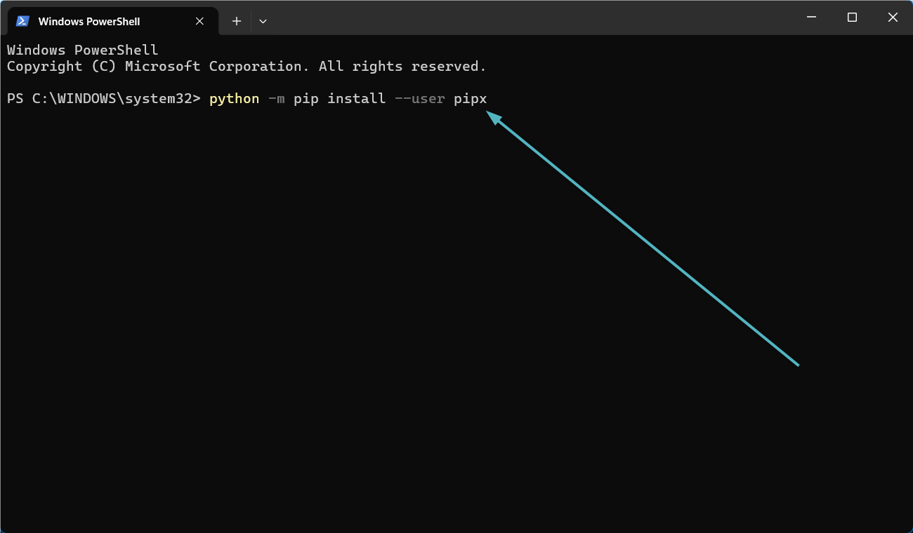

3. **Set up the pipx path**
     - This makes sure your computer can find pipx. Copy and run:
       ```powershell
       python -m pipx ensurepath
       ```

     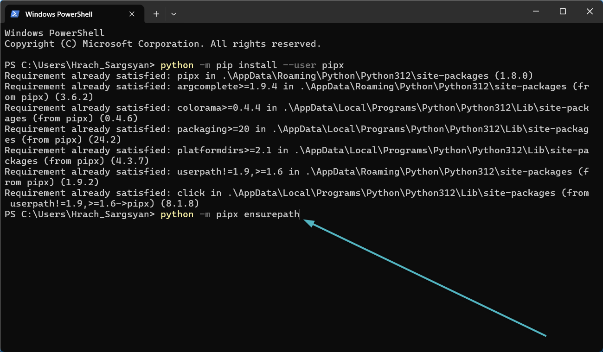

4. **Install elitea-mcp**
     - This is the client program. Copy and run:
       ```powershell
       pipx install elitea-mcp
       ```
     - Wait for the installation to complete

      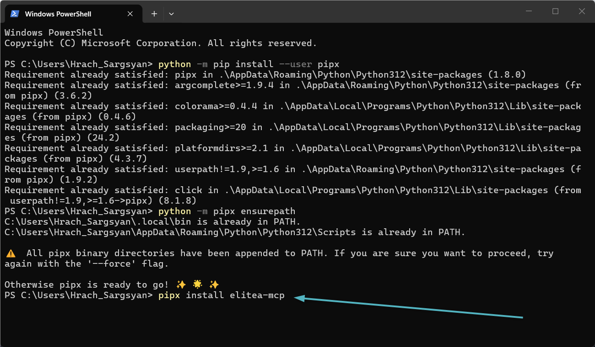

5. **Close and reopen PowerShell**
     - This refreshes your environment so the new program is recognized

---

### Configure the Client

In this part, you tell the client how to connect to your Elitea account. The client saves the connection in a `config.json` file in `%APPDATA%\elitea-mcp-client`.

1. **Run the setup wizard**
     - In PowerShell, enter:
       ```powershell
       elitea-mcp bootstrap
       ```
     - Press Enter

2. **Answer the prompts**
     - **Deployment URL:** Enter your Elitea URL (example: `https://next.elitea.ai`) and press Enter. The URL must start with `http://` or `https://`.
     - **Authentication token:** Paste your token (the one you copied earlier) and press Enter
     - **Host:** Press Enter to accept the default (`0.0.0.0`). The host applies only to the SSE transport.
     - **Port:** Press Enter to accept the default (`8000`). The port applies only to the SSE transport.
     - **Project ID:** Press Enter without a value to skip this prompt. It only asks for a Project ID to add MCP servers to the client. You add the Project ID for VS Code later in this guide.

3. **Check the result**
     - If the wizard shows an error, check your Deployment URL and token

      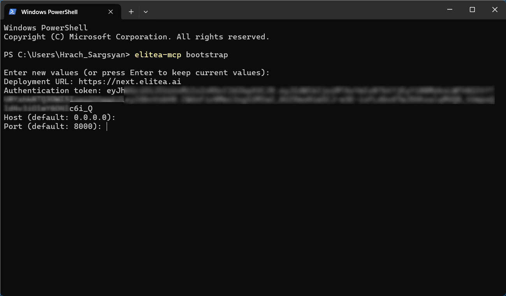

<Info>
**Set the Connection in a Window**

To enter the Deployment URL and token in a window and not in the terminal, run `elitea-mcp settings`. The window also asks for a Project ID. For all commands, see the [Command Reference](../../integrations/mcp/create-and-use-client-stdio#command-reference).
</Info>

---

### Connect to VS Code

In this part, you add the MCP server to VS Code so it can talk to Elitea. You enter the full launch command with your Project ID, so you do not need to edit a file afterward.

1. **Open the chat in Agent mode**
     - In VS Code, open GitHub Copilot Chat (select the chat icon in the sidebar, or press `Ctrl+Alt+I`)
     - In the agent picker, select **Agent**. Agent mode lets the chat use tools, such as your Elitea agents.

       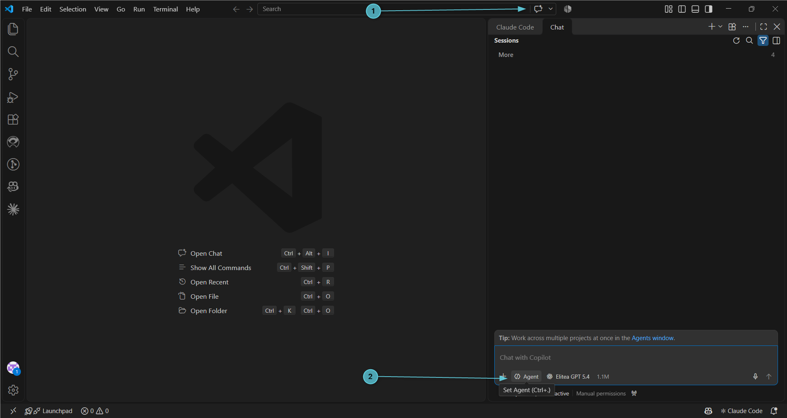

2. **Add the MCP server**
     - Press `Ctrl+Shift+P` to open the Command Palette, and run **MCP: Add Server**
            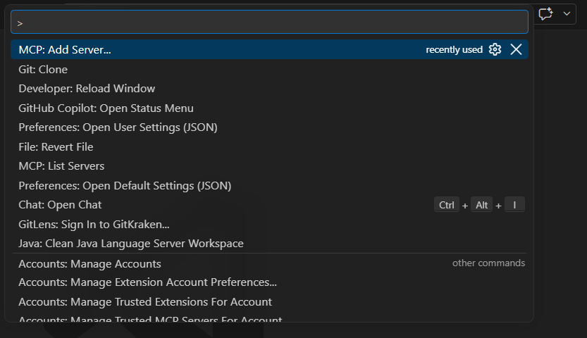
     - Select **Command (stdio)**
             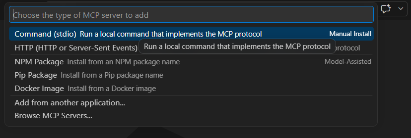
     - Enter the launch command and press Enter. Replace `YOUR_PROJECT_ID` with your number (example: `25`):
       ```text
       elitea-mcp run --project_id YOUR_PROJECT_ID

       ```
       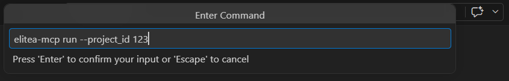
       

     - For **Server ID**, enter a name for the server. The name is yours to choose, for example `elitea-mcp`. VS Code shows this name in its server list and tools list, and you select it in later steps.

       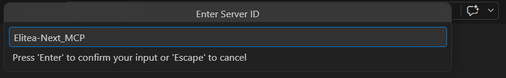

     - In the **Select the configuration target** list, choose where to add the server:
       - **Add to Current Agent Session:** adds the server to the current agent session only. Use it to try the server first.
       - **Global:** available in all workspaces, runs locally. It saves a personal configuration that you can use in all your projects.
       - **Workspace:** available in this workspace, runs locally. It saves the file in the workspace, for example `.vscode/mcp.json`, so you can share it with your team.

       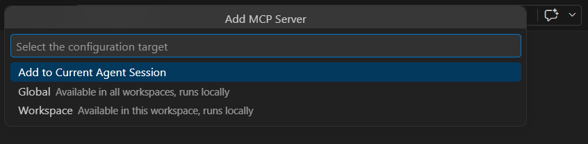

     - If you chose **Global**, VS Code asks one more question, **Select the global configuration**. Choose the file where VS Code saves the server:
       - **Copilot Global:** saves the server in `mcp-config.json` in the `.copilot` folder of your user folder, for example `C:\Users\<YourUsername>\.copilot\mcp-config.json`. Choose this option.
       - **User Configuration (deprecated):** saves the server in the `mcp.json` file of your VS Code user profile, for example `C:\Users\<YourUsername>\AppData\Roaming\Code\User\mcp.json`. VS Code marks this option as deprecated.

       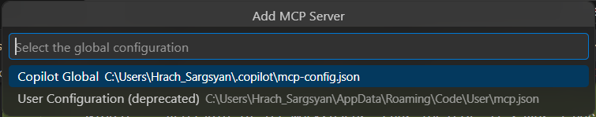


---

### Check the Configuration

VS Code keeps the server in the configuration target you chose. You do not need to change it now. To review it or to change the Project ID later, select the tab for your target, open the file and change the number in `args`, for example `"args": ["run", "--project_id", "25"]`. Then save the file and restart the server: run **MCP: List Servers**, select your server, and select **Restart Server**.

<Tabs>
<Tab title="Global">
**Where it is saved:** in the file you chose in **Select the global configuration**:

- **Copilot Global:** `C:\Users\<YourUsername>\.copilot\mcp-config.json`
- **User Configuration (deprecated):** `C:\Users\<YourUsername>\AppData\Roaming\Code\User\mcp.json`


**How to open it:** open the folder of the file you chose in File Explorer, and open the file in a text editor. In VS Code, you can also use **File** > **Open File** and select the file.
</Tab>
<Tab title="Workspace">
**Where it is saved:** in the `.vscode/mcp.json` file in your project folder. You can share this file with your team.

**How to open it:** in the Explorer, open the `mcp.json`.

<Note>
**Workspace Trust**

A workspace configuration follows Workspace Trust. In Restricted mode, the server cannot start. Trust the workspace first.
</Note>
</Tab>
<Tab title="Agent Session">
**Where it is saved:** nowhere. The server belongs to the current agent session only, so there is no file to edit.

**How to open it:** run **Chat: Open Customizations** and select **MCP Servers**, or run **MCP: List Servers**. To change the server, edit its fields and select **Save**. If the fields cannot be edited, add the server again with **MCP: Add Server** and the corrected launch command.

<Tip>
**Keep the Server for Later**

To use the server in other sessions, add it again with **Global** or **Workspace** as the target.
</Tip>
</Tab>
</Tabs>

<Tip>
**Turn a Server Off Without Deleting It**

In **Chat: Open Customizations** > **MCP Servers**, open the ellipsis (**...**) menu of the server. Select **Disable** to keep the configuration but stop using the server, or **Uninstall** to remove it. **Stop Server** in **MCP: List Servers** ends only the current run.
</Tip>

<Info>
**Example of correct configuration**

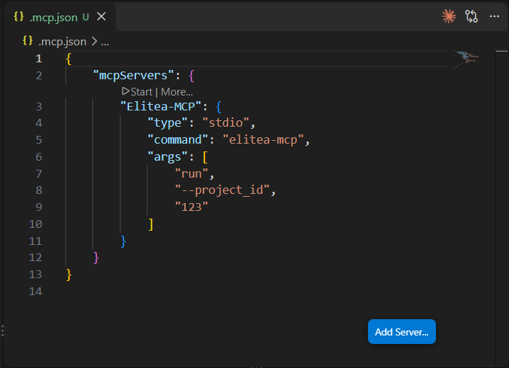

The Deployment URL and the token come from the configuration you saved with `elitea-mcp bootstrap`, so they are not in this file.
</Info>

---

### Tag Your Agents

For an agent to be available as a tool, it must have the `mcp` tag in your Elitea project. The server lists only the agents with this tag.

In Elitea, open the agent or pipeline you want to use, add the tag `mcp` (all lowercase) in the **Tags** field, and save your changes.

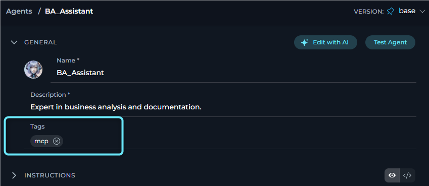

<Warning>
**Agent Tool Visibility**

Only agents with the `mcp` tag appear in VS Code. If no agent in the project has the tag, the server does not start and shows the message `No agents tagged "mcp" in project <ID>`. Tag the agents you want before you start the server.
</Warning>

---

### Start the Server

1. **Start the server**
     - Press `Ctrl+Shift+P` to open the Command Palette, and run **MCP: List Servers**
     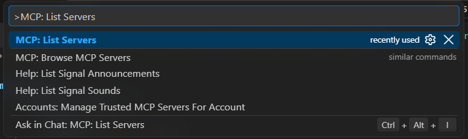
     - Select **elitea-mcp**, and select **Start Server**
     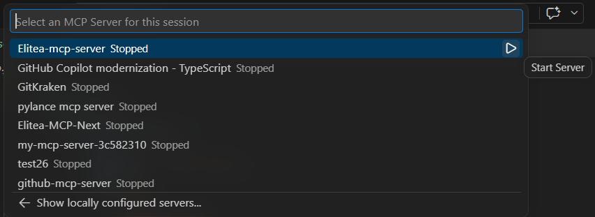

     You can also run **Chat: Open Customizations**, select **MCP Servers**, open the ellipsis (**...**) menu of the server, and select **Start Server**.

2. **Check the output**
     - Run **MCP: List Servers**, select **elitea-mcp**, and select **Show Output**
     - The **Output** view opens with the output of the server. If the server started, the output shows no error.

<Tip>
**Tag More Agents Later**

The server reads the tagged agents when it starts. After you tag another agent, run **MCP: List Servers**, select **elitea-mcp**, and select **Restart Server** to load it.
</Tip>

---

### Use Your Agent

You can now use your Elitea agents and pipelines from VS Code. The `elitea-mcp` server in this guide lists each one that has the `mcp` tag as a single tool.


1. **Open Copilot Chat**
     - Open the Chat view
     - In the agent picker, select **Agent**. MCP tools are available only in this mode.

2. **Check that the agents are listed**
     - Press `Ctrl+Shift+P` to open the Command Palette, and run **Chat: Open Customizations**
     - In the left pane, select **Tools**
     - Find **elitea-mcp** in the list. You can also enter its name in the **Type to search...** field.
     - Select the arrow next to the server name to expand it. Each agent with the `mcp` tag is listed under it as a tool.
     - If an agent is missing, check that it has the `mcp` tag in Elitea. Then run **MCP: List Servers**, select **elitea-mcp**, and select **Restart Server**.

     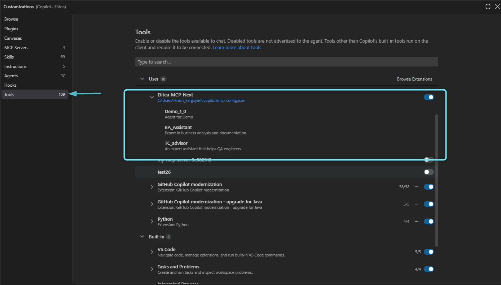

3. **Select the tools you want to use**
     - Turn on the switch of **elitea-mcp** to make its agents available to chat. Turn off the switch of any server you do not need. VS Code does not advertise a disabled tool to the agent.

4. **Enter your request and approve the tool call**
     - In the chat input, enter `#` and select your agent from the list, then enter your request. If the list does not show the agent, enter the agent name as plain text. The chat finds the matching MCP tool and runs it.
     - Example: `Use #BA_Assistant to show me the scope of the PLAN-6060 user story`

     - VS Code asks you to approve the call to the tool. Approve only a call you understand. Select **Allow Once** or **Allow** (**Continue** in older versions of VS Code) to run the tool, or **Skip** (**Cancel** in older versions) to decline it.

       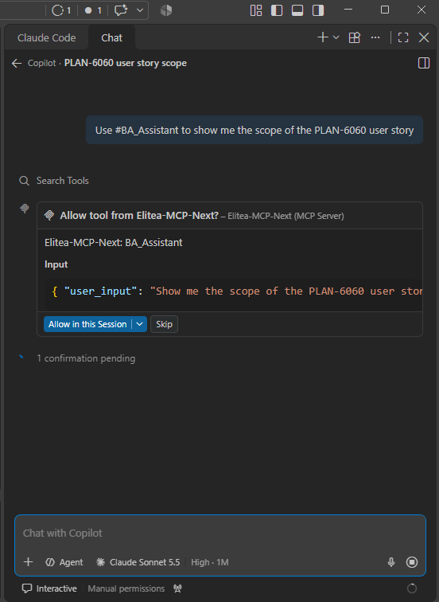

5. **Review the results**
     - Your agent runs and returns the result directly in the chat
     - To confirm that the answer came from your Elitea agent, expand the tool call in the conversation and check the input and the result

       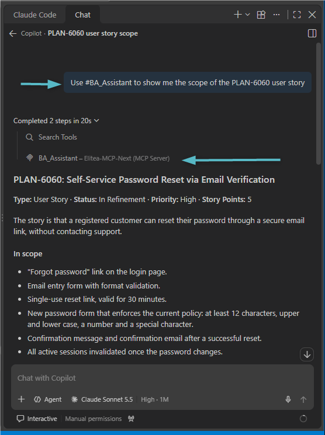

<Tip>
**Tool Inputs**

Each tool has a required `user_input` and one more input for each variable of the agent. A variable that has a value in Elitea uses that value by default.
</Tip>

<Note>
**Too Many Tools**

VS Code allows up to 128 tools in one request. If VS Code shows `Cannot have more than 128 tools per request`, turn off the tools or the MCP servers that you do not need. Run **Chat: Open Customizations**, select **Tools** and turn off their switches.
</Note>

---

## Troubleshooting

Find the message that matches your problem, then follow its steps. The messages from `elitea-mcp run` do not go to a log file. They go to the output of the MCP server in VS Code: run **MCP: List Servers**, select **elitea-mcp**, and select **Show Output**.

<Accordion title="The elitea-mcp command is not recognized">

The folder that holds the `elitea-mcp` command is not on your `PATH`.

1. Run `python -m pipx ensurepath` in PowerShell
2. Close and reopen PowerShell
3. Run `elitea-mcp --version` to check that the command works
4. Restart VS Code so it picks up the new `PATH`
</Accordion>

<Accordion title="The server says no agents are tagged mcp">

The output shows `No agents tagged "mcp" in project <ID>. Add the "mcp" tag to the agents you want to expose.`

1. Check that the **Project ID** in `mcp.json` is the project that holds your agents
2. In Elitea, add the `mcp` tag (all lowercase) to at least one agent in that project
3. Run **MCP: List Servers**, select **elitea-mcp**, and select **Restart Server**
</Accordion>

<Accordion title="No agents showing up in the Tools list">

1. Make sure your agents have the `mcp` tag in Elitea
2. Restart the server: run **MCP: List Servers**, select **elitea-mcp**, and select **Restart Server**
3. Check that you use the correct Project ID
4. The server lists up to 100 tagged agents. If you have more, remove the tag from the agents you do not need.
</Accordion>

<Accordion title="VS Code shows an error indicator or the server will not start">

1. Run **MCP: List Servers** from the Command Palette, and select **elitea-mcp**
2. Select **Show Output** to see the details. The **Output** view opens with the output of the server.


3. Match the message in the output to the cause:

   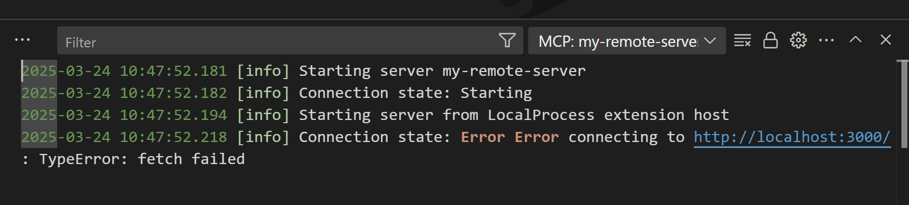

   - `Configuration missing. Please provide --deployment_url and --auth_token arguments or run bootstrap first.` - Run `elitea-mcp bootstrap`.
   - `Project ID is required` - Add `"--project_id", "<ID>"` to the `args` line in `mcp.json`.
   - `"project_id" must be a number` - Enter the Project ID as a number.
   - `Deployment URL "..." is not a valid URL` - Run `elitea-mcp bootstrap` again and enter the base address of Elitea, starting with `http://` or `https://`.
   - `Cannot reach <URL>: ... Check the URL, VPN or proxy.` - Check the Deployment URL, your VPN and your proxy.
   - `<URL> responded, but it is not an ELITEA platform` - The URL points to another site. Enter the base address of Elitea.
   - `Authentication failed: the token is invalid or expired` - Create another token in Elitea **Settings** > **Tokens** and run `elitea-mcp bootstrap` again.
   - `Your token has no access to project <ID>, or the project does not exist` - Check the Project ID in `mcp.json` and that your token belongs to a user of that project.
   - `Failed to fetch agent details: HTTP <code>` - A code of `401` or `403` means the token is wrong or has no access. A code of `404` means the Project ID, agent ID or version ID does not exist.
</Accordion>

<Accordion title="An agent is missing because two agents have the same name">

The output shows `Skipping agent with colliding name`.

1. The server turns each agent name into a tool name by replacing every character other than letters, digits, `_` and `-` with `_`. Two agents such as "BA Assistant" and "BA-Assistant" can end up with the same name.
2. Rename one of the agents in Elitea
3. Restart the server with **MCP: List Servers** > **elitea-mcp** > **Restart Server**
</Accordion>

<Accordion title="The server keeps disconnecting">

1. Check that your authentication token is still valid
2. Check your internet connection
3. Check that your Elitea Deployment URL is correct
4. Restart the server with **MCP: List Servers** > **elitea-mcp** > **Restart Server**
</Accordion>

<Accordion title="Multiple elitea-mcp versions are installed (pip and pipx conflict)">

If you see errors or unexpected behavior, you may have more than one version of `elitea-mcp`. This happens when you install it with both `pip` and `pipx`.

1. **Check for multiple installations:**
   ```powershell
   pip list | Select-String elitea-mcp
   pipx list | Select-String elitea-mcp
   ```

2. **Remove the pip version (keep pipx):**
   ```powershell
   pip uninstall elitea-mcp -y
   ```

3. **Check that the correct version is active:**
   ```powershell
   where.exe elitea-mcp
   ```

   You should see `C:\Users\<YourUsername>\.local\bin\elitea-mcp.exe`.

4. **Restart VS Code and the MCP server**

The pipx installation is the recommended method, because it keeps the tool in its own environment. A version installed with `pip` can conflict with it, and the system may use the wrong (often outdated) version.
</Accordion>

<Accordion title="The client is outdated or shows errors when it starts">

1. Upgrade the client in PowerShell:
   ```powershell
   pipx upgrade elitea-mcp
   ```
   If you installed with pip, use `pip install --upgrade elitea-mcp` instead.
2. Run `elitea-mcp --version` to check the installed version
3. Restart the server with **MCP: List Servers** > **elitea-mcp** > **Restart Server**
</Accordion>

---

<Info>
**Helpful Resources**

Elitea documentation:

- [MCPs Menu](../../menus/mcps)
- [Agents Menu](../../menus/agents)

External documentation:

- [MCP Protocol Official Docs](https://modelcontextprotocol.io/)
- [Add and use MCP servers in VS Code](https://code.visualstudio.com/docs/agent-customization/mcp-servers)
- [Manage and troubleshoot MCP servers](https://code.visualstudio.com/docs/agents/run/manage-mcp-servers)
- [MCP configuration reference](https://code.visualstudio.com/docs/agents/reference/mcp-configuration)
- [Use tools with agents](https://code.visualstudio.com/docs/agents/run/tools)
</Info>

---
