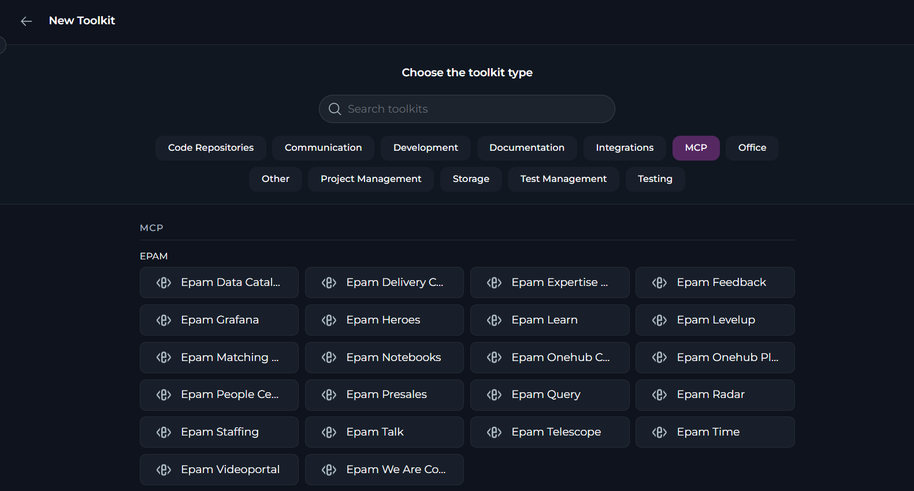
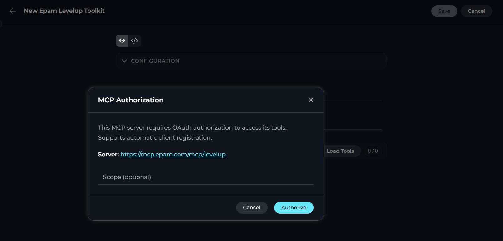
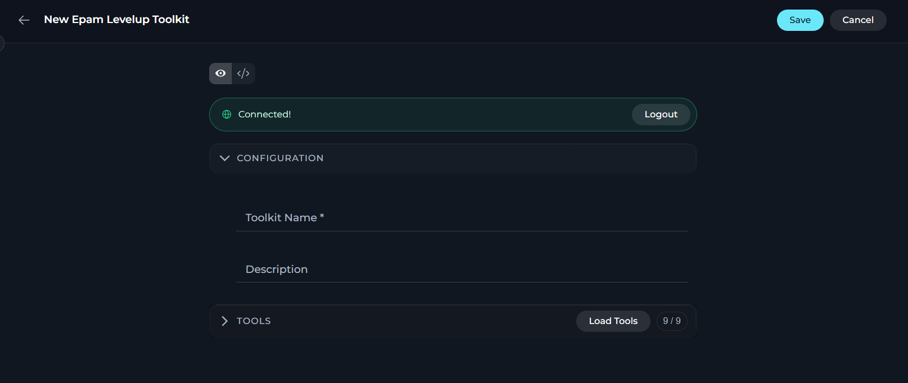
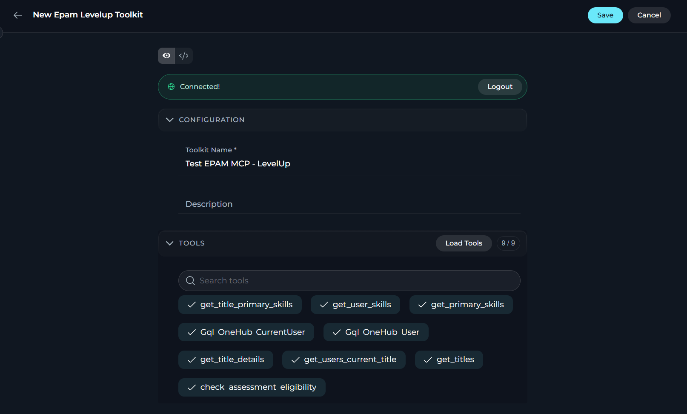

**EPAM MCP Servers** are ready-to-use MCP server connections for EPAM internal services and tools. Unlike remote MCP servers that require you to supply a server URL and credentials manually, EPAM MCP Servers are pre-configured by your ELITEA environment: connection settings (server URL, OAuth credentials) are automatically supplied at runtime so you can get started with just a few clicks.

## Available EPAM MCP Servers and Their Tools

EPAM MCP Servers are available at [next.elitea.ai](https://next.elitea.ai/) and are accessible only to EPAM employees. Authentication requires an active EPAM corporate account via the EPAM identity provider.

### EPAM MCP Servers

ELITEA supports most EPAM pre-built MCP servers:

<CardGroup cols={3}>
  <Card title="EPAM Data Catalog" icon="database" href="#epam-data-catalog">
    Discover, explore and describe data assets within EPAM's data catalog with search and metadata management tools.
  </Card>
  <Card title="EPAM Delivery Central" icon="chart-gantt" href="#epam-delivery-central">
    Review and update project delivery, risk and employee profile information.
  </Card>
  <Card title="EPAM Expertise Search" icon="magnifying-glass" href="#epam-expertise-search">
    Connect employee expertise, project data and case studies to quickly find relevant information for resource management and decision support.
  </Card>
  <Card title="EPAM Feedback" icon="comment-dots" href="#epam-feedback">
    Request, give or receive performance feedback from other employees.
  </Card>
  <Card title="EPAM Grafana" icon="chart-line" href="#epam-grafana">
    Query, inspect and manage Grafana dashboards, datasources and alerting configuration.
  </Card>
  <Card title="EPAM Heroes" icon="award" href="#epam-heroes">
    Recognize and reward colleagues' contributions and achievements by giving and tracking badges.
  </Card>
  <Card title="EPAM Learn" icon="graduation-cap" href="#epam-learn">
    Explore and access EPAM's learning solutions, courses and professional development resources.
  </Card>
  <Card title="EPAM Level Up" icon="arrow-trend-up" href="#epam-level-up">
    Check career growth requirements and skill matrices for titles and primary skills.
  </Card>
  <Card title="EPAM Matching Model" icon="diagram-project" href="#epam-matching-model">
    Match candidates to open positions and compare relevance scores for staffing.
  </Card>
  <Card title="EPAM Notebooks" icon="book-open" href="#epam-notebooks">
    Access OneHub Notebooks for data science and analytical workloads.
  </Card>
  <Card title="EPAM OneHub Core" icon="circle-nodes" href="#epam-onehub-core">
    Single access point for searching users, projects and skills as part of the OneHub platform.
  </Card>
  <Card title="EPAM OneHub Play" icon="window" href="#epam-onehub-play">
    Create, manage and share lightweight web apps built with Copilot Builder or uploaded as projects.
  </Card>
  <Card title="EPAM People Central" icon="users" href="#epam-people-central">
    Streamline HR and people management tasks relating to staffing, performance, retention and recognition.
  </Card>
  <Card title="EPAM Presales" icon="handshake" href="#epam-presales">
    Search EPAM presales content, including case studies, projects, opportunities and solutions.
  </Card>
  <Card title="EPAM Query" icon="terminal" href="#epam-query">
    Centralized knowledge platform to find answers, search documentation and retrieve content from EPAM documents.
  </Card>
  <Card title="EPAM Radar" icon="radar" href="#epam-radar">
    Search, filter, analyze and report across people, positions, projects and hiring data within EPAM.
  </Card>
  <Card title="EPAM Staffing" icon="briefcase" href="#epam-staffing">
    Access and operate on employees, applicants, positions, projects, requisitions, skills and staffing processes.
  </Card>
  <Card title="EPAM Talent Hub" icon="chart-pie" href="#epam-talent-hub">
    Review organizational units, team rosters, dashboard metrics and employee performance insights.
  </Card>
  <Card title="EPAM Talk" icon="comments" href="#epam-talk">
    Manage one-on-one talks and performance expectations for employees.
  </Card>
  <Card title="EPAM Telescope" icon="calendar" href="#epam-telescope">
    Check a person's or project's availability calendar, custom calendar and vacations.
  </Card>
  <Card title="EPAM Time" icon="clock" href="#epam-time">
    Review employee and project calendar days, time reporting issues and leave requests.
  </Card>
  <Card title="EPAM VideoPortal" icon="video" href="#epam-videoportal">
    Search and browse videos, channels and playlists, and load video metadata and transcripts.
  </Card>
  <Card title="We Are Community" icon="people-group" href="#we-are-community">
    Connect with EPAM's professional and social communities and events.
  </Card>
</CardGroup>

### EPAM MCP Server Tools

Each EPAM MCP server exposes a set of tools that agents can invoke to interact with the corresponding EPAM internal service.

<Warning title="Access depends on your EPAM account permissions">
Available tools and returned data depend on your EPAM corporate account permissions. If you lack access to an EPAM MCP server, tools will not load and you will see:

Contact your EPAM administrator to request the necessary access.
</Warning>

<Note>
Each accordion below corresponds to one EPAM MCP server. Expand an accordion to browse the tools available for that server.
</Note>

<AccordionGroup>

<Accordion title="EPAM Data Catalog">

Enables efficient discovery, exploration and governance of data assets within EPAM's data catalog, providing users with detailed information, search capabilities and metadata management through structured tools and protocols.

| Tool | Description |
|------|-------------|
| `get_current_user` | Get the current user's identity and roles in the Data Catalog. |
| `get_data_details` | Get detailed information for a specific data asset by its ID. |
| `get_data_type_definition` | Get the attribute definitions and allowed link types for a data type. |
| `get_doc` | Get one or more markdown guidance documents by their reference. |
| `list_data_types` | List the Data Catalog data types, ordered by priority. |
| `save_data_description` | Save a description for a Data Catalog data entity. |
| `search_data` | Search for data assets, with optional structured filters. |
| `search_data_facets` | Discover the exact facet keys and values to use when filtering `search_data`. |
| `search_data_semantic` | Search for data assets by natural-language meaning. |
| `search_services` | Search Data Catalog services by name. |

</Accordion>

<Accordion title="EPAM Delivery Central">

Interact with EPAM Delivery Central to review and update project delivery, risk and employee profile information.

| Tool | Description |
|------|-------------|
| `create_action_item` | Create an action item for an employee profile. |
| `get_action_item_categories` | Get the allowed action item categories. |
| `get_employee_info` | Get an employee's directory fields and active project profiles. |
| `get_finance_unit_summary` | Get a financial summary (revenue, cost, margin, budget, FTE, seniority) for a unit. |
| `get_perf_metric` | Retrieve performance delivery information from Delivery Central for a particular unit and metric. |
| `get_profile_action_items` | Get the role expectations and action items for an employee profile. |
| `get_status_history` | Retrieve the history of status updates for a specific unit within a time period. The unit can be resolved by ID or by name. |
| `get_team_info` | Retrieve general information about development team parameters and metrics including Project and Company NPS scores, team seniority, performance retention, team composition and geographical distribution. Does not return personal employee data. |
| `get_unit_attributes` | Get a unit's attributes, ancestor hierarchy and key staff. |
| `get_unit_attrition_reasons` | Get the allowed attrition reason values for a unit's account. |
| `get_unit_health_data` | Retrieve health delivery information for a particular unit. Summarizes unit data with output adapted to unit type and hierarchy position. Supports `short` and `detailed` response modes. |
| `get_unit_risks` | Get risks of the unit. |
| `resolve_unit_by_name` | Resolve a unit's ID, name, type and ancestor path from its name. |
| `search_project_members` | Get a unit's employees, optionally filtered by performance rating, impact level or risk of leaving. |
| `search_unit_targets` | Search for objectives, key results, milestones or deliverables under a unit and its subunits. |
| `update_employee_profile_metrics` | Update an employee's impact, risk of leaving or performance metrics on a project profile. |
| `update_unit_status` | Update a delivery unit's health status. |
| `upsert_unit_risk` | Create or update a risk for a delivery unit. |

</Accordion>

<Accordion title="EPAM Expertise Search">

Provides access to integrated organizational knowledge by connecting employee expertise, project data and case studies. Empowers users to quickly find relevant information for resource management, project insights and decision support within EPAM.

| Tool | Description |
|------|-------------|
| `current_user_id` | Get current user externalId that can be used in other tools to load information about the user. |
| `load_case_studies` | Load project case studies. |
| `load_employees_expertise` | Load employees expertise profiles including expert domains, certificates, client experience, deliverables, key contributions, VCN roles, work history, education and skills. |
| `load_employees_profile` | Load employees organizational profiles. |
| `load_presales` | Load presales. |
| `load_project_employees` | Load employees working on a project and their roles and positions. |
| `load_projects` | Load projects organizational profiles. |
| `load_projects_details` | Load projects details profiles including scope of work, activities, challenges and accomplishments. |
| `search_case_studies` | Search project case studies. |
| `search_employees` | Search employees profiles. |
| `search_employees_name` | Search employees identifiers by employee name. |
| `search_presales` | Search presales. |
| `search_projects` | Search projects profiles. |
| `search_qna` | Search questions asked by employees in the 'WFT Project Managers' email group. |

</Accordion>

<Accordion title="EPAM Feedback">

Interact with EPAM Feedback to request, give and receive performance feedback from other employees.

| Tool | Description |
|------|-------------|
| `Gql_OneHub_CurrentUser` | Get the current user's profile info. |
| `Gql_OneHub_User` | Search for a single user/person details. |
| `addBulkReviews` | Create multiple review records from a single request. |
| `changeReviewDueDate` | Update the due date of a review you created. |
| `changeReviewForm` | Change the review form type for a review. |
| `countReviews` | Get the count of reviews matching the given criteria. |
| `deleteReview` | Delete a review by its ID. |
| `findReviewsFullPaged` | Get a paginated list of full review records, filtered by reviewee, reviewer or status. |
| `findReviewsShortPaged` | Get a paginated list of short review records (without form content), filtered by reviewee, reviewer or status. |
| `getRoles` | Get role mappings for reviewee/reviewer email combinations. |
| `openReview` | Retrieve the full details of a review by its ID. |
| `refuseReview` | Refuse a review and save the refusal details. |
| `saveReviewForm` | Save the review form content for a review. |
| `shareReview` | Share a review with its intended recipients. |

</Accordion>

<Accordion title="EPAM Grafana">

Provides access to EPAM Grafana and its observability ecosystem, so agents and chatbots can query and analyze project metrics, and search, inspect, create and update dashboards, datasources and alerting configuration.

| Tool | Description |
|------|-------------|
| `alerting_manage_routing` | Manage alerting routing configuration: notification policies, contact points and time intervals. |
| `alerting_manage_rules` | Create, read, update or delete Grafana alert rules. |
| `alerting_manage_silences` | List, create, update or delete Grafana alerting silences. |
| `check_datasources_health` | Check the health of one or more datasources, or all datasources. |
| `create_annotation` | Create an annotation on a dashboard or panel. |
| `create_datasource` | Create a datasource. |
| `delete_annotation` | Permanently delete an annotation by ID. |
| `generate_deeplink` | Generate a deeplink URL for a dashboard, panel or Explore query. |
| `get_annotation_tags` | Get annotation tags, optionally filtered by tag name. |
| `get_annotations` | Get annotations filtered by dashboard, time range or tags. |
| `get_dashboard_by_uid` | Get the complete dashboard, including panels, variables and settings, by its UID. |
| `get_dashboard_panel_queries` | Get the panel queries from a dashboard. |
| `get_dashboard_property` | Get specific parts of a dashboard using a JSONPath expression. |
| `get_dashboard_summary` | Get a compact summary of a dashboard, without its full JSON. |
| `get_datasource` | Get detailed information about a datasource by UID or name. |
| `get_doc` | Get a Grafana documentation page. |
| `get_panel_image` | Render a dashboard panel, or a full dashboard, as a PNG image. |
| `get_query_examples` | Get example queries for a datasource type. |
| `list_cloudwatch_dimension_values` | List the values for a CloudWatch dimension key. |
| `list_cloudwatch_dimensions` | List the dimension keys for a CloudWatch metric. |
| `list_cloudwatch_metrics` | List the metrics for a CloudWatch namespace. |
| `list_cloudwatch_namespaces` | List the available CloudWatch namespaces. |
| `list_dashboard_versions` | List the saved versions of a dashboard. |
| `list_datasources` | List all configured datasources. |
| `list_prometheus_label_names` | List the label names in a PromQL-compatible datasource. |
| `list_prometheus_label_values` | Get the values for a label name in a PromQL-compatible datasource. |
| `list_prometheus_metric_metadata` | List metric metadata for a PromQL-compatible datasource. |
| `list_prometheus_metric_names` | List the metric names in a PromQL-compatible datasource. |
| `query_cloudwatch` | Query AWS CloudWatch metrics. |
| `query_prometheus` | Query a PromQL-compatible datasource with a PromQL expression. |
| `query_prometheus_histogram` | Query Prometheus histogram percentiles. |
| `search_dashboards` | Search dashboards by query, folder, tag or starred status. |
| `search_docs` | Search Grafana documentation. |
| `search_folders` | Search for Grafana folders by a query string. |
| `update_annotation` | Update the properties of an annotation by ID. |
| `update_dashboard` | Create or update a dashboard. |
| `update_datasource` | Update the non-secret fields of a datasource by UID. |
| `user_info` | Get information about the current Grafana identity. |

</Accordion>

<Accordion title="EPAM Heroes">

Interact with EPAM Heroes to give, search and validate recognition badges for employees.

| Tool | Description |
|------|-------------|
| `Gql_OneHub_User` | Search for a single user/person details. |
| `assignBadges` | Create badge assignments for one or more resolved employees, for SOCIAL or SYSTEM badge types. Do not use this tool to choose a badge, search the catalog, validate recipients or draft a comment. |
| `getBadge` | Retrieve one full badge definition by badge ID, including its name, status, description, type and assignment rules. |
| `getBadgeHolders` | List employees who hold a selected badge. |
| `getBadgeSections` | Get the badge catalog grouped into Give-a-badge sections, for selecting a badge to give. |
| `getEmployeeBadges` | List badges received by one employee. |
| `getGivenBadgeComments` | Get comment examples or history for a selected employee and badge. |
| `searchByName` | Look up a badge by its name, or part of its name, and return matching badges with their badge IDs. |
| `validateBadgeRecipients` | Validate whether a selected badge can be assigned to one or more resolved employees. |

</Accordion>

<Accordion title="EPAM Learn">

Supports and manages the learning process: search courses, track progress and skills, and manage team training requests.

| Tool | Description |
|------|-------------|
| `approve_team_requests` | Approve one or more of your team's training requests. |
| `check_current_user_courses_eligibility` | Filter a list of course IDs to the ones open and accessible to you. |
| `coordinator_list_courses` | List the courses where you hold a coordinator, observer or trainer role. |
| `coordinator_participant_issues` | List a course's participants with their per-module status and issues. |
| `course_list_groups` | List the groups of a course. |
| `course_participant_block_tree` | Get the full hierarchical block tree for one participant in a course. |
| `course_participant_blocks_progress` | Get per-block progress for one participant in a course. |
| `course_participant_progress` | Get paged participant progress for a course. |
| `get_badges_support` | Get the diagnostic status of badges for a course. |
| `get_catalog_course_profile` | Get a course's profile: summary, audience, outcomes, skills, duration and badges. |
| `get_conversation_nudges` | Get suggested follow-up messages after a learning-evidence or course search. |
| `get_course_feedback_submissions` | Get the completed feedback submissions for a course. |
| `get_feedback_respondents` | Get the list of feedback respondents for a course. |
| `get_feedback_statistics` | Get aggregated feedback statistics for a course. |
| `get_skills_status` | Get the status of skills associated with a course. |
| `get_team_requests` | List the training requests submitted by your direct reports. |
| `get_team_training_completion` | Get your team's training history. |
| `participant_latest_education` | Get a participant's enrollment history. |
| `ping` | Check that the MCP server is alive. |
| `reject_team_requests` | Reject one or more of your team's training requests. |
| `search_catalog_items` | Search the course catalog by name. |
| `search_learning_evidence` | Search EPAM Learn course content for evidence relevant to a question. |
| `search_relevant_courses` | Search the course catalog for courses matching a learning intent or skill. |

</Accordion>

<Accordion title="EPAM Level Up">

Interact with EPAM Level Up to check skill requirements and assessment eligibility for career titles.

| Tool | Description |
|------|-------------|
| `Gql_OneHub_CurrentUser` | Get the current user's profile info. |
| `Gql_OneHub_User` | Search for a single user/person details. |
| `check_assessment_eligibility` | Check whether a user is eligible for an assessment, and the factors affecting that eligibility. |
| `get_primary_skills` | Search for primary skills matching your text entry. |
| `get_title_details` | Get detailed information about a title and primary skill, including the title level, track and skill matrix. |
| `get_title_primary_skills` | Get the primary skills associated with a title ID. |
| `get_titles` | Search for titles matching your text entry, along with their associated primary skills. |
| `get_user_skills` | Get a user's skills with their developed levels. |
| `get_users_current_title` | Get the current title for one or more users. |

</Accordion>

<Accordion title="EPAM Matching Model">

Interact with the EPAM Matching Model to find and rank matching candidates and positions, and compare their relevance scores.

| Tool | Description |
|------|-------------|
| `Gql_OneHub_CurrentUser` | Get the current user's profile info. |
| `Gql_OneHub_User` | Search for a single user/person details. |
| `get_candidates_by_description` | Search for active candidates by a free-text position or role description. |
| `get_candidates_for_position` | Get ranked matching candidates for a position. |
| `get_post_acquisition_positions_predictions` | Suggest open positions that match an employee's profile. |
| `get_relevance_score` | Get the relevance score between one or more candidate/position pairs. |
| `get_relevance_score_with_skills` | Run a what-if relevance score using hypothetical skills instead of the candidate's stored skills, without saving any change. |
| `get_similar_applicants` | Find applicants similar to a baseline applicant. |
| `get_similar_candidates` | Find candidates similar to a given base candidate, optionally in the context of a position. |
| `get_similar_employees_for_applicant` | Find active employees similar to a baseline applicant. |
| `get_top_candidates_predictions` | Get precomputed candidate predictions for a position from the latest forecast run. |
| `get_top_positions_predictions` | Get precomputed position predictions for a candidate from the latest forecast run. |
| `matching_candidate_candidate` | Compare two candidates side by side, with per-attribute grades. |
| `matching_position_candidate` | Get the relevance score and matching attributes for a position/candidate pair. |
| `simulate_position_changes` | Run a what-if analysis of how changing a position's requirements would affect candidates' relevance scores, without saving any change. |

</Accordion>

<Accordion title="EPAM Notebooks">

Provides access to OneHub Notebooks for data science and analytical workloads.

| Tool | Description |
|------|-------------|
| `document_create` | Create a document. |
| `document_edit` | Edit a document. |
| `document_edit_publication` | Edit the publication status of an HTML document. |
| `document_rename` | Rename a document. |
| `documents_read` | Read document content. |
| `documents_search` | Search document fragments. |
| `notebook_create` | Create a workspace. |
| `notebook_details` | Get notebook workspace details including current user role, all workspace members and available documents. |
| `notebook_edit_members` | Edit workspace members. |
| `notebooks_discover` | List notebook workspaces. |

</Accordion>

<Accordion title="EPAM OneHub Core">

{/*
Provides a single access point for searching for information on users, projects and skills. It is used as part of the OneHub platform.

| Tool | Description |
|------|-------------|
| `Gql_OneHub_CurrentUser` | Gets current user profile info. Used when the user refers to themselves. |
| `Gql_OneHub_Location` | Search for a single location (City, Country, Region) details. |
| `Gql_OneHub_Project` | Get single project details — general information, description, status, dates and key staff. Do not use for people search. |
| `Gql_OneHub_Project_Positions` | Get single project positions: people who work on a project. |
| `Gql_OneHub_Skills` | Get all possible values for person skills (primary and key skills). |
| `Gql_OneHub_User` | Search for a single user/person details. |
| `Gql_OneHub_Users` | Search for multiple users/persons summary information including total count, paginated results and next page availability. |
*/}

Provides access to integrated organizational knowledge by connecting employee expertise, project data and case studies. Empowers users to quickly find relevant information for resource management, project insights and decision support within EPAM.

| Tool | Description |
|------|-------------|
| `current_user_id` | Get current user externalId that can be used in other tools to load information about the user. |
| `load_case_studies` | Load project case studies. |
| `load_employees_expertise` | Load employees expertise profiles including expert domains, certificates, client experience, deliverables, key contributions, VCN roles, work history, education and skills. |
| `load_employees_profile` | Load employees organizational profiles. |
| `load_presales` | Load presales. |
| `load_project_employees` | Load employees working on a project and their roles and positions. |
| `load_projects` | Load projects organizational profiles. |
| `load_projects_details` | Load projects details profiles including scope of work, activities, challenges and accomplishments. |
| `search_case_studies` | Search project case studies. |
| `search_employees` | Search employees profiles. |
| `search_employees_name` | Search employees identifiers by employee name. |
| `search_presales` | Search presales. |
| `search_projects` | Search projects profiles. |
| `search_qna` | Search questions asked by employees in the 'WFT Project Managers' email group. |

</Accordion>

<Accordion title="EPAM OneHub Play">

Host and manage HTML applications in OneHub Play.

| Tool | Description |
|------|-------------|
| `app_details` | Get an application's details, including publication status and available versions. |
| `app_edit_availability` | Edit the availability of a published version. |
| `app_spec_create` | Create a specification document for an application. |
| `app_spec_edit` | Edit a specification document for an application. |
| `app_spec_read` | Read a specification document's content. |
| `apps_create` | Create an application. |
| `apps_discover` | List the applications you own. |
| `version_create` | Create a version of an application. |
| `version_publish` | Publish a version of an application. |
| `version_read_content` | Read a version's HTML content. |

</Accordion>

<Accordion title="EPAM People Central">

Provides data-driven tools and processes documentation to streamline HR and people management tasks relating to staffing, performance, retention and recognition.

| Tool | Description |
|------|-------------|
| `Gql_OneHub_User` | Search for a single user/person details. |
| `docs_read` | Read documentation by URI(s). Returns Markdown content. Most useful entrypoint: `file:///docs/index.md` (lists HR and JS entrypoints). |
| `jint_execute` | Execute JavaScript code in a sandboxed Jint environment for advanced HR data operations. Requires reading API docs before use. |
| `people_central_employee_ai_summary` | Returns an AI-generated extended summary on subordinates: status, performance, achievements and more. Available only for direct subordinates. |

</Accordion>

<Accordion title="EPAM Presales">

Search EPAM presales content, including case studies, projects, opportunities and solutions.

| Tool | Description |
|------|-------------|
| `analyst` | Search Analyst Relations materials and reports from Gartner, Forrester and IDC. |
| `casestudies` | Search client-facing case studies. |
| `export_search_results` | Export the results from a Presales Portal search URL. |
| `get_document_details` | Get a document's content, metadata and contacts by document ID. |
| `get_document_download_urls` | Get temporary download links for a document's original file and thumbnail. |
| `get_document_structure` | Get summaries of a presentation's extracted slides by document ID. |
| `get_opportunity_details` | Resolve a Presales Portal, Dynamics CRM, OneCRM or SharePoint URL to its matching opportunity's CRM account and engagement details. |
| `get_similar_documents` | Find documents similar to a document identified by document ID. |
| `industries` | List EPAM industries with their taxonomy paths and EDIDs. |
| `offering_slides` | Search pitch deck slides for client conversations about an offering, product, blueprint or point of view. |
| `offerings` | Search verified offerings, products, blueprints and accelerators in the EPAM Growth Marketplace. |
| `opportunities` | Search EPAM CRM opportunities, optionally filtered by industry. |
| `policy` | Search the Ethics & Compliance Library for EPAM policies, certifications and regulations. |
| `projects` | Search EPAM project information and AI-generated summaries, optionally filtered by industry. |
| `qna` | Search client questions and answers from the past four years. |
| `salesbuddy` | Search validated FAQs from prior RFIs and RFPs about EPAM. |
| `slides` | Search slides from EPAM presentations and RFx responses created within the past two years. |
| `solutions` | Search EPAM SolutionsHub for software and service solutions. |
| `story_slides` | Search client-ready sales presentation slides about EPAM capabilities. |
| `toolbox_slides` | Search reusable EPAM Presales Toolbox slides, including proposal building blocks and brand templates. |
| `websites` | Search public EPAM websites, including epam.com. |
| `whoami` | Get the current user's display name and internal Microsoft Entra ID. |

</Accordion>

<Accordion title="EPAM Query">

The Query MCP server acts as a centralized knowledge platform for EPAM. It enables users to quickly find answers, search documentation and retrieve content from documents.

| Tool | Description |
|------|-------------|
| `query_ask` | Answer a short question using available documentation, with links to the matched documents. |
| `query_ask_pub` | Answer a short question using the entire publicly available EPAM documentation, with links to the matched documents. |
| `query_getTexts` | Gets the text content of documents by their document IDs. |
| `query_ping` | Method for connectivity healthcheck. |
| `query_search` | Search for documents according to a text query and an optional set of filters. |
| `query_search_pub` | Search for documents in the entire publicly available EPAM documentation. |
| `query_whoami` | Answers questions like "who am I" based on the user's authorization token. |

</Accordion>

<Accordion title="EPAM Radar">

Provides access to EPAM data such as people, positions, projects and hiring processes, enabling advanced search, filtering, analysis and reporting across multiple business domains.

| Tool | Description |
|------|-------------|
| `export_excel` | Start an asynchronous Excel export for a Radar query or saved search. Returns a `uid` for polling with `get_export_status`. Supports two modes: Query mode (`entityType` + `query` + `columns`) or Search mode (`searchId`). |
| `get_entity` | Fetch a single Radar entity by its ID and type. Returns default key summary fields or only specified fields. Useful for deep analysis after finding an entity via `query_radar` or `get_search_result`. |
| `get_entity_fields` | Get schema fields for a specific entity type. Use when you need fields not in the default projection (e.g., nested data like positions or skills breakdown). |
| `get_excel_columns` | List Excel export columns available to the current user for a given entity type. Call before `export_excel` to discover valid, permission-filtered column IDs. |
| `get_export_status` | Poll the status of an async Excel export job started by `export_excel`. Returns `pending`, `failed` or `completed` with a `directDownloadUrl` valid for 1 hour. |
| `get_filter_values` | Get complete technical details and possible values for a specific filter. Mandatory before using any filter in `query_radar` or `get_search_by_query`. |
| `get_filters` | Get all available filters for a specific entity type. Always call `get_filter_values` for any filter before using it in queries. |
| `get_my_searches` | List the user's saved searches with name and ID. Use before `get_search_result` when the user asks to load a saved or shared search. |
| `get_radar_glossary` | Provides domain-specific terminology and definitions for Staffing Radar. Explains EPAM/Radar-specific terms, field meanings and data relationships. |
| `get_search_by_query` | Convert an MCP query to a persistent Radar saved search and return a shareable URL. Use only when the user explicitly asks to save or share a search — not for data retrieval. |
| `get_search_result` | Execute a saved search by ID and return matching entities. Use only when the user provides a `searchId` or explicitly requested a persistent search via `get_search_by_query`. |
| `global_search` | Query Radar data by a simple free-text string across multiple fields (names, IDs, emails). Best for simple lookups; use `query_radar` for structured filtering. |
| `group_data_by` | Group and aggregate data by one or two dimensions (facets). Returns a count matrix for slice-and-dice analysis. Call `get_filters` first to discover groupable facets. |
| `query_radar` | Default tool for retrieving Radar data using structured filters. Use for all data requests — find, show, list, count, search, analyze — when the user specifies criteria. |
| `submit_user_feedback` | Submit user feedback about MCP tool usage, results quality or suggestions for improvement. |
| `whoami` | Return the current user's Radar profile for context. Use when the user asks "who am I" or references their own positions or projects. |

</Accordion>

<Accordion title="EPAM Staffing">

Provides detailed information and performs operations related to employees, applicants, positions, projects, requisitions, skills and staffing processes within EPAM's staffing management system.

| Tool | Description |
|------|-------------|
| `bulk-add-applicants-to-pool` | Add multiple applicants to a pool as hiring links in a specified status. |
| `bulk-add-applicants-to-requisition` | Add multiple applicants to a requisition as hiring links in a specified status. |
| `change-proposal-state` | Perform a state transition for a proposal. Check `availableTransitions` on the proposal before calling. |
| `create-position` | Create a position in Staffing Desk on a Project or Opportunity. Modifies data. |
| `create-proposal` | Propose a candidate to an open position. Always call `get-proposal-conflicts` first. |
| `edit-position` | Edit an existing position in Staffing Desk. Modifies data. |
| `get-api-epam-com-dictionary` | Look up records of an api.epam.com dictionary backing a custom field. |
| `get-applicant-by-id` | Get a single applicant's info by their ID. |
| `get-applicant-proposals` | Get proposals made for a specific applicant. |
| `get-applicant-skills` | Get skills an applicant has, including spoken languages. |
| `get-applicant-sources` | Get the list of applicant sources. |
| `get-available-billing-types` | Get billing types available for position creation. |
| `get-available-position-validation-statuses` | Get the demand-validation statuses you can currently assign to a position. |
| `get-container-by-id` | Get a container (Project or Opportunity) by ID. |
| `get-current-date` | Get the current date. |
| `get-current-user` | Get info about the current user. |
| `get-custom-dictionary` | Get the allowed records of a Staffing Desk custom dictionary. |
| `get-custom-field-definition` | Get a Staffing Desk custom field's definition by ID. |
| `get-employee-by-id` | Get a single employee's info by their ID. |
| `get-employee-proposals` | Get proposals made for a specific employee. |
| `get-employee-skills` | Get skills an employee has, including spoken languages. |
| `get-job-functions` | Get list of Job Functions available for search or creation of entities in Staffing Desk. |
| `get-no-go-location-reasons` | Get the list of reasons for marking a location as no-go on a position. |
| `get-pool` | Get detailed information about a pool by its ID. |
| `get-position` | Get detailed information about a position by its ID. |
| `get-position-allowed-custom-fields` | Get the custom field definitions allowed on a position for a given project. |
| `get-position-monthly-workload` | Get monthly workload of a position for a specified period. |
| `get-position-proposals` | Get proposals made for a specific position. |
| `get-position-roles` | Get the list of roles for position creation or filtering. |
| `get-position-validation-issues` | Get the demand-validation issues detected on a position. |
| `get-position-weekly-workload` | Get weekly workload of a position for a specified period. |
| `get-proposal-conflicts` | Check restriction rules, proposal conflicts and matching scores before proposing a candidate. Always call before `create-proposal`. |
| `get-proposal-decline-reasons` | Get the list of reasons for declining a proposal. |
| `get-proposal-transitions` | Get the list of available state transitions for a proposal. Call before `change-proposal-state`. |
| `get-reasons-for-office-only` | Get options for the Reasons for Office Only field for a Position or Container. |
| `get-reasons-for-opening` | Get reasons for opening a position. |
| `get-reasons-for-partial-office` | Get options for the Reasons for Partial Office field for a Position or Container. |
| `get-requisition` | Get detailed information about a requisition by its ID. |
| `get-spoken-languages` | Get the list of spoken languages that can be required on a position. |
| `get-staffing-channels` | Get possible options for Staffing Channels for a position. |
| `get-staffing-desk-url` | Get the URL of the Staffing Desk environment this server works with. |
| `get-support-email` | Get the support email for submitting issues, requests or feedback on Staffing Desk. |
| `get-timezone-info` | Get information about a time zone by its ID. |
| `get-work-from-office-required` | Get possible options for the 'Work from office required' field on a position. |
| `preselect-applicant-for-pool` | Preselect an applicant for a pool, creating a hiring link. |
| `preselect-applicant-for-requisition` | Preselect an applicant for a requisition, creating a hiring link. |
| `search-applicant-locations` | Search applicant locations by name, type or parent ID. |
| `search-applicants-by-name` | Search applicants by fuzzy query. Returns short info sorted by similarity. |
| `search-containers` | Search containers (Projects or Opportunities) by various parameters. |
| `search-customers` | Search customers by various parameters. |
| `search-employees` | Search employees for staffing purposes by various criteria. At least one filter required. |
| `search-employees-by-name` | Search employees by fuzzy query. Returns short info sorted by similarity. |
| `search-locations` | Search locations by various filters. |
| `search-pools` | Search pools in Staffing Desk by various criteria. At least one filter required. |
| `search-positions` | Search positions in Staffing Desk by various criteria. At least one filter required. |
| `search-recruiters` | Search for recruiters available for hiring links. |
| `search-requisitions` | Search requisitions in Staffing Desk by various criteria. At least one filter required. |
| `search-skill-specs` | Search skill specializations by name. |
| `search-skills` | Search skills. |
| `search-titles` | Get list of job titles. |
| `update-position-validation-issue` | Resolve, ignore or revert a demand-validation issue on a position. |
| `update-position-validation-status` | Change the demand-validation status of a position. |

</Accordion>

<Accordion title="EPAM Talent Hub">

Provides data-driven tools and process guidance for Talent Hub operations, helping managers and employees navigate organizational units, role-based access, dashboard metrics, team structure and unit-level insights.

| Tool | Description |
|------|-------------|
| `getActionCategories` | Get all enabled action categories, with their linked actions. |
| `getActionCategoryById` | Get a category catalog entry by ID, with its linked actions. |
| `getCurrentUser` | Get identity information for the current user. |
| `getCustomRoles` | Get all custom roles, sorted by name. |
| `getEmployee` | Get minimal identity information for an employee by profile ID. |
| `getEmployeeBusinessImpact` | Get utilization, margin and staffability indicators for an employee. |
| `getEmployeeCheckInAttrition` | Get the attrition assessment from an employee's most recent check-in talk. |
| `getEmployeeCheckInPartnerEvaluation` | Get the growth potential and performance data from an employee's most recent check-in talk. |
| `getEmployeeCheckInPrevious` | Get an employee's latest Performance check-in talk, with company metrics as they stood before that talk. |
| `getEmployeePerformanceHistoryV2` | Get an employee's individual performance metric changes over the last 12 months. |
| `getEmployeeProjects` | Get an employee's current project assignments, with impact, risk, performance and workload data. |
| `getEmployeeReportingLine` | Get an employee's direct-manager chain. |
| `getRoleAssignments` | Get all assignments for a role type, optionally filtered by employee. |
| `getSignalEventById` | Get a signal event, including all affected people. |
| `getSignalEvents` | Get the signal events for the current manager, filtered by role. |
| `getTalentPartnersForEmployee` | Get the talent partners assigned to an employee. |
| `getTeamMembersPagedForUnits` | Get a page of team roster rows with assessment fields, for one or more units. |
| `getUnitsGroupedByNetwork` | Get the current user's managed unit hierarchies, grouped by network. |
| `getUnitsMetrics` | Get dashboard widget metrics for one or more organizational units. |
| `listAnalyticsReports` | List all enabled analytics reports. |
| `searchEmployeesByName` | Search for employees by name, within your accessible people network. |

</Accordion>

<Accordion title="EPAM Talk">

Interact with EPAM Talk to manage one-on-one talks and performance expectations.

| Tool | Description |
|------|-------------|
| `Gql_OneHub_User` | Search for a single user/person details. |
| `getMyExpectations` | Get the current user's performance expectations that are to-do or in progress. |
| `talk_info` | Get talk status info for one or more employees by their UPSA/PMC/Global ID. |
| `talk_save` | Create a new one-on-one talk, or update an existing one, with a follow-up note and an optional managers-only note. |

</Accordion>

<Accordion title="EPAM Telescope">

Check a person's or project's availability calendar, custom calendar and vacations.

| Tool | Description |
|------|-------------|
| `get_person_availability_calendar` | Get a person's profile (name, title, primary skill, location, time zone, weekend days, projects and streams) plus their availability calendar: public holidays, vacations, anniversaries and birthdays. |
| `get_person_custom_calendar` | Get a person's calendar events, such as vacations and public holidays. |
| `get_project_vacations` | Get a project's calendar events, such as vacations and public holidays. |

</Accordion>

<Accordion title="EPAM Time">

Interact with EPAM Time to review employee and project calendar days, time reporting issues and leave requests.

| Tool | Description |
|------|-------------|
| `get_employees_calendar_days` | Get an employee's calendar days for a period: working days, holidays, days off and vacation details. |
| `get_employees_time_reporting_issues` | Get time reporting issue statistics for one or more employees and a period, including reporting gaps and over-reporting. |
| `get_project_positions_time_reporting_issues` | Get time reporting issue statistics for one or more projects' positions and a period, including reporting gaps and over-reporting. |
| `get_requested_leaves` | Get leave request data for one or more employees or projects and a period. |

</Accordion>

<Accordion title="EPAM VideoPortal">

Read-only access to EPAM Video Portal: search videos, channels and playlists; browse channel content and personal lists; load video metadata and transcripts.

| Tool | Description |
|------|-------------|
| `list_channel_playlists` | Get the playlists for a channel. |
| `list_channel_subscribers` | Get the subscribers for a channel. |
| `list_channel_videos` | Get the videos for a channel. |
| `list_latest_public_videos` | Get the latest public videos on the portal. |
| `list_my_videos` | Get the videos owned by the current user. |
| `list_subscription_videos` | Get the videos from the channels the current user is subscribed to. |
| `list_watch_later_videos` | Get the videos in the current user's Watch Later list. |
| `load_playlist_videos` | Get the videos in a playlist, by its slug or URL. |
| `load_video` | Get a video's metadata and transcript, by its slug or URL. |
| `search_channels` | Search channels by keyword or topic. |
| `search_playlists` | Search playlists by keyword or topic. |
| `search_portal` | Search videos, channels and playlists together, by keyword or topic. |
| `search_videos` | Search videos by keyword or topic. |

</Accordion>

<Accordion title="We Are Community">

Interact with We Are Community to browse, join and manage EPAM communities and events.

| Tool | Description |
|------|-------------|
| `getCommunityFilters` | Get the valid filter values (location, format, language, level) for community lists. |
| `getEventFilters` | Get the valid filter values (location, format, language, level) for event lists. |
| `getManagedCommunitiesList` | Get a paginated list of communities the current user manages. |
| `getManagedCommunitiesRanking` | Get the top communities ranked by participants, event count or member count. Requires the super user role. |
| `getManagedCommunityById` | Get full details for a managed community. |
| `getManagedCommunityEventCount` | Count approved events linked to a managed community. |
| `getManagedCommunityMemberCount` | Get a managed community's member count, or membership joins/leaves over a date range. |
| `getManagedCommunityMembers` | Get a paginated list of a managed community's subscriptions, optionally filtered by status. |
| `getManagedCommunityParticipantCount` | Get registration and attendance counts for a managed community's events. |
| `getManagedEventById` | Get full details for an event the current user owns or manages. |
| `getManagedEventParticipantStats` | Get participant counts for a managed event, grouped by registration status. |
| `getManagedEventParticipants` | Get a paginated list of participants for a managed event. |
| `getManagedEventTalks` | Get all submitted talks for a managed event, including ones pending review. |
| `getManagedEventsList` | Get a paginated list of events the current user owns or manages, in any publish status. |
| `getMyCommunities` | Get the published communities the current user has joined. |
| `getMyRegistrations` | Get the events the current user has registered for. |
| `getPortalCommunitiesList` | Get a paginated list of communities visible to the current user. |
| `getPortalCommunityById` | Get full details for a community visible to the current user. |
| `getPortalEventAgenda` | Get the published talk schedule for an event. |
| `getPortalEventById` | Get full details for a published event by its ID. |
| `getPortalEventsList` | Get a paginated list of published events visible to the current user. |

</Accordion>

</AccordionGroup>

## How to Work with EPAM MCP Servers

ELITEA provides a simple flow for connecting to and configuring EPAM MCP servers. Once a toolkit is created, you can use it in chat conversations or attach it to agents for automated workflows.

### Connect a New EPAM MCP Server

<Note>
The setup and creation flow is the same for all EPAM MCP servers. Follow the steps below once to create any EPAM MCP toolkit — simply select the desired server in Step 1.
</Note>

<Steps>

<Step title="Open the Toolkits panel and select the EPAM MCP type">
1. Navigate to your ELITEA project and open the **Toolkits** panel from the left sidebar.
2. Click **+ Create** to open the toolkit creation dialog.
3. Select the **MCP** category.
4. Choose the EPAM MCP you want to connect:

     
</Step>

<Step title="Authorize">
An **MCP Authorization** pop-up will appear showing the server URL and an optional **Scope** field:

1. Select **Authorize** in the pop-up.
2. In the EPAM OAuth sign-in window, approve the requested permissions.

The sign-in window closes and ELITEA retrieves the list of available tools from the MCP server.

<Warning title="Authorization expires after 59 minutes">
EPAM MCP access tokens expire after 59-minutes. Long-running operations or scheduled tasks may lose access and require re-authorization. For uninterrupted access, plan tasks accordingly and be prepared to re-authenticate when prompted.
</Warning>
</Step>

<Step title="Enter a name and description">
The toolkit configuration form opens with two fields to fill in:
- **Toolkit name** *(required)* — enter a name to identify this toolkit in your project
- **Description** *(optional)* — add a short description to help your team understand what this toolkit is for

<Note>
All connection settings (server URL, OAuth credentials) are handled automatically by ELITEA — there is nothing else to configure.
</Note>
</Step>

<Step title="Select tools and save">
After authorization, the full list of tools provided by the MCP server appears as a checklist.

Select the tools you want to make available in ELITEA, then select **Save** to create the toolkit.

The EPAM MCP toolkit is now ready to use in chats and agents.

<Note>
If you create the EPAM MCP toolkit inside a **team project**, it will be available to all members of that project — they can add it to their agents and chat conversations without needing to set it up individually.
</Note>
</Step>

</Steps>

### Test EPAM MCP Server Tools

After you save your EPAM MCP toolkit, you can test its tools from the toolkit detail page. By testing, you verify that authorization works and validate tool behavior before you add the toolkit to a chat or an agent.

<Info>
EPAM MCP servers are tested the same way as any other toolkit.
</Info>

To test an EPAM MCP tool:

1. On the toolkit detail page, select **Test**.
2. In the **Test Settings** panel, select **Select Tool**, and search for the tool you want to test.
3. Select a model, and complete the parameter fields for the tool.
4. Select **Run Test**.

The **Results** panel shows the request and response for each run.

<video controls>
  <source src="../../img/integrations/mcp/epam-mcp/epm-mcp_test-tools.mp4" type="video/mp4"/>
</video>

**Best practices**

* Verify that EPAM OAuth authorization is configured correctly.
* Test tools and their parameters and see actual responses from the EPAM MCP server.
* Debug the tool behavior and understand output formats before integrating with agents.

<Info>
For detailed instructions on how to use the Test Settings panel, see **[How to Test Toolkit Tools](../../how-tos/credentials-toolkits/how-to-test-toolkit-tools)**.
</Info>

### Use EPAM MCP Servers in Chat

<Info>
EPAM MCP servers are added to chats as **Toolkits**, not as *MCPs*.
</Info>

To add an EPAM MCP toolkit to a chat:

1. In the sidebar, select **[Chat](../../menus/chat)**.
2. Select **+ Chat** or open an existing chat.
3. In the message input toolbar, select **+** > **Toolkits**.
4. Search for your configured EPAM MCP toolkit, and select the toggle next to it.

The toolkit is added to the conversation, with its configured tools enabled.

<video controls>
  <source src="../../img/integrations/mcp/epam-mcp/epm-mcp_add-chat.mp4" type="video/mp4"/>
</video>

To use the toolkit, ask a question or request an action that calls one of its tools. If OAuth authorization is required, a pop-up opens: complete the sign-in, and the response continues.

### Use EPAM MCP Servers in Agents

<Info>
EPAM MCP servers are added to agents as **Toolkits**, not as *MCPs*.
</Info>

To add an EPAM MCP toolkit to an agent, you must first create and save the agent.

To add an EPAM MCP toolkit to an Agent:

1. In the sidebar, select **[Agents](../../menus/agents)**.
2. Create an agent, or open an existing one.
3. In the **Tools** section of the agent configuration, select **+ Toolkit**.
4. Search for your configured EPAM MCP toolkit, and select it.

The toolkit is added to the agent, with its configured tools enabled.

<video controls>
  <source src="../../img/integrations/mcp/epam-mcp/epm-mcp_add-agent.mp4" type="video/mp4"/>
</video>

The agent can call EPAM MCP tools when it answers user queries.

## Related Documentation

<CardGroup cols={2}>
  <Card title="EPAM MCP Hub" icon="server" href="https://mcp.epam.com/">
    Browse all available EPAM MCP servers, their tools and descriptions.
  </Card>
</CardGroup>

<Info title="See Also">
See also:
- [Remote MCP Servers](/integrations/mcp/create-and-use-remote-mcp)
- [Create and Use Stdio MCP](/integrations/mcp/create-and-use-server-stdio)
- [Create and Edit Agents (Canvas)](/how-tos/chat-conversations/how-to-create-and-edit-agents-from-canvas)
- [MCP Client (ELITEA as MCP Client)](/integrations/mcp/create-and-use-client-stdio)
</Info>