## Overview

The Model Context Protocol (MCP) is an open standard that lets AI tools, agents and client applications exchange context, tasks and results. Elitea implements an MCP server, so you can use your Elitea agents and toolkit tools in VS Code. To learn more about MCP, see the [MCP Protocol](https://modelcontextprotocol.io/) documentation.

This guide uses the SSE transport. With SSE, VS Code receives responses from Elitea as they arrive, so you see updates while a tool runs.

## Prerequisites

Before you begin, make sure you have the following items.

<CardGroup cols={2}>
  <Card title="MCP Server Endpoint" icon="link">
    Your project's MCP Server URL has this format:
    ```
    https://your-elitea-server.com/app/PROJECT_ID/mcp
    ```
    Find your endpoint in Elitea **Settings** > [AI Configurations](../../menus/settings/general#ai-configurations).
  </Card>

  <Card title="Authentication Token" icon="key">
    Create one in Elitea **Settings** > [Personal Tokens](../../menus/settings/personal-tokens). Copy and store it securely, because it is shown only once.
  </Card>

  <Card title="VS Code Requirements" icon="code">
    - VS Code version 1.99 or later
    - `chat.mcp.enabled` setting turned on (enabled by default)
    - GitHub Copilot subscription with Agent mode enabled
  </Card>
</CardGroup>

<Info title="MCP Client Compatibility">
Only MCP clients that support custom HTTP headers (specifically `Authorization: Bearer [TOKEN]`) can connect to Elitea's SSE MCP Server. VS Code is currently the primary supported client.
</Info>

## Connect to ELITEA MCP Server

In this part, you add the Elitea MCP server to VS Code over SSE, and then add your token to its configuration. You can save the server for one workspace or for all your workspaces.

### Add the Server to VS Code

1. **Open the chat in Agent mode**
     - In VS Code, open GitHub Copilot Chat (select the chat icon in the sidebar, or press `Ctrl+Alt+I`)
     - In the agent picker, select **Agent**. Agent mode lets the chat use tools, such as your Elitea agents.
    
          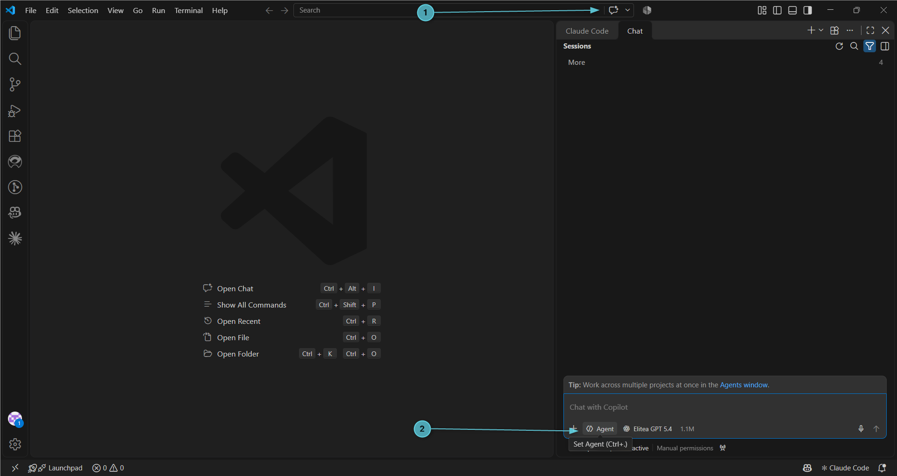

2. **Add the MCP server**
     - Press `Ctrl+Shift+P` to open the Command Palette, and run **MCP: Add Server**
     - You can also run **Chat: Open Customizations**, select **MCP Servers**, and select **Add Server** (**+**) in the **User** group

         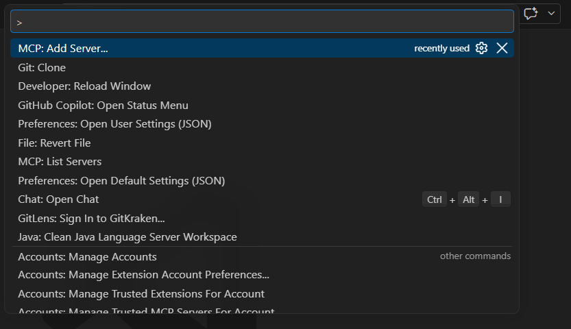

     - Select **HTTP (HTTP or Server-Sent Events)**
         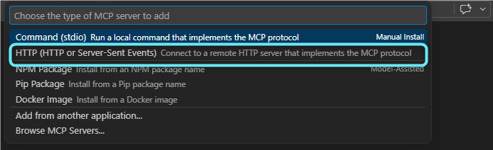

3. **Enter the server details**
     - For the URL, enter your project endpoint, for example `https://next.elitea.ai/app/PROJECT_ID/mcp`. Replace `PROJECT_ID` with your Elitea project ID, which is a number. For example, if your project ID is `25`, the URL is `https://next.elitea.ai/app/25/mcp`.
         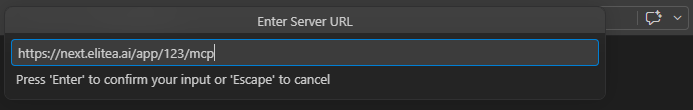

     - For **Server ID**, enter a name, such as `Elitea-mcp-server`, or keep the default
     
         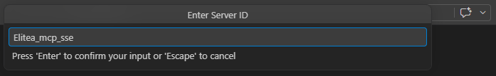

4. **Choose where to save the configuration**
     - In the **Select the configuration target** list, choose where to add the server:
       - **Add to Current Agent Session:** adds the server to the current agent session only. Use it to try the server first. Choose **Global** or **Workspace** to add the token, because the token steps below apply to those two options.
       - **Global:** available in all workspaces, runs locally. It saves a personal configuration that you can use in all your projects.
       - **Workspace:** available in this workspace, runs locally. It saves the file `.mcp.json` in the root folder of the workspace, so you can share it with your team.

     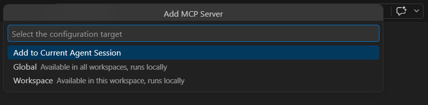

     - For **Workspace** or **Global**, the configuration file opens in the editor. You add the token to it in the next section.

<Info>
**Global Configuration**

If you choose **Global**, VS Code asks **Select the global configuration**. Choose **Copilot Global**, which saves the server in `mcp-config.json` in the `.copilot` folder of your user folder, for example `C:\Users\<YourUsername>\.copilot\mcp-config.json`.

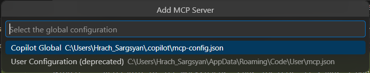
</Info>

### Add Your Token

The token goes in the `"headers"` section of the server entry. The token is not part of the dialog. Choose the tab that matches the option you selected in step 4.

<Tabs>
<Tab title="Workspace">
1. **Open the configuration file**
     - Press `Ctrl+Shift+P` to open the Command Palette, and run **Chat: Open Customizations**. Select **MCP Servers**.
     - Find your server under the **Workspace** group, open the ellipsis (**...**) menu of the server, and open its configuration. The file is `.mcp.json` in the root folder of your workspace.

     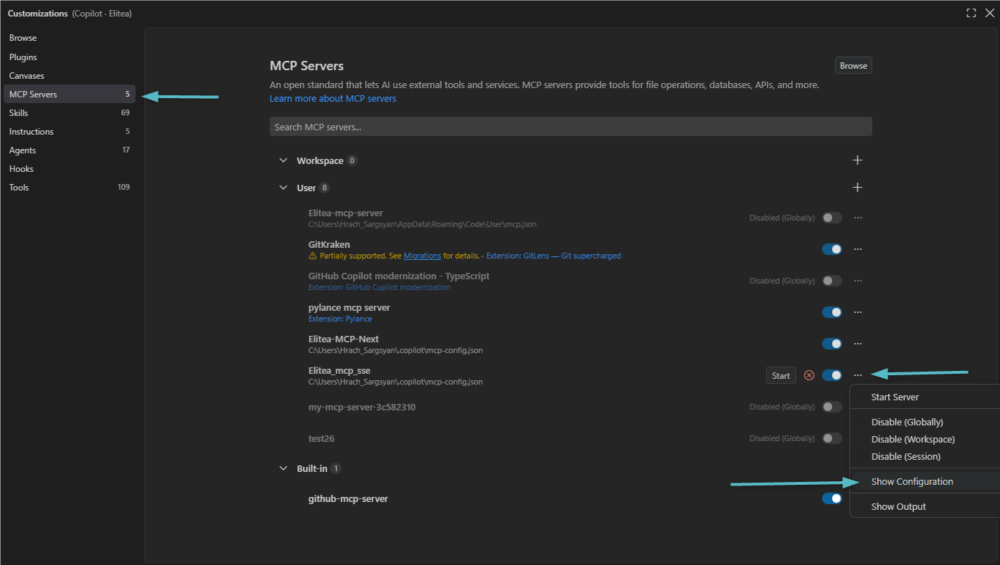

2. **Add your token**
     - The file does not have a `"headers"` section. Add it manually to the server entry:
       - Add the `headers` section, next to `"url"` and `"type"`:
         ```json
         "headers": {
             "Authorization": "Bearer YOUR_TOKEN_HERE"
         }
         ```
       - Replace `YOUR_TOKEN_HERE` with your token and save the file.

         ```json
         {
             "mcpServers": {
                 "test_works": {
                     "url": "https://next.elitea.ai/app/1/mcp",
                     "type": "http",
                     "headers": {
                         "Authorization": "Bearer YOUR_TOKEN_HERE"
                     }
                 }
             }
         }
         ```
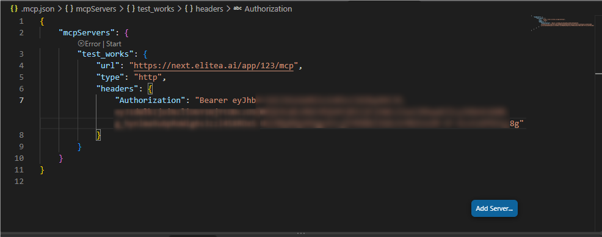
       
</Tab>
<Tab title="Global">
1. **Open the configuration file**
     - Press `Ctrl+Shift+P` to open the Command Palette, and run **Chat: Open Customizations**. Select **MCP Servers**.
     - Find your server under the **User** group, open the ellipsis (**...**) menu of the server, and open its configuration.

     

2. **Add your token**
     - The file does not have a `"headers"` section. Add it manually to the server entry in `mcp-config.json`:
       - Add the `headers` section, next to `"url"` and `"type"`:
         ```json
         "headers": {
             "Authorization": "Bearer YOUR_TOKEN_HERE"
         }
         ```
       - Replace `YOUR_TOKEN_HERE` with your token and save the file.

         ```json
         {
           "mcpServers": {
             "Elitea_mcp_sse": {
               "tools": [
                 "*"
               ],
               "type": "http",
               "url": "https://next.elitea.ai/app/123/mcp",
               "headers": {
                 "Authorization": "Bearer YOUR_TOKEN_HERE"
               }
             }
           }
         }
         ```

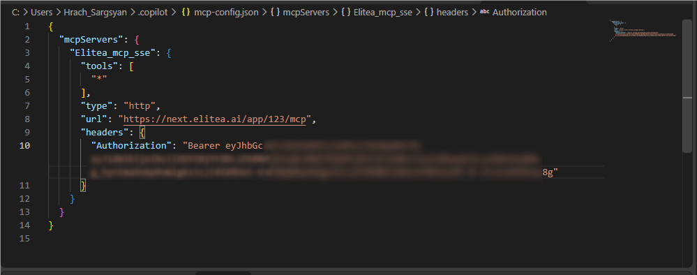

</Tab>
</Tabs>

<Info>
**Server Type**

Use `"type": "http"` with the `/mcp` endpoint. The legacy `"type": "sse"` expects the `/sse` endpoint instead, because `/mcp` does not offer an SSE stream.
</Info>

### Start the Server

1. **Start the server**
     - Press `Ctrl+Shift+P` to open the Command Palette, and run **MCP: List Servers**
     - Select your Elitea server, and select **Start Server**

2. **Check the output**
     - If the server does not start, select the server and select **Show Output** to see the error

<Info>
**Multiple MCP Servers**

You can add as many MCP servers as you need. For example, if you have several Elitea projects and want to use different agents from each, repeat these steps for each server, whether you use the Workspace or the Global configuration.
</Info>

---

## Using Elitea Agents as MCP Tools

To use Elitea agents, pipelines, and toolkit tools in VS Code via MCP, they must be made available through MCP in Elitea.

<Note>
If you add or update agents/pipelines with the `mcp` tag, or enable toolkit tools for MCP after starting your MCP server, restart the server to sync and make them available as tools.
</Note>

### Tagging Agents and Pipelines

1. In the Elitea web interface, tag your agents or pipelines with `mcp`.    Only tagged agents and pipelines will be synced and available as tools in VS Code.

   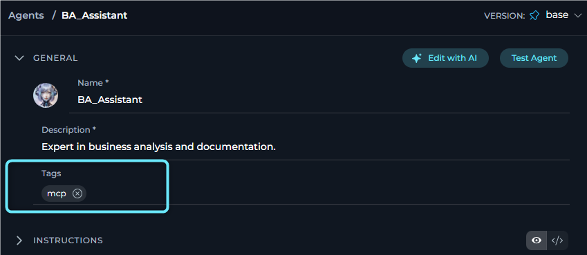


<Info title="Important Notes">
- Only the "**base**" version of each agent or pipeline tagged with `mcp` will be pulled and used. If you have multiple versions of the same agent/pipeline, ensure the version you want to use is the "**base**".
- If you have several agents with the same name, only one will be fetched and shown in VS Code. Please consider renaming your agents with unique names if you need them all to be fetched and used.
</Info>

### Making Toolkit Tools Available by MCP

Besides agents and pipelines, you can also expose selected toolkit tools through the MCP interface.

1. When creating or editing a toolkit in Elitea, go to the **TOOLS** section.
2. Select the **Make tools available by MCP** checkbox to enable MCP access for the selected tools.
  
       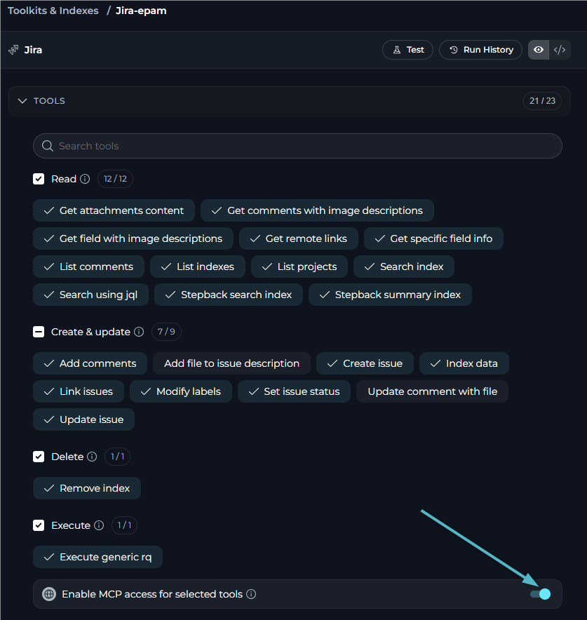

Only the tools you select in your toolkit configuration are exposed via MCP and made available in VS Code; they appear alongside your tagged agents and pipelines in the MCP client's tool list.


<Info>
For detailed instructions on making toolkit tools available by MCP, including security considerations and testing procedures, see [Make Tools Available by MCP](./make-tools-available-by-mcp).
</Info>

---

### Using MCP Tools in Agent Mode

Once your MCP server is connected and your agents, pipelines, and toolkit tools are made available, you can use them from VS Code.

1. **Open Copilot Chat**
     - Open the Chat view
     - In the agent picker, select **Agent**. MCP tools are available only in this mode.

2. **Check the connected tools**
     - Press `Ctrl+Shift+P` to open the Command Palette, and run **Chat: Open Customizations**
     - In the left pane, select **Tools**
     - Find your Elitea server in the list. You can also enter its name in the **Type to search...** field.
     - Select the arrow next to the server name to expand it. The agents and pipelines with the `mcp` tag and the toolkit tools made available by MCP are listed under it as tools.

     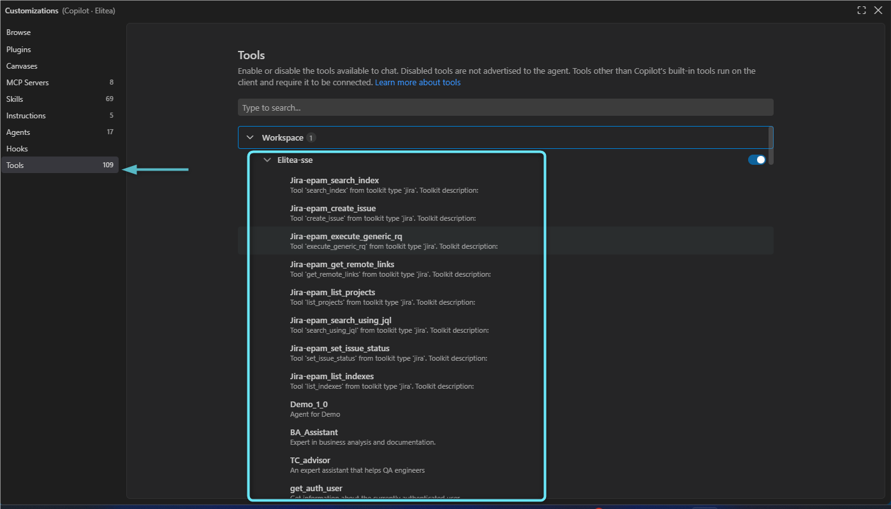

3. **Enter your request and approve the tool call**
     - In the chat input, enter `#` and select the tool from the list, then enter your request. If the list does not show the tool, enter the agent name as plain text. The chat finds the matching MCP tool and runs it.
     - Example: `Use #BA_Assistant to show me the scope of the PLAN-6060 user story`

     - VS Code asks you to approve the call to the tool. Approve only a call you understand. Select **Allow Once** or **Allow** (**Continue** in older versions of VS Code) to run the tool, or **Skip** (**Cancel** in older versions) to decline it.

       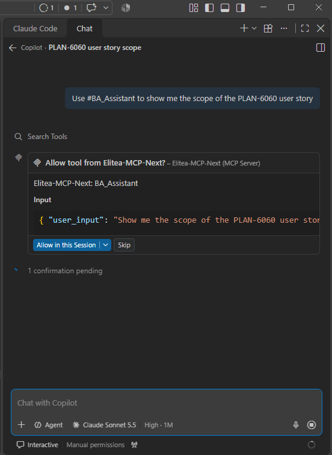

4. **Review the results**
     - The tool runs and returns the result directly in the chat
     - To confirm that the answer came from Elitea, expand the tool call in the conversation and check the input and the result

       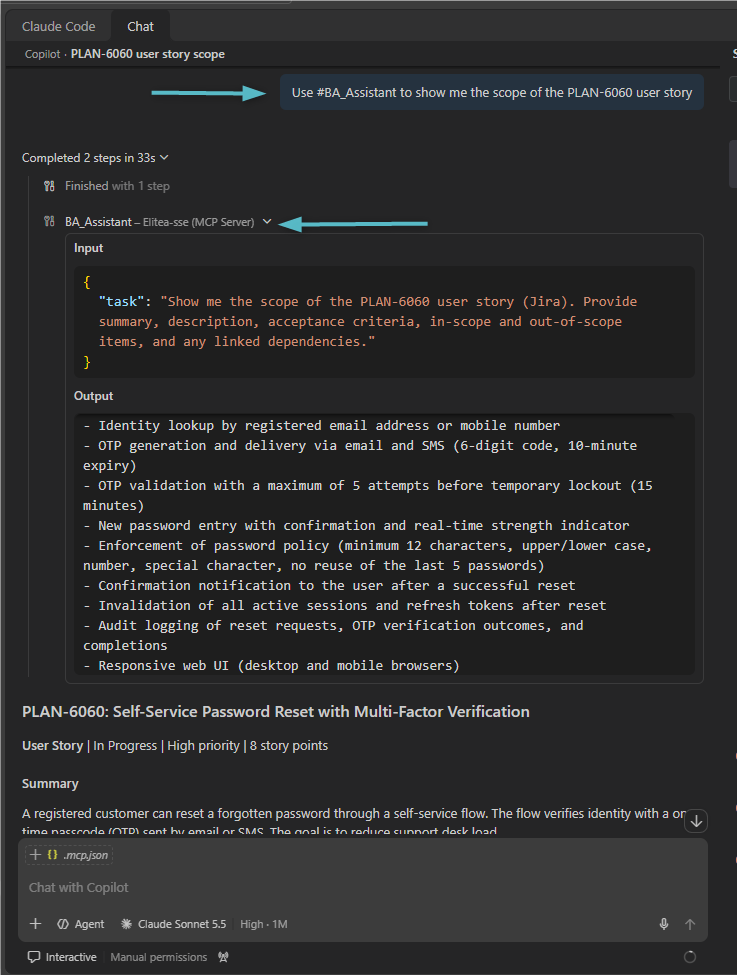

<Tip>
**Auto-Confirm**

Use the **Allow** button dropdown to set auto-confirm for a tool: for the current session only, for this workspace, or always. For tools that change data, such as creating or updating tickets, use the current session or this workspace.
</Tip>

---
## Use Cases

Here are practical examples demonstrating how to use Elitea MCP tools in your daily workflow:

<Accordion title="Enhancing Jira User Stories with BA Assistant Agent">
**Scenario:** You want to improve the acceptance criteria of a Jira User Story using the BA Assistant agent.

1. **Select the BA Assistant Tool**  
   - Open the Chat view and select **Agent** in the agent picker
   - Run **Chat: Open Customizations**, select **Tools**, and check that **BA Assistant** is turned on under your Elitea server

2. **Request Enhancement**  
   In the chat, reference the tool and provide your instruction:
   ```
   #BA_Assistant
   Show me the scope of PLAN-3012 user story. Enhance ACs.
   ```

3. **Review and Confirm**  
   - Copilot will propose using the BA Assistant tool to retrieve and enhance the user story
   - Select **Allow** to confirm the tool execution
   - The agent will fetch the Jira ticket, analyze it, and present enhanced acceptance criteria

4. **Save Results**  
   - Copilot will offer to save the enhanced user story as a file (e.g., `PLAN-3012_enhanced.md`)
   - Confirm to save it to your workspace
</Accordion>

<Accordion title="Analyzing Confluence Documentation with Content Analyzer">
**Scenario:** You need to analyze a Confluence page and extract key information for a technical specification.

1. **Select the Content Analyzer Tool**  
   - Open the Chat view and select **Agent** in the agent picker
   - Run **Chat: Open Customizations**, select **Tools**, and check that **Content Analyzer** is turned on under your Elitea server

2. **Request Analysis**  
   In the chat, provide your instruction:
   ```
   #Content Analyzer
   Analyze the API documentation page in Confluence space "TECH" titled "REST API v2 Specification". 
   Extract all endpoint definitions and create a summary table.
   ```

3. **Confirm and Execute**  
   - Review the tool call parameters
   - Select **Allow** to run the analysis
   - The tool will fetch the Confluence page and extract structured information

4. **Use Results**  
   - Review the generated summary table
   - Ask Copilot to save it as a markdown file or incorporate it into your documentation
</Accordion>

<Accordion title="Running Test Cases with QTest Integration">
**Scenario:** You want to retrieve test case details from QTest and update their execution status.

1. **Select QTest Tools**  
   - Open the Chat view and select **Agent** in the agent picker
   - Run **Chat: Open Customizations**, select **Tools**, and check that the QTest toolkit tools are turned on under your Elitea server

2. **Retrieve Test Case**  
   In the chat, request test case information:
   ```
   #Get test case
   Get details for test case TC-12345 from QTest project "Mobile App Testing"
   ```

3. **Review and Update**  
   - Copilot will show the test case details including steps, expected results, and current status
   - Select **Allow** to confirm
   - Request an update if needed:
   ```
   Update the execution status to "Passed" and add a comment: "All scenarios verified successfully in build 2.3.1"
   ```

4. **Confirm Changes**  
   - Review the proposed update
   - Select **Allow** to apply changes to QTest
   - Verify the update was successful
</Accordion>

---
## Troubleshooting

<Accordion title="No Agents or Pipelines Are Shown">
**Problem:** MCP tools (agents, pipelines, or toolkit tools) do not appear in the VS Code tool list after connecting the MCP server.

**Solution:**

1. **Check MCP Tag:** Ensure your agents and pipelines in Elitea are tagged with `mcp`. Only tagged items will sync and appear as tools in VS Code.
2. **Check Toolkit MCP Checkbox:** For toolkit tools, verify that the "Make tools available by MCP" checkbox is enabled in the toolkit's TOOLS section.
3. **Restart the Server:** If you add or update tags or enable MCP for toolkit tools after starting the MCP server, restart the server to sync the changes. Run **MCP: List Servers**, select your server, and select **Restart Server**.
4. **Scope of MCP Server:** Verify whether your MCP server is configured for the correct scope (Global or Workspace). Sometimes, tools may not appear if the configuration is not in the expected location.
5. **Check Server Status:** Ensure the MCP server shows as "Running" in VS Code. If it shows an error status, check the server logs for details.
</Accordion>

<Accordion title="Token Authentication Issues">
**Problem:** Connection fails with authentication errors or "401 Unauthorized" messages.

**Solution:**

1. **Correct Token:** Double-check that you have copied and pasted the correct authentication token into your configuration. Tokens are case-sensitive and should not have extra spaces.
2. **Token Expiry:** Ensure your token has not expired. Check the token's expiration date in Elitea Settings under [Personal Tokens](../../menus/settings/personal-tokens).
3. **Token Placement:** Verify the token is added under the `"headers"` section in your MCP server configuration with the exact format:
    ```json
    "headers": {
        "Authorization": "Bearer YOUR_TOKEN_HERE"
    }
    ```
4. **Bearer Prefix:** Ensure the word "Bearer" (with a capital B and a space after it) appears before your token. Do not include extra colons or quotes around "Bearer".
5. **Generate New Token:** If the issue persists, generate a new token in Elitea and update your configuration.
</Accordion>

<Accordion title="VS Code MCP Server Connection Errors">
**Problem:** VS Code shows error indicators for the MCP server or fails to connect.

**Solution:**

1. **Check Error Indicator:** If VS Code encounters an issue with an MCP server, an error indicator will appear in the Chat view.
   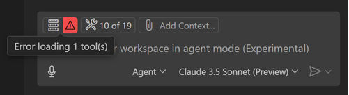

2. **View Server Logs:** 
    - Run **Chat: Open Customizations**, select **MCP Servers**, open the ellipsis (**...**) menu of your Elitea server, and select **Show Output**
    - Look for specific error messages that indicate the root cause
   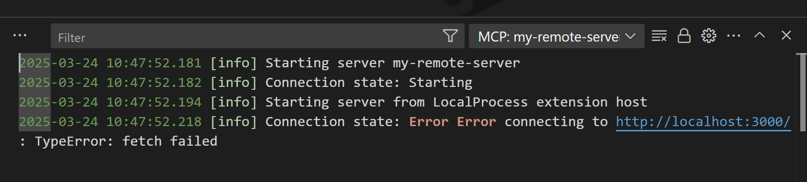

3. **Command Palette Access:** Alternatively, run **MCP: List Servers**, select your Elitea server, and select **Show Output** for troubleshooting details.

4. **Verify Server URL:** Ensure your server URL is correctly formatted:
    - Should be: `https://your-elitea-server.com/app/PROJECT_ID/mcp`
    - Should NOT include extra paths or trailing slashes

5. **Check VS Code Version:** Verify that you use VS Code 1.99 or later with `chat.mcp.enabled` setting turned on.
</Accordion>

<Accordion title="Configuration File Issues">
**Problem:** MCP server configuration not loading or showing syntax errors.

**Solution:**

1. **Validate JSON Syntax:** Ensure your `mcp.json` file contains valid JSON. Common issues include:
    - Missing commas between properties
    - Extra commas after the last property
    - Mismatched quotes or brackets
    - Incorrect escape characters

2. **Check File Location:**
    - **Workspace:** `.vscode/mcp.json` in your project root
    - **Global:** `mcp-config.json` in the `.copilot` folder of your user folder, for example `C:\Users\<YourUsername>\.copilot\mcp-config.json`

3. **Verify Type Property:** Set `"type": "http"` for the Elitea server, and use the `/mcp` endpoint in the `url`:
    ```json
    {
        "servers": {
            "Elitea-mcp-server": {
                "type": "http",
                "url": "https://next.elitea.ai/app/1/mcp",
                "headers": {
                    "Authorization": "Bearer YOUR_TOKEN"
                }
            }
        }
    }
    ```

4. **Reload VS Code:** After making configuration changes, reload VS Code window (Command Palette → "Developer: Reload Window").
</Accordion>

<Accordion title="Network and Connectivity Issues">
**Problem:** MCP server fails to connect due to network-related errors.

**Solution:**

1. **Check Internet Connection:** Ensure your internet connection is stable and active.
2. **Firewall and Proxy Settings:** 
    - Verify that your firewall is not blocking the MCP server URL
    - If behind a corporate proxy, ensure VS Code proxy settings are configured correctly
    - Check that SSE (Server-Sent Events) connections are allowed through your firewall
3. **VPN Considerations:** If using a VPN, try connecting with and without it to identify if the VPN is causing issues.
4. **Test Server Accessibility:** Open the MCP server URL in a web browser to verify that it is accessible from your network.
5. **SSL/TLS Issues:** Ensure your system trusts the SSL certificate of your Elitea server. Self-signed certificates may cause connection failures.
</Accordion>

<Accordion title="Tools Not Executing or Hanging">
**Problem:** MCP tools appear in the list but do not execute or hang when invoked.

**Solution:**

1. **Check Tool Selection:** Ensure the tool is turned on in **Chat: Open Customizations** > **Tools** before trying to use it.
2. **Verify Agent Mode:** Confirm that you are in **Agent mode** in GitHub Copilot Chat. MCP tools only work in Agent mode.
3. **Review Tool Parameters:** Some tools may hang if required parameters are missing or invalid. Check the tool call preview before you select Allow.
4. **Server Timeout:** If tools consistently timeout, check the Elitea server logs for performance issues or rate limiting.
5. **Restart Server and VS Code:** Try restarting both the MCP server and VS Code completely.
</Accordion>

<Accordion title="Multiple Servers Conflict">
**Problem:** Issues when multiple MCP servers are configured.

**Solution:**

1. **Verify Active Server:** Use **MCP: List Servers** from the Command Palette to see all configured servers and their status.
2. **Check Server Names:** Ensure each MCP server has a unique name/ID to avoid conflicts.
3. **Scope Conflicts:** If you have the same server configured in both Global and Workspace settings, the Workspace setting takes precedence.
4. **Disable Unused Servers:** Stop or remove MCP servers that you do not currently use to simplify troubleshooting.
</Accordion>

### Support Contact

If you encounter issues not covered in this guide or need additional assistance with MCP Server integration, please refer to **[Contact Support](../../support/contact-support)** for detailed information on how to reach the ELITEA Support Team.

**Email:** SupportAlita@epam.com

---

## FAQ

<Accordion title="What is the difference between Workspace and Global MCP server configuration?">
**Workspace configuration** (`.vscode/mcp.json`) is project-specific and can be shared with your team via version control. It only works when you open that specific workspace.

**Global configuration** (`mcp-config.json` in the `.copilot` folder of your user folder) applies to all VS Code workspaces on your machine and is not shared with others. It is ideal for personal tokens and servers you use across multiple projects.

**Which should I use?**
- Use **Workspace** if you want team members to have the same MCP servers configured (they need to add their own tokens)
- Use **Global** for personal MCP servers or when working across multiple projects with the same Elitea instance
</Accordion>

<Accordion title="Can I use the same Elitea token for both Workspace and Global configurations?">
Yes, you can use the same Elitea personal token in both configurations. However, for security reasons, it is recommended to:
- Store the token in **[Secrets](../../menus/settings/secrets)** in Elitea
- Use different tokens for different environments (development vs. production)
- Regularly rotate tokens and update configurations accordingly
</Accordion>

<Accordion title="How do I know which version of my agent/pipeline will be used via MCP?">
Only the **"latest"** version of each agent or pipeline tagged with `mcp` will be pulled and used in VS Code. If you have multiple versions:

1. Ensure the version you want to use is marked as "latest" in Elitea
2. If you have multiple agents/pipelines with the same name, only one will be fetched
3. Consider renaming agents with unique names if you need multiple versions accessible via MCP
</Accordion>

<Accordion title="Can I use MCP tools outside of Agent mode?">
No, MCP tools can only be invoked in **Agent mode** in GitHub Copilot Chat. However, you can reference tools in all chat modes (ask, edit, agent) by typing `#` followed by the tool name, but the actual execution requires Agent mode.
</Accordion>

<Accordion title="Why do I need to restart the MCP server after tagging new agents?">
The MCP server caches the list of available tools when it starts. When you add new tags (`mcp`) to agents/pipelines or enable toolkit tools for MCP, the server needs to be restarted to:

1. Re-scan the Elitea project for MCP-tagged items
2. Refresh its internal tool registry
3. Make newly tagged items available in VS Code's tool list

Run **MCP: List Servers**, select your server, and select **Restart Server** to sync the changes.
</Accordion>

<Accordion title="What is the difference between agents, pipelines, and toolkit tools in MCP?">
**Agents** are AI assistants with specific instructions and capabilities that can be invoked as tools via MCP. They can use toolkits and perform complex reasoning.

**Pipelines** are multi-step workflows that chain together agents and other operations. They can also be exposed as MCP tools when tagged.

**Toolkit Tools** are individual functions from integrated services (like Jira, Confluence, QTest) that can be made available directly through MCP by enabling the "Make tools available by MCP" checkbox.

All three types appear in the same MCP tool list in VS Code and can be used interchangeably in your workflows.
</Accordion>

<Accordion title="How many MCP servers can I configure in VS Code?">
There is no hard limit on the number of MCP servers you can configure. You can add multiple Elitea MCP servers (for different projects), as well as other MCP servers from different providers. Each server appears separately in the tools list, grouped by server name.

**Best practice:** Give each server a descriptive name (e.g., "Elitea-Production", "Elitea-Development") to identify them in the tool selection menu.
</Accordion>

<Accordion title="Do I need GitHub Copilot subscription to use Elitea MCP Server?">
Yes, you need an active GitHub Copilot subscription to use MCP tools in VS Code. The MCP integration works through GitHub Copilot's Agent mode, which is a Copilot feature. Without Copilot, you are not able to access the MCP tool interface in VS Code.
</Accordion>

<Accordion title="Can I control which toolkit tools are exposed via MCP?">
Yes! When configuring a toolkit in Elitea, you can selectively enable the "Make tools available by MCP" checkbox for specific toolkits. Only the tools you select in that toolkit will be exposed through MCP. This allows you to:

1. Limit exposure of sensitive operations
2. Keep the MCP tool list focused and manageable
3. Follow the principle of least privilege

For more details, see [Make Tools Available by MCP](./make-tools-available-by-mcp).
</Accordion>

<Accordion title="What should I do if my token expires?">
When your Elitea personal token expires:

1. Go to Elitea → [Settings → Personal Tokens](../../menus/settings/personal-tokens)
2. Generate a new token with an appropriate expiration date
3. Update your configuration file (`.vscode/mcp.json` or `mcp-config.json`) with the new token in the `"Authorization": "Bearer NEW_TOKEN"` field
4. Save the file
5. Run **MCP: List Servers**, select your server, and select **Restart Server**

**Tip:** Set token expiration dates based on your security policies, and consider calendar reminders to rotate tokens before they expire.
</Accordion>

<Accordion title="Why does the Allow button dropdown offer different auto-confirm options?">
The Allow button dropdown provides flexibility in how you want to handle tool execution confirmations:

- **Current session only:** Auto-confirms for this VS Code session only (until you close VS Code)
- **This workspace:** Auto-confirms whenever you work in this specific project or workspace
- **Always auto-confirm:** Auto-confirms for all workspaces and sessions

**Security recommendation:** Use "Current session only" or "This workspace" for better security control, especially when working with tools that modify data (like creating issues or updating tickets).
</Accordion>

---

<Info>
**Helpful Resources**

Elitea documentation:

- [MCPs Menu](../../menus/mcps)
- [Agents Menu](../../menus/agents)

External documentation:

- [MCP Protocol Official Docs](https://modelcontextprotocol.io/)
- [Add and use MCP servers in VS Code](https://code.visualstudio.com/docs/agent-customization/mcp-servers)
- [Manage and troubleshoot MCP servers](https://code.visualstudio.com/docs/agents/run/manage-mcp-servers)
- [MCP configuration reference](https://code.visualstudio.com/docs/agents/reference/mcp-configuration)
- [Use tools with agents](https://code.visualstudio.com/docs/agents/run/tools)
</Info>

---
