---

## Introduction

This document is your definitive resource for integrating and utilizing the **Dataverse toolkit** within ELITEA. It provides a comprehensive, step-by-step walkthrough, from registering an application in Azure Active Directory to configuring the toolkit in ELITEA and effectively using it within your Agents. By following these steps, you will unlock the power of automated CRM record lookups, queries, and updates, all directly within the ELITEA platform. This integration empowers you to leverage AI-driven automation to optimize your Dataverse-driven workflows using the combined strengths of ELITEA and Microsoft Dataverse.

**Brief Overview of Microsoft Dataverse**

Microsoft Dataverse (branded internally as **OneCRM**) is Microsoft's cloud data platform for business applications, exposed through the Dataverse Web API (`/api/data/v9.2/`). The ELITEA Dataverse toolkit interacts with a Dataverse environment through this Web API, enabling Agents to:

<CardGroup cols={2}>
  <Card title="Identify the Connection" icon="id-badge">
    Return the Dataverse identity the toolkit is acting as.
  </Card>
  <Card title="Read Records" icon="file-lines">
    Retrieve one record by entity set and GUID, with optional column selection.
  </Card>
  <Card title="Query Records" icon="magnifying-glass">
    Query records using OData `$filter`, `$select`, and `$orderby`, with a bounded result count.
  </Card>
  <Card title="Discover Table Schema" icon="table-list">
    List the updatable columns of a table—logical names, display labels, types, required levels, choice values, and lookup bind targets—before attempting an update.
  </Card>
  <Card title="Update Records" icon="pen-to-square">
    Update specific columns of an existing record, acting as the signed-in user with their own Dataverse permissions. The toolkit never creates new records.
  </Card>
</CardGroup>

Integrating Dataverse with ELITEA brings CRM automation directly into your AI-driven workflows. Your ELITEA Agents can intelligently look up, query, and update CRM records on behalf of a signed-in user, making your Dataverse-driven processes smarter and more efficient.

## Toolkit's Account Setup and Configuration in Dataverse

<Info title="Integration with ELITEA">
The application you register in this section will be used when creating your Dataverse credential in ELITEA (Step 1 of the integration process).
</Info>

### Registering an App in Azure Active Directory (Azure AD)

The Dataverse toolkit authenticates using a signed-in user's delegated identity via Microsoft Entra ID (Azure AD). To enable this, you need to register an application in Azure AD that will represent ELITEA.

1.  **Access Azure Portal:** Open your web browser, navigate to the [Azure Portal](https://portal.azure.com/), and log in using an account with sufficient permissions to register applications in Azure AD.
2.  **Navigate to App Registrations:** In the Azure portal, use the search bar at the top to search for "App registrations" and select **"App registrations"** from the search results under "Services".
3.  **Create New Registration:** On the "App registrations" page, click **"+ New registration"**.

     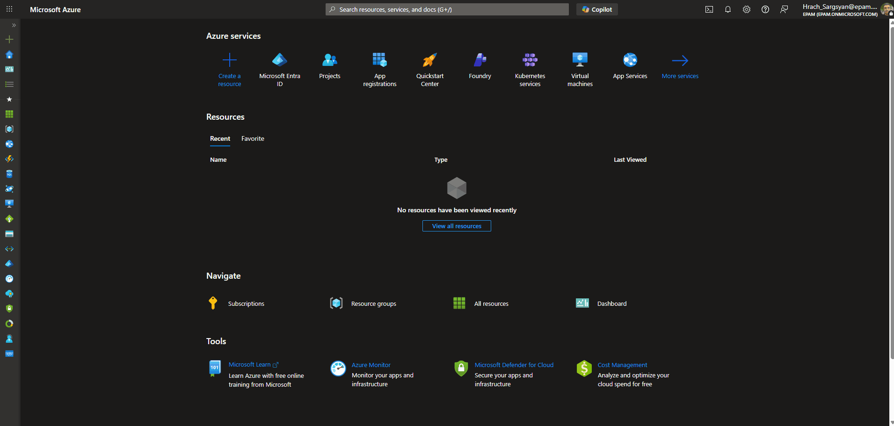

4.  **Configure App Registration Details:** On the "Register an application" page, provide the following information:
    *   **Name:** Enter a meaningful and descriptive name for your application registration, for example "ELITEA Dataverse Integration" or "ELITEA Agent Access to OneCRM".
    *   **Supported account types:** Select the appropriate account type based on your organization's requirements. In most cases, **"Accounts in this organizational directory only (\[Your Organization Name] only - Single tenant)"** is the recommended option for internal organizational use.
    *   **Redirect URI:** A redirect URI must always be configured, since the Dataverse toolkit relies on a delegated OAuth sign-in flow:
          1. In the **"Select a platform"** dropdown, select **"Web"**.
          2. In the URI field, enter the ELITEA callback URL for your instance. The correct value depends on your deployment — refer to the info callout below.
5.  **Register Application:** Click the **"Register"** button at the bottom of the page to create the app registration.

     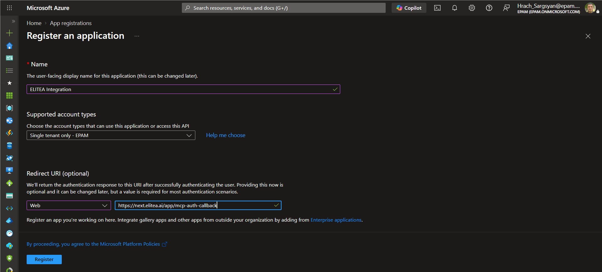

<Info title="ELITEA OAuth Redirect URI">
The redirect URI to register in Azure AD depends on your ELITEA deployment:

| Deployment Type | Redirect URI |
|----------------|--------------|
| **ELITEA Cloud** | **Pattern:** `https://<your-elitea-instance-domain>/app/mcp-auth-callback` <br /> **Example:** `https://next.elitea.ai/app/mcp-auth-callback` |
| **Self-hosted / standard path** | `https://<your-domain>/mcp-auth-callback` |
| **Self-hosted / sub-path (e.g., `/app`)** | `https://<your-domain>/app/mcp-auth-callback` |

<Info>
**URL is not shown in the UI**

ELITEA does not display the redirect URI anywhere in its interface. The URL is automatically derived from the domain your ELITEA instance is deployed on. If you are unsure which value applies, contact your ELITEA administrator.
</Info>
</Info>

### Application Credentials

Once the app registration is created successfully, you will be redirected to the application's **Overview** page. Note down the following, as you will need them to configure the Dataverse credential in ELITEA:

*   **Application (client) ID** — Copy and store this value securely.
*   **Directory (tenant) ID** — Copy and store this value securely.

     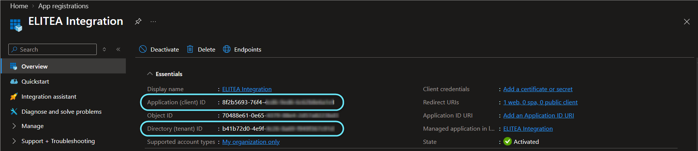

### Configure API Permissions for the Registered App

To allow ELITEA to act on a signed-in user's Dataverse environment, configure a **delegated** Dataverse permission for your registered application.

1.  **Navigate to API Permissions:** In your registered app within the Azure portal, navigate to the left-hand menu and click **"API permissions"**.
2.  **Add Permissions:** On the "API permissions" page, click **"+ Add a permission"**.

     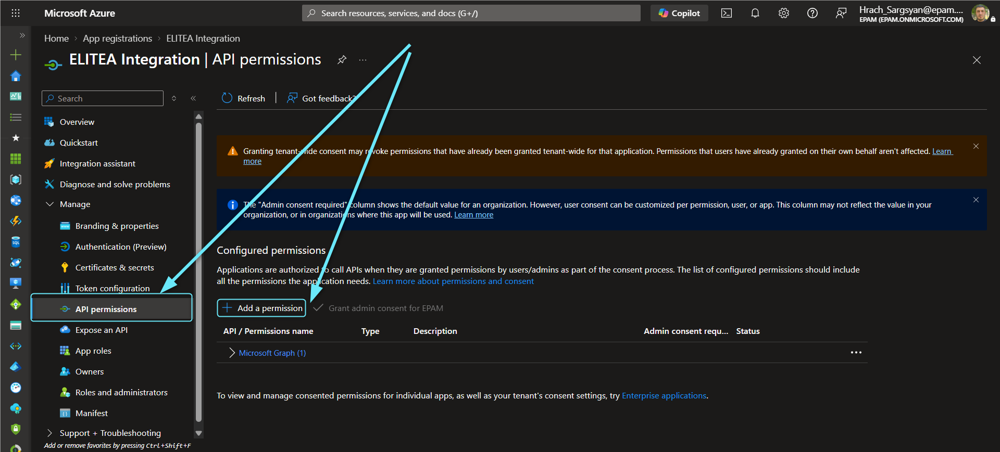

3.  **Select API Type - Dataverse:** In the "Request API permissions" panel, select the **"APIs my organization uses"** tab, search for **"Dataverse"**, and select the **Dataverse** entry from the results.

     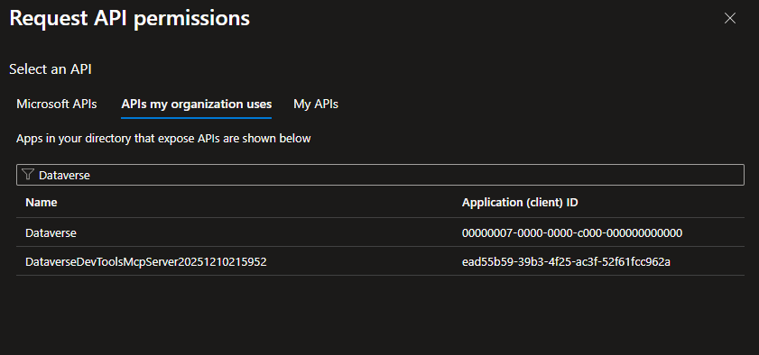

4.  **Select the user_impersonation Scope:** Check the **`user_impersonation`** option. This is the only scope the toolkit requests — it is combined automatically with `offline_access` when ELITEA builds the sign-in request.

     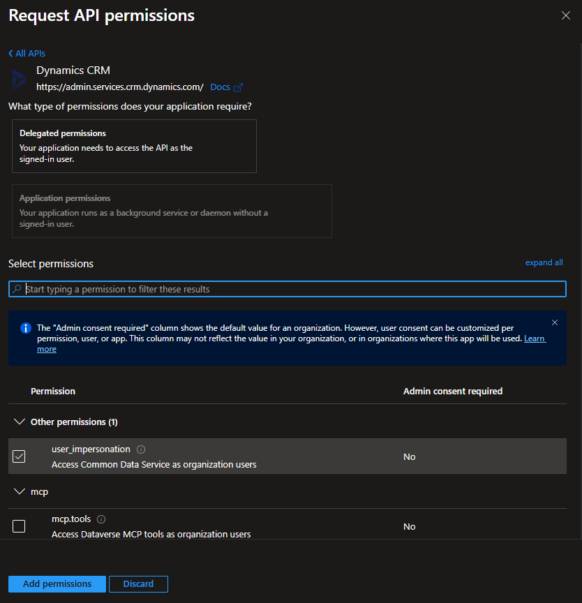

5.  **Add Permissions:** Click **"Add permissions"** at the bottom of the panel to add the selected scope to your application registration.
6.  **Grant Admin Consent (if required by your tenant):** On the "API permissions" page, click **"Grant admin consent for \[Your Organization Name]"** and then **"Yes"** if your organization requires admin consent for delegated permissions before users can authorize the app.

      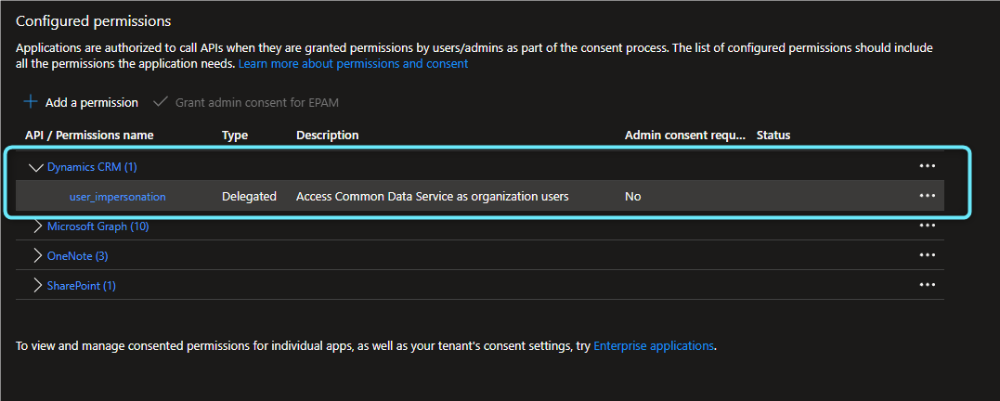

### Configure the Client Secret

To securely authenticate your ELITEA Dataverse credential, create a Client Secret for your registered application.

1.  **Navigate to Certificates & secrets:** In your registered app within the Azure portal, click **"Certificates & secrets"**.
2.  **Create New Client Secret:** On the "Certificates & secrets" page, select the **"Client secrets"** tab and click **"+ New client secret"**.

      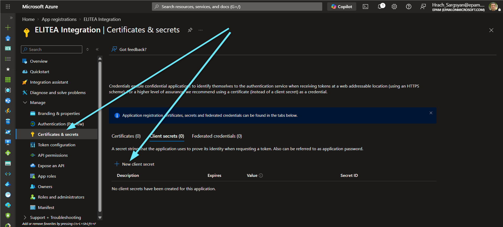

3.  **Configure Client Secret Details:** In the "Add a client secret" panel, enter a **Description** and choose an appropriate **Expiration** period.

      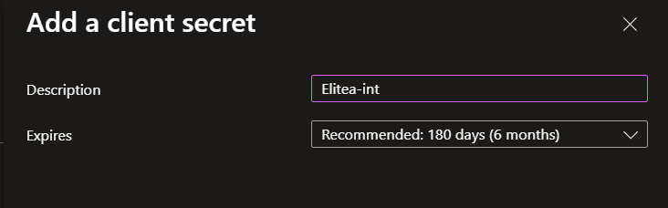

4.  **Add Client Secret:** Click **"Add"** to create the client secret.
5.  **Securely Copy and Store the Client Secret Value:** **Immediately copy the generated Client Secret Value** displayed in the **"Value"** column. **This is the only time you will see the full value.** Store it securely, preferably in ELITEA's **[Secrets](../../menus/settings/secrets)** feature.

      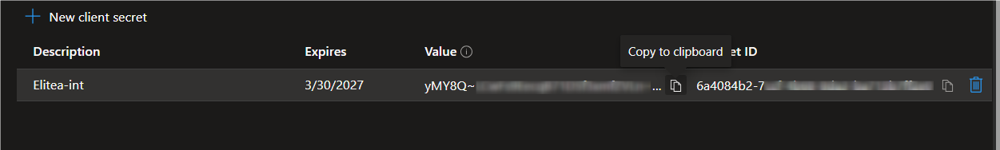

<Warning title="Important">
Copy the **"Value"** column — not the **"Secret ID"** column. The Value is the actual credential used for authentication.
</Warning>

---

## System Integration with ELITEA

To integrate Dataverse with ELITEA, you need to follow a three-step process: **Create Credentials → Create Toolkit → Use in Agents**. This workflow ensures secure authentication and proper configuration.

### Step 1: Create Dataverse Credentials

Before creating a toolkit, you must first create Dataverse credentials in ELITEA.

1. **Navigate to Credentials Menu:** Open the sidebar and select **[Credentials](../../menus/credentials)**.
2. **Create New Credential:** Click the **`+ Credential`** button.
3. **Select Dataverse (OneCRM):** Choose **Dataverse (OneCRM)** as the credential type.

     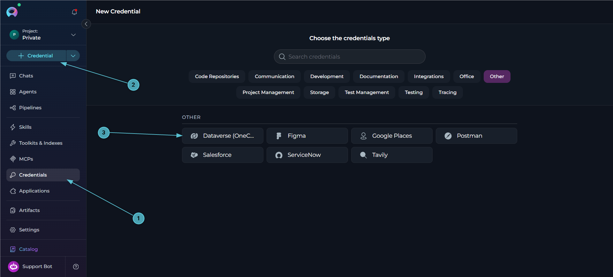

4. **Configure Credential Details:**

   | Field | Required | Description |
   |-------|----------|-------------|
   | **Display Name** | Required | Descriptive name for this credential (e.g., *"Dataverse - Sales Org"*) |
   | **ID** | Required | Unique identifier for the credential. Auto-populated from the Display Name |
   | **Url** | Required | Dataverse environment URL, e.g. `https://onecrmepam.crm4.dynamics.com`. Must be a plain `https://<org>.dynamics.com` address — no path, port, or embedded credentials |
   | **Tenant Id** | Required | Entra tenant ID (GUID) or verified domain |
   | **Client Id** | Required | Entra app (client) ID from your app registration |
   | **Client Secret** | Required | Entra app client secret generated in your app registration |

   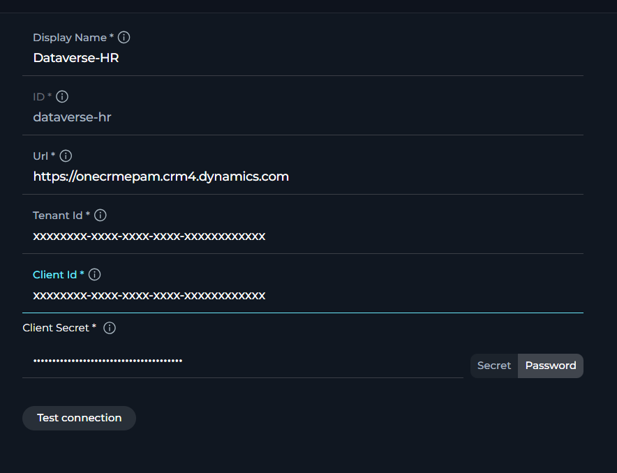

5. **Log in:** Click **Test Connection**. If no login is stored on the credential yet, Dataverse responds asking for authorization, and ELITEA opens a popup to sign in via Microsoft Entra ID. After you authorize, a refresh token is stored on the credential (so scheduled and unattended runs can authenticate without a browser) and the connection is verified against Dataverse's `WhoAmI` endpoint. Once a login is stored, clicking **Test Connection** again simply re-verifies it. 

    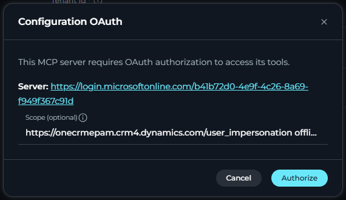

6. **Save Credential:** Click **Save** to create the credential. It will be added to the credentials dashboard and available to use in toolkit configurations.


<Tip title="Security Recommendation">
It's highly recommended to use **[Secrets](../../menus/settings/secrets)** for the Client Secret instead of entering it directly. Create a secret first, then reference it in your credential configuration.
</Tip>

<Note>
**Stored Login for Scheduled Runs**

Logging in on the credential form saves a refresh token into the credential itself (not just your browser session), so Agents using this credential continue to work in scheduled or unattended runs — the platform refreshes the stored login on your behalf. In a team project, only project admins can log in or out of a shared credential's stored login; any user can manage the login on their own private credential.
</Note>

<Warning title="Re-login Required If the Login Is Revoked or Expires">
If the stored login expires or is revoked in Entra ID, ELITEA's connection check surfaces an authorization-required error and the credential's status reverts to **"Not Connected"**. Click **Login** again to complete a new OAuth authorization flow.
</Warning>

### Step 2: Create Dataverse Toolkit

Once your credentials are configured, create the Dataverse toolkit:

1. **Navigate to Toolkits Menu:** Open the sidebar and select **[Toolkits & Indexes](../../menus/toolkits)**.
2. **Create New Toolkit:** Click the **`+ Toolkit`** button.
3. **Select Dataverse (OneCRM):** Choose **Dataverse (OneCRM)** from the list of available toolkit types.

     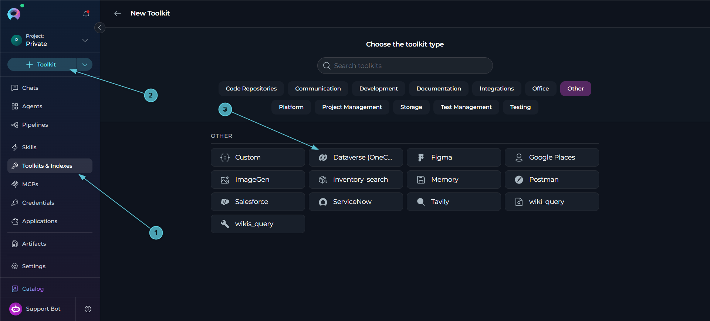

4. **Configure Toolkit Details:**

   | Field | Required | Description |
   |-------|----------|-------------|
   | **Toolkit Name** | Required | Descriptive name for the toolkit (e.g., *"OneCRM Dataverse"*) |
   | **Description** | Optional | Brief description of the toolkit's purpose |
   | **Dataverse Configuration** | Required | Select the Dataverse credential created in Step 1 |

5. **Enable Desired Tools:** In the **"Tools"** section, select the checkboxes next to the specific Dataverse tools you want to enable. **Enable only the tools your agents will actually use** to follow the principle of least privilege.
       * **Enable MCP access for selected tools** — (optional) exposes the tools selected in this toolkit through the platform MCP server, so external MCP clients can call them.
6. **Save Toolkit:** Click **Save** to create the toolkit.

     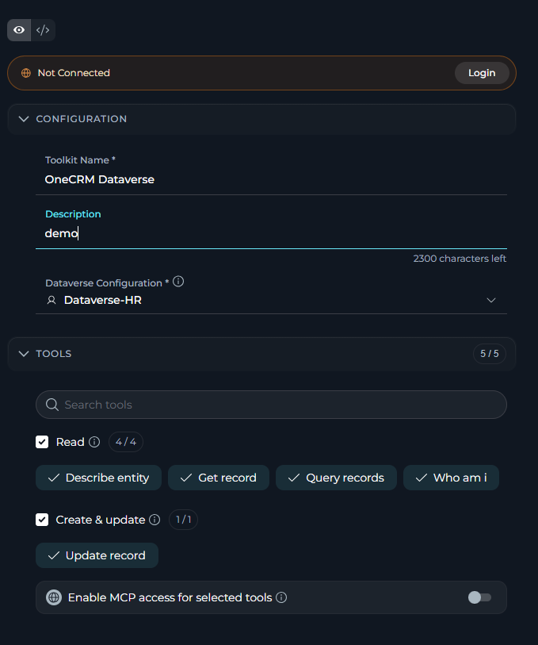

#### Available Tools:

The Dataverse toolkit provides 5 tools for interacting with CRM records. In the toolkit configuration form, tools are grouped by the effect they have on your Dataverse environment:

| **Category** | **Tool Name** | **Description** |
|---|---|---|
| **Read** | **Who am I** | Return the Dataverse identity the toolkit acts as (`UserId`, `BusinessUnitId`, `OrganizationId`) |
| | **Get record** | Read one Dataverse record by entity set and GUID. Use `select` to limit columns, e.g. `"name,statecode"`. Lookup columns use the `_<name>_value` form; formatted labels are returned as `<column>@OData.Community.Display.V1.FormattedValue` |
| | **Query records** | Query Dataverse records with OData `$filter` / `$select` / `$orderby`, e.g. filter `"statecode eq 0"`, orderby `"createdon desc"`. Returns at most `top` records (max 50) and whether more exist |
| | **Describe entity** | List the columns of a Dataverse table that can be updated: logical name, display label, type, required level, choice values for option columns, and the bind target for lookups. Use `search` (matches name or label) to narrow it down. Call this before **Update record** to get exact column names and option codes |
| **Create & update** | **Update record** | Update columns of one existing Dataverse record, acting as the signed-in user (their OneCRM rights apply). Never creates records |

<Tip title="Tool Groups">
In the **Tools** section of the toolkit form, each group (**Read**, **Create & update**) has its own select-all checkbox and a count badge, and the search box filters across all groups at once. **Read** tools only retrieve data; **Create & update** tools change existing records. The Dataverse toolkit defines no **Delete** or **Execute** tools.
</Tip>

<Note>
**Update Record Never Creates New Records**

**Update record** sends the Dataverse Web API a conditional `PATCH` (`If-Match: *`), which Dataverse refuses if the record does not already exist, rather than silently creating one. Ownership columns (e.g. `ownerid`), status columns (`statecode`, `statuscode`), and other system-managed columns (`createdon`, `createdby`, `modifiedon`, `modifiedby`, `versionnumber`, and similar) cannot be updated through this tool — Dataverse has dedicated actions for ownership and status transitions. Lookup columns must be set using the `"<navigation>@odata.bind": "/<entity_set>(<guid>)"` form, and multi-select choice columns take comma-separated option values, e.g. `"895450000,895450002"`. At most 20 columns can be updated in a single call.
</Note>

<Note>
**Discover Columns Before Updating**

**Describe entity** is designed to be called before **Update record**. It returns the exact logical column names, whether each is required, the valid option values for choice (picklist) columns, and the `@odata.bind` key and target entity set for lookup columns — removing the need to guess column names or option codes.
</Note>

#### Testing Toolkit Tools

After configuring your Dataverse toolkit, you can test individual tools directly from the Toolkit detailed page using the **Test Settings** panel. This allows you to verify that your credentials are working correctly and validate tool functionality before adding the toolkit to your workflows.

**General Testing Steps:**

1. **Select LLM Model:** Choose a Large Language Model from the model dropdown in the Test Settings panel
2. **Configure Model Settings:** Adjust model parameters like Creativity, Max Completion Tokens, and other settings as needed
3. **Select a Tool:** Choose the specific Dataverse tool you want to test from the available tools
4. **Provide Input:** Enter any required parameters or test queries for the selected tool
5. **Run the Test:** Execute the tool and wait for the response
6. **Review the Response:** Analyze the output to verify the tool is working correctly and returning expected results

<Tip title="Key benefits of testing toolkit tools:">
* Verify that Dataverse credentials and connection are configured correctly
* Test tool parameters and see actual responses from your Dataverse environment
* Debug tool behavior and understand output formats
* Optimize tool settings before integrating with agents or pipelines
> For detailed instructions on how to use the Test Settings panel, see **[How to Test Toolkit Tools](../../how-tos/credentials-toolkits/how-to-test-toolkit-tools)**.
</Tip>

---

### Step 3: Add Dataverse Toolkit to Your Workflows

Now you can add the configured Dataverse toolkit to your agents, pipelines, or use it directly in chat:

---
#### In Agents:

1. **Navigate to Agents:** Open the sidebar and select **[Agents](../../menus/agents)**.
2. **Create or Edit Agent:** Either create a new agent or select an existing agent to edit.
3. **Add Dataverse Toolkit:**
     * In the **"TOOLS"** section of the agent configuration, click the **"+Toolkit"** icon
     * Select your configured Dataverse toolkit from the dropdown list
     * The toolkit will be added to your agent with the previously configured tools enabled

      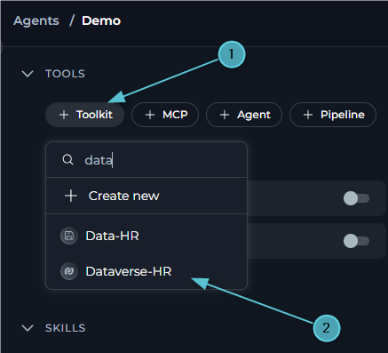

Your agent can now interact with the connected Dataverse environment using the configured toolkit.

---
#### In Pipelines:

Toolkits are picked **inside a pipeline node** on the flow canvas, not from a separate "Tools" panel.

1. **Navigate to Pipelines:** Open the sidebar and select **[Pipelines](../../menus/pipelines)**.
2. **Create or Edit Pipeline:** Either create a new pipeline or select an existing pipeline to edit.
3. **Add a Node that Uses a Toolkit:** On the flow canvas, add (or select) a **Toolkit** node, or an **LLM** node if you want the model to choose tools itself.
4. **Pick the Dataverse Toolkit:**
     * On a **Toolkit** node, click the **Toolkit** field and select your configured Dataverse toolkit from the picker, then choose which tool to run from the **Tool** field that appears.
     * On an **LLM** node, click the **Toolkits & MCPs** field and select your configured Dataverse toolkit from the picker — it's added with every tool enabled on the toolkit itself, and you can refine which ones that node can call from the tool selector that appears underneath.
     * Either way, the toolkit is attached to your pipeline automatically; no separate "Save" step is needed to register it.
5. **Review Attached Tools:** The pipeline's **Tools** panel lists every toolkit, MCP, or agent referenced by a node, which node(s) use it, and lets you jump to that node. A toolkit removed from every node it was used in can be removed from here too.

      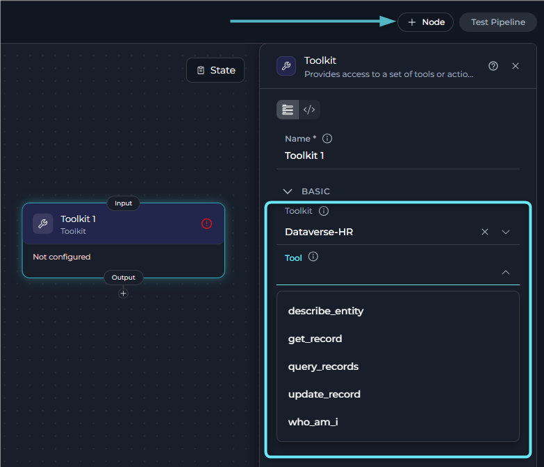

---
#### In Chat:

1. **Navigate to Chat:** Open the sidebar and select **[Chat](../../menus/chat)**.
2. **Start New Conversation:** Click **+ Conversation** or open an existing conversation.
3. **Add Dataverse Toolkit to Conversation:**
   - Click the **`+`** icon in the chat input toolbar (tooltip: *Add files, agents, toolkits and more…*)
   - Hover over **Toolkits** in the popup menu
   - Search for your Dataverse toolkit by name
   - Enable the toolkit to add it to your conversation
4. **Verify Toolkit Added:** The Dataverse toolkit appears in the **PARTICIPANTS** panel on the right side under the **Toolkits** section.
5. **Use Toolkit in Chat:** You can now directly interact with the connected Dataverse environment by asking questions or requesting actions that will trigger the Dataverse toolkit tools.

      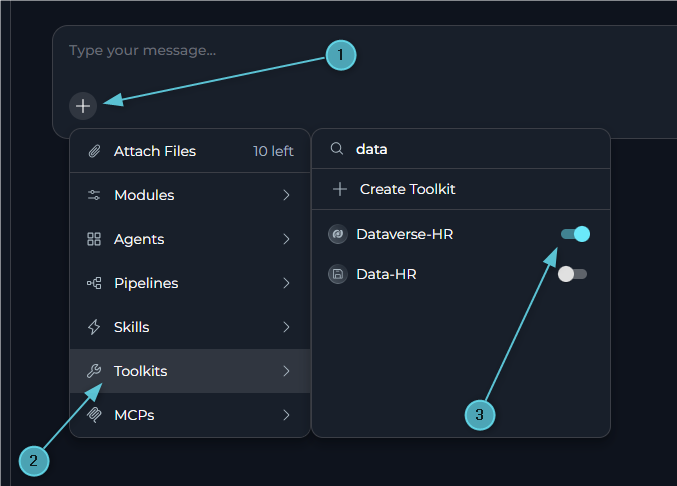

<Tip>
You can also add the toolkit by typing **`#`** in the chat input box and searching for your Dataverse toolkit.
</Tip>

<Info title="Authorizing the toolkit from Chat">
If no valid login is available when a Dataverse tool is called, ELITEA raises an authorization request for the toolkit. When this happens:

- A prompt appears asking: *"Authorization is required for toolkit "\<toolkit name>". Authorize now or skip it for this run?"*
- Selecting **Authorize** opens an OAuth dialog with **Cancel** and **Authorize** buttons.
- Completing the sign-in shows a **"Successful authentication!"** confirmation and the message **"✓ Authorization successful! Your credentials and session have been saved. Please send your message again to use the authorized MCP server."**
- Send your message again to continue with the now-authorized toolkit.
</Info>

<Info title="Example Chat Usage:">
- "Who am I connected to Dataverse as?"
- "Get the opportunity with ID {GUID} and show me its name and status."
- "Query all open accounts and sort them by creation date."
- "What columns can I update on the epam_engagements table?"
- "Update the priority of this engagement record to P1."
</Info>

## Instructions and Prompts for Using the Dataverse Toolkit

To effectively instruct your ELITEA Agent to use the Dataverse toolkit, you need to provide clear and precise instructions within the Agent's "Instructions" field. These instructions are crucial for guiding the Agent on *when* and *how* to utilize the available Dataverse tools to achieve your desired automation goals.

### Instruction Creation for OpenAI Agents

When crafting instructions for the Dataverse toolkit, especially for OpenAI-based Agents, clarity and precision are paramount. Break down complex tasks into a sequence of simple, actionable steps. Explicitly define all parameters required for each tool and guide the Agent on how to obtain or determine the values for these parameters. OpenAI Agents respond best to instructions that are:

*   **Direct and Action-Oriented:** Employ strong action verbs and clear commands to initiate actions. For example, "Use the 'get_record' tool...", "Query the opportunities table...", "Describe the columns of...".

*   **Parameter-Centric:** Clearly enumerate each parameter required by the tool. For each parameter, specify:
    *   Its name (exactly as expected by the tool)
    *   The format or type of value expected
    *   How the Agent should obtain the value – whether from user input, derived from previous steps in the conversation, retrieved from an external source, or a predefined static value

*   **Contextually Rich:** Provide sufficient context so the Agent understands the overarching objective and the specific scenario in which each Dataverse tool should be applied within the broader workflow. Explain the desired outcome or goal for each tool invocation.

*   **Step-by-Step Structure:** Organize instructions into a numbered or bulleted list of steps for complex workflows. This helps the Agent follow a logical sequence of actions.

*   **Add Conversation Starters:** Include example conversation starters that users can use to trigger this functionality. For example, "Conversation Starters: 'Show me open opportunities', 'Update this account's description', 'What fields can I set on an engagement record?'"

When instructing your Agent to use a Dataverse toolkit tool, adhere to this structured pattern:

1. **State the Goal:** Begin by clearly stating the objective you want to achieve with this step. For example, "Goal: To update the priority of a CRM engagement record."

2. **Specify the Tool:** Clearly indicate the specific Dataverse tool to be used for this step. For example, "Tool: Use the 'update_record' tool."

3. **Define Parameters:** Provide a detailed list of all parameters required by the selected tool. For each parameter:
   - **Parameter Name:** `<Parameter Name as defined in tool documentation>`
   - **Value or Source:** `<Specify the value or how to obtain the value. Examples: "user input", "from previous step", "hardcoded value 'opportunities'", "value of variable X">`

4. **Describe Expected Outcome (Optional but Recommended):** Briefly describe the expected result or outcome after the tool is successfully executed. For example, "Outcome: The Agent will confirm which columns were updated."

5. **Add Conversation Starters:** Include example conversation starters that users can use to trigger this functionality.

<Info title="Example Agent Instructions">
**CRM Record Lookup and Update Pattern:**

```markdown
You are a CRM assistant. Help the user look up and update Dataverse records without guessing column names.

## Looking Up a Record
- **Tool**: get_record
- **Parameters**:
    - entity_set: the table the user refers to, e.g. "opportunities", "accounts"
    - record_id: the record GUID (ask the user, or use one found by query_records)
    - select: (optional) only the columns the user asked about
- **Process**:
    1. Call the tool and present the returned fields in plain language
    2. If a column has a formatted-label counterpart, prefer showing the label over the raw code

## Finding Records
- **Tool**: query_records
- **Parameters**:
    - entity_set: the table to search
    - filter: an OData $filter built from the user's criteria, e.g. "statecode eq 0"
    - orderby: (optional) e.g. "createdon desc"
    - top: how many records the user wants (default 10, max 50)
- **Process**:
    1. Summarize the records found
    2. If more_available is true, tell the user more records exist and offer to narrow the search

## Discovering Columns Before an Update
- **Tool**: describe_entity
- **Parameters**:
    - entity_set: the table the user wants to update
    - search: (optional) a keyword to narrow down to the relevant column
- **Process**:
    1. Use the returned logical names, option values, and bind targets to build the update call
    2. Never guess a column name or option code — always call this first if unsure

## Updating a Record
- **Tool**: update_record
- **Parameters**:
    - entity_set: the table containing the record
    - record_id: the record's GUID
    - fields: a dict of column logical names to new values, confirmed against describe_entity
- **Process**:
    1. Confirm the planned change with the user before calling the tool
    2. Report back which columns were updated

## Conversation Starters
- "Show me all open opportunities created this month"
- "What's the status of account {GUID}?"
- "What columns can I update on the epam_engagements table?"
- "Set this engagement's priority to P1"
```
</Info>

### Chat Usage Examples by Tool Category

The following examples demonstrate how to interact with the Dataverse toolkit in ELITEA Chat, grouped by functional area. Each example shows the user request and the expected agent behavior.

<Accordion title="Identity - Who Am I">
**Chat Example:**
```
User: "Who am I connected to Dataverse as?"

Agent Response: [Agent uses who_am_i tool]

🪪 **Dataverse Identity**:

- **UserId**: 4bc255b0-be02-467c-9f6e-bdcff31242db
- **BusinessUnitId**: 1a2b3c4d-...
- **OrganizationId**: 9e8d7c6b-...
```
</Accordion>

<Accordion title="Reading - Get Record">
**Chat Example:**
```
User: "Get opportunity {4bc255b0-be02-467c-9f6e-bdcff31242db} and show me the name and status."

Agent Response: [Agent uses get_record tool with entity_set="opportunities", record_id="4bc255b0-be02-467c-9f6e-bdcff31242db", select="name,statecode"]

📄 **Opportunity Record**:

- **Name**: Deal with Acme Corp
- **Status**: Open (statecode: 0)
```
</Accordion>

<Accordion title="Querying - Query Records">
**Chat Example:**
```
User: "Show me the 5 most recently created open accounts."

Agent Response: [Agent uses query_records tool with entity_set="accounts", filter="statecode eq 0", orderby="createdon desc", top=5]

🔍 **Open Accounts (5)**:

1. Acme Corp — created 2026-11-03
2. Globex Inc — created 2026-11-01
...

More records are available — let me know if you'd like to see additional results.
```
</Accordion>

<Accordion title="Schema Discovery - Describe Entity">
**Chat Example:**
```
User: "What columns can I update on the epam_engagements table related to priority?"

Agent Response: [Agent uses describe_entity tool with entity_set="epam_engagements", search="priority"]

📋 **Updatable Columns Matching "priority"**:

- **epam_prioritycode** (Priority) — picklist, required
  - Options: 895450001 = "P1 - High"

Let me know the value you'd like to set, and I can update the record for you.
```
</Accordion>

<Accordion title="Updating - Update Record">
**Chat Example:**
```
User: "Set the priority of engagement {4bc255b0-be02-467c-9f6e-bdcff31242db} to P1."

Agent Response: [Agent uses update_record tool with entity_set="epam_engagements", record_id="4bc255b0-be02-467c-9f6e-bdcff31242db", fields={"epam_prioritycode": 895450001}]

✅ **Record Updated!**

- **Table**: epam_engagements
- **Record**: 4bc255b0-be02-467c-9f6e-bdcff31242db
- **Updated**: epam_prioritycode → 895450001 (P1 - High)
```
</Accordion>

---

## <Icon icon="triangle-exclamation" size={24} /> Troubleshooting

<Accordion title="Credential Not Appearing in Toolkit Configuration">
**Problem:** When creating a toolkit, your Dataverse credential doesn't appear in the credentials dropdown.

**Troubleshooting Steps:**

1. **Check Credential Scope:** Ensure you're working in the same workspace/project where the credential was created. Private credentials are only visible in your Private workspace, while project credentials are visible within the specific team project.
2. **Verify Credential Creation:** Go to the Credentials menu and confirm that your Dataverse credential was successfully saved.
3. **Credential Type Match:** Ensure you selected **"Dataverse (OneCRM)"** as the credential type when creating the credential.
</Accordion>

<Accordion title="OAuth Login Fails with 'No Reply Address Is Registered' Error">
**Problem:** When clicking **Login** during credential setup, the OAuth flow fails with an error such as:
> *AADSTS500113: No reply address is registered for the application.*

**Cause:** This error occurs when no Redirect URI has been registered in your Azure AD App Registration. Azure AD requires the redirect URI to be explicitly registered before it will send the authorization response back to ELITEA.

**Troubleshooting Steps:**

1. **Open your App Registration:** In the [Azure Portal](https://portal.azure.com), go to **Microsoft Entra ID → App registrations** and select your app.
2. **Navigate to Authentication:** In the left menu, click **"Authentication"**.
3. **Add a Redirect URI:** If no Web platform exists, click **"+ Add a platform"** → **"Web"**. If Web is already listed, click the **Edit** pencil next to it.
4. **Enter the ELITEA callback URL:** In the **"Redirect URIs"** field, enter the value matching your deployment (see the [redirect URI table](#registering-an-app-in-azure-active-directory-azure-ad) above).
5. **Save:** Click **"Configure"** (or **"Save"** if editing), then click **"Save"** at the top of the page.
6. **Retry:** Return to your ELITEA Dataverse credential and click **Login** again.
</Accordion>

<Accordion title="'The Client Secret Is Wrong or Expired' Error">
**Problem:** The connection test or Login flow fails with *"The client secret is wrong or expired."*

**Cause:** Entra ID returned `AADSTS7000215` or `AADSTS7000222` — the client secret value on the credential does not match (or has expired on) the app registration.

**Troubleshooting Steps:**

1. **Re-check the Client Secret Value:** Confirm you copied the **Value** column (not the **Secret ID**) when the secret was generated.
2. **Generate a New Secret if Expired:** In Azure AD, go to **Certificates & secrets** on your app registration, create a new client secret, and update your ELITEA credential with the new value.
</Accordion>

<Accordion title="'No Consent for Dataverse' or 'Login Expired or Was Revoked' Errors">
**Problem:** The connection test or a tool call reports *"The app has no consent for Dataverse: log in and approve the permission"* or *"The Dataverse login expired or was revoked: log in again."*

**Cause:** Entra ID rejected the refresh exchange — either consent was never granted (`AADSTS65001`), or the stored refresh token is no longer usable (`AADSTS700082`, `AADSTS700084`, `AADSTS50173`, or a generic `invalid_grant`).

**Troubleshooting Steps:**

1. **Re-authenticate:** On the credential form, click **Login** again to complete a fresh OAuth authorization flow.
2. **Check Admin Consent:** If your tenant requires admin consent for delegated permissions, confirm it has been granted on the **API permissions** page of your app registration.
</Accordion>

<Accordion title="'Dataverse URL Must Look Like https://<org>.crm.dynamics.com'">
**Problem:** Saving or testing the credential fails with an error about the Dataverse URL format.

**Cause:** The **Url** field must be a plain `https://<org>.dynamics.com` address — no path, port, query string, username, or trailing slash content beyond the host is accepted.

**Troubleshooting Steps:**

1. **Use the Environment URL Only:** Copy the Dataverse environment URL exactly as shown in the Power Platform admin center, without adding `/api/data/v9.2/` or any other path.
2. **Remove Extra Characters:** Strip any trailing slash, port number, or embedded credentials from the URL before saving.
</Accordion>

<Accordion title="'Your Dataverse User Has No Permission for This Operation'">
**Problem:** A tool call fails with *"Your Dataverse user has no permission for this operation."*

**Cause:** This is a `403` response from Dataverse — the signed-in user's own Dataverse security role does not grant access to the table or operation being attempted. The Dataverse toolkit always acts with the signed-in user's own rights, not elevated application permissions.

**Troubleshooting Steps:**

1. **Check the User's Security Role:** Ask your Dataverse administrator to confirm the signed-in user has the appropriate security role for the table and operation.
2. **Re-authenticate as a Different User (if needed):** If a different user should be performing this operation, log out of the credential and log in again as that user.
</Accordion>

<Accordion title="'Record Not Found (Updates Never Create New Records)'">
**Problem:** **Update record** fails with *"Record not found (updates never create new records)."*

**Cause:** This is a `412` response — the `record_id` provided does not match an existing record in the given `entity_set`. By design, the toolkit's update call never creates a new record when the target does not exist.

**Troubleshooting Steps:**

1. **Verify the Record ID:** Use **Query records** or **Get record** to confirm the record exists before updating it.
2. **Verify the Entity Set:** Confirm the `entity_set` name matches the table the record actually belongs to (e.g., `accounts` vs. `opportunities`).
</Accordion>

<Accordion title="A Column Cannot Be Updated">
**Problem:** **Update record** fails with an error naming a specific column as not updatable.

**Cause:** The column is either read-only or system-managed (for example `statecode`, `ownerid`, `createdon`), the name does not match a real column's logical name, or the value provided is a nested object/list where a plain value or an `@odata.bind` reference was expected.

**Troubleshooting Steps:**

1. **Call Describe Entity First:** Use **Describe entity** to confirm the exact logical column name, whether it is required, and its valid option values or bind target.
2. **Use the Correct Format for Lookups and Choices:** Set lookup columns using `"<navigation>@odata.bind": "/<entity_set>(<guid>)"`, and multi-select choice columns as a comma-separated string of option values.
</Accordion>

### <Icon icon="envelope" size={24} /> Support Contact

If you encounter issues not covered here or need additional assistance with Dataverse integration, please refer to **[Contact Support](../../support/contact-support)** for detailed information on how to reach the ELITEA Support Team.

---

## <Icon icon="circle-question" size={24} /> FAQ

<Accordion title="What are the required credential fields for the Dataverse toolkit?">
**Always required:**

* **Url** — the Dataverse environment URL, e.g. `https://onecrmepam.crm4.dynamics.com`.
* **Tenant Id** — Entra tenant ID (GUID) or verified domain.
* **Client Id** — Entra app (client) ID.
* **Client Secret** — Entra app client secret.

**Set automatically by the Login flow (never typed by the user):**

* **Refresh token** — saved to the credential once you complete the OAuth sign-in. This field does not appear in the credential form.
</Accordion>

<Accordion title="Can the Dataverse toolkit create new records?">
**No.** The toolkit only exposes **Update record**, which updates columns on an existing record and uses a conditional request (`If-Match: *`) that Dataverse refuses if the record does not already exist. There is no create-record tool in this toolkit.
</Accordion>

<Accordion title="Does the Dataverse toolkit act with the application's own permissions or the signed-in user's permissions?">
**The signed-in user's permissions.** The toolkit authenticates via a delegated OAuth sign-in, so every read or update is performed with the Dataverse security roles of whichever user completed the Login flow on the credential — not with elevated application-level access.
</Accordion>

<Accordion title="What happens to scheduled or unattended Agent runs — do they need a browser login?">
**No.** Once you complete the Login flow once on the credential, the refresh token is stored in the credential itself. Scheduled and unattended runs use this stored login to obtain a fresh access token automatically, without requiring a browser to be open.
</Accordion>

<Accordion title="How do I find the right column names and option values before updating a record?">
Call **Describe entity** for the table you want to update, optionally with a `search` keyword to narrow the results. It returns each updatable column's logical name, display label, type, whether it is required, the valid option values for choice columns, and the `@odata.bind` key and target entity set for lookup columns.
</Accordion>

<Accordion title="Can I use the same Dataverse credential across multiple toolkits and agents?">
Yes! Once you create a Dataverse credential, you can reuse it across multiple Dataverse toolkits, and each toolkit can be used by multiple agents, pipelines, and chat sessions. This promotes better credential management and reduces duplication.
</Accordion>

<Accordion title="What are some best practices for using the Dataverse toolkit effectively?">
**Test Integration Thoroughly:**

- After setting up the Dataverse toolkit and incorporating it into your Agents, thoroughly test each tool you intend to use to ensure seamless connectivity, correct authentication, and accurate execution of CRM operations.

**Follow Security Best Practices:**

- Store the Client Secret using ELITEA's Secrets Management feature rather than entering it directly.
- Grant only the `user_impersonation` Dataverse permission — no broader API permissions are needed.

**Discover Before You Update:**

- Always call **Describe entity** before **Update record** for a table you have not updated before, to avoid guessing column names or option codes.

**Confirm Before Updating:**

- Have Agents confirm the planned change with the user before calling **Update record**, especially since updates act under a real person's Dataverse identity and permissions.

**Provide Clear Instructions:**

- Craft clear and unambiguous instructions within your ELITEA Agents to guide them in using the Dataverse toolkit effectively. Use the prompt examples provided in this documentation as a starting point.
</Accordion>

<Note title="Microsoft documentation">
- **[Azure Portal](https://portal.azure.com)** - *Manage your Azure AD App Registrations, API permissions, and Client Secrets.*
- **[Register an App with Microsoft Entra ID for Dataverse](https://learn.microsoft.com/en-us/power-apps/developer/data-platform/walkthrough-register-app-azure-active-directory)** - *Official Microsoft tutorial for registering an app for Dataverse access.*
- **[Dataverse Web API Reference](https://learn.microsoft.com/en-us/power-apps/developer/data-platform/webapi/overview)** - *Official documentation for the Dataverse Web API used by this toolkit.*
- **[OData Query Options](https://learn.microsoft.com/en-us/power-apps/developer/data-platform/webapi/query-data-web-api)** - *Reference for the OData `$filter`, `$select`, and `$orderby` syntax used by the query_records tool.*
</Note>
