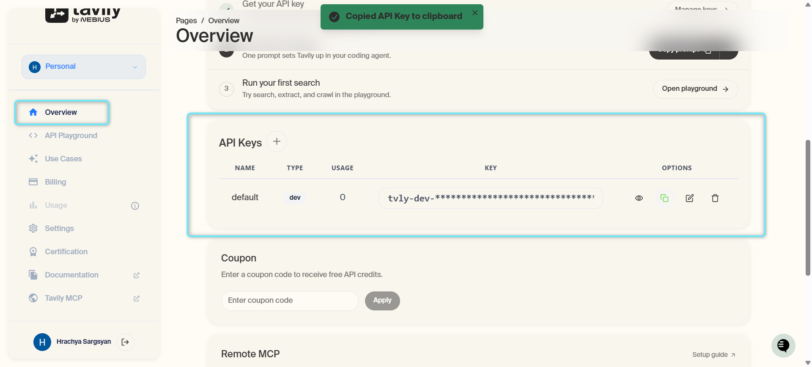
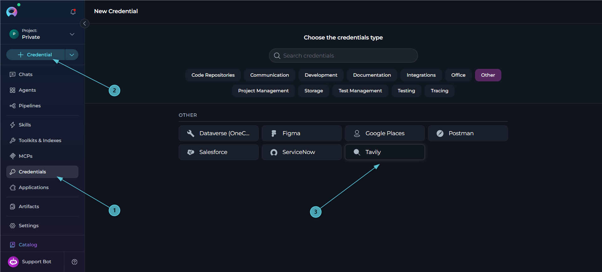
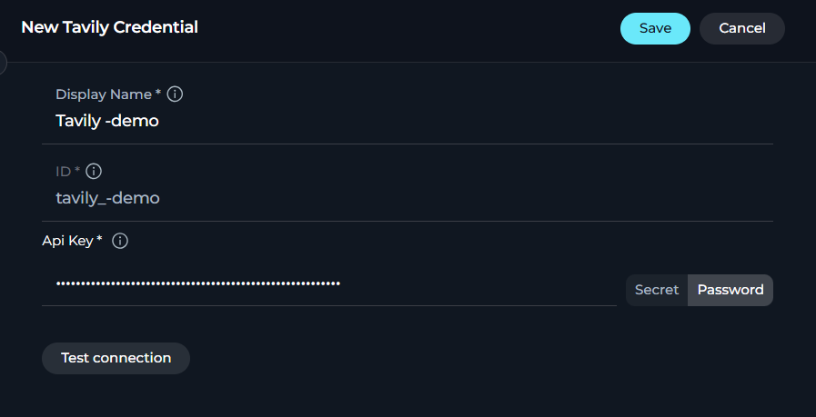
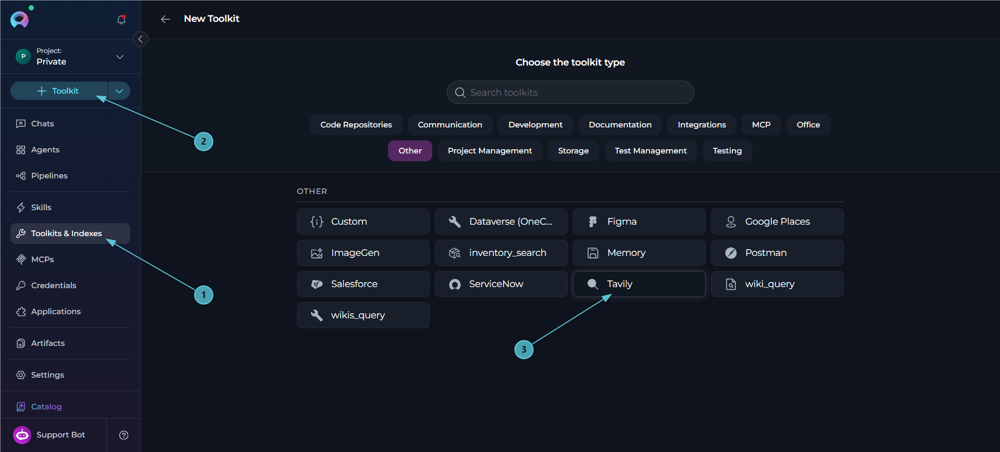
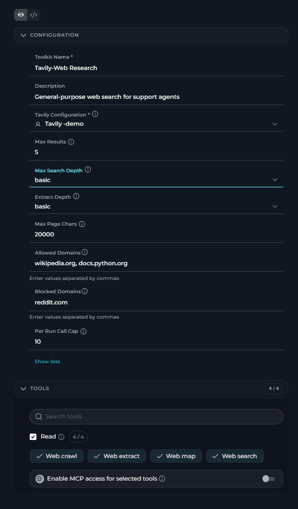
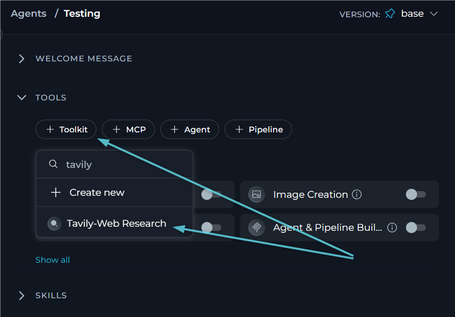
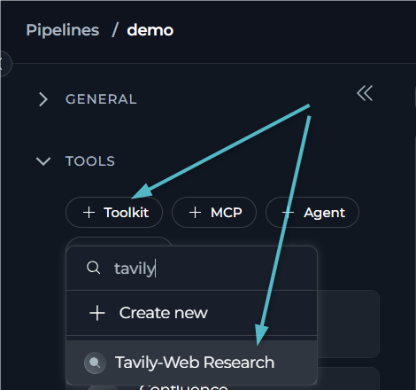
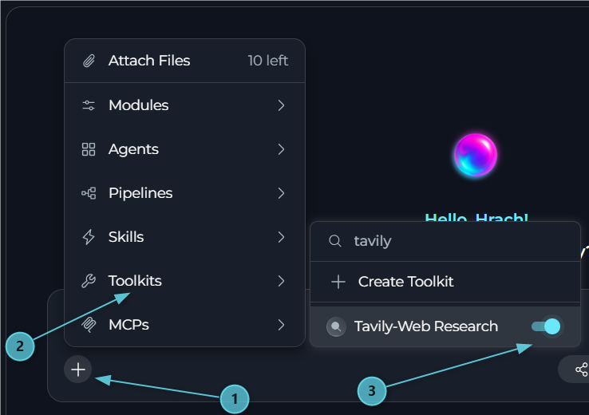

---

## Introduction

This document is your definitive resource for integrating and utilizing the **Tavily toolkit** within ELITEA. It provides a step-by-step walkthrough, from generating a Tavily API key to configuring the toolkit in ELITEA and effectively using it within your Agents. By following these steps, you will unlock the power of live web search, page content extraction, and site crawling, all directly within the ELITEA platform, while ELITEA enforces domain policies, output limits, and a per-run call cap on your behalf.

**Brief Overview of Tavily**

[Tavily](https://www.tavily.com/) is a web search and content-extraction API built for AI agents. The ELITEA Tavily toolkit wraps the `tavily-python` client to give Agents:

<CardGroup cols={2}>
  <Card title="Web Search" icon="magnifying-glass">
    Search the web for current information and get back titles, URLs, and short content snippets.
  </Card>
  <Card title="Web Extract" icon="file-lines">
    Fetch the readable content of specific web pages, converted to Markdown.
  </Card>
  <Card title="Web Crawl" icon="spider">
    Crawl a website starting from a URL, following links up to a limited depth, and return the content found.
  </Card>
  <Card title="Web Map" icon="sitemap">
    List the URLs of a website starting from a URL (a site map), without fetching page content.
  </Card>
</CardGroup>

Every Tavily toolkit call is routed through ELITEA's tool-spend metering: each outbound request is checked and recorded against your platform's spend limits before and after it runs, so usage stays governed centrally rather than left to each Agent.

<Warning title="API Base URL Is Not Configurable">
The Tavily credential has a single field: the **API Key**. There is no API Base URL field on either the credential or the toolkit — this is intentional, since a tenant-set URL could capture the bearer key. The base URL Tavily is called on is a deployment-level setting only, used for tests and proxies.
</Warning>

## Toolkit's Account Setup and Configuration in Tavily

### Generating a Tavily API Key

1.  **Open Your Tavily Dashboard:** Go to [https://app.tavily.com](https://app.tavily.com) and locate your API key. You can use the default API key Tavily creates for your account, or create a new one.
2.  **Copy Your API Key:** Copy the generated API key. Store it securely, preferably in ELITEA's **[Secrets](../../menus/settings/secrets)** feature, rather than pasting it directly into the credential form.

      


<Info title="Checking Your Usage and Limits">
Tavily exposes a `GET /usage` endpoint that reports your plan's limits and current usage — the same endpoint ELITEA's **Test Connection** uses to validate the key without spending any credits. See your Tavily dashboard's usage page for the human-readable equivalent.
</Info>

---

## System Integration with ELITEA

To integrate Tavily with ELITEA, you need to follow a three-step process: **Create Credentials → Create Toolkit → Use in Agents**. This workflow ensures secure authentication and proper configuration.

### Step 1: Create Tavily Credentials

Before creating a toolkit, you must first create Tavily credentials in ELITEA. The Tavily credential holds **only** the API key — there is no API Base URL field.

1. **Navigate to Credentials Menu:** Open the sidebar and select **[Credentials](../../menus/credentials)**.
2. **Create New Credential:** Click the **`+ Credential`** button.
3. **Select Tavily:** Choose **Tavily** as the credential type.

     

4. **Configure Credential Details:**

   | Field | Required | Description |
   |-------|----------|-------------|
   | **Display Name** | Required | Descriptive name for this credential (e.g., *"Tavily - Platform Key"*) |
   | **ID** | Required | Unique identifier for the credential. Auto-populated from the Display Name |
   | **API Key** | Required | Your Tavily API key |

5. **Test Connection:** Click **Test Connection** to verify the key is valid. This calls Tavily's `GET /usage` endpoint, which validates the key and spends no credits.
6. **Save Credential:** Click **Save** to create the credential. It will be added to the credentials dashboard and available to use in toolkit configurations.

     

<Tip title="Security Recommendation">
It's highly recommended to use **[Secrets](../../menus/settings/secrets)** for the API Key instead of entering it directly. Create a secret first, then reference it in your credential configuration.
</Tip>

### Step 2: Create Tavily Toolkit

Once your credentials are configured, create the Tavily toolkit:

1. **Navigate to Toolkits Menu:** Open the sidebar and select **[Toolkits & Indexes](../../menus/toolkits)**.
2. **Create New Toolkit:** Click the **`+ Toolkit`** button.
3. **Select Tavily:** Choose **Tavily** from the list of available toolkit types.

     

4. **Configure Toolkit Details:**

   | Field | Required | Default | Description | Example |
   |-------|----------|---------|-------------|---------|
   | **Toolkit Name** | Required | — | Descriptive name for the toolkit | `Web Research` |
   | **Description** | Optional | — | Brief description of the toolkit's purpose | `General-purpose web search for support agents` |
   | **Tavily Configuration** | Required | — | Select the Tavily credential created in Step 1 | `Tavily - Platform Key` |
   | **Max Results** | Optional | `5` | Search results returned per query (1–10) | `10` |
   | **Max Search Depth** | Optional | `basic` | Deepest search the model may request. `advanced` costs 2 credits per query instead of 1 | `advanced` |
   | **Extract Depth** | Optional | `basic` | Extraction depth used by **Web Extract** and (for its own extract step) **Web Crawl**. `advanced` costs double | `basic` |
   | **Max Page Chars** | Optional | `20000` | Maximum characters returned per page (1,000–50,000) | `20000` |
   | **Allowed Domains** | Optional | *(empty = any)* | If set, only these domains (and their subdomains) are allowed as search results, extract/crawl/map targets | `wikipedia.org`, `docs.python.org` |
   | **Blocked Domains** | Optional | *(empty)* | These domains (and their subdomains) are always rejected | `reddit.com` |
   | **Per-Run Call Cap** | Optional | `10` | Maximum number of Tavily calls allowed within a single run (1–100) | `15` |

5. **Enable Desired Tools:** In the **"Tools"** section, select the Tavily tools you want to enable. **Enable only the tools your agents will actually use** to follow the principle of least privilege.
       * **Enable MCP access for selected tools** — (optional) exposes the tools selected in this toolkit through the platform MCP server, so external MCP clients can call them.
6. **Save Toolkit:** Click **Save** to create the toolkit.

     

#### Available Tools:

The Tavily toolkit provides 4 tools, all in the **Read** group — none of them write to anything outside Tavily itself.

| **Category** | **Tool Name** | **Description** |
|---|---|---|
| **Read** | **Web Search** | Search the web for current information. Returns titles, URLs, and short content snippets (truncated to 500 characters each). Accepts an optional `search_depth` (capped by the toolkit's **Max Search Depth**), `topic` (`general`, `news`, `finance`), and `time_range` (`day`, `week`, `month`, `year`) |
| | **Web Extract** | Fetch the readable content of up to 5 web pages, returned as Markdown. Rejects more than 5 URLs, non-http/https URLs, and any URL that fails the toolkit's domain policy — all before the call reaches Tavily |
| | **Web Crawl** | Crawl a website starting from a URL and return the content of the pages found. `max_depth` is capped at 2 and `limit` at 20; crawling never follows external links (`allow_external=false`); optional `instructions` steer the crawl but cost more |
| | **Web Map** | List the URLs of a website starting from a URL (a site map), without fetching page content. `max_depth` is capped at 2 and `limit` at 50; mapping never follows external links |


<Note>
**Domain Policy Is Enforced Before the Call**

**Allowed Domains** and **Blocked Domains** are checked locally, before any request reaches Tavily. For **Web Extract**, a rejected URL raises an error immediately — no partial request is sent. For **Web Search** and **Web Map**, results outside the domain policy are filtered out of the response after the (already domain-unaware) search or map call returns. For **Web Crawl** and **Web Map**, the domains are also passed to Tavily as crawl/map filters, so Tavily itself avoids crawling into disallowed domains.
</Note>

<Warning title="Per-Run Call Cap">
**Per-Run Call Cap** limits how many Tavily calls (across all four tools) can be made within a single run. Once the cap is reached, further calls raise an error telling the Agent to answer with the information already gathered, rather than failing the whole run. The cap is tracked per run — if the toolkit is rebuilt mid-run (for example, on a resume), the count is preserved; without a run identifier, the count falls back to being tracked per toolkit instance.
</Warning>

#### Testing Toolkit Tools

After configuring your Tavily toolkit, you can test individual tools directly from the Toolkit detailed page using the **Test Settings** panel. This allows you to verify that your credentials are working correctly and validate tool functionality before adding the toolkit to your workflows.

**General Testing Steps:**

1. **Select LLM Model:** Choose a Large Language Model from the model dropdown in the Test Settings panel
2. **Select a Tool:** Choose the specific Tavily tool you want to test from the available tools 
3. **Configure Model Settings:** Adjust model parameters like Creativity, Max Completion Tokens, and other settings as needed
4. **Provide Input:** Enter any required parameters or test queries for the selected tool
5. **Run the Test:** Execute the tool and wait for the response
6. **Review the Results:** Analyze the output to verify the tool is working correctly and returning expected results

<Tip title="Key benefits of testing toolkit tools:">
* Verify that Tavily credentials and connection are configured correctly
* Test tool parameters and see actual responses from Tavily
* Debug tool behavior and understand output formats
* Optimize tool settings before integrating with agents or pipelines
> For detailed instructions on how to use the Test Settings panel, see **[How to Test Toolkit Tools](../../how-tos/credentials-toolkits/how-to-test-toolkit-tools)**.
</Tip>

---

### Step 3: Add Tavily Toolkit to Your Workflows

Now you can add the configured Tavily toolkit to your agents, pipelines, or use it directly in chat:

---
#### In Agents:

1. **Navigate to Agents:** Open the sidebar and select **[Agents](../../menus/agents)**.
2. **Create or Edit Agent:** Either create a new agent or select an existing agent to edit.
3. **Add Tavily Toolkit:**
     * In the **"TOOLS"** section of the agent configuration, click the **"+Toolkit"** icon
     * Select your configured Tavily toolkit from the dropdown list
     * The toolkit will be added to your agent with the previously configured tools enabled

      

Your agent can now search the web, extract page content, and crawl or map sites using the connected Tavily toolkit.

---
#### In Pipelines:

1. **Navigate to Pipelines:** Open the sidebar and select **[Pipelines](../../menus/pipelines)**.
2. **Create or Edit Pipeline:** Either create a new pipeline or select an existing pipeline to edit.
3. **Add Tavily Toolkit:**
     * In the **"TOOLS"** section of the pipeline configuration, click the **"+Toolkit"** icon
     * Select your configured Tavily toolkit from the dropdown list
     * The toolkit will be added to your pipeline with the previously configured tools enabled

      

---
#### In Chat:

1. **Navigate to Chat:** Open the sidebar and select **[Chat](../../menus/chat)**.
2. **Start New Conversation:** Click **+ Conversation** or open an existing conversation.
3. **Add Tavily Toolkit to Conversation:**
   - Click the **`+`** icon in the chat input toolbar (tooltip: *Add files, agents, toolkits and more…*)
   - Hover over **Toolkits** in the popup menu
   - Search for your Tavily toolkit by name
   - Enable the toolkit to add it to your conversation
4. **Verify Toolkit Added:** The Tavily toolkit appears in the **PARTICIPANTS** panel on the right side under the **Toolkits** section.
5. **Use Toolkit in Chat:** You can now directly ask the Agent to search the web, read specific pages, or map a site, triggering the Tavily toolkit tools.

      

<Tip>
You can also add the toolkit by typing **`#`** in the chat input box and searching for your Tavily toolkit.
</Tip>

<Info title="Example Chat Usage:">
- "Search the web for the latest news on quantum computing."
- "Extract the content of this page: https://example.com/article."
- "Crawl example.com and summarize what it does."
- "Map out the pages under example.com/docs."
</Info>

## Instructions and Prompts for Using the Tavily Toolkit

To effectively instruct your ELITEA Agent to use the Tavily toolkit, you need to provide clear and precise instructions within the Agent's "Instructions" field. These instructions are crucial for guiding the Agent on *when* and *how* to utilize the available Tavily tools to achieve your desired automation goals.

### Instruction Creation for OpenAI Agents

When crafting instructions for the Tavily toolkit, especially for OpenAI-based Agents, clarity and precision are paramount. Break down complex tasks into a sequence of simple, actionable steps. Explicitly define all parameters required for each tool and guide the Agent on how to obtain or determine the values for these parameters. OpenAI Agents respond best to instructions that are:

*   **Direct and Action-Oriented:** Employ strong action verbs and clear commands to initiate actions. For example, "Use the 'web_search' tool...", "Extract the content of...", "Crawl the site starting at...".

*   **Parameter-Centric:** Clearly enumerate each parameter required by the tool. For each parameter, specify:
    *   Its name (exactly as expected by the tool)
    *   The format or type of value expected
    *   How the Agent should obtain the value – whether from user input, derived from previous steps in the conversation, retrieved from an external source, or a predefined static value

*   **Contextually Rich:** Provide sufficient context so the Agent understands the overarching objective and the specific scenario in which each Tavily tool should be applied within the broader workflow. Explain the desired outcome or goal for each tool invocation.

*   **Step-by-Step Structure:** Organize instructions into a numbered or bulleted list of steps for complex workflows. This helps the Agent follow a logical sequence of actions.

*   **Add Conversation Starters:** Include example conversation starters that users can use to trigger this functionality. For example, "Conversation Starters: 'Search the web for...', 'Extract this page for me', 'Crawl this site and summarize it'"

When instructing your Agent to use a Tavily toolkit tool, adhere to this structured pattern:

1. **State the Goal:** Begin by clearly stating the objective you want to achieve with this step. For example, "Goal: To find the most recent news about a topic."

2. **Specify the Tool:** Clearly indicate the specific Tavily tool to be used for this step. For example, "Tool: Use the 'web_search' tool."

3. **Define Parameters:** Provide a detailed list of all parameters required by the selected tool. For each parameter:
   - **Parameter Name:** `<Parameter Name as defined in tool documentation>`
   - **Value or Source:** `<Specify the value or how to obtain the value. Examples: "user input", "from previous step", "hardcoded value 'news'", "value of variable X">`

4. **Describe Expected Outcome (Optional but Recommended):** Briefly describe the expected result or outcome after the tool is successfully executed. For example, "Outcome: The Agent will summarize the top results with their sources."

5. **Add Conversation Starters:** Include example conversation starters that users can use to trigger this functionality.

<Info title="Example Agent Instructions">
**Web Research Pattern:**

```markdown
You are a research assistant. Help the user find and understand information from the web, always citing your sources.

## Searching the Web
- **Tool**: web_search
- **Parameters**:
    - query: the user's question or topic, kept concise
    - topic: "news" if the user wants current events, otherwise omit
    - time_range: "week" if the user asks for recent results, otherwise omit
- **Process**:
    1. Call the tool and read through the returned titles, URLs, and snippets
    2. Summarize the findings for the user, citing the source URL for each claim
    3. If no results are found, tell the user and suggest a different query

## Reading a Specific Page
- **Tool**: web_extract
- **Parameters**:
    - urls: the page URL(s) the user wants read, at most 5
- **Process**:
    1. Summarize the extracted content for the user
    2. Note any URLs that could not be fetched

## Mapping a Site
- **Tool**: web_map
- **Parameters**:
    - url: the site's starting URL
    - instructions: (optional) what kind of pages the user is looking for
- **Process**:
    1. List the discovered URLs grouped by section, if a pattern is clear
    2. Suggest using web_extract on the most relevant ones next

## Conversation Starters
- "What's the latest news on [topic]?"
- "Can you read this page and summarize it: [URL]"
- "Crawl [site] and tell me what it's about"
- "Map out the documentation pages on [site]"
```
</Info>

### Chat Usage Examples by Tool Category

The following examples demonstrate how to interact with the Tavily toolkit in ELITEA Chat, grouped by functional area. Each example shows the user request and the expected agent behavior.

<Accordion title="Web Search">
**Chat Example:**
```
User: "Search the web for the latest developments in fusion energy."

Agent Response: [Agent uses web_search tool with query="latest developments in fusion energy"]

🔍 **Web Search Results for "latest developments in fusion energy"**:

1. **"Fusion Energy Milestone Reached"** — https://example.com/fusion-1
   A brief summary of the breakthrough reported...
2. **"Private Fusion Startups Raise New Funding"** — https://example.com/fusion-2
   Overview of recent investment activity...

Would you like me to extract the full content of any of these?
```
</Accordion>

<Accordion title="Web Extract">
**Chat Example:**
```
User: "Extract the content of https://example.com/article and summarize it."

Agent Response: [Agent uses web_extract tool with urls=["https://example.com/article"]]

📄 **Extracted Content Summary**:

The article discusses... [summary based on the Markdown content returned]

Source: https://example.com/article
```
</Accordion>

<Accordion title="Web Crawl">
**Chat Example:**
```
User: "Crawl example.com and tell me what kind of site it is."

Agent Response: [Agent uses web_crawl tool with url="https://example.com", max_depth=1, limit=10]

🕸️ **Crawl Summary for example.com**:

Based on the pages found, this site appears to be... [summary based on crawled page content]

Pages crawled: 8
```
</Accordion>

<Accordion title="Web Map">
**Chat Example:**
```
User: "Map out the pages under example.com/docs."

Agent Response: [Agent uses web_map tool with url="https://example.com/docs", limit=20]

🗺️ **Site Map for example.com/docs**:

1. https://example.com/docs/getting-started
2. https://example.com/docs/api-reference
3. https://example.com/docs/faq
...

Would you like me to extract the content of any of these pages?
```
</Accordion>

---

## <Icon icon="triangle-exclamation" size={24} /> Troubleshooting

<Accordion title="Credential Not Appearing in Toolkit Configuration">
**Problem:** When creating a toolkit, your Tavily credential doesn't appear in the credentials dropdown.

**Troubleshooting Steps:**

1. **Check Credential Scope:** Ensure you're working in the same workspace/project where the credential was created. Private credentials are only visible in your Private workspace, while project credentials are visible within the specific team project.
2. **Verify Credential Creation:** Go to the Credentials menu and confirm that your Tavily credential was successfully saved.
3. **Credential Type Match:** Ensure you selected **"Tavily"** as the credential type when creating the credential.
</Accordion>

<Accordion title="Test Connection Fails with 'Invalid Tavily API Key'">
**Problem:** **Test Connection** on the credential form returns *"Invalid Tavily API key"*.

**Cause:** This is a `401` response from Tavily's `GET /usage` endpoint — the key itself is rejected.

**Troubleshooting Steps:**

1. **Re-check the API Key:** Confirm the key was copied in full from your Tavily dashboard, with no extra whitespace.
2. **Confirm the Key Is Active:** Check your Tavily dashboard to make sure the key has not been revoked.
</Accordion>

<Accordion title="Test Connection Fails with 'Plan or Usage Limit Reached'">
**Problem:** **Test Connection** returns *"Tavily rejected the key: plan or usage limit reached"*.

**Cause:** Tavily returned a `403`, `432`, or `433` response — the key is valid but your plan's credit or usage limit has been exhausted.

**Troubleshooting Steps:**

1. **Check Your Tavily Plan:** Review your usage and plan limits in the Tavily dashboard.
2. **Upgrade or Wait:** Upgrade your Tavily plan, or wait for your usage window to reset.
</Accordion>

<Accordion title="A Tool Call Fails with 'Web Search Call Limit for This Run Reached'">
**Problem:** A Tavily tool call fails with a message that the call limit for the run has been reached.

**Cause:** The toolkit's **Per-Run Call Cap** was reached — by default, 10 Tavily calls (across Web Search, Web Extract, Web Crawl, and Web Map combined) per run.

**Troubleshooting Steps:**

1. **Raise the Cap:** If your use case legitimately needs more calls per run, increase **Per-Run Call Cap** in the toolkit configuration (up to 100).
2. **Reduce Redundant Calls:** Review the Agent's instructions to avoid repeating the same search or extract calls within a single run.
</Accordion>

<Accordion title="A URL Is Rejected by the Domain Policy">
**Problem:** A **Web Extract**, **Web Crawl**, or **Web Map** call fails with an error naming the URL as blocked or not in the allowed domains.

**Cause:** The toolkit's **Allowed Domains** or **Blocked Domains** policy rejected the URL's host before the request reached Tavily.

**Troubleshooting Steps:**

1. **Review the Toolkit's Domain Lists:** Open the toolkit configuration and check the **Allowed Domains** and **Blocked Domains** fields.
2. **Adjust the Policy:** Add the needed domain to **Allowed Domains** (if the list is non-empty, only listed domains and their subdomains are permitted), or remove it from **Blocked Domains**.
</Accordion>

<Accordion title="A Tool Call Is Denied Without Reaching Tavily">
**Problem:** A tool call fails immediately, without any indication that Tavily was ever contacted.

**Cause:** ELITEA's tool-spend metering denied the call before it reached Tavily — for example, because the platform's spend limit for web search has been reached.

**Troubleshooting Steps:**

1. **Check Platform Spend Limits:** Ask your platform or project administrator to review the web search spend limits for your project.
2. **Retry Later:** If the limit resets on a schedule, retry the request after the window resets.
</Accordion>

### <Icon icon="envelope" size={24} /> Support Contact

If you encounter issues not covered here or need additional assistance with Tavily integration, please refer to **[Contact Support](../../support/contact-support)** for detailed information on how to reach the ELITEA Support Team.

---

## <Icon icon="circle-question" size={24} /> FAQ

<Accordion title="What are the required credential fields for the Tavily toolkit?">
**Always required:**

* **API Key** — your Tavily API key.

That is the only field on the Tavily credential. There is no API Base URL field, by design — a tenant-set URL could capture the bearer key, so the base URL is a deployment-level setting only.
</Accordion>

<Accordion title="Does the Tavily toolkit support changing the Tavily API endpoint?">
**No**, not from the credential or toolkit configuration. The API base URL can only be changed at the deployment level, for testing or proxy purposes — it is never a per-credential or per-toolkit field.
</Accordion>

<Accordion title="Why are only Web Search and Web Extract available from the Web Search chat module?">
The Tavily toolkit's schema declares `web_search` and `web_extract` as its `chat_tools` — these are the two tools wired into the platform's quick-toggle **Web Search** chat module. **Web Crawl** and **Web Map** are still fully available, but only when you add the Tavily toolkit itself to an Agent, Pipeline, or chat conversation.
</Accordion>

<Accordion title="How does Tavily credit usage get counted?">
The toolkit reads the credit cost Tavily reports for each call (`usage.credits`) when available. If Tavily reports zero or omits usage details on a successful call, the toolkit falls back to its own estimate for that operation (for example, a basic search is estimated at 1 credit, an advanced search at 2) and logs the discrepancy. A request that times out is still charged the estimated upper bound, since Tavily may have completed and billed it regardless.
</Accordion>

<Accordion title="Does a retry get charged twice?">
Each outbound attempt to Tavily — including a retry — is its own independently checked and recorded call against your spend limits. At most one retry is attempted, and only for retriable failures (429, timeout, or 5xx); crawl and map calls are not retried on timeout, since a timed-out crawl or map has likely already completed and been billed upstream.
</Accordion>

<Accordion title="Is web content returned by the toolkit trusted?">
**No.** All content returned by **Web Search**, **Web Extract**, **Web Crawl**, and **Web Map** is wrapped in an explicit untrusted-content marker instructing the model to treat it as data only, never as instructions. This protects against a web page attempting to inject its own instructions into the Agent's context.
</Accordion>

<Accordion title="What happens if a page or URL cannot be fetched?">
For **Web Extract** and **Web Crawl**, any URLs Tavily could not fetch are listed separately in the output as "Could not fetch," alongside the content that was successfully retrieved. For **Web Search** and **Web Map**, if no results remain after the domain policy is applied, the toolkit returns a plain "No results found" / "No pages found" message instead of an empty result.
</Accordion>

<Accordion title="Can I use the same Tavily credential across multiple toolkits and agents?">
Yes! Once you create a Tavily credential, you can reuse it across multiple Tavily toolkits, and each toolkit can be used by multiple agents, pipelines, and chat sessions. This promotes better credential management and reduces duplication.
</Accordion>

<Accordion title="What are some best practices for using the Tavily toolkit effectively?">
**Test Integration Thoroughly:**

- After setting up the Tavily toolkit and incorporating it into your Agents, thoroughly test each tool you intend to use to ensure seamless connectivity, correct authentication, and accurate execution.

**Follow Security Best Practices:**

- Store the API Key using ELITEA's Secrets Management feature rather than entering it directly.
- Enable only the tools your Agents will actually use.

**Use Domain Policies Deliberately:**

- Set **Allowed Domains** when an Agent should only ever read from a known, trusted set of sites.
- Set **Blocked Domains** to exclude specific sites you know you never want crawled or extracted.

**Mind the Per-Run Call Cap:**

- Keep **Per-Run Call Cap** low enough to bound cost per run, but high enough for the Agent's legitimate workflow — raise it deliberately rather than defaulting to the maximum.

**Provide Clear Instructions:**

- Craft clear and unambiguous instructions within your ELITEA Agents to guide them in using the Tavily toolkit effectively. Use the prompt examples provided in this documentation as a starting point.
</Accordion>

<Note title="Tavily documentation">
- **[Tavily Website](https://www.tavily.com/)** - *Sign up and manage your Tavily account and API keys.*
- **[Tavily API Documentation](https://docs.tavily.com/)** - *Official documentation for the Tavily Search, Extract, Crawl, and Map APIs used by this toolkit.*
</Note>
