## Overview

ELITEA Pipelines are workflow automation tools that let you visually design and execute complex sequences of actions and decisions. Each pipeline orchestrates multi-step processes by connecting nodes — LLM interactions, toolkit integrations, conditional logic, and custom code execution — to interact with external services and data sources, from data processing and decision-making to integrations with platforms like Jira, GitHub, and Salesforce.

**Why Use Pipelines?**

Unlike manual task execution or simple automation, pipelines provide a structured approach to complex workflow automation:

<CardGroup cols={3}>
  <Card title="Workflow Orchestration" icon="sitemap">
    Automate multi-step processes with conditional logic, loops, and parallel execution paths.
  </Card>
  <Card title="Visual Design" icon="shapes">
    Design and configure workflows using the drag-and-drop Flow Designer or the YAML Editor.
  </Card>
  <Card title="Service Integration" icon="plug">
    Connect toolkits, agents, MCPs, and nested pipelines within a single workflow.
  </Card>
  <Card title="Reusability" icon="recycle">
    Create modular, reusable workflows that can be nested and combined for different use cases.
  </Card>
  <Card title="Scalability" icon="gauge-high">
    Handle both simple linear processes and intricate multi-branch workflows with equal efficiency.
  </Card>
</CardGroup>

**How Pipelines Work**

Build a workflow by connecting nodes — LLM calls, agent interactions, toolkit operations, code execution, routers, decision points, and human-in-the-loop approvals — then configure the model settings and conversation flow. Once configured, the pipeline executes autonomously: following the defined logic, making decisions based on conditions, and leveraging integrated services to complete tasks while adapting to dynamic inputs.

**Key Capabilities**

<CardGroup cols={2}>
  <Card title="Conditional Logic" icon="code-branch">
    Implement complex decision trees using Router and Decision nodes for dynamic workflow paths.
  </Card>
  <Card title="Human-in-the-Loop" icon="user-check">
    Pause a run for a human decision using the HITL node, then resume automatically once approved, edited, or rejected.
  </Card>
  <Card title="State Management" icon="database">
    Track and modify workflow state throughout execution using State Modifier nodes.
  </Card>
  <Card title="Version Control" icon="code-compare">
    Create, manage, and compare different versions of pipelines for iterative development.
  </Card>
</CardGroup>

By leveraging ELITEA Pipelines, you can automate complex processes, reduce manual effort, and create scalable workflow solutions that adapt to your organization's evolving needs.


## Navigating the Pipelines Menu

The Pipelines menu is accessible from the main platform navigation. Upon entering the Pipelines section, you'll see a dashboard listing all created pipelines for your project, switchable between **Card View** and **Table View** using the toggle in the top-right corner, with a **Search Bar** and **Filter by Tags** to narrow down the list. Pin a pipeline to keep it at the top of the list.

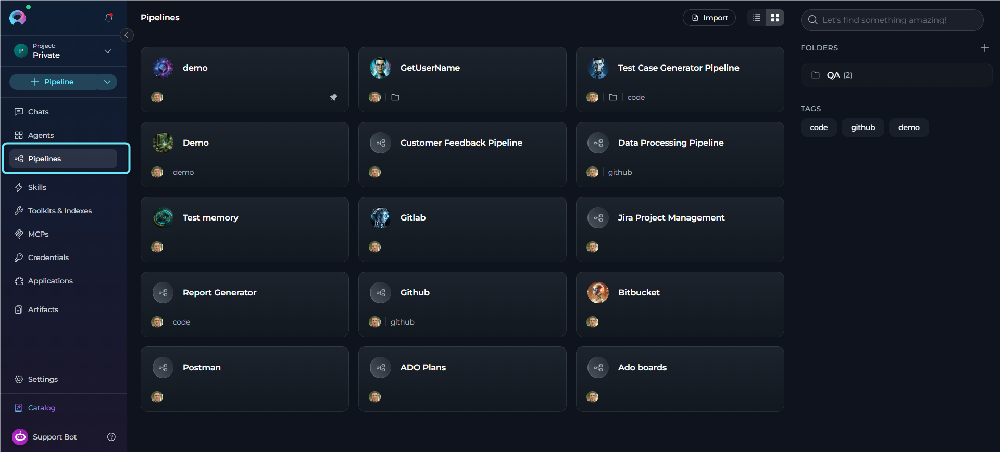
---

## Organize Pipelines into Folders

Folders help you organize pipelines into logical groups for better navigation and management. You can create folders, move pipelines between folders, and control folder access within team projects.

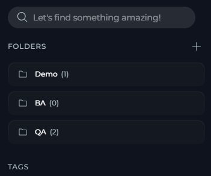

**Create a Folder:**

1. In the **Pipelines** dashboard right panel, locate the **Folders** section.
2. Select **+ Create Folder**.
3. Enter a folder name (up to 128 characters).
4. Select **Save**.

     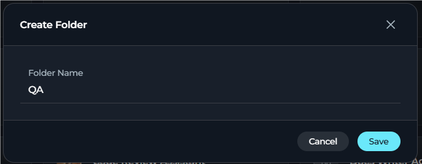

**Move a Pipeline to a Folder:**

1. **Hover over a Pipeline card:** A "Move to folder" icon (folder with arrow) appears on the card.
2. **Click the folder icon:** Opens a menu with folder options.
3. **Select a folder from the list:** The menu displays:
   - **+ Create Folder** option at the top
   - A scrollable list of existing folders
   - Pinned folders are marked with a pin icon
   - The current folder (if any) is highlighted and marked with a checkmark
4. The Pipeline is moved to the selected folder.

    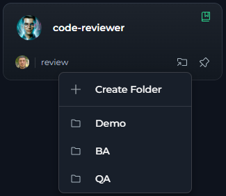

**View Folder Contents:**

Click any folder in the Folders panel to filter the pipelines list to show only pipelines in that folder. The folder name appears in the header, and the pipelines count updates to reflect the filtered view. Click **X** to close the folder view and return to the full list.

    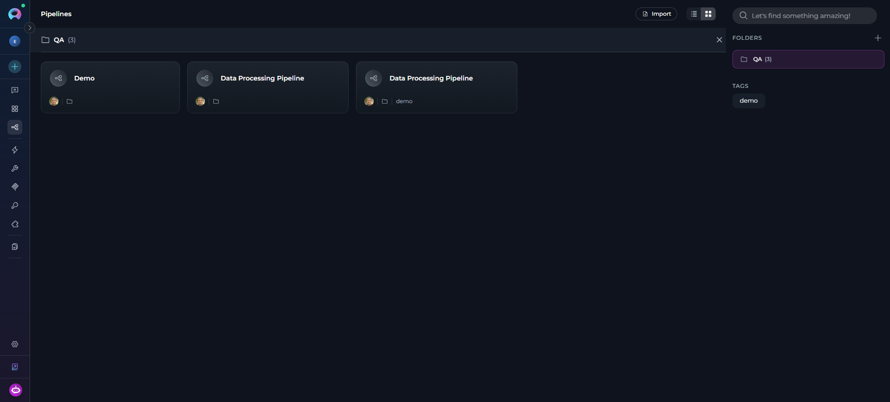

**Manage Folders:**

Each folder card in the right panel has a three-dot menu (⋮) with the following options:
    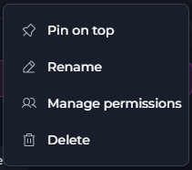
| Action | Description |
| --- | --- |
| **Pin on top** | Pin the folder to the top of the folders list |
| **Rename** | Change the folder name |
| **Manage permissions** *(Team projects only)* | Control which team members can view the folder |
| **Delete** | Permanently remove the folder (pipelines inside are moved back to the main list, not deleted) |

**Remove a Pipeline from a Folder:**

1. Open the pipeline card's three-dot menu (⋮), or the folder picker on the card/row.
2. Select **Remove from folder**.
3. The pipeline returns to the main pipelines list and the folder icon is removed from its card.

<Note>
Folders are available in team and personal projects. In team projects, folder access can be restricted to specific users. The Public project does not support folders.
</Note>

### Folder Permission Management

In team projects, you can control which users can view and modify specific folders by setting permission exceptions. By default, users retain the permissions granted by their project roles. Permission exceptions can only restrict access.

**Access Folder Permissions:**

1. In the **Pipelines** dashboard right panel, locate the folder in the **Folders** list.
2. Select the folder's three-dot menu (⋮).
3. Select **Manage permissions**.
4. The **Manage Permissions** dialog opens.
    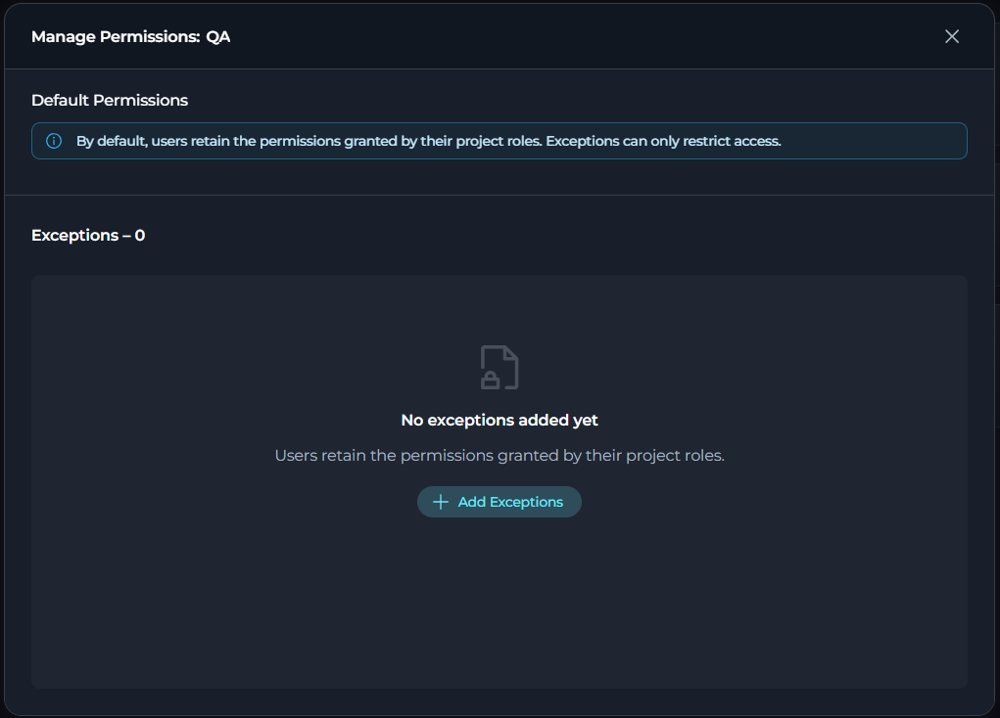

**Add Permission Exceptions:**

1. In the Manage Permissions dialog, select **Add Exceptions**.
2. Search for and select one or more users from the project.
3. Choose a permission level: **Read-only** or **No access**.
4. Select **Save**. The selected users are added to the permissions table.

    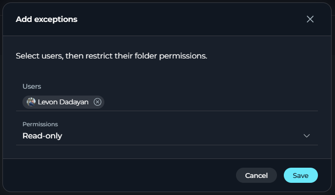

<Note>
You can select multiple users with the row checkboxes and use **Edit selected** to change their permission level in bulk (up to 200 exceptions per folder). Use the search box above the table to filter exceptions by name or email.
</Note>

**Permission Levels:**

| Permission Level | Description |
| --- | --- |
| **Read/write (default)** | User can view folder contents and modify folder settings |
| **Read-only** | User can view folder contents but cannot modify folder settings or move pipelines |
| **No access** | User cannot see the folder or its contents |

**Edit Permission Exceptions:**

- To modify an existing exception, locate the user in the permissions table and select the **Edit** (pencil) icon in the Actions column. Change the permission level to your desired setting and select **Save**.
- To remove an exception and return the user to default permissions, change the permission level to **Read/write (default)**. When saved, the user is removed from the exceptions table and inherits permissions based on their project role.

<Note>
Permission exceptions apply only to the folder itself. Users with no access to a folder cannot see it in their folders list or view its contents.
</Note>

---

## Creating a Pipeline

Creating a pipeline opens the same editor used for editing one — you can fill in its settings, build the workflow, and attach tools right away.

**The Pipeline Editor Layout**

The editor uses a **two-panel layout**: the **left panel** holds the configuration form with all settings sections, and the **center panel** holds the **Flow/YAML editor** for visually designing or coding your pipeline workflow.

1. Click the **+ Pipeline** button to open the pipeline editor in creation mode.

     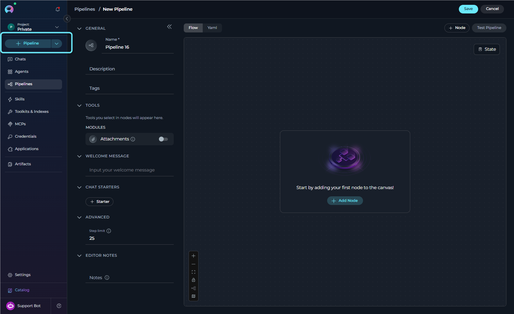

2. Fill out the configuration sections in the left panel:

     | Field | Description |
     |-------|--------------|
     | **Name** | A unique name for your pipeline (e.g., "Test Case Generator Pipeline"). |
     | **Description** *(optional)* | A clear description of the pipeline's purpose. |
     | **Tags** *(optional)* | Type a tag name or pick from pre-existing tags. |
     | **MMODULES → Attachments** *(optional)* | Toggle on to let users upload files in chat. Adds the `input_attachments` state variable automatically — see [File Attachments](#file-attachments). |
     | **WELCOME MESSAGE** *(optional)* | A message to guide users interacting with the pipeline (e.g., "Welcome! I can help you generate test cases based on your acceptance criteria."). |
     | **CHAT STARTERS** *(optional)* | Predefined commands or prompts to initiate interactions (e.g., "Generate test cases for the login feature"). |
     | **STEP LIMIT** *(optional)* | The maximum number of tool execution steps the pipeline can perform in a single turn (range: 0-999, default: 25), preventing infinite loops and managing resource usage. |
     | **EDITOR NOTES** *(optional)* | Internal documentation for the current pipeline version — rollout reminders, implementation notes, review comments (up to 1000 characters). Not sent to the LLM or used during execution. |

3. Design your workflow in the center panel — see [Designing Your Pipeline](#designing-your-pipeline) below.
4. Click **Save** to create the pipeline. This action creates what's known as the "**base**" version of your pipeline, and unlocks the **Information** section, the **Schedules** features, and the **Test Pipeline** button.


Your newly created pipeline will subsequently appear on the **Pipelines** page for your project.


<Tip>
**Adding a Custom Image**

When configuring Pipelines, you can further personalize their profiles by adding a custom image along with the **Name** and **Description**. This feature allows you to create a unique, visually distinct identity for each Pipeline, making them easier to recognize and manage.

To add an image:

1. Click the **Pen Icon** next to the image placeholder. This opens the **"Choose the image from the list or upload"** dialog.
2. Pick an icon from the **Default** grid, or select a previously uploaded icon from the **Uploaded** grid.
3. Click **Import** to upload a new custom image (bmp, ico, gif, jpeg, jpg, png, tiff, or webp — under 500 KB) from your local system. Uploaded icons can be removed individually from the **Uploaded** grid.

    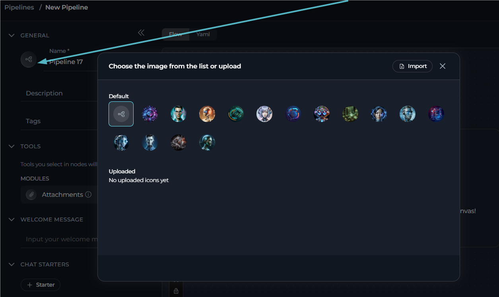
</Tip>

## Designing Your Pipeline

The **center panel** of the pipeline editor contains the canvas, available from the moment you open the editor — even before the first save. A toolbar at the top of the canvas has a **Flow** / **Yaml** toggle to switch between the visual and code views, plus a **Node** button to add nodes and a **Test Pipeline** button (once saved).

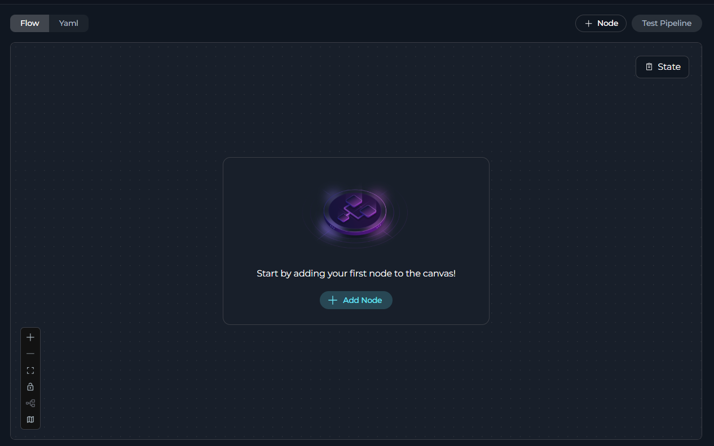


### State Management

**State** is your pipeline's memory — a set of key-value pairs that persist across the run and can be read or written by any node, letting you pass data between nodes, store intermediate results, and drive conditional logic.

<Note>
**Default State Variables**

Every pipeline includes built-in default state variables that are automatically available without manual configuration:

* **`input`** - The most recent message from the user
* **`messages`** - The complete conversation history
* **`tool_outcomes`** - The accumulated results of tool calls made during execution
* **`last_tool_outcome`** - The result of the most recently executed tool call
* **`input_attachments`** - Added automatically when File Attachments are enabled (see [File Attachments](#file-attachments))

Reference any state variable in your workflow nodes using `{{state.variable_name}}`.
</Note>

**Managing State Variables:**

1. Click the **State** button at the top-right of the canvas to open the **State** drawer.
    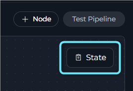
2. The drawer lists the default variables plus any custom ones you've added.
3. Click **+ Context** to add a custom variable: enter a **Variable Name** (e.g. `project_id`, `analysis_result`, `counter`), select its data type — **String**, **Number**, **List**, or **Json** — and set an optional default value.
4. Use **State Modifier** nodes to read or write state during execution, and reference state in any node's fields with `{{state.variable_name}}`.

     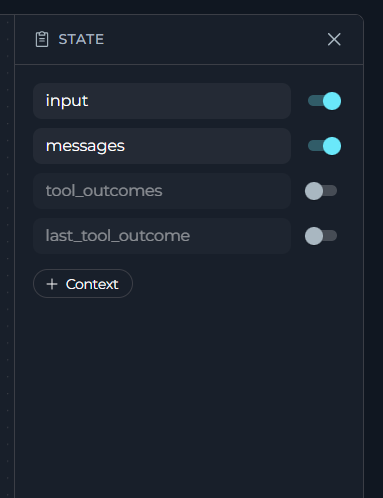

<Info>
**Learn More About State Management**

For a full walkthrough of state, default variables, and advanced patterns, see the **[Pipeline States Guide](../how-tos/pipelines/states)**.
</Info>


### Adding Nodes

1. Click the **Node** button in the canvas toolbar (or **Add Node** on an empty canvas) to open the node palette — a flat, searchable grid of every node type, such as **LLM**, **Agent**, **Toolkit**, **MCP**, **Code**, **Router**, **Decision**, **Human-in-the-Loop**, **State Modifier**, and **Printer**.

     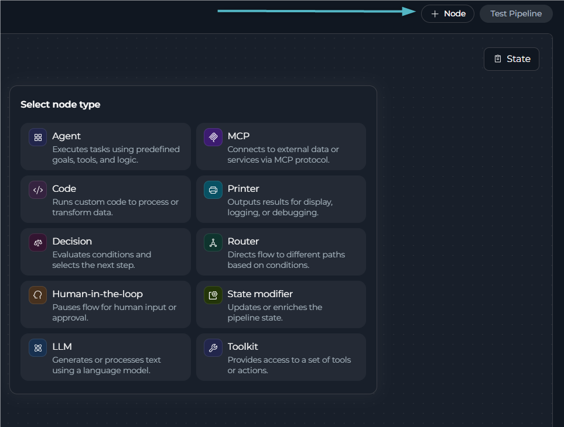

2. Pick a type to place it directly on the canvas; its configuration panel opens automatically so you can set it up right away.

     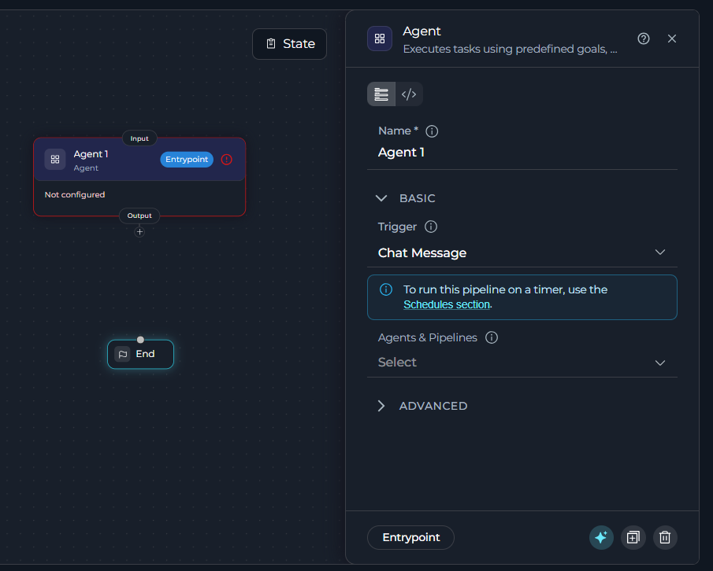

3. A **Toolkit**, **MCP**, or **Agent** node is how you attach a specific resource: open the node's configuration panel and use its picker to select the toolkit, MCP server, agent, or pipeline (with inline search and a **"Create new"** option) — see **[Toolkits](./toolkits)**, **[MCPs](./mcps)**, and **[Agents](./agents)**. Everything attached this way is summarized read-only in the **Tools** section of the left panel.
4. An **End** node is always present automatically to mark where a path terminates — it isn't added from the node palette, and stays hidden until you've placed your first node.


<Tip>
**Best Practices for Using Nodes**

**Plan Your Workflow**: Before adding nodes, outline the desired workflow to ensure a clear and logical structure.

**Use Descriptive Names**: Name each node clearly to make the pipeline easier to understand and maintain.

**Test Iteratively**: Test nodes and connections incrementally to identify and resolve issues early in the design process.

**Leverage Node Types**: Choose the appropriate node type for each task:

**Interaction Nodes:**

- **[LLM Node](../how-tos/pipelines/nodes/interaction-nodes#llm-node)**: Leverage language models for text processing and generation
- **[Agent Node](../how-tos/pipelines/nodes/interaction-nodes#agent-node)**: Integrate other agents into your pipeline for specialized tasks

**Execution Nodes:**

- **[Toolkit Node](../how-tos/pipelines/nodes/execution-nodes#toolkit-node)**: Integrate with external services and APIs
- **[MCP Node](../how-tos/pipelines/nodes/execution-nodes#mcp-node)**: Connect to Model Context Protocol servers for additional context
- **[Code Node](../how-tos/pipelines/nodes/execution-nodes#code-node)**: Execute custom code logic within your pipeline

**Control Flow Nodes:**

- **[Router Node](../how-tos/pipelines/nodes/control-flow-nodes#router-node)**: Direct flow based on multiple conditions
- **[Decision Node](../how-tos/pipelines/nodes/control-flow-nodes#decision-node)**: Implement conditional branching based on criteria
- **[Human-in-the-Loop Node](../how-tos/pipelines/nodes/control-flow-nodes#human-in-the-loop-node)**: Pause the run for a human to approve, edit, or reject before continuing

**Utility Nodes:**

- **[State Modifier Node](../how-tos/pipelines/nodes/utility-nodes#state-modifier-node)**: Manage and update pipeline state variables
- **[Printer Node](../how-tos/pipelines/nodes/utility-nodes#printer-node)**: Output and display data during pipeline execution

By following best practices and leveraging the available nodes, you can design efficient and scalable workflows tailored to your specific needs.

**Learn More About Flow Designer**: For comprehensive information about using the Flow Designer and advanced workflow design techniques, see the **[Flow Designer Guide](../how-tos/pipelines/flow-editor)**. For details on entry points, transitions, and the End node, see the **[Node Connectors Guide](../how-tos/pipelines/nodes-connectors)**.
</Tip>

**Flow Designer**

* Use **Flow** mode to visually design your pipeline on the canvas.
* Connect nodes by dragging from one node's handle to another's, or click the **+** next to an output handle to create or pick the next node without dragging.
* Use the canvas toolbar in the bottom-left corner to zoom in/out, fit the view, lock/unlock the canvas, auto-arrange nodes, and show/hide the minimap.

### **YAML Editor**:

The Flow Designer has two YAML editing surfaces — one for the whole pipeline, and one scoped to a single node — both useful for a code-first approach, intricate logic the visual designer can't express, or replicating and tweaking an existing pipeline quickly.

* **Whole-pipeline YAML**: Switch the canvas-top toggle to **Yaml** mode to view and edit the entire pipeline's definition as code — nodes, transitions, and settings all in one place.

     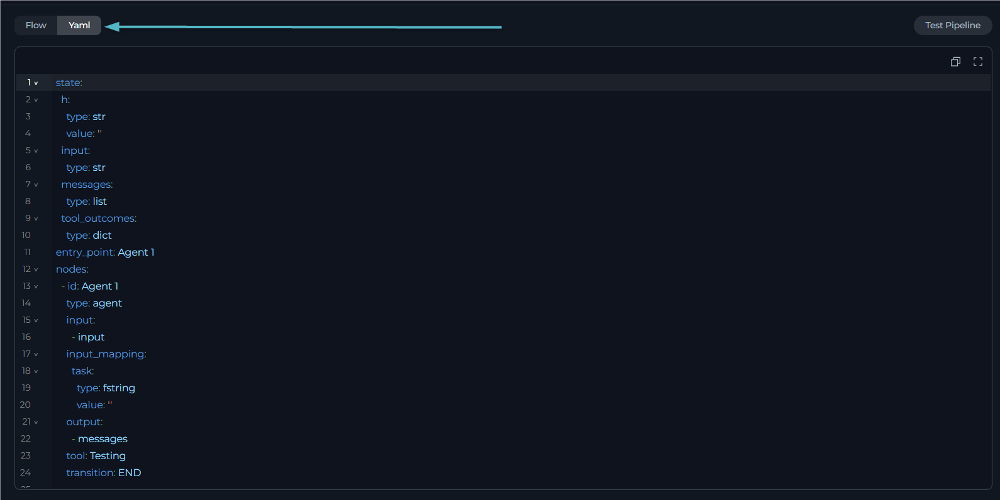

* **Single-node YAML**: Inside any node's configuration panel, use its **Flow view** / **YAML view** toggle to edit just that node's settings as raw YAML, without leaving Flow mode or switching the whole canvas.

     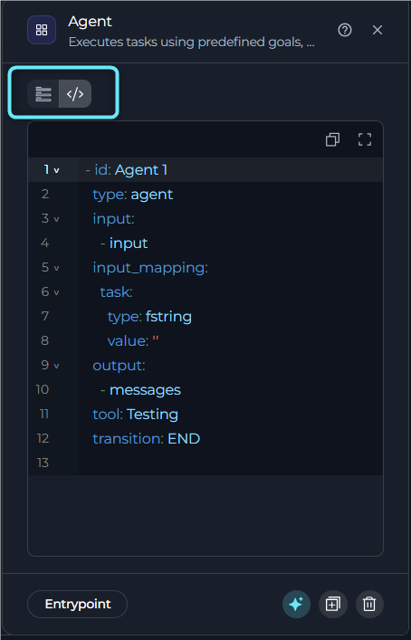

In either view, the editor validates your YAML syntax as you type, so you can catch errors before they stop the pipeline from running.

<Info>
**Learn More About YAML Configuration**

For detailed information about YAML syntax, configuration options, and advanced pipeline programming, see the **[YAML Editor Guide](../how-tos/pipelines/yaml)**.
</Info>

## Test Pipeline

Pipelines are run and tested through the embedded chat inside the pipeline editor — there is no separate standalone execution page. The **Test Pipeline** button that opens this chat stays disabled (with a tooltip explaining why) until the pipeline has been saved and the workflow is actually runnable: it needs at least one node connected to **End**, an entry point set, a path from that entry point to **End**, and every node fully configured — any missing required field blocks the button until it's filled in.

**Open the Test Chat**: Click **Test Pipeline** in the canvas toolbar to open the embedded chat panel.

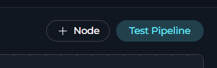

### Select & Configure the AI Model

Before sending a message, you can choose which AI model processes the pipeline and optionally adjust its parameters.

1. Select the **model button** in the chat panel's toolbar to open the model selector dropdown.
2. Choose the desired model from the list (for example, `gpt-4o`, `gpt-5.1`).
3. Select the **Model Settings** icon (⚙️) next to the model button to adjust generation parameters.

   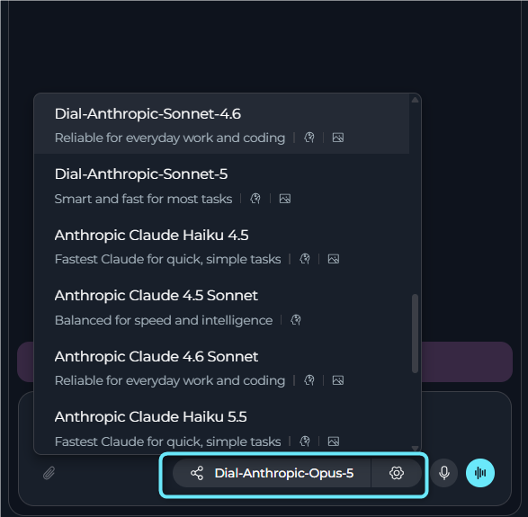

<Tabs>
  <Tab title="Reasoning Models (e.g. GPT-5.1)">
    | Parameter | Description |
    |-----------|-------------|
    | **Reasoning** | Controls the depth of logical thinking and problem-solving. Available levels depend on the selected model. |

    | Level | Behavior |
    |-------|----------|
    | **Low** | Fast, surface-level reasoning with concise answers and minimal steps |
    | **Medium** | Balanced reasoning with clear explanations and moderate multi-step thinking *(default)* |
    | **High** | Deep, thorough reasoning with detailed step-by-step analysis (may be slower) |

       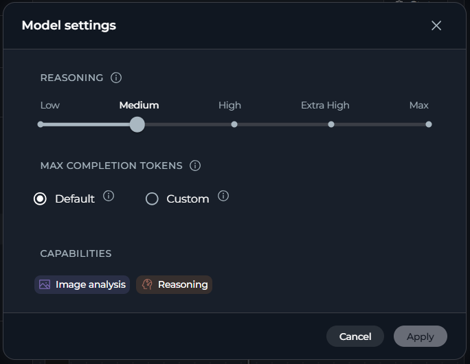

    <Note>
    Some models expose additional levels such as **Minimal** or **Extra High**, or only a single fixed level.
    </Note>
  </Tab>
  <Tab title="Standard Models (e.g. GPT-4o)">
    | Parameter | Description |
    |-----------|-------------|
    | **Creativity** | Controls response randomness. Lower values produce focused, deterministic outputs; higher values produce more varied and creative responses. |

    | Level | Behavior |
    |-------|----------|
    | **1** | Highly focused and deterministic outputs |
    | **2** | Mostly focused with slight variation |
    | **3** | Balanced between focus and creativity *(default)* |
    | **4** | More varied and creative responses |
    | **5** | Maximum creativity and diversity |

     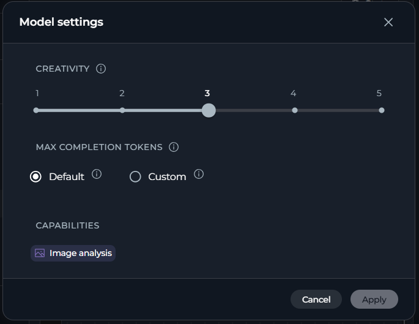

  </Tab>
</Tabs>

**Max Completion Tokens** *(All Models)* — limits the maximum length of AI responses, measured in tokens (roughly 4 characters per token):

| Option | Description |
|--------|-------------|
| **Auto** | No custom ELITEA limit is applied — the provider and model's own native output limit is used *(default)* |
| **Custom** | Manually set a specific token limit for responses. The field is pre-filled with a starting value of 4096 tokens, which you can edit; the interface shows remaining tokens available, and setting too high a value shows an error if it exceeds the model's maximum output tokens. |

### Start the Conversation

If a **Welcome Message** is configured, it appears first. Begin by either:

- Clicking a **Conversation Starter** (if configured) — this fills the input with that prompt, so you can edit it before sending
- Typing your own instruction into the chat input field and clicking **Send**

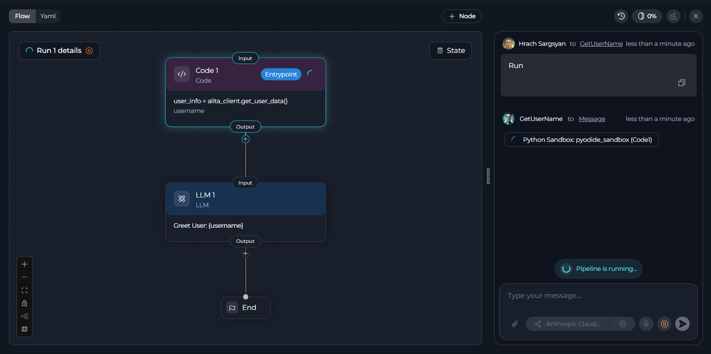

**Chat Actions:**

| Action | Icon / Location | Description |
|--------|------------------|-------------|
| **Send** | Send icon, chat input | Submits your message and continues the conversation |
| **Read out** | Megaphone icon, below each response | Reads the response aloud using Text-to-Speech — see [Text-to-Speech](#text-to-speech) |
| **Copy to clipboard** | Below each response | Copies the response text for use elsewhere |
| **Regenerate** | Below each response | Produces a new response to replace the current one |
| **Edit response** | Below each response | Edits the response text in place *(not currently enabled on this release)* |
| **Delete** | Below each response | Removes that response from the chat |
| **Clear the chat** | Chat panel toolbar | Erases the entire conversation history for a fresh start |
| **Run History** | Clock icon, chat panel toolbar | Opens past runs — see [Pipeline Runs](#pipeline-runs) below |

### Managing Context Budget

Context Budget management is **enabled by default** for every project (a project administrator can disable it by setting the `context_manager` secret to `false`). It keeps long conversations within the model's token limits through automatic message pruning and summarization, so the pipeline keeps working without hitting a token limit.

Once enabled, the **Context Budget** widget appears above the chat during pipeline execution. Click it to expand and view detailed metrics and configuration options.

     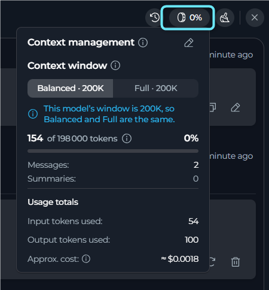

<Info>
**Learn More About Context Management**

For detailed information about context management configuration, strategies, and best practices, see the **[Context & Budget Management Guide](../how-tos/chat/ctxt-bdgt)**.
</Info>

### Pipeline Runs

Each time you execute a pipeline, the system creates a **pipeline run** that captures the complete execution context — inputs, outputs, state changes, and performance metrics. While a run is executing (or just after), a run chip appears at the top of the Flow Designer canvas showing its status (**Completed**, **Error**, **Stopped**, or **In Progress**); if multiple runs exist, a clock icon lets you switch between them.

Click the run chip to open the **Run Details** dialog: a step-by-step timeline of every node the run executed, with the state snapshot before and after each step, and any error details. From here you can **Stop** a run that's still in progress, or **Delete** one that's finished.

     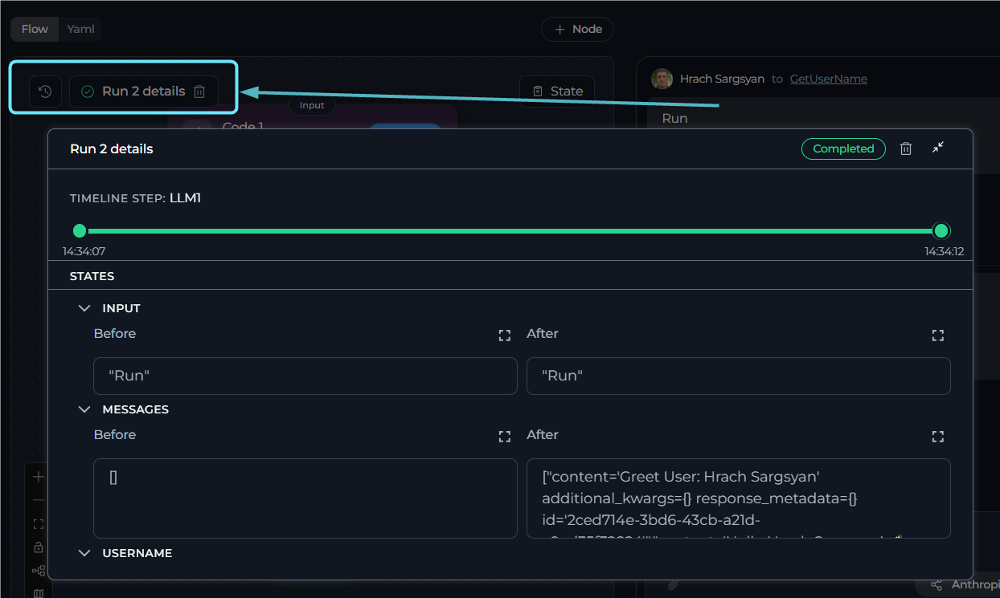


<Info>
**Learn More About Pipeline Runs**

For comprehensive information about managing and analyzing pipeline runs, including advanced debugging and optimization techniques, see the **[Pipeline Runs Guide](../how-tos/pipelines/pipeline-runs)**.
</Info>

### Voice Capabilities

The pipeline execution interface supports voice input and voice output, letting you dictate prompts and have pipeline responses read back to you.

<CardGroup cols={3}>
  <Card title="Voice Input" icon="microphone">
    Dictate prompts into the chat input field. Transcribed text is inserted at the cursor position in real time.
  </Card>
  <Card title="Text-to-Speech" icon="volume-high">
    Have pipeline responses read aloud, with adjustable voice, speed, and volume, from a mini-player pill in the input area.
  </Card>
  <Card title="Speaking Mode" icon="waveform-lines">
    Hands-free voice loop. ELITEA records, sends, speaks the pipeline's response, and listens again — automatically.
  </Card>
</CardGroup>

---

<Tabs>
  <Tab title="Voice Input">
    **Voice Input** lets you dictate prompts directly into the pipeline input field. The transcribed text is inserted at the cursor position, so you can combine typed and spoken content in the same message.

    **How to use Voice Input:**

    1. Click the **microphone** icon in the message input toolbar to start recording.
    2. Speak your prompt. A live transcript appears in the input field as you talk — interim results update in real time.
    3. Click the **Stop** (■) button to finish recording. The final transcript is committed and focus returns to the input field.

        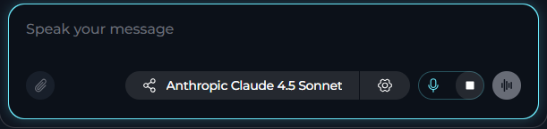

    <Note>
    Voice Input uses a server-side ASR (automatic speech recognition) model if configured in **Settings → AI Configuration**, or falls back to the browser's built-in Web Speech API. If neither is available, the microphone icon is hidden. If a platform administrator has temporarily disabled voice features, the icon is shown disabled with a tooltip explaining why.
    </Note>
  </Tab>
  <Tab title="Text-to-Speech">
    **Text-to-Speech** reads pipeline responses aloud. A **Read out** button (megaphone icon) appears in the action bar below each pipeline response when the message contains speakable text.

    **How to use Text-to-Speech:**

    1. Click the **Read out** (megaphone) button below a pipeline response to start playback.
    2. The text is highlighted word-by-word as it is read aloud, and a playback pill appears in the input area.
    3. In the playback pill, click the **Play/Stop** toggle to stop playback (or start it again); click the **Voice settings** (gear) icon to open the **Voice settings** dialog.

         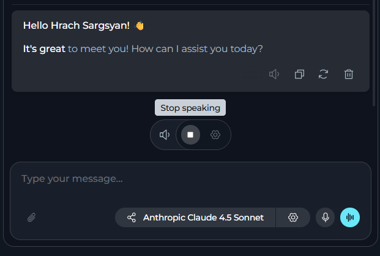

    **Voice Settings:**

    The **Voice settings** dialog lets you adjust playback before or between sessions:

    - **Voice**: Choose from the TTS model's available voices (e.g. `alloy`), or a browser voice if no model is configured.
    - **Speed**: Adjust playback rate from 0.5× to 2.0×.
    - **Volume**: Adjust playback volume from 0% to 100%.

         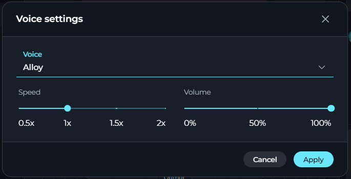

    <Note>
    When a TTS model is configured in **Settings → AI Configuration**, ELITEA uses that model for audio generation. If no TTS model is configured, playback falls back to the browser's built-in SpeechSynthesis API — the Voice selector then lists browser voices instead.
    </Note>
  </Tab>
  <Tab title="Speaking Mode">
    **Speaking Mode** is a continuous, hands-free voice loop. Once activated, ELITEA automatically records your speech, sends your prompt after a pause, plays back the pipeline's response, and then starts listening again — without any manual interaction between turns.

    **How to activate Speaking Mode:**

    1. Leave the message input field empty.
    2. Click the **voicewave** icon (shown in place of the Send button when the input is empty) to enter Speaking Mode.
    3. A voicewave pill with an **Exit** (✕) button replaces the send button, indicating Speaking Mode is active.
    4. Speak your prompt. After **3 seconds of silence**, your message is automatically sent.
    5. The pipeline response streams in and is read aloud via Text-to-Speech.
    6. Once the response finishes playing, recording starts again for the next turn.
    7. Click the **✕** button in the voicewave pill to exit Speaking Mode at any time.

         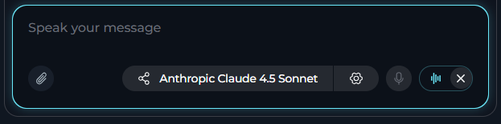

    <Note>
    Speaking Mode requires a voice recognition source (server ASR model or browser Web Speech API) for input and uses Text-to-Speech for output. If you start manual voice input while Speaking Mode is active, Speaking Mode is automatically deactivated.
    </Note>
  </Tab>
</Tabs>

---

## File Attachments

Enable users to upload and share files — documents, images, code files, and more — directly in pipeline conversations. Once enabled, files are uploaded from the pipeline's **Test Pipeline** panel using the paperclip icon, drag-and-drop, or clipboard paste in the chat input. When Attachments are enabled, ELITEA automatically injects a file-storage and retrieval toolkit into the pipeline at execution time, and adds an `input_attachments` state variable that any pipeline node can reference.

<CardGroup cols={3}>
  <Card title="Enable Once" icon="toggle-on">
    Turn on the **Attachments** toggle in the pipeline configuration. The `input_attachments` state variable is added to the YAML automatically.
  </Card>
  <Card title="Three Ways to Attach" icon="paperclip">
    Upload files using the paperclip icon, drag-and-drop onto the chat input, or paste from the clipboard (Ctrl+V).
  </Card>
  <Card title="Access in Nodes" icon="code">
    Reference uploaded files in any pipeline node using `{{state.input_attachments}}` after the files have been uploaded.
  </Card>
</CardGroup>

---

**Enabling File Attachments**

File attachment support is **disabled by default** for pipelines. To enable it:

1. Open the pipeline and locate the **left configuration panel**.
2. Scroll to **Modules**.
3. Toggle **Attachments**.
4. Select **Save** to apply changes.

    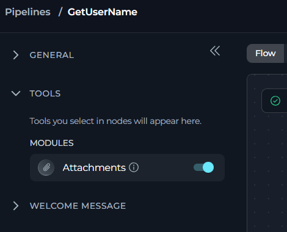

<Note>
When you enable Attachments, ELITEA automatically adds an `input_attachments` state variable (type: `list`, default: `[]`) to the pipeline's YAML `state` section. When you disable Attachments, the variable is automatically removed. No manual YAML editing is needed.
</Note>

<Warning>
Attachments require a **default vector storage (pgvector)** and a **default embedding model** to be configured in your project settings. If these are not configured, an error will occur when users attempt to attach files. Contact your platform administrator to verify the project configuration before enabling attachments.
</Warning>

---

**Attaching Files in Chat**

Once Attachments are enabled for the pipeline, three methods are available in the chat input:

- **Paperclip icon** — Click the paperclip button in the message input toolbar to open the system file picker and select one or more files. The tooltip shows how many attachment slots remain (*"Attach files (N left)"*) and is disabled once the maximum is reached.
- **Drag and drop** — Drag files from your operating system and drop them directly onto the chat input area.
- **Clipboard paste** — Copy files to your clipboard and press **Ctrl+V** while the chat input is focused to attach them instantly.

Attached files appear above the message input before you send:
- **Images** are displayed as thumbnail previews in a grid layout.
- **Other files** (documents, code, data, archives) are displayed as filename chips showing the file name and type icon.

    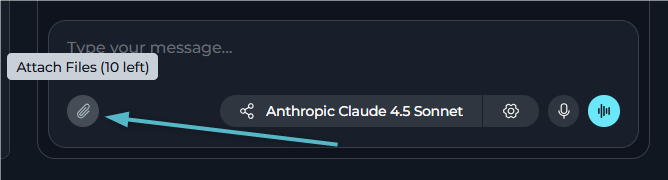


---

**File Limits**

The limits below are the platform defaults; a project administrator can reconfigure each one for the project.

| Limit | Default Value |
|-------|-------|
| Maximum files per message | 10 |
| Maximum total size per message | 150 MB |
| Maximum size per individual file | 150 MB |
| Maximum images per message | 10 |
| Maximum size per image file | 3 MB *(SVG excluded from size limit)* |

---

**Supported File Types**

Supported file types are fetched dynamically from the platform's registered document loaders, so the exact list can vary by deployment. The following are typically available:

| Category | Examples |
|----------|---------|
| **Images** | JPEG, PNG, GIF, WebP, BMP, SVG |
| **Documents** | PDF, DOCX, XLS, XLSX, PPTX, JSON, JSONL, HTML, XML, EML, MSG |
| **Code** | JS, JSX, TS, TSX, Python, Java, C#, PHP, Ruby, Go, Rust, Kotlin, Swift, C, C++, SQL, YAML, Shell, and more |
| **Text** | TXT, MD/MDX |

<Note>
Legacy binary **.doc** and **.ppt** files are not supported — convert them to **.docx** / **.pptx** first. Archive formats (ZIP, TAR, etc.) are not supported as pipeline attachments.
</Note>

---

**YAML Integration**

When Attachments are enabled, the pipeline YAML is automatically updated to include:

```yaml
state:
  input_attachments:
    type: list
    default: []
```

Pipeline nodes can reference uploaded files using `{{state.input_attachments}}`. Each item in the list represents one processed file — images are passed as image content, and all other files are indexed and passed as extracted text — ready for use in LLM, Code, or Toolkit nodes.

<Info>
The `input_attachments` state variable is fully managed by the platform. It is added when Attachments are enabled and removed when they are disabled. The backend automatically injects the file-storage toolkit (using the project's default attachment bucket, vector storage, and embedding model) at predict time — no manual toolkit configuration is required.
</Info>

---

## Schedules

The **Schedules** section in the left configuration panel lets you configure one or more recurring, timed executions of the pipeline, independent of its chat/webhook entry-point trigger. This section only appears for users with permission to list schedules.

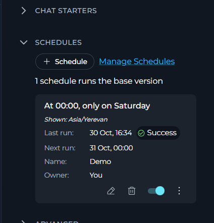

<Info>
For complete details on creating, editing, and testing schedules, approval rules, and the cross-project **Manage Schedules** page, see the **[Schedules guide](../how-tos/pipelines/entry-point#schedules)**.
</Info>

---

## Managing Pipeline Versions

To optimally manage your pipeline, understanding how to save and create versions is crucial. Follow these guidelines to efficiently save your pipeline, create versions, and manage them.

**How to Save a Pipeline:**

* To save your work on a Pipeline for the first time, simply click the **Save** button. This action creates what's known as the "**base**" version of your pipeline.
* You can continue to modify your pipeline and save the changes to the "**base**" version at any time by clicking the **Save** button again. If you wish to discard any changes made, you have the option to click the **Discard** button before saving.

<Info>
**Note**

The "**base**" version represents the initial version you create. You can keep updating this version with your changes by saving them, without the need to create additional versions for your pipeline.
</Info>

### How to Create New Versions

Pipelines support versioning, allowing you to maintain multiple iterations of a Pipeline without disrupting other pipelines or agents that reference it as a tool. Every Pipeline has a base version, and you can create additional named versions to test changes, iterate on improvements, or maintain different variants for different use cases.

**Key Version Concepts:**

- **base version**: The always-present initial version of every Pipeline, created the first time you click **Save**. Cannot be deleted.
- **Named versions**: Additional versions you create with **Save As Version** (for example, "v2", "updated-for-api-v3"). Each must have a unique name within the Pipeline.
- **Version selector**: The **Version** dropdown in the pipeline toolbar that lists all versions of the Pipeline so you can switch between them.

**Common Version Operations:**

| Operation | How to Access | Description |
|-----------|---------------|-------------|
| **Create version** | **Save As Version** button in toolbar | Save current changes as a new named version |
| **Switch versions** | **Version** dropdown in toolbar | Navigate between existing versions to view or edit |
| **Set as default / Export / Share / Compare versions / Fork / Publish / Unpublish** | Version's three-dot menu (⋮) | Additional per-version actions — a version is run by selecting it and using the test chat or Execute flow, not a separate menu action |
| **Delete version** | **Delete** action on a version | Remove a version that is no longer needed |

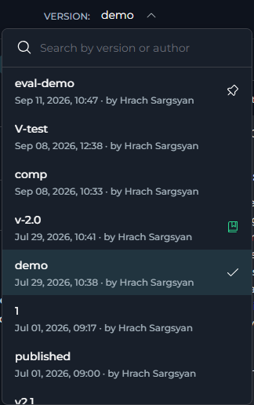

<Tip>
**Best Practices for Version Naming**

- **Length**: Keep the version name concise. The quick **Save As Version** dialog allows up to 255 characters with no character restrictions; the **Publish** wizard's version-naming step limits names to 50 characters, allowing only letters, numbers, dots, hyphens, and underscores.
- **Clarity**: Choose names that clearly describe the version's purpose or the changes it introduces, for easier tracking and management.
</Tip>

<Info>
**Full Versioning Guide**

For detailed information on version management, naming conventions, and best practices, see the **[Entity Versioning guide](../how-tos/agents-pipelines/entity-versioning)**.
</Info>

### Exporting and Importing Pipelines

ELITEA allows you to export the **currently selected version** of a pipeline as a file and import it into another project. Export and import are always version-specific — there is no option to export the entire pipeline with all its versions at once.

**Exporting a Pipeline Version:**

1. Open the pipeline and select the **version** you want to export using the version selector.
2. Click the **three-dot menu (⋮)** in the toolbar.
3. Select **Export**. The file downloads automatically to your device.
   - If the selected version has **no nested dependencies**, a single **`.md`** file is downloaded.
   - If the selected version references **other agents or pipelines as tools**, the export is a **`.zip`** file containing all dependencies.

**Importing a Pipeline:**

1. In the **Pipelines** dashboard, click the **Import** button in the toolbar.
2. Upload the `.md` or `.zip` file previously exported from ELITEA.
3. The Import Wizard displays entity cards for the main pipeline and any nested dependencies. Review configuration before confirming.
4. Click **Import** to complete. The pipeline will appear in the current project.

<Info>
After import, tools requiring authentication will need their credentials reconfigured manually.
</Info>

<Info>
**Full Import/Export Guide**

For complete details on file formats, nested dependencies, and advanced options, see the **[Import/Export Agents and Pipelines guide](../how-tos/agents-pipelines/import-export)**.
</Info>

---

### Forking Pipelines

Forking copies the **currently selected version** of a pipeline from one project to another within the same ELITEA environment — no file download required. Only one version is forked at a time; there is no option to fork the entire pipeline with all its versions.

**How to Fork a Pipeline Version:**

1. Open the pipeline and select the **version** you want to fork using the version selector.
2. Click the **three-dot menu (⋮)** in the toolbar and select **Fork**.
3. In the **Fork parameters** wizard, choose a **target project** from the dropdown. No project is pre-selected; you must pick one manually.
4. Review the entity cards — the main pipeline card and any nested dependencies that will be forked automatically.
5. Click **Fork**. When complete, click **Got it** to navigate directly to the forked pipeline in the target project.

<Info>
**What Gets Forked**

- Only the **currently selected version** is forked.
- Nested agent or pipeline dependencies are automatically included.
- **Model settings** are preserved if the model is available in the target project; otherwise the first available model is used.
- **Credentials** for tools must be reconfigured manually after forking.
</Info>

<Info>
**Full Forking Guide**

For complete details and agent forking, see the **[Fork Agents and Pipelines guide](../how-tos/agents-pipelines/forking)**.
</Info>

---

### Pipeline History

The **Run History** panel is a persisted, complete audit trail of every past execution of your pipeline — useful for reviewing past conversations, comparing how different versions performed, debugging by replaying a run, and keeping records for compliance.

**How to access Run History:**

1. Open any saved pipeline and click **Test Pipeline** to open the embedded chat panel.
2. In the chat panel's toolbar, click the **clock icon**. The tooltip reads *"Run History"*.
   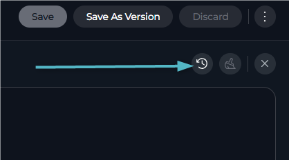

3. The pipeline page navigates to the two-panel Run History view. Use the breadcrumb trail at the top of the page to return to the pipeline — there is no dedicated close button.

**Run History layout:**

The Run History panel uses a two-panel layout:

- **Left panel** — sortable list of all past runs. Click any column header to sort:

    | Column | Description |
    |--------|-------------|
    | **Date** | Timestamp of the run in `dd-MM-yyyy, hh:mm a` format |
    | **Schedule** | Shows the schedule that triggered the run, linking to that schedule's settings. |
    | **Version** | Pipeline version used for the run |
    | **Duration** | Total execution time of the run |

    Click a row to load the conversation replay in the right panel. Each row also has a **three-dot menu (⋮)** with: **Share link**, **Delete**, **Restore chat**, and **Analytics** (shown only for runs recent enough to carry usage-tracking data).

- **Right panel** — full conversation replay of the selected run.

     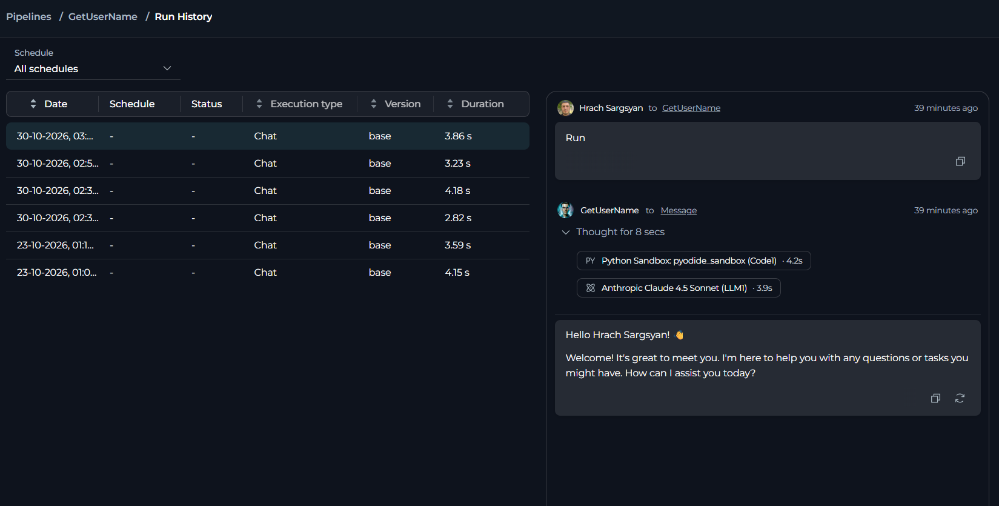

<Note>
If the pipeline has at least one [Schedule](#schedules) configured, a **Schedule** dropdown also appears above the list (default: **All schedules**), letting you filter Run History down to runs triggered by a specific schedule.
</Note>

**Run Analytics:**

Selecting **Analytics** from a run's three-dot menu opens a dedicated page scoped to that single run only—no other runs or ordinary chats are mixed in. The header shows the run date and the pipeline version used. Use **Refresh data** to reload the figures, or **Export to Excel** (one worksheet per tab) to download them.

<Tabs>
  <Tab title="Costs">
  Estimated cost cards (total, input, output, cache read/write) plus Cost by User and Cost by Model tables.
  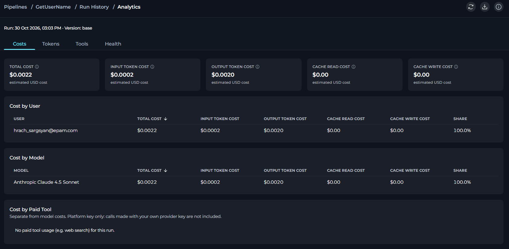
  </Tab>
  <Tab title="Tokens">
  Token count cards (total, input, output, cache read/write) plus Token Usage by User and Token Usage by Model tables.
  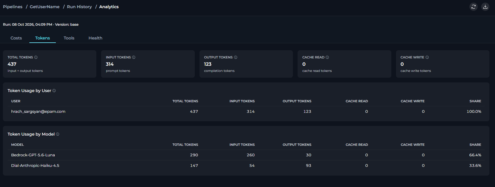
  </Tab>
  <Tab title="Tools">
  A Tool Details table (calls, users, average latency, errors) with search and pagination. This tab is hidden if the run made no tool calls.
  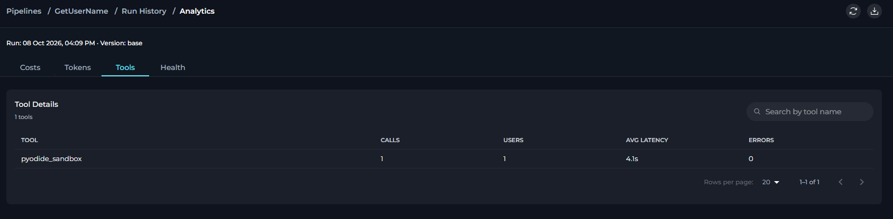
  </Tab>
  <Tab title="Health">
  A Health by Event Type table (total, errors, error rate, average latency).
  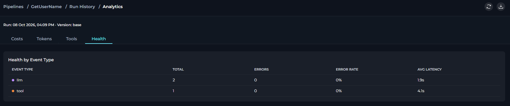
  </Tab>
</Tabs>

<Info>
**Export to Excel**

Downloads one worksheet per tab—Costs, Tokens, Tools, and Health—covering every row for this run, not just the rows visible on the current table page. Each worksheet also includes the project, pipeline, version, and run date for reference.
</Info>

<Note>
**Availability**

**Analytics** is only available for runs whose last-updated timestamp is on or after September 30, 2026 (UTC) — the date per-run usage-tracking data started being recorded. The menu item does not appear for runs older than that cutoff; restoring or re-running an old conversation updates its timestamp and can make Analytics available for it.
</Note>

<Info>
**Learn More About Pipeline History**

For detailed instructions on using the History panel, please refer to the **[Agents and Pipelines History Guide](../how-tos/agents-pipelines/agents-pipelines-history)**.
</Info>

---

## Pipeline Evaluation

Pipeline Evaluation provides the same framework used for agents — dimensions, test cases, and automated scoring — to measure and improve pipeline performance. You can create evaluation suites that test your pipeline against predefined criteria and receive actionable feedback, with the trajectory view showing which **nodes** ran (instead of an agent's LLM/tool steps).

**Access Pipeline Evaluation:**

1. Open any saved pipeline.
2. Select the **three-dot menu (⋮)** in the pipeline tab bar.
3. Select **Evaluate (Beta)**.
4. The Pipeline Evaluation page opens with tabs for Suites, Dimensions, Datasets, and History.

   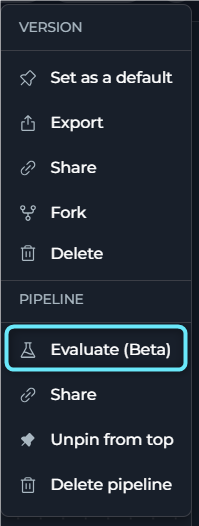

**Key Capabilities:**

- **Dimensions**: Define scoring criteria (for example, relevance, tone, accuracy) that can be scored by AI, humans, or custom code validation scripts.
- **Datasets**: Create collections of test cases with inputs and expected outputs to run against your pipeline.
- **Suites**: Combine dimensions and datasets into evaluation suites that score pipeline runs across multiple criteria.
- **Runs**: Execute evaluation suites to generate scored results and identify areas for improvement.
- **Enhance with AI**: Analyze failed checks and generate suggested fixes for your pipeline or evaluation criteria.

<Info>
For complete details on creating dimensions, datasets, suites, running evaluations, and using AI-powered enhancement features, see [**Agent Evaluation**](../how-tos/agents-pipelines/agent-evaluation) and [**Agent Evaluation FAQ**](../how-tos/agents-pipelines/agent-evaluation-faq) — the same guide applies to pipelines.
</Info>

---

## Best Practices

<Accordion title="Keep It Modular">
Break down complex workflows into smaller, manageable nodes for better readability and maintainability. Create reusable pipeline components.
</Accordion>

<Accordion title="Use Clear Node Names">
Name each node descriptively to make your pipeline self-documenting. Use consistent naming conventions across your pipelines.
</Accordion>

<Accordion title="Test Iteratively">
Test each node and connection individually before executing the entire pipeline. Use sample data to validate data flow.
</Accordion>

<Accordion title="Organize with Tags">
Use tags to categorize pipelines by function, department, or use case. This makes pipelines easier to find and manage.
</Accordion>

<Accordion title="Version Your Pipelines">
Create named versions for significant changes. This allows you to roll back if needed and compare different iterations.
</Accordion>

<Accordion title="Handle Errors Gracefully">
Implement error handling and fallback mechanisms in your pipeline design. Use Decision nodes to manage error conditions.
</Accordion>

<Accordion title="Document Your Logic">
Add descriptions to nodes and use the YAML editor comments to explain complex logic. Include conversation starters that demonstrate usage.
</Accordion>

---

## Troubleshooting

<Accordion title="Pipeline Not Executing">
Check that all required tools are properly configured with valid credentials. Verify node connections are complete. Review the execution history for error messages.
</Accordion>

<Accordion title="Node Failing or Timing Out">
Verify credentials and network connectivity. Check if external services are accessible. Review node configuration parameters for correctness.
</Accordion>

<Accordion title="Incorrect Data Flow">
Review connections between nodes to ensure data is passed correctly. Test with sample data to identify where data transformation fails. Check State Modifier configurations.
</Accordion>

<Accordion title="Cannot Save Pipeline Changes">
Verify you have edit permissions. Check for validation errors in node configurations. Try discarding changes and reapplying them incrementally.
</Accordion>

<Accordion title="Version Not Creating">
Ensure the version name meets requirements (max 48 characters, no special characters). Check that you have permission to create versions. Try refreshing the page.
</Accordion>

<Accordion title="Pipeline Not Appearing in List">
Clear search filters and check tag filters. Verify you're in the correct project. Refresh the pipelines dashboard.
</Accordion>

For further assistance, contact your platform administrator or refer to the support documentation.

### Support Contact

If you encounter issues not covered in this guide or need additional assistance with Pipeline management, please refer to **[Contact Support](../support/contact-support)** for detailed information on how to reach the ELITEA Support Team.

---

<Info>
**Additional Resources**

For more detailed information on related topics, please refer to the following documentation:

* **[Sensitive Action Authorization Guardrail](../how-tos/chat/action-auth)** - Learn how pipeline tool calls can be paused for human authorization before executing sensitive actions.
* **[Credentials](./credentials)** - Learn how to create and manage credentials for toolkit integrations
* **[Toolkits](./toolkits)** - Comprehensive guide on creating and configuring toolkits
* **[Glossary](../home/glossary)** - Definitions of key terms and concepts used in the ELITEA platform
* **[Pipeline Overview](../how-tos/pipelines/overview)** - Advanced pipeline development guide
* **[Nodes and Connectors](../how-tos/pipelines/nodes-connectors)** - Learn how to connect and manage nodes in your pipeline workflows
* **[Entry Point Configuration](../how-tos/pipelines/entry-point)** - Configure pipeline entry points and initialization
* **[AI Assistant in Nodes](../how-tos/pipelines/ai-assistant-in-nodes)** - Use AI assistance for node configuration and setup
* **[How to Create and Edit Pipelines from Canvas](../how-tos/chat-conversations/how-to-create-and-edit-pipelines-from-canvas)** - Design workflows from chat interface
</Info>


