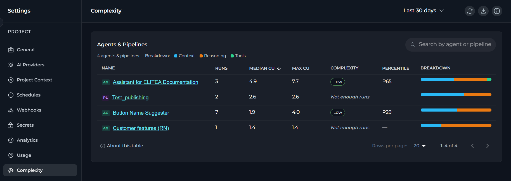
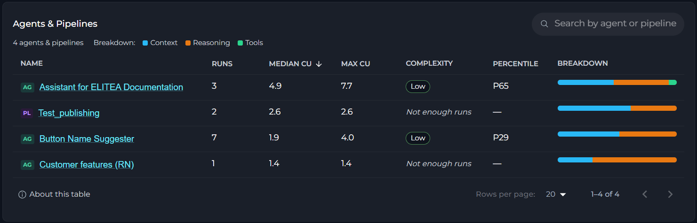
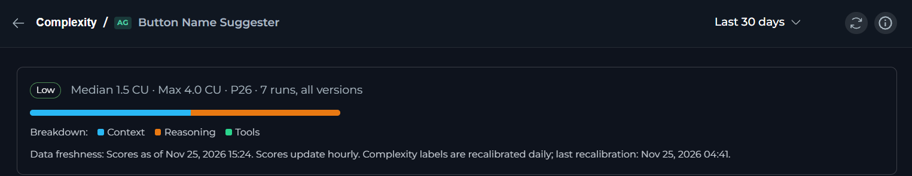
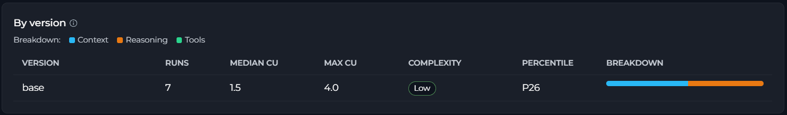
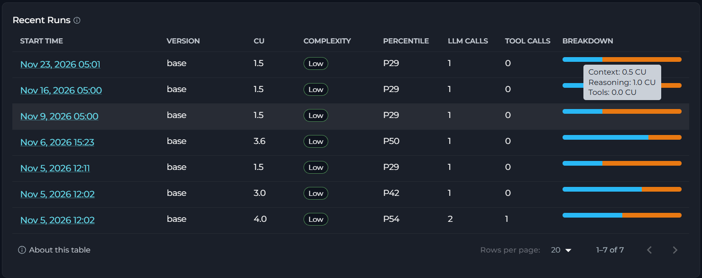

In **Complexity**, you can see how much context, reasoning and tool work the runs of your agents and pipelines use. Each run gets a score in complexity units (CU) and a label, so you can compare agents and pipelines in the project.

To open **Complexity**, in **Settings**, select **Complexity**.

<Note>
**Complexity** is shown only if your platform administrator has turned on the complexity feature and usage metering. If the complexity feature and usage metering are off, the page does not appear in **Settings**.
</Note>

The page header has these controls:

- **Period**—sets the time range: **Last 7 days**, **Last 30 days** or **Last 90 days**. The default is **Last 30 days**.
- **Refresh**—reloads the scores.
- **Export to Excel**—downloads all rows for the selected period and search as an Excel file.
- **About Complexity**—explains how scores and labels are calculated, including the current thresholds.

When you first open **Complexity**, a **About Complexity** opens automatically.

## How Complexity Is Measured

**A higher score does not mean a worse result**. It shows that a run used more context, reasoning or tools.

### Complexity Units

ELITEA calculates the complexity units (CU) of each run from three parts:

| Part | How it is counted |
| --- | --- |
| **Context** | 1 CU per 1,000 tokens of the largest prompt in the run, up to 30 CU. |
| **Reasoning** | 1 CU per LLM call. |
| **Tools** | 1 CU per tool call. Heavier tools count more, up to 5 CU: indexing counts 5, sandbox, code and file processing count 3, and search and SQL count 2. Lookups, such as asking the user or loading a skill, count 0. |

ELITEA scores a run about 30 to 90 minutes after it finishes. Scores update hourly.

### Complexity Labels

ELITEA gives each agent, pipeline and run a label based on the complexity score:

| Label | Meaning |
| --- | --- |
| **Low** | The score is lower than the **Medium** threshold. |
| **Medium** | The score is between the **Medium** and **High** thresholds. |
| **High** | The score is between the **High** and **Extreme** thresholds. |
| **Extreme** | The score is higher than the **Extreme** threshold. |

ELITEA calculates the thresholds from the scores of runs on your platform, so a label shows how complex a run is compared with other runs there. ELITEA recalibrates the thresholds daily. Until it has enough runs to calibrate, ELITEA uses default thresholds and shows a note about it. If a platform administrator has set the thresholds, **About Complexity** says so.

An agent or pipeline needs **at least three scored runs** in the selected period **to get a label**. Until then, the label shows as pending.

**Percentile** shows how a score compares with other runs. For example, *P90* means the run is more complex than 90% of runs.

### Breakdown

**Breakdown** shows which parts the score of a run, an agent or a pipeline is made of. The bar has one segment each for **Context**, **Reasoning** and **Tools**. The width of a segment is the share of that part in the total score. For example, if the **Tools** segment is the widest, tool calls add most of the score.

The color legend for the segments appears in the header of the Agents & Pipelines table, on the details page and on the **Complexity** tab of a run.

## Agents & Pipelines Table

The table lists every agent and pipeline that has scored runs in the selected period.

The table header shows the title **Agents & Pipelines**, the number of agents and pipelines in the list, the **Breakdown** color legend and a search field.

In **Search by agent or pipeline**, enter a name to filter the table. If too many names match, ELITEA shows a note that some results may be missing. Narrow the search to see all matching agents and pipelines.

The table has these columns:

| Column | Description |
| --- | --- |
| **Name** | The name of the agent or pipeline, with its type. Select the name to open its details. |
| **Runs** | The number of scored runs in the period. |
| **Median CU** | The approximate median score of the runs. ELITEA calculates it from daily summaries to keep the table fast. |
| **Max CU** | The highest score among the runs. |
| **Complexity** | The label of the agent or pipeline, based on its median score. |
| **Percentile** | How the median score compares with other runs. |
| **Breakdown** | The share of **Context**, **Reasoning** and **Tools** in the score. |

Select a column header to sort by **Runs**, **Median CU**, **Max CU** or **Percentile**. By default, the table is sorted by **Median CU**, with the highest median CU shown first.

In the table footer, **About this table** explains the **Median CU** column and shows when the scores and labels were last updated. You can show 10, 20, 50 or 100 rows per page.

<Note>
If the nightly recalibration has not run for over a day, ELITEA warns that labels may be out of date.
</Note>

## Agent & Pipeline Details

To see the complexity of one agent or pipeline, select its name in the Agents & Pipelines table. The period you chose stays selected. To return to the table, select **Complexity** at the top of the page or the back arrow.

The details page has three sections: **Summary**, **By version** and **Recent Runs**.

### Summary

The **Summary** shows the complexity of the agent or pipeline across all its versions in the selected period:

- The label.
- The median CU, the maximum CU, the percentile and the number of runs.
- The **Breakdown** bar with its legend.
- The time of the last scoring and a note about the thresholds.

If there are no scored runs in the period, the section says so.

### By Version

**By version** shows the median CU of each version of the agent or pipeline. ELITEA calculates the exact median from the scored runs of that version in the selected period.

The table has these columns:

| Column | Description |
| --- | --- |
| **Version** | The name of the version. |
| **Runs** | The number of scored runs of the version. |
| **Median CU** | The exact median score of the version's runs. |
| **Max CU** | The highest score among the version's runs. |
| **Complexity** | The label assigned to the version. |
| **Percentile** | How the median score compares with other runs. |
| **Breakdown** | The share of **Context**, **Reasoning** and **Tools**. |

### Recent Runs

**Recent Runs** lists the individual runs of the agent or pipeline in the selected period. Select the information icon next to the title to see what the table shows.

The table has these columns:

| Column | Description |
| --- | --- |
| **Start time** | When the run started. Select it to open the run's analytics on the **Complexity** tab. |
| **Version** | The version that ran. |
| **CU** | The total score of the run. |
| **Complexity** | The label assigned to the run. |
| **Percentile** | How the score compares with other runs. |
| **LLM calls** | The number of LLM calls in the run. |
| **Tool calls** | The number of tool calls in the run. |
| **Breakdown** | The share of **Context**, **Reasoning** and **Tools**. Hover over the bar to see the detailed breakdown. |

In the table footer, **About this table** shows when the scores were last updated. The pagination controls set 10, 20, 50 or 100 rows per page.

If you select a run in the table (by selecting its **Start time**), ELITEA opens the **Complexity** tab in the run's analytics of the agent or pipeline (**Agent or Pipeline** > **Run History** > **Analytics**).

<Callout icon="book" color="#C9B896" title="See Also">
- [Agent Run History](../agents#view-agent-history)
- [Pipeline Run History](../pipelines#pipeline-history)
</Callout>