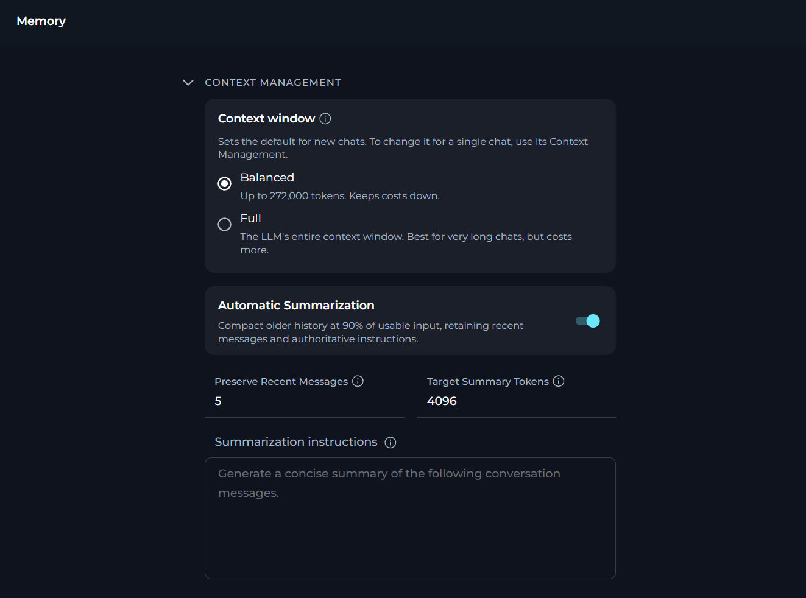
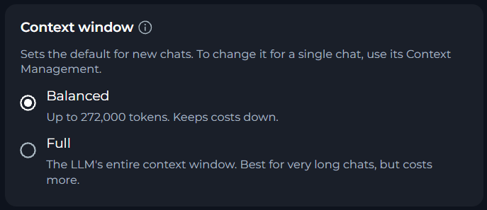
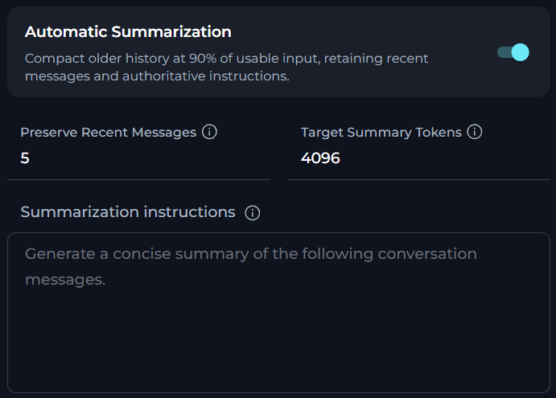
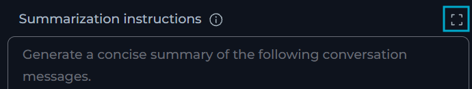

In **Memory**, you can set your personal defaults for how new conversations manage context — the context window size for new chats, and automatic summarization of older messages.

To open **Memory**, in **Settings**, select **Memory**.

**Memory** is a personal setting: it is scoped to you as an ELITEA user, not to the project, and it applies only to chats you start after changing these settings.

<Note>
Memory settings only set the defaults for **new** chats. You can override the context window for a single chat from that chat's own Context Management widget — see [Managing Context and Budgets](../../how-tos/chat/ctxt-bdgt.mdx). Existing chats keep their starting settings.
</Note>

**Memory** has one expandable section, **Context Management**, containing:

<CardGroup cols={2}>
	<Card title="Context Window" icon="brain">
		Choose the default context window size for new chats.
	</Card>
	<Card title="Automatic Summarization" icon="file-lines">
		Choose whether and how ELITEA summarizes older messages in new chats.
	</Card>
</CardGroup>

## Context Window

With **Context window**, you set your personal default context window mode for new chats you create.

| Option | Description |
| --- | --- |
| **Balanced** *(default)* | Up to 272,000&nbsp;tokens. Keeps costs down. |
| **Full** | The model's entire context window. Best for very long chats, but costs more. |

With either option, ELITEA reserves a safety margin inside the window for the response, so the conversation is not cut off.

<Note>
If you have not set a personal default, ELITEA falls back to your project's default context window set by the platform administrator.
</Note>

## Automatic Summarization

With **Automatic Summarization**, you set your personal default for whether ELITEA automatically condenses older messages in new chats to free up context space, and how.

When enabled *(default)*, ELITEA compacts older history once the chat nears its context limit, while always keeping the most recent messages and your instructions in full.

| Setting | Type | Default | Range | Description |
| --- | --- | --- | --- | --- |
| **Preserve Recent Messages** | Number | 5 | 1–99 | Number of most recent messages always kept in full, never summarized. |
| **Target Summary Tokens** | Number | 4,096 | 100–4,096 | Target length, in tokens, for each generated summary. |
| **Summarization instructions** | Multiline text | "Generate a concise summary of the following chat messages." | — | Custom instructions for how ELITEA generates summaries. |

<Note>
**Preserve Recent Messages** and **Target Summary Tokens** are disabled if **Automatic Summarization** is off.
</Note>

To change the summarization instructions, select the full screen view action (appears on hover) in the instructions field, edit the text, then close the full screen view:

## How Settings Apply

Changes save automatically — there is no save button. Text and number fields save when you select outside the field; toggles save immediately when you change them. A **Settings saved successfully** toast confirms the save; if saving fails, ELITEA shows a toast naming what failed to save.

Memory settings apply only to new chats, agents and pipelines. They do not apply to chats created by other users, to shared chats, or to existing chats. Agent and Pipeline definitions can also have their own independent context settings, which take precedence over your personal defaults.

<Callout icon="book" color="#C9B896" title="See Also">
See also:
- [Managing Context and Budgets](../../how-tos/chat/ctxt-bdgt.mdx)
- [General Settings](./general.mdx)
</Callout>