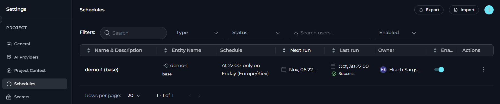
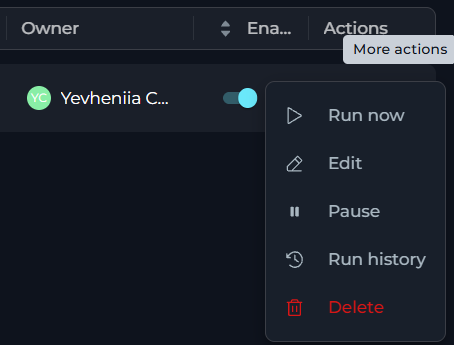
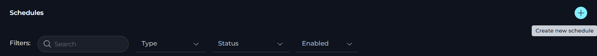
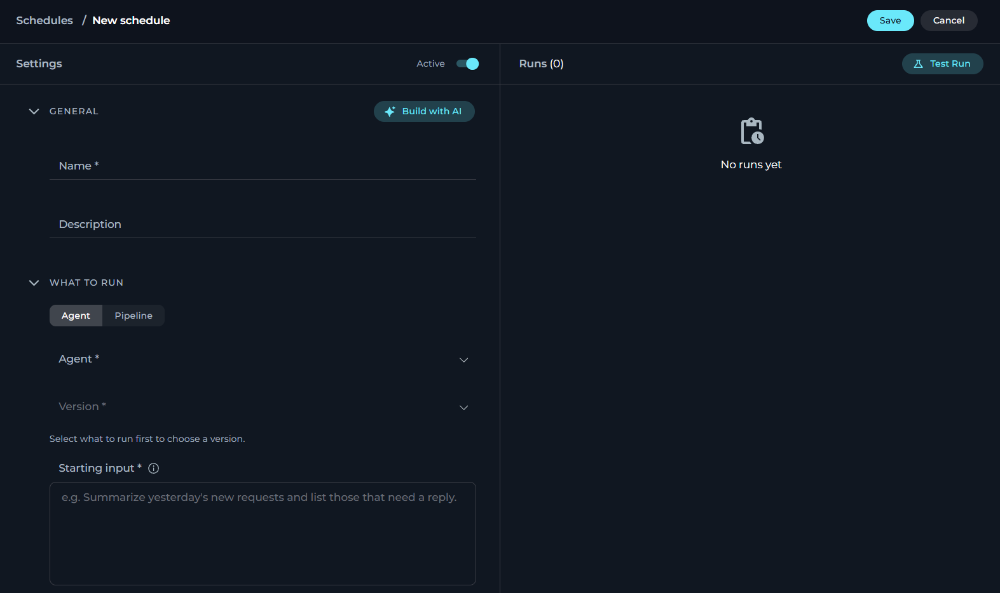
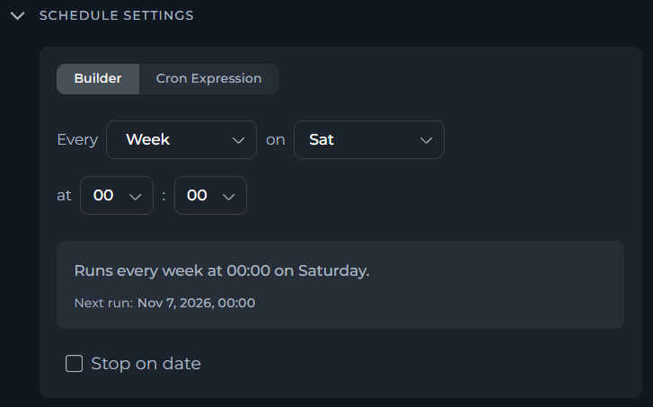
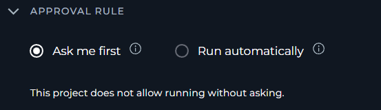

In **Schedules**, you can view, create and manage all agent and pipeline schedules in the project.

To open **Schedules**, in **Settings**, select **Schedules**.

## Permissions

**Schedules** is shown only to users who have permission to list schedules. Creating, editing, running and deleting a schedule each require their own permission:

| Permission | Controls |
| --- | --- |
| **List** | Viewing the **Schedules** page and list. |
| **Details** | Viewing a single schedule. |
| **Create** | Creating a schedule, including with **Build with AI**. |
| **Run** | **Run now**, **Test Run** and triggering a manual run. |
| **Delete** | Deleting a schedule. |
| **Admin** | Filtering the list by owner, reassigning a schedule's owner and editing the project-wide **Run without approval** setting. |
| **Export** / **Import** | Exporting or importing schedules. |

<Note>
In your private project, there are no other members to own a schedule, so every schedule belongs to you. With the permissions above, you see, run and delete every schedule in the project.
</Note>

## Schedules Table

The schedules table lists every schedule in the project, with these columns:

| Column | Description |
| --- | --- |
| **Name & Description** | The schedule's name, linking to its detail page, and its description. |
| **Entity Name** | The agent or pipeline the schedule runs, and its version. |
| **Schedule** | A plain-language summary of when the schedule runs. |
| **Next run** | When the schedule is next due to run. |
| **Last run** | When the schedule last ran, with a status chip (for example, **Success**). |
| **Owner** | The project member the schedule belongs to. |
| **Enabled** | A toggle showing whether the schedule is active or paused. |
| **Actions** | Actions you can perform on the selected schedule. |

You can use the filters above the table to narrow the list:

| Filter | Filters by |
| --- | --- |
| **Search** | Schedule name. |
| **Type** | *Agent* or *pipeline*. |
| **Status** | The result of the schedule's last run: **Running**, **Success**, **Failed**, **Skipped**, **Blocked** or **Awaiting approval**. |
| **Enabled** | Whether the schedule is currently active or paused. |

<Note>
Project administrators also see an **Owner** filter, to filter the list by one or more owners. Other project members only see the schedules they own.
</Note>

**Status** and **Enabled** are different: **Status** reflects the outcome of the last run, while **Enabled** reflects whether the schedule is currently turned on. A paused schedule still shows the status of its last run.

| Status | Meaning |
| --- | --- |
| **Running** | The run is currently in progress. |
| **Success** | The run completed successfully. |
| **Failed** | The run encountered an error and did not complete. |
| **Skipped** | The run did not start because the previous run of this schedule was still running. |
| **Blocked** | The run stopped before starting because of a risk-check finding — for example, a missing credential that cannot wait for approval. |
| **Awaiting approval** | The run reached a sensitive action and is paused, waiting for the owner to approve or reject it. |

## Schedule Actions

Select the **More actions** icon on a schedule to:

- **Run now** — runs the saved schedule immediately, as a manual trigger. Next run does not change.
- **Edit** — opens the schedule for editing.
- **Pause** — turns the schedule off without deleting it. (Shows **Resume** for a paused schedule.)
- **Run history** — opens the schedule and scrolls to its Runs section.
- **Change owner** — reassigns the schedule to another project member. Available to project administrators.
- **Delete** — permanently deletes the schedule.

<Warning>
Deleting a schedule cannot be undone. ELITEA asks you to type the schedule's name to confirm.
</Warning>

The exact actions you see on the selected schedule also depend on its own rules — for example, only the schedule owner or a project administrator can usually edit, pause or delete it.

## How to Create a Schedule

1. Select the **+** button in the top-right corner.

   

2. Fill in the [schedule's settings](#schedule-fields).
3. Select **Save**.

   

### Schedule Settings

**Active**, at the top of the form, turns the schedule on or off — the same state as the **Enabled** column in the list.

**General**

| Field | Required | Description |
| --- | --- | --- |
| **Name** | Required | The schedule's name. |
| **Description** | Optional | A note explaining what this schedule does and why. A clear description helps you and other project members tell schedules apart in the list. |

<Callout icon="lightbulb" color="#a855f7" title="">
Select **Build with AI** to describe the schedule in plain language and have ELITEA propose the name, description, what to run, schedule and approval rule for you to review before applying.
</Callout>

**What to Run**

| Field | Required | Description |
| --- | --- | --- |
| **Agent / Pipeline** | Required | Choose whether the schedule runs an agent or a pipeline. |
| **Agent** or **Pipeline** | Required | The specific agent or pipeline to run. |
| **Version** | Required | The version to run. Only available after you select what to run. |

For a pipeline, you additionally choose how the run starts:

- **Entrypoint** — starts the pipeline from its entry point, with no starting input.
- **Prompt** — sends a starting input as the pipeline's first message, same as for an agent.

For an agent, or a pipeline set to **Prompt**:

| Field | Required | Description |
| --- | --- | --- |
| **Starting input** | Required | The text the run receives as its first message. Use `{{name}}` to add a variable. |

**Timing**

Set when the schedule runs, using either tab:

- **Builder** — choose a period (for example, **Week**), a day and a time. ELITEA shows a plain-language summary and the next run.
- **Cron Expression** — enter a 5-field cron expression directly (minute, hour, day of month, month, day of week). You can use [crontab.guru](https://crontab.guru) to build or check an expression.

<Note>
If a saved cron expression cannot be represented by the **Builder** tab (for example, it runs on multiple days), that tab is disabled until you simplify the expression or edit it as text.
</Note>

Select **Stop on date** to add an end date. The schedule stops running after that date; you can clear the date to remove the limit.

**Approval Rule**

Choose whether this schedule can skip approval when it runs a sensitive action — a tool your platform administrator has marked as requiring authorization in Guardrails:

- **Ask me first** *(default)* — the run pauses and asks you for approval.
- **Run automatically** — the run proceeds without asking.

<Note>
**Run automatically** is only available if your project administrator has turned on **Run without approval** in [General settings](./general.mdx#schedules). If that project-wide setting is off, every schedule must ask for approval on a sensitive action, and ELITEA shows this as the reason **Run automatically** is disabled.
</Note>

You can see the full approval algorithm in [Run Without Approval](./general.mdx#run-without-approval).

### Testing Before You Save

While creating a new schedule, you can select **Test Run** to run the form's current settings once, without saving the schedule. **Next run** and **Last run** are not affected.

For a schedule that is already saved, the equivalent action is **Run now** (see [Schedule Actions](#schedule-actions)), which saves any pending changes first, then runs the schedule as a manual trigger.

## Best Practices

- **Use meaningful names and descriptions.** As the number of schedules in a project grows, the **Name & Description** column is often the only way you or a teammate can tell schedules apart at a glance, without opening each one.
- **Use Test Run before saving.** Confirm the agent or pipeline runs the way you expect before the schedule goes live.
- **Prefer Builder over Cron Expression** unless you need a pattern the Builder cannot express. The Builder's plain-language summary and next-run preview make mistakes easier to catch than a raw cron string.
- **Set Stop on date for temporary schedules.** For a schedule that should only run for a limited time, set an end date instead of relying on someone to pause or delete it manually later.
- **Choose Run automatically consciously.** Only pick it for a schedule whose sensitive actions you trust to run unattended.
- **Pause instead of delete when in doubt.** Pausing keeps the schedule's settings and history so you can resume it later; deleting is permanent.
- **Reassign ownership when someone leaves the project.** Use **Change owner** to keep each schedule's owner current, since its owner receives approval requests and schedule-related notifications.

<Callout icon="book" color="#C9B896" title="See Also">
See also:
- [General Settings](./general.mdx#schedules)
- [Schedules in Agents](../agents.mdx#schedules)
- [Schedule Trigger in Pipelines](../../how-tos/pipelines/entry-point.mdx#schedule)
</Callout>