In **Usage**, you can review your budget consumption of platform-shared models, with usage broken down by model, source, agent, pipeline, skill, and (in team projects) by member, and export usage data to Excel.

To open **Usage**, in **Settings**, select **Usage**.

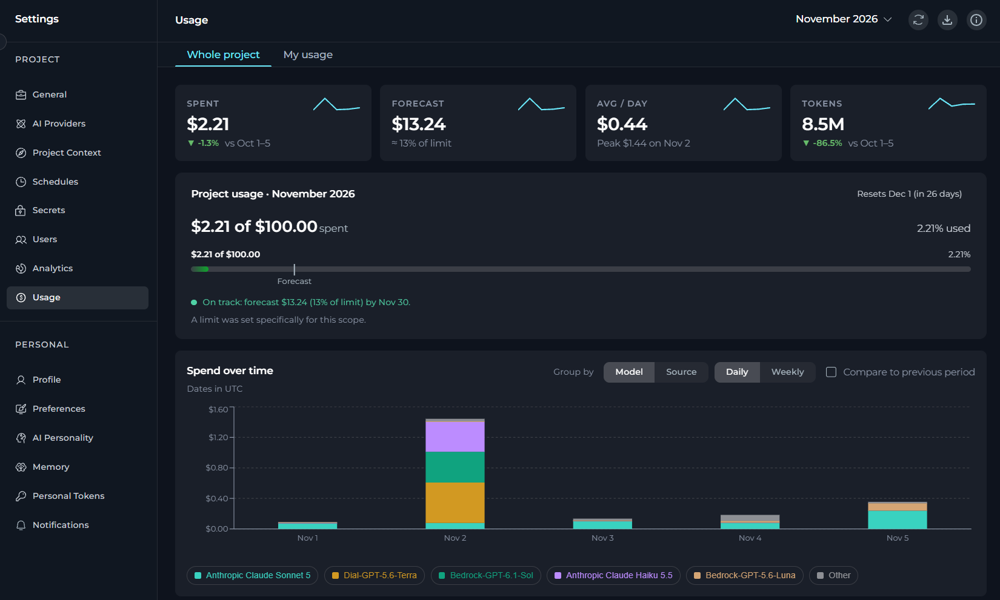

<Note>
**Usage** is shown only when your platform administrator has turned on cost budgets for the platform. If it is off, the **Usage** tab does not appear in Settings.
</Note>

**Usage** includes these elements:

- **Page header** — the page title, the current billing period (or a period selector when more than one period has usage), a **Refresh** button, an **Export to Excel** button, and an **About Usage** info popover.

  

- **Tabs** — **Whole project** and **My usage**, hidden in private projects, since there is only one scope to view.
- **Content area** — the scrollable panel below the tabs, rendering the budget status, KPI cards, charts, tables, and (in team projects) the Members table, all for the selected period.

At the bottom of the content area, ELITEA shows when the displayed data was last updated — for example, *Updated just now* or *Updated 5m ago* — with a small inline refresh icon next to it, as an alternative to the **Refresh** button in the page header.

## How to Work with Usage

Select **About Usage** in the page header for an explanation of what counts toward the budget shown:

- In a private project, requests made without selecting a team project are charged there — including requests made with personal access tokens from external tools such as Claude Code, IDE extensions, and scripts.
- In every scope, only requests to platform-managed shared models count toward the budget. Usage of models configured with your own provider credentials is billed by that provider and is not included here.

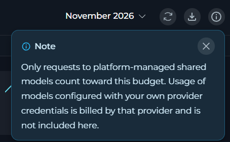

For the current period, ELITEA may still be collecting usage figures. In that case, it shows this message: *Usage figures are still being collected for this period. They may lag live activity by a short time.*

### Limitations

- Usage is reported for the current calendar-month billing period, not a rolling 30-day window.
- Only requests to platform-managed shared models are included.
- Models configured with your own provider credentials are billed by that provider and are not included here.
- Paid tools (such as web search) are tracked against their own separate limit and are not part of the model budget shown here.

### Select a Period

Each period in **Usage** is a calendar month. If more than one past calendar month has recorded usage, the page header shows a period selector instead of a plain label. It lists the current month and up to three past months that have usage, each with its date range; only months with usage are listed.

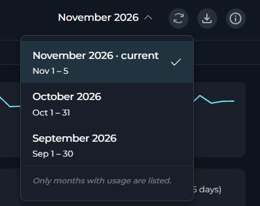

<Note>
If you switch tabs or scope and the period you had selected has no data for the new scope, ELITEA shows a toast and falls back to the current period.
</Note>

For a past (closed) period, ELITEA shows that period's final totals, without a budget limit, percentage used, or forecast — these only apply to the current period.

<video src="../../img/menus/settings/project/usage/usage_closed-period.mp4" controls alt="Video demonstrating usage data for a closed period."></video>

### Export Usage Data

You can export usage data to an Excel file.

To export usage data:

1. In **Settings** > **Usage**, select the export button in the page header.
2. Wait for ELITEA to prepare the export.

ELITEA disables export while usage data is still loading. On the **Whole project** tab, exporting also fetches the full member list — regardless of any active search filter or page — before building the file.

If export fails, ELITEA shows a toast: *Unable to export usage data. Please try again.* If a manual refresh fails, ELITEA shows a separate toast: *Unable to refresh usage data. Please try again.*

## Usage Tabs

In **Usage**, you work with two tabs:

<CardGroup cols={2}>
	<Card title="Whole project" icon="briefcase">
		Review project-wide usage, budget state, model usage, and member usage.
	</Card>
	<Card title="My usage" icon="user">
		Review your own usage and budget state in the selected project.
	</Card>
</CardGroup>

<Info title="Tab switcher visibility">
In a private project, ELITEA treats the project budget as your own budget, so you see no switcher. In a team project, you can switch between the whole-project view and your personal usage view.
</Info>

### KPI Cards

ELITEA shows four summary cards for the selected scope and period.

| Card | Shows when you can see cost amounts | Shows when you cannot see cost amounts |
| --- | --- | --- |
| **SPENT** | Amount spent, with a trend sparkline. | Replaced by **BUDGET USED**, showing the percentage of the limit used. |
| **FORECAST** (current period) or **LIMIT** (past period) | Projected end-of-period spend (current period) or the effective limit (past period). | Forecast or limit shown as a percentage instead of an amount. |
| **AVG / DAY** | Average spend per day so far this period, with the peak day. | Average tokens per day, with the peak day. |
| **TOKENS** | Total tokens used, with a breakdown on hover. | Replaced by **CACHE HIT RATE** when no percentage is available either; otherwise still shows **TOKENS**. |

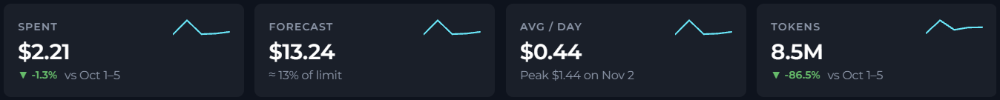

<Note>
Whether you can see cost amounts for this scope is determined by ELITEA; project members who cannot see amounts still see every card, with percentages or token counts in place of currency values.
</Note>

Where a prior period is available for comparison, **SPENT** and **TOKENS** also show a delta chip against that period.

### Budget Status

At the top of the content area, ELITEA shows the current budget status for the selected scope and month.

- A title combining the scope and month, for example *Project usage · October 2026*, with a chip showing when the month resets (or **Closed** for a past month).
- If you can see cost amounts: the amount spent, the limit (when one applies), and the percentage used.
- A progress bar, with a **Forecast** tick marking the projected end-of-month spend when enough data is available.
- A status line explaining where you stand — for example, that the month is closed, that no limit applies, that you are on track, or that the forecast is expected to exceed the limit on a specific day.
- A hint line explaining the limit: whether it was set specifically for this scope, inherited from the platform default, or that no limit applies.

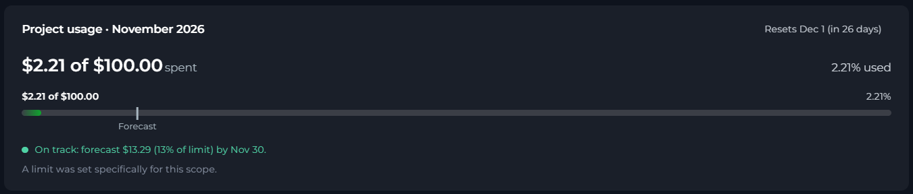

If the budget is nearing its limit, ELITEA shows a warning message naming the percentage used. If the budget is exceeded, ELITEA shows an error message explaining that requests to platform-shared models are unavailable until the limit is increased or the current budget month resets.

### Spend Over Time

This chart shows usage across the selected month, titled **Spend over time** if you can see cost amounts, or **Tokens over time** otherwise. Dates are shown in UTC.

- **Group by** — **Model**, **Source**, or **Member** (member grouping is only offered in **Whole project** scope, when you can see amounts, and when the data includes a member breakdown).
- **Daily** / **Weekly** — switches the bar granularity. Weekly bars start on Monday and are clipped to the month.
- **Compare to previous period** — overlays the previous month as a dashed line, when a previous month is available.

Select a legend entry to show or hide that series in the chart.

If no usage is recorded for the month, ELITEA shows *No usage recorded for this period yet.* instead of the chart.

<video src="../../img/menus/settings/project/usage/usage_spent-over-time.mp4" controls alt="Video demonstrating the Spend over time chart."></video>

### This Month vs Last Month

When the previous month has recorded usage, ELITEA shows a cumulative comparison chart: the current month's running total against the same point in the previous month, with a dotted line marking the limit (when one applies) and a dotted forecast extension for the rest of the current month.

A subtitle states whether the current month is running above or below the same point last month.

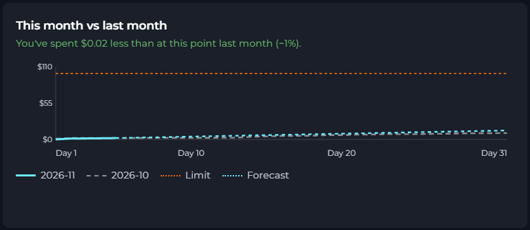

This chart does not appear when there is no data for the previous month to compare against.

### Spent by Source

**Spent by source** is a donut chart broken down by the source where the usage came from — Chat, Agents, Pipelines, Automations, Indexing, Skills, Evaluations, External API, or Other.

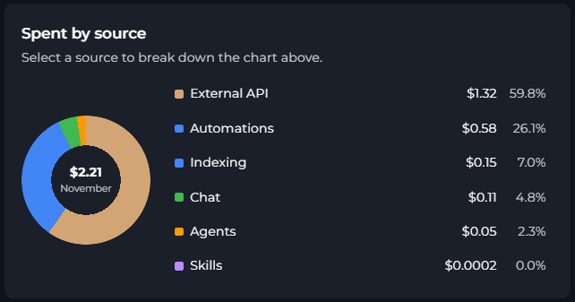

Select a source in the legend to highlight it in the **Spend over time** chart above; select it again to clear the highlight.

<video src="../../img/menus/settings/project/usage/usage_spent-by-source_select.mp4" controls alt="Video demonstrating selecting a source to highlight it in the Spend over time chart."></video>

### Models

The **Models** table lists usage by model for the selected period, sorted by cost (or share, if you cannot see amounts) by default.

| Column | Description |
| --- | --- |
| **Model** | Model display name, with a type chip for image generation or embedding models. |
| **Cost** | Cost for that model. Shown only when you can see cost amounts. |
| **Tokens** | Total tokens used by the model. |
| **% of total** | Share of total usage for the model. |
| **vs prior** | Change against the comparable prior period. Shown only when prior-period data is available. |
| **Trend** | A small sparkline of the model's usage over the period. |

Select a column header to sort by it. By default, ELITEA shows up to eight models; select **Show all N models** to see the rest, or **Show top 8 models** to collapse the list again.

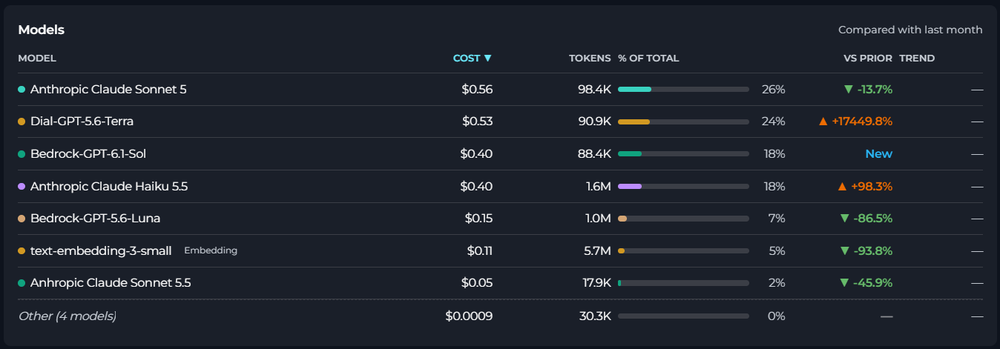

If no model usage is recorded for the period, ELITEA shows *No model usage recorded for this period yet.* instead of the table.

### Paid Tools

If the project has any paid tools available — features with their own separate monthly limit, such as web search — ELITEA shows a **Paid Tools** section below **Models**, with one usage meter per tool, even if it has not been used yet this period.

Paid-tool usage is tracked separately from model usage and is never counted toward the model budget above. Calls made with your own provider key for a paid tool are not counted either.

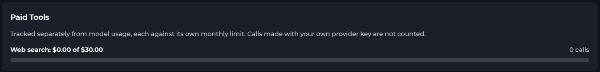

### Top Agents/Pipelines

ELITEA shows up to five top agents or pipelines for the selected period, titled **Top spending agents/pipelines** by default, or **Top running agents/pipelines** when sorted by runs. This section is hidden when there is no agent or pipeline usage for the period.

| Column | Description |
| --- | --- |
| **Name** | Agent or pipeline name, with an **AG** or **PL** badge showing which it is. |
| **Runs** | Number of runs in the period. |
| **Spend** (or **Share**, if you cannot see amounts) | Amount spent by that agent or pipeline, or its share of total spend. |
| **Per run** | Average spend per run. |
| **vs prior** | Change against the comparable prior period. Shown only when prior-period data is available. |

Select any column header to sort by it. Select **View in Analytics** to open the equivalent breakdown in [Analytics](./analytics.mdx), filtered to the last 30 days.

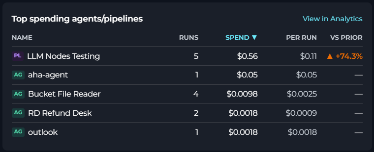

### Top Skills

ELITEA shows up to five top skills for the selected period, titled **Top spending skills** by default, or **Top running skills** when sorted by runs. This section is hidden when there is no skill usage for the period.

| Column | Description |
| --- | --- |
| **Skill** | Skill name. |
| **Runs** | Number of times the skill was used in the period. |
| **Avg per run** | Average spend per use. |
| **Spend** (or **Share**, if you cannot see amounts) | Amount spent on that skill, or its share of total spend. |

There is no **vs prior** column for skills. Select any column header to sort by it. Select **View in Analytics** to open the equivalent breakdown in [Analytics](./analytics.mdx), filtered to the last 30 days.

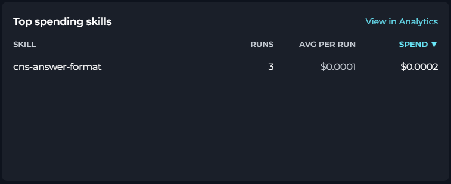

### Token Mix

A segmented bar (with a legend) breaking total tokens down into **Input**, **Output**, **Cached**, and **Image** tokens, with each segment's share of the total.

When a cache hit rate is available, ELITEA shows it in a footer line below the legend.

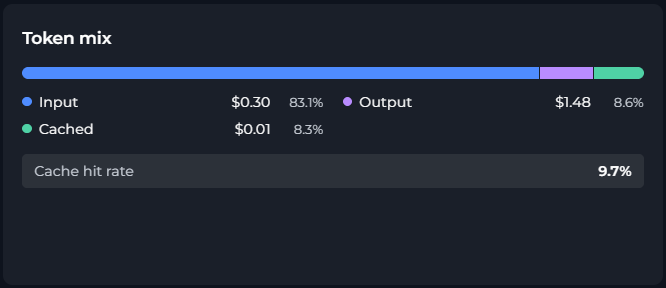

This section is hidden when there are no tokens to break down.

### Monthly History

When more than one month has recorded usage, ELITEA shows a bar chart of spend across the last four months with data, with a dotted line marking the current limit. Select a bar to open that month.

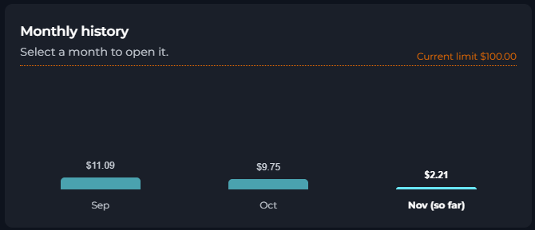

This section is hidden when only one month has usage.

### Members

**Members** is shown only in **Whole project** scope, and only in a team project.

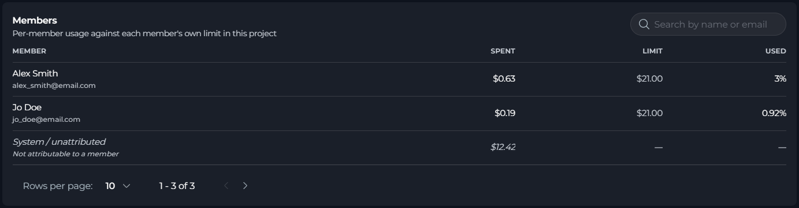

The table includes a row for each project member, plus a pinned **System / unattributed** row for spend that cannot be tied to a specific member.

| Column | Description |
| --- | --- |
| **Member** | Member name or email. |
| **Spent** | Amount spent by that member. |
| **Limit** | Effective limit for that member. Shows **—** for a past period. |
| **Used** | Percentage of the member's limit used so far. Shows **—** for a past period. |
| **vs prior** | Change against the comparable prior period. Shown only when prior-period data is available. |

Select **Member** or **Spent** to sort the table by that column. The **Used** value is highlighted when the member is at or over the warning threshold — 80% of their limit by default.

<Note>
Viewing **Members** requires platform-administrator access. If you do not have it, ELITEA shows *Unable to load the member breakdown.* with a **Retry** button instead of the table.
</Note>

If ELITEA cannot read some members' spend records, it shows a warning that the list reflects current members only, and that spend for members who have left the project is missing.

**Members** includes a search field that filters members by name or email. If the search returns no matches, ELITEA shows *No members match this search.* The table is paginated, showing 10 members per page by default.

<Info title="See Also">
See also:

- [Analytics](./analytics.mdx)
</Info>