In **Webhooks**, you can view, create and manage all webhooks of the project. A webhook gives an external system, such as GitHub or GitLab, a URL. When the system sends a request to this URL, ELITEA runs an agent or a pipeline and uses the body of the request as the input of the run.

To open **Webhooks**, in **Settings**, select **Webhooks**.

<Note>
**Webhooks** is shown only to users who have permission to list schedules and uses the same permissions as [Schedules](./schedules).
</Note>

## Webhooks Page Structure

The **Webhooks** page includes a header, a table that lists all webhooks in the project, and filters you can use to narrow the list.

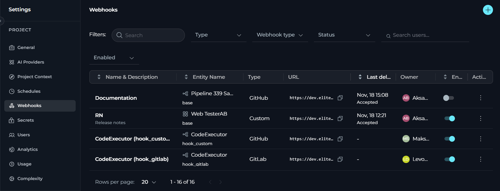

In the top right corner of the header, you see the **+** button by which you can [create a new webhook](#how-to-create-webhooks). The button is shown only to users who have permission to create schedules.

### Webhooks Table

The table lists every webhook in the project. By default, the webhook with the most recent delivery is shown first, and webhooks without a delivery come last.

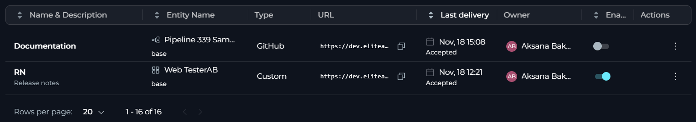

The table has these columns:

| Column | Description |
| --- | --- |
| **Name & Description** | The name of the webhook. Select the webhook name to open its details page. |
| **Entity Name** | The agent or pipeline that the webhook runs, and its version. |
| **Type** | The sender of the webhook: **GitHub**, **GitLab** or **Custom**. A GitLab webhook with a signing token shows **GitLab (signing token)**. |
| **URL** | The URL that the sender calls. Select the copy icon to copy it. |
| **Last delivery** | The result of the last request that ELITEA accepted as genuine, and when it arrived. |
| **Owner** | The project member the webhook belongs to. |
| **Enabled** | Shows whether the webhook is on or paused. |
| **Actions** | The actions you can perform on the webhook. |

You can sort the table by **Name & Description**, **Entity Name**, **Last delivery** or **Enabled**.

<Note>
Only project administrators see the **Owner** column. Other project members see only the webhooks they own.
</Note>

**Last delivery** shows one of these results:

| Result | Description |
| --- | --- |
| **Accepted** | ELITEA accepted the request and started a run. |
| **Duplicate** | ELITEA already received this request. |
| **Ping received** | The sender sent a test ping. |
| **Disabled** | The webhook was paused when the request arrived. |
| **Refused** | ELITEA refused the request. |
| **Too many runs** | The webhook reached its limit of running runs. |
| **Start failed** | ELITEA accepted the request but could not start the run. |

Each webhook has a limit of running runs. If a request arrives when the webhook has reached its limit, ELITEA refuses it and the sender retries later. **Last delivery** then also shows how many runs are running, for example *3 running / 3*. Project administrators set the limit in **Settings** > **General** > **Schedules** > **Running runs per webhook**. If the field is empty, ELITEA uses the default limit of the platform. The field shows the default and the platform maximum. ELITEA saves the value when you leave the field.

Select the **More actions** icon of a webhook to see these actions:

- **Run with sample** runs the webhook with a sample body that you enter.
- **Edit** opens the details of the webhook.
- **Pause** turns the webhook off without deleting it. For a paused webhook, the action is **Resume**.
- **Rotate secret** replaces the secret of the webhook.
- **Change owner** assigns the webhook to another project member. This action is available to project administrators.
- **Delete** deletes the webhook. ELITEA asks you to confirm the deletion.

The actions you see depend on your permissions and on the webhook. For example, usually only the owner of a webhook or a project administrator can edit, pause or delete it.

### Filters

To narrow the list of the webhooks displayed in the table, use these filters:

| Filter | Filters by |
| --- | --- |
| **Search** | The name of the webhook. |
| **Type** | Agent, pipeline or toolkit index. |
| **Webhook type** | **GitHub**, **GitLab** or **Custom**. |
| **Status** | The result of the last run: **Running**, **Success**, **Failed**, **Skipped**, **Blocked** or **Awaiting approval**. |
| **Enabled** | Whether the webhook is on (**Yes**) or paused (**No**). |

Project administrators also see an **Owner** filter. Other project members see only the webhooks they own.

## Webhook Details

If you select the name of the webhook in the table, ELITEA opens its details page that includes a header, a settings panel (on the left) and a runs panel (on the right).

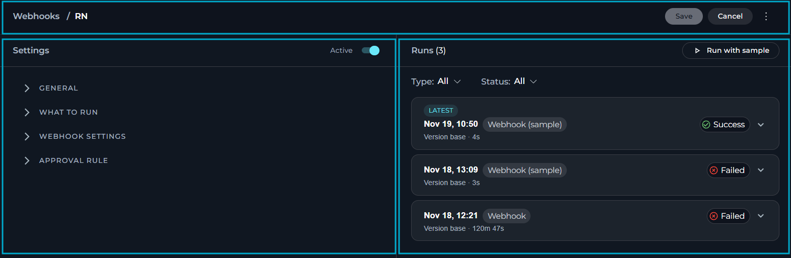

In the header, you see the name of the webhook, **Save** and **Cancel** buttons and a menu with these options:

- **Run with sample** runs the webhook with a sample body that you enter.
- **Rotate secret** replaces the secret of the webhook.
- **Change owner** assigns the webhook to another project member. This option is available to project administrators.
- **Delete** deletes the webhook. ELITEA asks you to confirm the deletion.

<Note>
If the tools of the agent or pipeline changed, or another person confirmed the sensitive actions, the header also shows the **Needs re-confirm** label. Until you confirm the sensitive tools again, runs pause and ask. Select **Review risks** to check the tools.
</Note>

To change the secret of a webhook, in the menu, select **Rotate secret**. Then select a mode, **Rotate** or **Regenerate**:

- **Rotate**—the old secret keeps working for 24 more hours, so you can update the sender without lost deliveries. You cannot start another rotation until this one ends.
- **Regenerate**—the old secret stops working immediately. ELITEA refuses deliveries that use it.

For a GitLab webhook with a signing token, in **Signing token**, paste the new token from GitLab. ELITEA then shows the URL and the new secret. Copy the secret before you select **Done**.

### Settings Panel

In the **Settings** panel, you can turn the webhook on or off and change its name, description, settings and approval rule.

<Note>
You cannot change the agent or pipeline of a saved webhook.
</Note>

The panel has these sections: **General**, **What to Run**, **Webhook Settings** and **Approval Rule**.

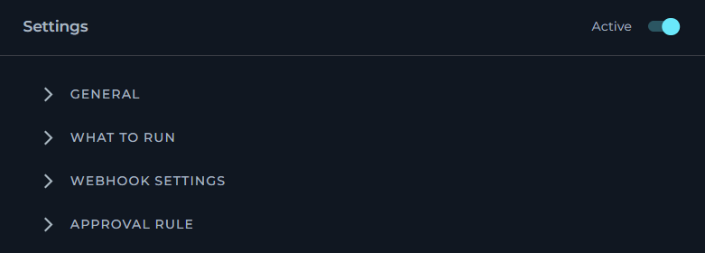

**General**

**General** shows the name, the description and the owner of the webhook.

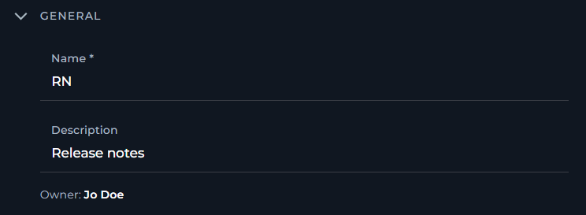

The name is required and can have up to 256 characters. The description can have up to 2,304 characters. You can change the name and the description.

<Callout icon="lightbulb" color="#a855f7" title="Tip">
Use a meaningful name and description. They are the only text that tells webhooks apart in the **Webhooks** table, and you can search the table by name. A clear name and description help you and other project members find the right webhook.
</Callout>

In a saved webhook, **General** also shows the **owner** of the webhook. You cannot change the owner in the webhook details. To assign another owner, use **Change owner**.

**What to Run**

**What to Run** shows what the webhook runs and how:

- The agent or pipeline that the webhook runs. You cannot change it in a saved webhook. To use another agent or pipeline, create a new webhook.
- The version of the agent or pipeline that runs when the webhook is called. You cannot change the version in a saved webhook. To use another version, create a new webhook.
- The **Connections** panel for agents and pipelines that require connections.
- The starting input of the run.

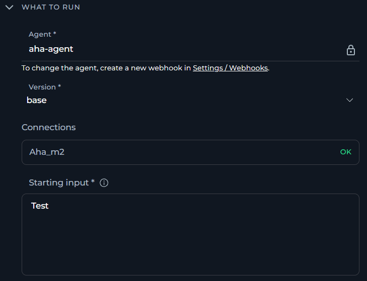

A webhook runs when an external system calls its URL, so no one is signed in at that moment. For this reason, every **connection** that the agent or pipeline needs, such as a toolkit credential, must have the status **OK**. The panel shows one row for each toolkit of the version, with the reason if the connection is not **OK**. For a connection with a saved login, the row has a sign-in control. You can save the webhook only when every connection is **OK**.

**Starting input** describes what the run receives when it starts.

For an agent, **Starting input** is required. It is the text that the run receives as its first message. Use `{{name}}` to add a variable. Each variable gets its own field.

For a pipeline, you select how the run starts:

- **Entrypoint**—starts the pipeline from its entry point, with no starting input.
- **Prompt**—sends the **Starting input** text as the first message of the pipeline. The **Starting input** field appears only with this option.

**Webhook Settings**

**Webhook Settings** shows the type of the sender, the URL with a copy icon, and the result and time of the last delivery, or **No delivery yet**.

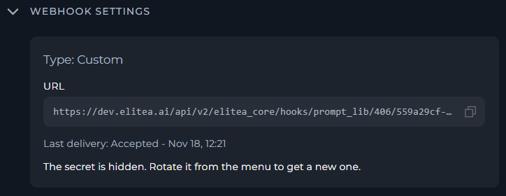

A note says that the secret is hidden, because ELITEA never shows a saved secret again. While a rotation of the secret is in progress, the section also shows when the previous secret stops working.

You cannot change the type of a saved webhook.

**Approval Rule**

**Approval Rule** sets how the webhook handles sensitive actions.

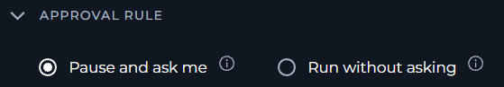

If you select **Run without asking**, anyone who has the secret of the webhook can start runs that act without approval. Treat the secret like a password: rotate it when people leave the project, and never paste it into chats or screenshots.

<Callout icon="book" color="#C9B896" title="See Also">
For detailed information about **Approval Rule**, see [Schedules](./schedules#schedule-settings).
</Callout>

### Runs Panel

The **Runs** panel lists the runs of the webhook, from the newest to the oldest. The title of the panel shows the number of runs. If the webhook has no runs, the panel shows **No runs yet**.

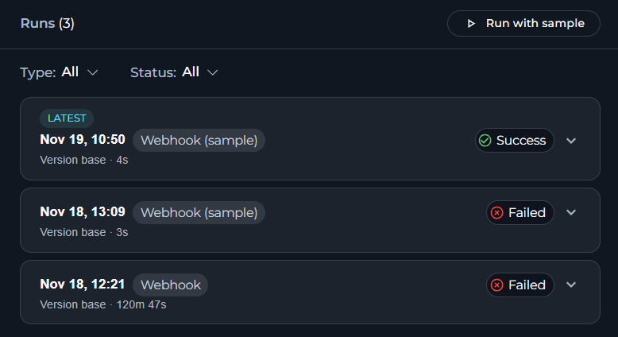

The panel shows the latest 100 runs. If the webhook has more runs, the panel shows a note with the number of shown runs and the **Open Run History** link. The filters of the panel work only on the shown runs.

**Filters**

If the webhook has two or more runs, the panel has these filters:

- **Type** lists the triggers of the runs that the webhook has.
- **Status** lists the statuses of the runs that the webhook has.

**Run cards**

Each run has its own card.

All cards have a collapsed view and an expanded view. You can expand and collapse run cards with the chevron icon. Only one card is expanded at a time. If a run waits for approval, ELITEA expands its card for you. After a sample run starts, ELITEA expands the card of the new run.

In the collapsed view, every run card shows:

- The start time of the run. The newest run has the **LATEST** label.
- The trigger: **Webhook** for a delivery of the sender, or **Webhook (sample)** for a sample run.
- The status of the run.
- The version of the agent or pipeline and the duration of the run.

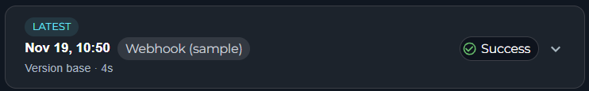

In the expanded view, every run card shows the details of the run in addition to the basic data displayed in the collapsed view:

- The response of the run, or **No response.** if the run has none.
- The **Run logs** toggle, which shows the log lines of the run with their times. For a failed run, ELITEA shows the error message and opens the logs.
- The **Open in Run History** button, which opens the run in Run History.

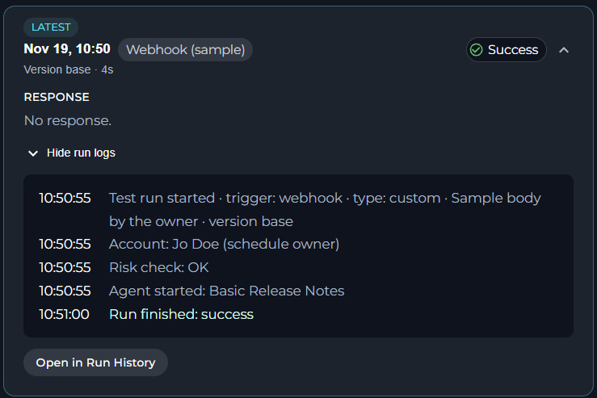

Runs can have one of these statuses:

- **Success**—the run finished.
- **Failed**—the run did not finish.
- **Running**—the run is in progress.
- **Awaiting approval**—the run paused before a sensitive tool call and waits for a decision.
- **Waiting for input**—the run waits for input.
- **Expired**—the run did not get a decision in time.
- **Blocked**—the run stopped before it started.
- **Cancelled**—the run was stopped.
- **Skipped**—the run did not start.

For a failed run, the expanded card also has the **Run again** button. It opens the **Run with sample** dialog.

If a run has the status **Awaiting approval**, its details show the **Action needed** card instead. The card says that the run is paused before a sensitive tool call. Select **Approve** to continue the run or **Reject** to end it as **Failed**.

<Callout icon="book" color="#C9B896" title="See Also">
For more information about approvals, see [Schedules](./schedules).
</Callout>

**Run with sample**

The title of the **Runs** panel includes the **Run with sample** button so that you can test a webhook without the sender.

<Note>
**Run with sample** is not available while a run is active, or if you do not have permission to run webhooks.
</Note>

To try a webhook without the sender:

1. Select **Run with sample**.
2. In **Sample body**, enter the body that the sender would deliver, for example `{"action": "opened"}`. The maximum size is 512 KB.

   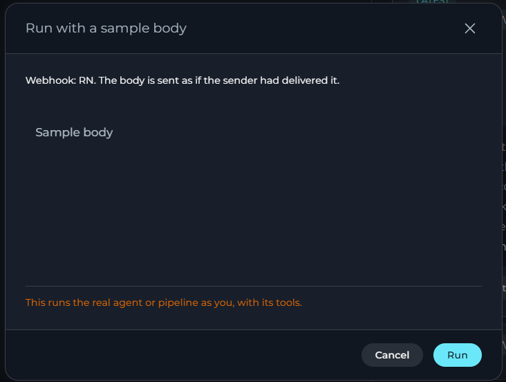

3. Select **Run**.

If the body is not valid JSON, the run gets it as plain text. The sample run starts the real agent or pipeline as you, with its tools.

## How to Create Webhooks

You can create a webhook in two ways, and the procedure is the same:

- From **Settings**—in **Webhooks**, select the **+** button. In **What to Run**, select the agent or pipeline.
- From the agent or pipeline—in the editor, in the **Webhooks** section, select **Webhook**. The agent or pipeline is already set in **What to Run**.

<Callout icon="book" color="#C9B896" title="See Also">
For detailed information about creating webhooks for agents, see [Webhooks for Agents](../../how-tos/credentials-toolkits/how-to-use-webhooks).

For detailed information about creating webhooks for pipelines, see [Pipeline Entry Point](../../how-tos/pipelines/entry-point#webhook).
</Callout>