## Overview

<CardGroup cols={3}>
  <Card title="Reusable" icon="arrow-rotate-right">
    Write once, attach to many agents. Updates to a Skill apply everywhere it is used.
  </Card>
  <Card title="On-Demand" icon="bolt">
    Invoke any attached Skill mid-conversation by typing `~skill-name`, or run a Skill on its own from its Run panel, the API, or as a chat participant.
  </Card>
  <Card title="Versioned" icon="code-branch">
    Maintain multiple named versions alongside the always-present `base`, so you can iterate without breaking existing agents.
  </Card>
</CardGroup>

**Typical use cases**

| Use case | Example |
|---|---|
| Shared reasoning templates | A "write unit tests" or "summarize findings" instruction used by multiple agents |
| Persona or tone guidance | A "formal-communication" Skill injected when the agent sends external messages |
| Domain-specific procedures | A step-by-step QA checklist or release-note writing guide |
| Modular agent construction | Build a large agent from small, independently tested Skills |
| Standalone capability | Running a Skill directly — without an agent — from its own Run panel, the API, or as a chat participant |

<Note>
**Skills Have No Toolkit Access On Their Own**

When a Skill runs by itself — from its Run panel, the API, or as a chat participant — it runs as a pure instruction-and-model turn, with no toolkits, MCPs, or other tools attached. An agent that attaches the Skill can still use its own toolkits alongside the Skill's instructions.
</Note>

---

## Access Skills

<Warning>
**Project Scope**

Skills are only available inside **team (non-public) projects**. The **Skills** menu item is hidden when the Public project is selected. Switch to a team or personal project to see it.
</Warning>

To open the Skills area:

1. Select the correct project from the **project switcher** at the top of the left sidebar.
2. Select **Skills** in the main navigation sidebar.
The **Skills** page opens, showing the **Skills** tab — a scrollable list (or card grid) of all Skills in the current project.

    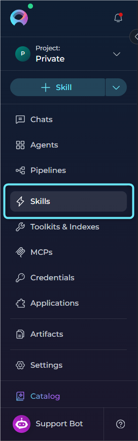

---

## Organize Skills into Folders

Folders help you organize Skills into logical groups for better navigation and management. You can create folders, move Skills between folders, and control folder access within team projects.

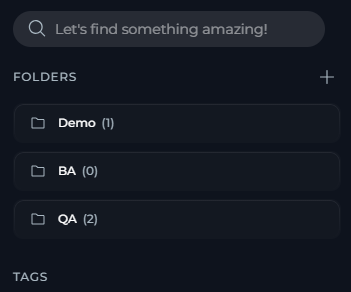

**Create a Folder:**

1. In the **Skills** dashboard right panel, locate the **Folders** section.
2. Select **+ Create Folder**.
3. Enter a folder name (up to 128 characters).
4. Select **Save**.

     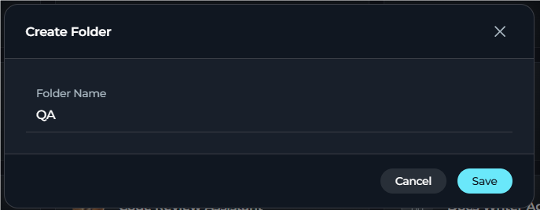

**Move a Skill to a Folder:**

1. **Hover over a Skill card:** A "Move to folder" icon (folder with arrow) appears on the card.
2. **Click the folder icon:** Opens a menu with folder options.
3. **Select a folder from the list:** The menu displays:
   - **+ Create Folder** option at the top
   - A scrollable list of existing folders
   - Pinned folders are marked with a pin icon
   - The current folder (if any) is highlighted and marked with a checkmark
4. The Skill is moved to the selected folder.

    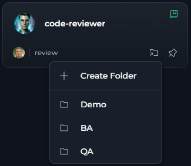

**View Folder Contents:**

Click any folder in the Folders panel to filter the Skills list to show only Skills in that folder. The folder name appears in the header, and the Skills count updates to reflect the filtered view. Click **X** to close the folder view and return to the full list.

    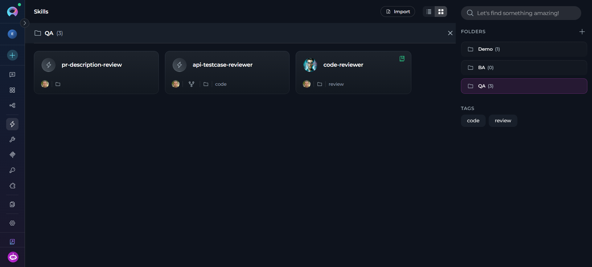

**Manage Folders:**

Each folder card in the right panel has a three-dot menu (⋮) with the following options:
    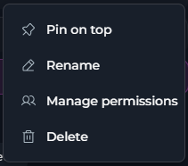
| Action | Description |
| --- | --- |
| **Rename** | Change the folder name |
| **Pin to top** | Pin the folder to the top of the folders list |
| **Delete** | Permanently remove the folder (Skills inside are moved back to the main list, not deleted) |
| **Manage Access** *(Team projects only)* | Control which team members can view the folder |

**Remove a Skill from a Folder:**

1. Open the Skill card's three-dot menu (⋮).
2. Select **Remove from Folder**.
3. The Skill returns to the main Skills list and the folder icon is removed from its card.

<Note>
Folders are available in team and personal projects. In team projects, folder access can be restricted to specific users. The Public project does not support folders.
</Note>

### Folder Permission Management

In team projects, you can control which users can view and modify specific folders by setting permission exceptions. By default, users retain the permissions granted by their project roles. Permission exceptions can only restrict access.

**Access Folder Permissions:**

1. In the **Skills** dashboard right panel, locate the folder in the **Folders** list.
2. Select the folder's three-dot menu (⋮).
3. Select **Manage Access**.
4. The Manage Permissions dialog opens.
    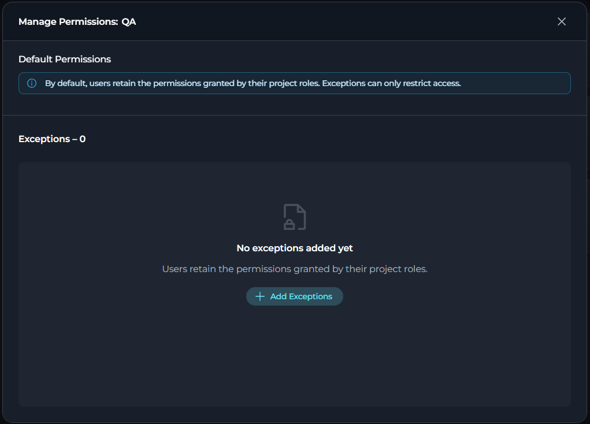

**Add Permission Exceptions:**

1. In the Manage Permissions dialog, select **+ Add Exception**.
2. Search for and select one or more users from the project.
3. Choose a permission level: **Read-only** or **No access**.
4. Select **Add**. The selected users are added to the permissions table.

    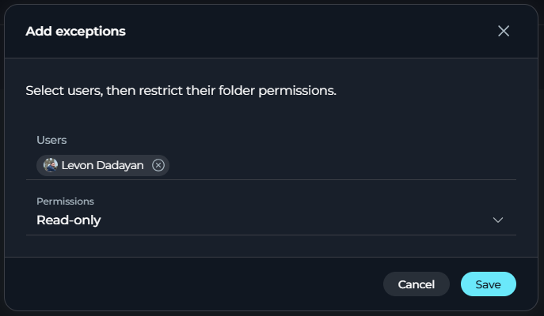

**Permission Levels:**

| Permission Level | Description |
| --- | --- |
| **Read/write (default)** | User can view folder contents and modify folder settings |
| **Read-only** | User can view folder contents but cannot modify folder settings or move Skills |
| **No access** | User cannot see the folder or its contents |

**Edit Permission Exceptions:**

- To modify an existing exception, locate the user in the permissions table and select the **Edit** (pencil) icon in the Actions column. Change the permission level to your desired setting and select **Save**. 
- To remove an exception and return the user to default permissions, change the permission level to **Read/write (default)**. When saved, the user is removed from the exceptions table and inherits permissions based on their project role.

<Note>
Permission exceptions apply only to the folder itself. Users with no access to a folder cannot see it in their folders list or view its contents.
</Note>

---

## Create a Skill

You can create a Skill from the Skills page, directly from the agent editor, or from chat using the Skill Builder module.

<Tip>
**Create from Chat:**

You can also create and update Skills directly from chat using the **Skill Builder** module. When enabled, you can describe your skill requirements in natural language, and the conversation will create or update the Skill for you. The created skill automatically opens in Canvas mode for review and is added to your project. See [Skill Builder](../how-tos/modules/skill-builder) for details.
</Tip>

### From the Skills Page

1. Select the **`+ Skill`** button in the top section of the left sidebar, or go to the Skills page and select **Create** in the empty state if no Skills exist yet.
  - Alternatively, use the global **`+` Create** button in the sidebar and select **Skill** from the dropdown.
  The **New Skill** form opens with three accordion sections: **General**, **Instructions**, and **Run settings**.

       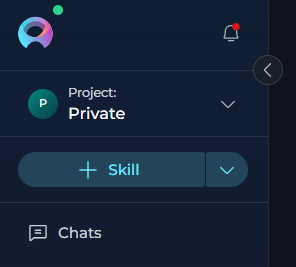
2. In the **General** section, complete the following fields. Then, in the **Instructions** section, enter your skill instructions in the Markdown or CodeMirror editor.

   | Field | Required | Example |
   |---|---|---|
   | **Name** | Yes | `code-reviewer`|
   | **Description** | Yes | `Reviews code for quality issues and suggests improvements.` |
   | **Tags** | No | `qa`, `review` |

  <Note>
  **Name rules**

  Name must use lowercase letters, digits, and hyphens only. It must not start or end with a hyphen. The maximum length is 64 characters. It must not contain `claude` or `anthropic`.
  </Note>

  In the **Instructions** section:
  - Use the toggle button group in the section header to switch between **Edit mode** and **Preview mode**. New and freshly opened Skill editors default to **Preview mode**, rendering the Markdown instead of showing raw text.
  - A character counter at the bottom of the editor shows the remaining characters. The maximum is configured by your platform administrator (default **50,000 characters**) and is enforced consistently in the manual editor, the AI Edit dialog, and AI-generated drafts. Lowering this limit never truncates instructions you already saved — it only blocks new growth beyond the limit.
   
     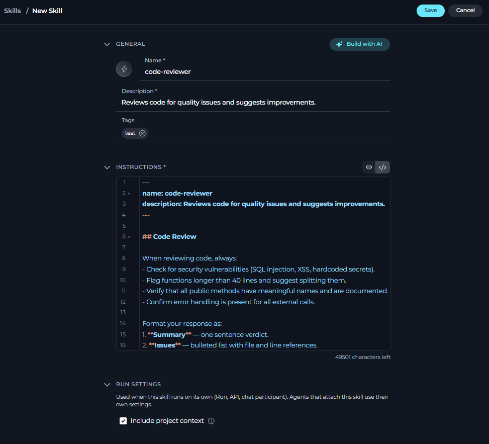

  <Note>
  **YAML Frontmatter**

  In Edit mode, you can start your instructions with a YAML frontmatter block specifying `name:` and `description:`. These values stay in sync with the Skill's **Name** and **Description** fields in the General section. Only a block that parses as valid YAML is treated as frontmatter — otherwise the full text is treated as instructions. The character counter counts only the instructions body, excluding any frontmatter block.
  </Note>

   **Example instructions:**
   ```
   ## Code Review

   When reviewing code, always:
   - Check for security vulnerabilities (SQL injection, XSS, hardcoded secrets).
   - Flag functions longer than 40 lines and suggest splitting them.
   - Verify that all public methods have meaningful names and are documented.
   - Confirm error handling is present for all external calls.

   Format your response as:
   1. **Summary** — one sentence verdict.
   2. **Issues** — bulleted list with file and line references.
   3. **Suggestions** — concrete fix for each issue.
   ```

   In the **Run settings** section, optionally turn off **Include project context** — when disabled, the project context is left out of the Skill's system prompt when it runs on its own (directly, through the API, or as a chat participant).

   <Note>
   The Skill's **Model** is not set here. It is chosen later, from the model selector in the Run chat's input toolbar once the Skill is saved — see [Run a Skill from the Editor](#run-a-skill-from-the-editor). Run settings have no effect when an agent attaches this Skill — attaching agents use their own model and settings instead.
   </Note>

3. Select **Save** in the tab bar at the top of the page.

After you select **Save**, the Skill configuration page opens. 

<video controls width="100%" aria-label="Full skill creation flow from form to saved Skill.">
  <source src="../img/menus/skills/skill-create-full.mp4" type="video/mp4" />
</video>

### Upload a Skill Icon

In the **General** section, the Skill icon is editable when your role includes the upload icon permission.

1. Open the Skill editor.
2. In **General**, select the Skill icon.
3. Upload a new icon or select an existing icon from the icon gallery.
4. Select **Save**.

The selected icon is stored in the Skill version metadata and is shown in Skill lists, attached Skill cards, and mention lists.

If needed, you can also remove an uploaded icon from the icon gallery.

   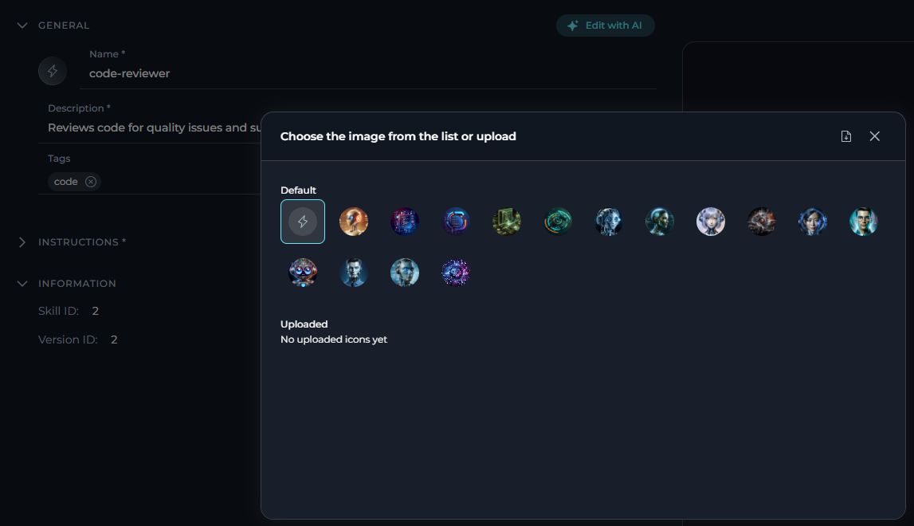

### Generate a Skill with AI

Instead of filling in the form manually, select **Generate with AI** in the **General** section header to open the **Generate skill** dialog.

1. Describe what you want the Skill to do in the input field.

   **Example prompt:**
   ```
   Create a skill that reviews pull request descriptions. It should check that the PR
   has a clear summary, lists affected components, includes test coverage notes,
   and flags any missing ticket references.
   ```

2. ELITEA drafts a **Name**, **Description**, and **Instructions** for you.
3. Review and edit the draft in the dialog.
4. Select **Approve** to apply it to the form, then select **Save**.

    <video controls width="100%" aria-label="Full skill creation flow from form to saved Skill.">
     <source src="../img/menus/skills/skills-build-ai.mp4" type="video/mp4" />
    </video>

### Edit a Skill with AI

You can also refine an existing Skill with **Edit with AI**.

1. Open an existing Skill.
2. Select **Edit with AI**.
3. Describe the changes you want.
4. Select **Generate Draft**.
5. Review the generated draft step by step.
6. Select **Save** or **Save as Version**.

   <video controls width="100%" aria-label="Edit a Skill with AI.">
     <source src="../img/menus/skills/skill-edit-withai.mp4" type="video/mp4" />
   </video>

---

## Run and Test a Skill

A Skill can be run on its own — without being attached to any agent — directly from its editor, through the Run API, or as a chat participant. The Skill editor's right panel gives you two different chat experiences depending on whether the version has unsaved changes.

<Note>
**Run Settings Apply Only When the Skill Runs on Its Own**

The model and settings configured for a Skill's Run chat are used only when this Skill runs on its own — from its Run panel, the API, or as a chat participant. Agents that attach this Skill use their own model and settings instead.
</Note>

Each Skill version also has a **Run settings** accordion with an **Include project context** toggle — turn it off to leave the project context out of the Skill's system prompt when it runs on its own.

### Run a Skill from the Editor

1. Open the Skill and save any pending changes, so the editor shows the persistent **Run** chat instead of the ephemeral Test chat.
2. Select the **model chip** in the Run chat's input toolbar to choose the AI model this Skill runs with, the same control used in an agent's embedded chat. Select the **Model Settings** icon next to it to adjust generation parameters (for example reasoning effort or temperature).
   - The selected model and its parameters save directly to the Skill version, and are included when you [export](#export-a-skill) or [publish](../how-tos/agents-pipelines/skill-publishing) that version.
   - **Auto** is also available in the model chip, the same way it is in Agent chats — with **Auto** selected, ELITEA chooses the model for each run automatically.
3. Send a message in the chat panel the same way you would in an agent chat.
4. Use **Clear the chat** to start a new run, the same control used in agent chats.
5. Select **View run history** to open the Skill's [Run History](#view-skill-run-history).

Skills published to **ELITEA Catalog** can also be run directly from there with a one-click **Run** button, without opening the Skill editor.

### Use Voice Capabilities

The Skill Run and Test chat panels support the same voice features as the agent chat interface.

<CardGroup cols={3}>
  <Card title="Voice Input" icon="microphone">
    Dictate prompts into the chat input field. Transcribed text is inserted at the cursor in real time.
  </Card>
  <Card title="Text-to-Speech" icon="volume-high">
    Have Skill responses read aloud. Pause and resume playback from a mini-player pill in the input area.
  </Card>
  <Card title="Speaking Mode" icon="waveform-lines">
    Hands-free voice loop. ELITEA records, sends, speaks the response, and listens again — automatically.
  </Card>
</CardGroup>

**Voice Input**

Select the **microphone** icon in the message input toolbar to start recording. Speak your prompt. A live transcript appears in the input field as you talk. Select **Stop** to finish. The final transcript is committed to the input field.

<Note>
**Voice input**

Voice Input uses a server-side automatic speech recognition (ASR) model if it is configured in **Settings** > **AI Configuration**. Otherwise, it falls back to the browser Web Speech API. If neither is available, the microphone icon is hidden.
</Note>

**Text-to-Speech**

A **Read out** button appears in the action bar below each Skill response. Select it to start playback. The text is highlighted as it is read. A playback pill in the input area provides **Pause** and **Resume** controls.

<Note>
**Text-to-speech**

When a text-to-speech (TTS) model is configured in **Settings** > **AI Configuration**, ELITEA uses it for audio generation. Otherwise, playback falls back to the browser SpeechSynthesis API.
</Note>

**Speaking Mode**

**Speaking Mode** is a continuous, hands-free voice loop. Leave the input field empty, then select the **voicewave** icon shown in place of the Send button to activate it. ELITEA records your speech, sends your prompt after three seconds of silence, plays back the response, and then starts listening again. Select **✕** in the voicewave pill to exit.

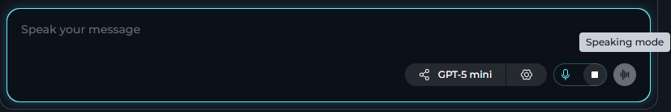

---

## View Skill Run History

Each Skill has its own **Run History** page, reached by selecting **View run history** from the Skill's Run panel (or the equivalent action for a Catalog Skill).

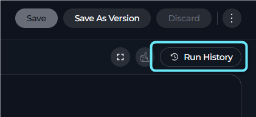


The Run History page uses the same list layout as [Agents and Pipelines History](../how-tos/agents-pipelines/agents-pipelines-history): a list of past runs with **Date**, **Version**, and **Duration** columns, and a row-level menu to restore a run's conversation or open its analytics. Runs created from a chat participant appear in this same list but cannot be deleted from it, unlike the Skill's own standalone runs.

### Per-Run Analytics

Selecting the analytics action on a run opens a dedicated analytics view scoped to that single run, reusing the same four-tab layout used for agent and pipeline run analytics:

<Tabs>
  <Tab title="Costs">
  Cost totals for the run, broken down the same way as agent run analytics.
  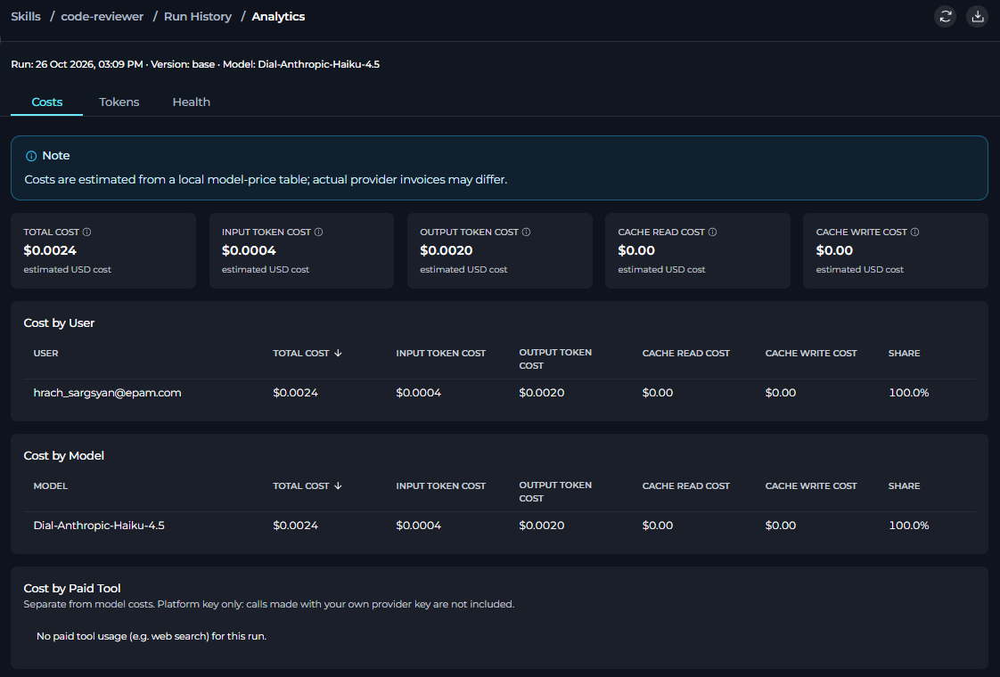
  </Tab>
  <Tab title="Tokens">
  Token totals for the run, broken down the same way as agent run analytics.
  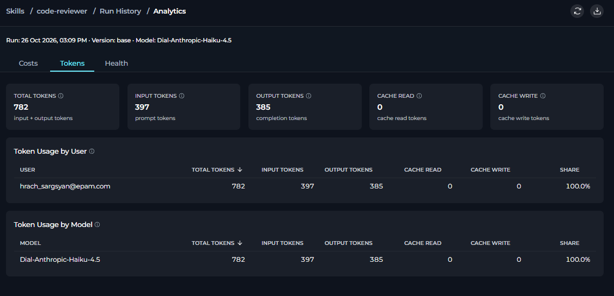
  </Tab>
  <Tab title="Health">
  Shows failed calls for the run when any occurred, otherwise a per-event-type health breakdown.
  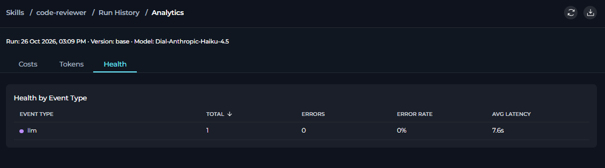
  </Tab>
</Tabs>

The header shows the run's date, version, and model. Use **Refresh** to reload the figures, or **Export to Excel** to download them.

<Note>
Per-run analytics for a Skill is not available for shared/read-only chats.
</Note>

---

## Create & Manage Versions

Skills support **versioning**, allowing you to maintain multiple iterations of a Skill without breaking existing agents that depend on it. Every Skill has a `base` version, and you can create additional named versions to test changes, iterate on improvements, or maintain different variants for different use cases.

**Key Version Concepts:**

- **base version**: The always-present initial version of every Skill. Cannot be deleted.
- **Default version**: The version agents use when a Skill is attached without specifying a particular version. Can be changed to any version except those currently attached to agents.
- **Named versions**: Additional versions you create (e.g., "v2", "updated-for-api-v3"). Each must have a unique name within the Skill.
- **Version selector**: Dropdown in the Skill editor tab bar that shows all versions, their creators, and creation dates.

**Common Version Operations:**

| Operation | How to Access | Description |
|-----------|---------------|-------------|
| **Create version** | **Save As Version** button in tab bar | Save current changes as a new named version |
| **Switch versions** | Version selector dropdown in tab bar | Navigate between existing versions to view or edit |
| **Set default** | **⋮** menu > **Set as a default** | Make a version the default for agent attachments |
| **Compare versions** | **⋮** menu > **Compare Versions** | View side-by-side differences and selectively merge changes |
| **Delete version** | **⋮** menu > **Delete** | Remove a version (not available for base or default versions) |

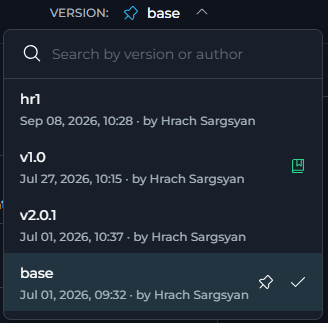


<Note>
For detailed information about version management patterns, best practices, naming conventions, and the complete Compare Versions workflow, see [Entity Versioning](../how-tos/agents-pipelines/entity-versioning). The reference documentation describes agent versioning, but skill versioning works the same way.
</Note>


### Export a Skill

1. Open the Skill and go to the version you want to export.
2. Select the **⋮** overflow menu in the tab bar.
3. Under the **VERSION** section, select **Export**.
4. A `.md` file for the current version is downloaded to your machine.

    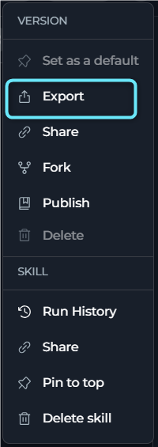

### Import a Skill

1. On the **Skills** page, select the **Import** icon button in the top toolbar.
2. A file picker opens. Select the `.md` export file from your machine.
3. The **Import parameters** dialog appears, showing:
   - **PROJECT** — a project selector (defaults to the currently selected project). Change it to import the Skill into a different project.
   - **MAIN ENTITY** — a preview card showing the Skill name, type, description, and instructions from the file.
4. Select **Import** to create the Skill, or select **Cancel** to abort.

    <video controls width="100%" aria-label="Import a Skill.">
      <source src="../img/menus/skills/skills-import.mp4" type="video/mp4" />
    </video>

<Note>
**Imported version**

Imported Skills are always created with the `base` version, regardless of the version stored in the export file.
</Note>

### Fork a Skill

You can fork a Skill version from the Skill editor or from ELITEA Catalog.

1. Open the Skill version you want to reuse.
2. Open the **⋮** overflow menu.
3. Select **Fork**.
4. Complete the import flow.

   <video controls width="100%" aria-label="Fork a Skill.">
     <source src="../img/menus/skills/skill-fork.mp4" type="video/mp4" />
   </video>

The fork action uses the Skill fork export payload and creates a copy in your selected project.

---

### Publish a Skill

Skills can be published to **ELITEA Catalog** and later unpublished.

1. Open the Skill version you want to publish.
2. Open the **⋮** overflow menu.
3. Select **Publish**.
4. Complete the publish flow.

The publish flow validates the Skill version, then publishes it to ELITEA Catalog. Published Skills can be listed in the public catalog and reused in other projects.

   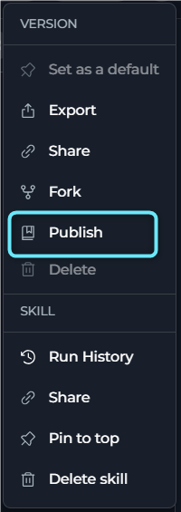

To remove a published Skill, open the same menu and select **Unpublish**.

For the full flow, see [Skill Publishing](../how-tos/agents-pipelines/skill-publishing).

### Delete a Skill

<Warning>
**Delete warning**

Deleting a Skill removes it from all agents it is attached to, and from every chat where it was added as a participant. This action cannot be undone.
</Warning>

1. Open the **⋮ menu** in the editor tab bar.
2. Under the **SKILL** section, select **Delete skill**.
3. Enter the Skill name to confirm, then select **Delete**.

   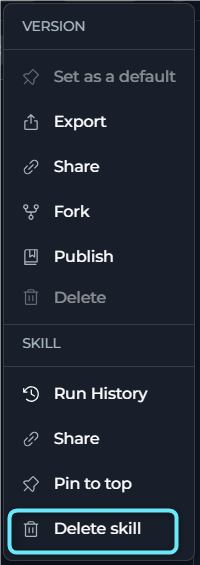


---

## Use Skills from ELITEA Catalog

Published Skills are available in **ELITEA Catalog**.

From the catalog, you can:

- Browse published Skills by category
- Open Skill details
- Export a published Skill
- Fork a published Skill into your project
- Attach a public Skill to one or more agents in the current project

The catalog also tracks public Skill counts and refreshes when a Skill is published or unpublished.

   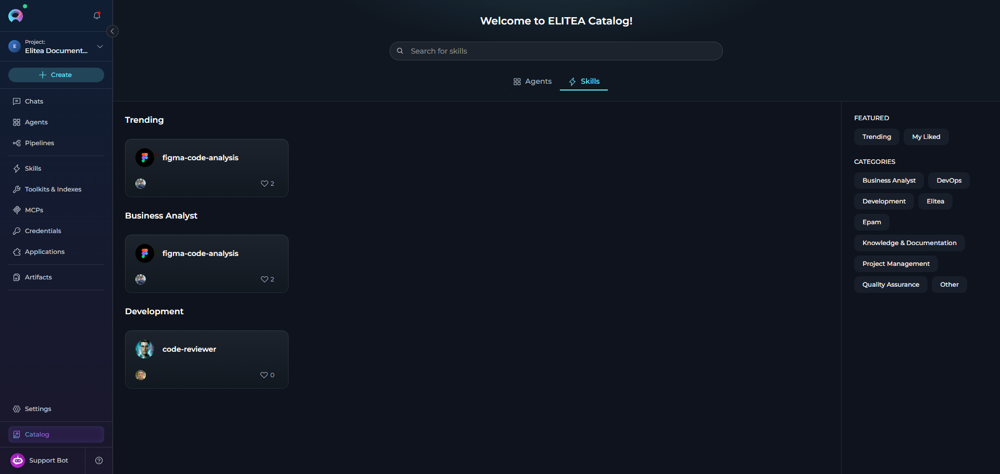

When you attach a public Skill from ELITEA Catalog, the system sends the selected public Skill version to one or more agent versions in the current project.

For the full flow, see **[ELITEA Catalog](./agents-studio)**

---

## Use Skill in Agent

Skills are attached at the **agent version** level, not to the agent as a whole. You must save the agent before Skills can be attached.

<Info>
**Skill limit**

The maximum number of Skills attachable to a single agent version is configured by your platform administrator and returned by the API — the fallback value if the API does not specify one is **50** (previously a fixed **5**). The counter in the Skills section always shows how many are currently attached against this limit (e.g., `2/50 skills added`). Lowering the limit never removes Skills already attached — it only blocks new attaches.
</Info>

1. In **Agents**, open the agent you want to configure.
2. In the agent configuration form, scroll to the **Skills** accordion section (below the Instructions and Toolkits sections).
3. Select the **`+ Skill`** button to open the skill picker dropdown.
   - The button is disabled and shows a tooltip if the agent has not been saved yet (`Save the agent first, then add skills`) or if the Skill limit has been reached (`Maximum number of skills reached`).
4. Search for the Skill by name in the **Search skills…** field, or browse the list. The dropdown loads additional Skills as you scroll past the first page, so it can list every candidate Skill even when the project has many of them.
5. Click a Skill to attach it. It attaches immediately using the Skill's `base` version.
   - Skills already attached to the agent version are excluded from the list to prevent duplicates.

    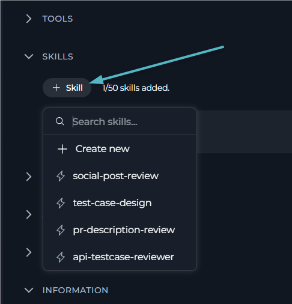
   

To create a new Skill from the agent editor:

1. Select **`+ Skill`** in the Skills accordion.
2. Select **Create new** at the bottom of the picker dropdown.
3. You are taken to the Skill creation form.

If the selected attached version is later deleted, the Skill card shows this warning banner:

> *The attached skill version no longer exists. Select a valid version or remove this skill.*

If no Skills are attached to the agent, the mention list in chat shows:

> *No skills attached to this agent*

<Note>
**Searching Attached Skills**

Once an agent version has more than 8 attached Skills, a **Search attached skills** box appears above the list of attached Skill cards, so you can filter down to the one you need. With 8 or fewer attached, no search box is shown.
</Note>

---

**Change the Attached Version**

Each attached Skill card shows the currently active version name below the Skill's name. To change which version the agent uses:

1. On the Skill card inside the agent **Skills** section, select the version name, for example `base`.
2. A **Versions** dropdown appears, listing all available versions.
3. Select the version you want. The attachment is updated automatically. The old version is detached and the new version is attached.
4. The selected version is highlighted with a check mark.

    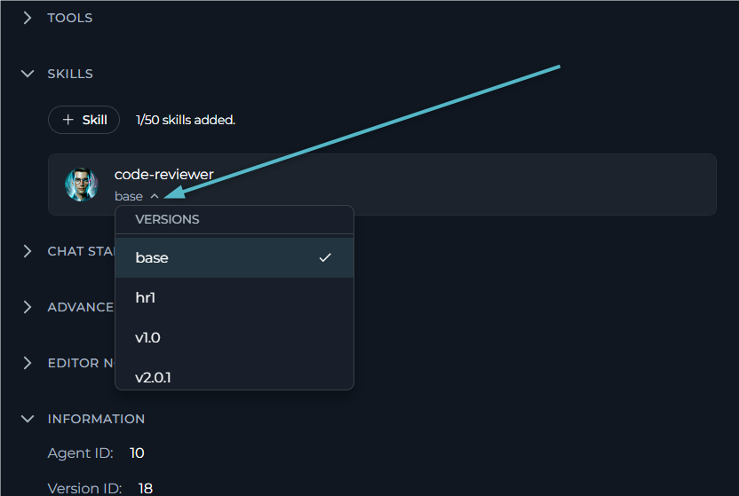

---


## Use Skills in Chat

Independently of any agent, you can add a Skill directly to a chat as a participant — the same way you would add an agent, pipeline, toolkit, or MCP — so it runs on its own, without an agent in between.

### Add a Skill to the Conversation

1. In the chat input toolbar, select the **`+`** button.
2. Select the **Skills** category from the menu.
3. Search for the Skill by name (placeholder: *"Search skills..."*), or browse **your project's Skills** and **Catalog Skills** separately.
4. Select a Skill to add it to the chat as a participant.
   - Select **Create Skill** at the bottom of the list to create a brand-new Skill inline from the chat, without leaving the conversation.
   
   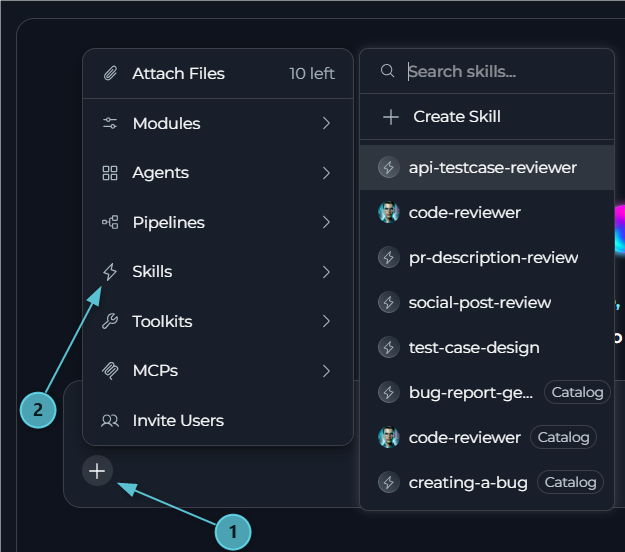


Once added, the Skill appears in the chat input as its own participant chip, with:

- A **Switch Skill** button to swap in a different Skill without leaving the chat.
- A **version selector**, if the Skill has more than one version, to pick which version responds.
- A **Skill settings** (gear) button that opens the Skill editor inline, if you have permission to edit Skills.
- A **Switch to a model** option, letting you swap the Skill participant for a plain AI model mid-conversation.

   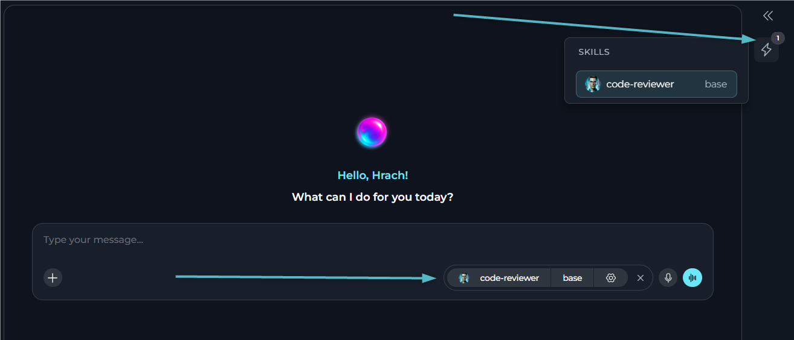


If the Skill or its pinned version is later removed, the chip shows a warning:

<Note>
**Lifecycle Sync**

If a Skill participant is deleted, or unpublished from the public catalog, it is automatically removed as a participant from every chat that had it added. Renaming a Skill or changing its icon refreshes those details across every chat where it is a participant.
</Note>

### Mention a Skill in Chat

Once a Skill is attached to an agent, or added to the chat as a participant, you can invoke it explicitly by typing `~` (tilde) followed by the Skill name in the chat composer.

1. In a chat conversation, type `~` in the message input.
2. A **Mention skill** dropdown appears above the input. The suggestions are grouped by where the Skill comes from:
   - **Attached to agent** — Skills attached to the active agent's current version.
   - **Skills in this chat** — Skills added to this conversation as chat participants.
   - If neither group has any Skills, the dropdown shows an empty-state message appropriate to the context (for example *"No skills attached to this agent"*).
3. Type additional characters to filter the list, or use the arrow keys to highlight a Skill.
4. Press **Enter** or select the Skill name to insert it as a mention token in your message.
5. Send the message. The responding agent or model receives and executes that Skill's instructions for this turn.

   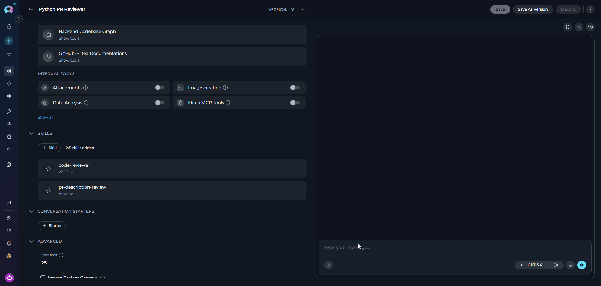

<Note>
**Mentioning vs. Adding**

Mentioning a Skill that is already attached to the agent or already a participant in the chat does not add a new participant — it just references that Skill for the current message. To add a Skill to the conversation itself, use the **`+`** button described above.
</Note>

### Skills in Chat Templates

[Chat templates](../how-tos/chat/config-mnmt#work-with-chat-templates) can include Skills as participants alongside Agents, Pipelines, Toolkits, MCPs, and Users.

1. Go to **Settings > General > Chat Configuration** and open or create a chat template.
2. In the participant picker, select the **Skills** tab.
3. Search for and select one or more Skills to add as template participants. Catalog Skills are marked with a **Catalog** badge.
4. Select **Save**.

Every chat created from that template starts with its Skill participants already attached, the same way Agent or Pipeline participants are.

---

---

## Troubleshooting

<AccordionGroup>
  <Accordion title="The Skills Menu Item Is Missing from the Sidebar">
    The Skills menu item is hidden when the **Public project** is selected. Open the project switcher at the top of the sidebar and select a team or personal project. If the item is still missing, contact your platform administrator to verify you have the required permissions.
  </Accordion>

  <Accordion title="The Save Button Is Disabled on the Skill Creation or Edit Form">
    The **Save** button requires all of the following:
    - **Name** is non-empty and matches the allowed pattern (lowercase letters, digits, hyphens; no leading/trailing hyphens; no `claude` or `anthropic`).
    - **Description** is non-empty.
    - **Instructions** are non-empty.
    - At least one field has been changed since the last save.
    - None of the three fields exceed their character limits (the Instructions limit is configured by your platform administrator; the default is 50,000 characters).

    Check the character counters next to each field and the validation error messages below the inputs.
  </Accordion>

  <Accordion title="The + Skill Button in the Agent Editor Is Disabled">
    Two conditions disable the button:
    - **Agent not yet saved** — save the agent first. The tooltip reads *"Save the agent first, then add skills"*.
    - **Limit reached** — the agent version already has the maximum number of Skills attached (configured by your platform administrator, default 50). Remove one before adding another. The tooltip reads *"Maximum number of skills reached"*.
  </Accordion>

  <Accordion title="A Skill Card Shows a Warning Banner">
    The banner *"The attached skill version no longer exists. Select a valid version or remove this skill."* means the specific named version attached to this agent has been deleted from the Skill. Either select a different version from the version dropdown on the card, or remove the Skill and re-attach it.
  </Accordion>

  <Accordion title="The Mention Skill Dropdown Does Not Appear When I Type ~ in Chat">
    The `~` trigger only shows the dropdown if the current chat has at least one Skill available — either attached to the active agent, or added to the chat as a participant. Check the agent's **Skills** section in the agent editor, or add a Skill to the chat using the **`+`** button, then try again.
  </Accordion>

  <Accordion title="A Chat Skill Participant Shows an Unavailable Warning">
    - *"This skill is no longer available. Switch to a model or remove it from the chat."* means the Skill itself was deleted or unpublished.
    - *"This skill version is no longer available. Select another version or switch to a model."* means only the pinned version is gone.

    Select a different version from the version selector, switch the participant to a plain model, or remove it from the chat.
  </Accordion>

  <Accordion title="The Run Chat Still Shows the Ephemeral Test Chat Instead of a Persistent Run">
    The Skill editor falls back to the ephemeral Test chat whenever the current version has unsaved draft changes, or you do not have permission to run the Skill. Save your changes first to switch to the persistent Run chat.
  </Accordion>

  <Accordion title="Save As Version Fails with 'A Version with That Name Already Exists'">
    Each version name within a Skill must be unique. Choose a different name. Also note that the name `base` is reserved and cannot be used as a custom version name.
  </Accordion>

  <Accordion title="Import Fails or Does Not Create the Skill">
    - Only `.md` files exported from Elitea are accepted.
    - Ensure the target project is selected correctly in the **Import parameters** dialog.
    - If the Skill name in the file contains uppercase letters, spaces, or invalid characters, the import will be rejected. Edit the file or re-export from a corrected Skill.
  </Accordion>
</AccordionGroup>

---

<Info>
**Guides & References**

- **[Skill Builder](../how-tos/modules/skill-builder)** — Create and update Skills directly from chat
- **[Agents](./agents)** — Configure agents and attach Skills, Toolkits, and MCPs
- **[Chat](./chat)** and **[Chat Configuration & Management](../how-tos/chat/config-mnmt)** — Add Skills as chat participants and chat template participants
- **[Agents and Pipelines History](../how-tos/agents-pipelines/agents-pipelines-history)** — Run history and run analytics layout shared with Skills
- **[Analytics](./settings/analytics)** — Project-wide usage dashboard, including the Skills tab
- **[Skill Publishing](../how-tos/agents-pipelines/skill-publishing)** — Publish a Skill version to ELITEA Catalog
- **[Project Context](./settings/project-context)** — Define shared background context injected into every AI interaction
- **[Entity Versioning](../how-tos/agents-pipelines/entity-versioning)** — Version management patterns for agents, pipelines, and Skills
- **[Export and Import](../how-tos/agents-pipelines/import-export)** — Exporting and importing Elitea entities
</Info>