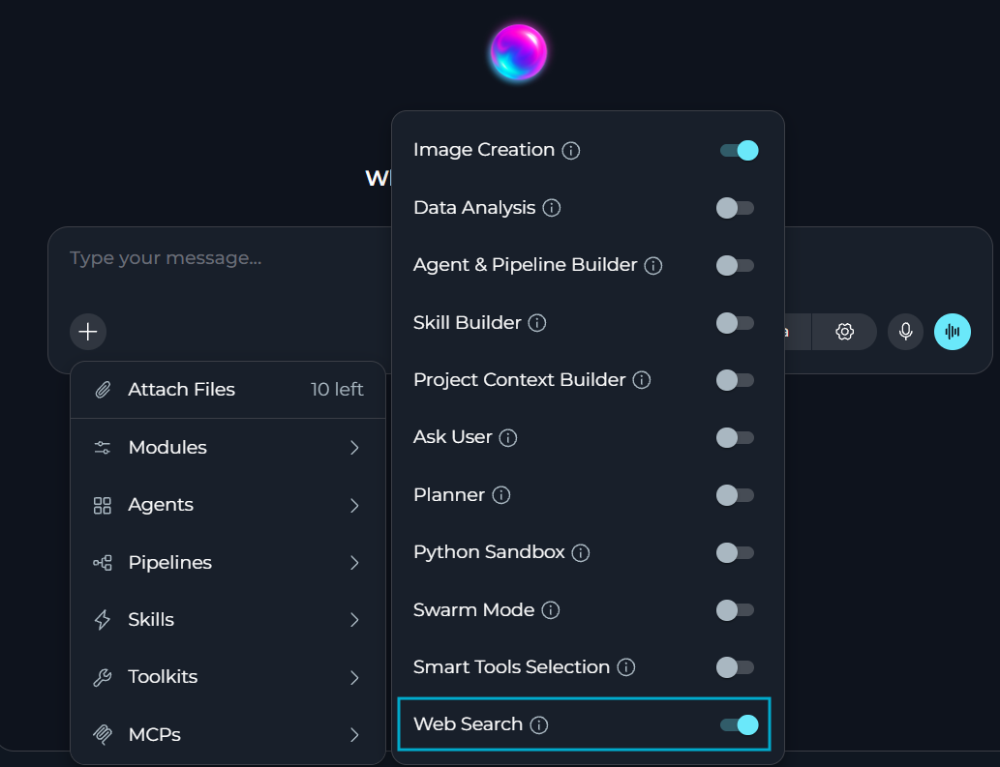
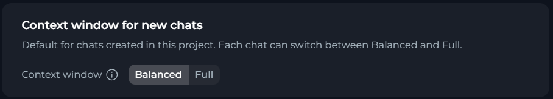

ELITEA 2.0.8 introduces an input guardrail, built-in web search, chat export and import and a new Dataverse toolkit. It also redesigns the Pipeline editor, replaces token limits with simple context window modes, and adds scheduled agents and pipelines, enterprise credential governance and admin-managed Microsoft Entra ID apps. Besides, starting with this release, each skill becoms a self-contained entity that can be run and used independently.

* **Release version**: 2.0.8
* **Released on**: November 08, 2026
* **Access**: [ELITEA Platform](https://next.elitea.ai)

## New Features

### Scheduled Agents and Pipelines

You can now run agents and pipelines automatically on schedule and manage all schedules of your project on the new settings page.

* Create a schedule with a name, agent or pipeline version, prompt and run time.
* Create several user-owned schedules for the same agent or pipeline.
* Choose how a run handles sensitive actions.
* Pause, resume, edit, delete or run schedules from the **Schedules** page or from the **Schedules** section of the agent or pipeline editor.
* Check schedule runs in **Run History** and get notifications when a run fails, waits for your approval or a schedule expires.

<Info>
Existing Pipeline schedules are moved to the new **Schedules** page and keep running.
</Info>

**Benefits:** Reliable automation for recurring tasks.

Details: {/* TODO: add links to the Schedules documentation */}.

{/* TODO: add image */}

### Web Search

You can now turn on the new **Web Search** module in chats and agents and let the LLM search the Internet, read web pages and cite its sources.

* **Web Search** uses a toolkit set up by your platform administrator.
* Use the new **Tavily** toolkit with your own Tavily key to search, read, map and crawl websites in Agents and Pipelines.

**Benefits:** Smarter, up-to-date answers without manual research.

Details: [Web Search](../how-tos/modules/web-search), [Web Search Settings](../menus/settings/general#web-search), [Tavily Toolkit](../integrations/toolkits/tavily_toolkit).

### Enterprise Credential Governance

Platform administrators can now control credentials used by agents in enterprise deployments.

* Approve an identity for each agent or pipeline version.
* Allow the credential use for a specific agent, toolkit or user, and revoke this permission when necessary.
* Store credentials in a corporate vault.
* Turn governance on or off for each project in the Admin portal. Every change is recorded in the audit log.

<Info>
Governance is off by default.
</Info>

**Benefits:** Advanced credentials security for enterprise deployments.

### Microsoft Entra ID Apps in the Admin Portal

You can now create SharePoint, Outlook and Microsoft Teams credentials without entering Microsoft Entra ID app details.

* Platform administrators register Entra ID apps once in the Admin portal and select the toolkits each app supports.
* Use the **Default app** or **Custom app** mode when creating credentials.
* The app secret is never shown after it is saved. When administrators replace it, all credentials that use the app get the new secret automatically.

<Info>
Existing credentials keep working without any changes.
</Info>

**Benefits:** Simpler, more secure Microsoft toolkits onboarding at scale.

Details: [SharePoint Toolkit](../integrations/toolkits/sharepoint_toolkit#step-1-create-sharepoint-credentials), [Outlook Toolkit](../integrations/toolkits/outlook_toolkit#step-1-create-outlook-credentials), [Microsoft Teams Toolkit](../integrations/toolkits/teams_toolkit#step-1-create-teams-credentials).

### Dataverse Toolkit

You can now connect agents and pipelines to Microsoft Dataverse (OneCRM) with the new **Dataverse** toolkit.

* Read and search records. The toolkit cannot create or delete records, or change their owner or status.
* Sign in with your Microsoft account.
* Update fields of an existing record as the signed-in user, so your Dataverse permissions apply.
* Use the same saved sign-in for the Outlook, Microsoft Teams and SharePoint toolkits.
* Only project administrators can sign in or out on a team project credential.

**Benefits:** CRM-aware agents and pipelines, without manual data exports.

Details: {/* TODO: add link to the Dataverse toolkit documentation */}

### Exporting and Importing Chats

You can now export a chat to a file and import it back into ELITEA.

* Select **Export** in the chat menu to save the chat as a JSON file, or as a ZIP archive with all uploaded and generated files.
* Any user who can open a chat can export it.
* Select **Import** in the chat list to bring an exported chat into any project. Messages keep their original order and time.
* Choose which attachments to import.

**Benefits:** Reliable backup and migration of your chats.

Details: {/* TODO: add links to the Export and Import Chats documentation */}[Manage Chats](../how-tos/chat/config-mnmt#how-to-manage-chats).

{/* TODO: add image */}

### Agent Evaluation: Tool Use and Run Comparison

You can now evaluate how an agent reaches its answer, not only the answer itself.

* See every step of a test case in the trace view: tools called, their inputs, results, duration and errors.
* Use ready-to-use dimensions to check that the agent calls the correct tools, avoids unnecessary steps and respects guardrails.
* Evaluate agents and pipelines that run several sub-agents in parallel, with their steps and costs included in the results.
* See the results of earlier evaluation runs after you create a new version of the agent.

**Benefits:** More confidence in agent efficiency and safety.

Details: [Dimensions](../how-tos/agents-pipelines/agent-evaluation#dimensions), [Review Results](../how-tos/agents-pipelines/agent-evaluation#review-results), [Review Run History](../how-tos/agents-pipelines/agent-evaluation#review-run-history).

{/* TODO: add image */}

### Input Guardrail

Platform administrators can now check what users send to the LLM before their input leaves ELITEA.

* ELITEA looks for credentials and personal data in your messages in chats, agents, pipelines, sub-agents, scheduled and API runs, as well as agent instructions and chat history.
* Platform administrators set the cases when ELITEA must block the message, mask the detected data, warn the user or record the detection.
* If your message is blocked, ELITEA explains why. If part of your message is masked, you see a notice and the masked text.
* Platform administrators review all detections in the **Audit Trail** of the Admin portal. The detected values are never stored or shown.

<Info>
The guardrail is off by default. When administrators turn it on, credentials are blocked by default and personal data is not checked until they enable it.
</Info>

**Benefits:** Lower risk of data leaks and compliance violations.

### Run Status in Chats

You can now see when an agent or pipeline is still running or waiting for your input as soon as you open a chat.

* A status label with an animated icon is shown in the chat while a run is in progress.
* The status is shown in chats and on the pipeline page, visible for all users who open the chat.

**Benefits:** Better indication of the participant's status.

Details: {/* TODO: add link */}

### Step Durations in Chat

You can now see how long each step of a response took.

* ELITEA shows the duration of each tool, LLM step and sub-agent section in a chat response.
* Durations are shown while the response is generated and when you reopen the chat.
* If the real duration is unknown, ELITEA does not invent the time.

**Benefits:** Faster troubleshooting of slow responses.

Details: {/* TODO: add link */}

### Delete Project Data

You can now delete all entities of selected types from a project in one action, in the new **Delete Project Data** section in **Settings → General**.

* Only the owner of a private project or an **admin** of a team project can delete project entities.
* Select what to delete: **Chats**, **Agents**, **Pipelines**, **Skills**, **Toolkits** and **Credentials**, or use **Select all**.
* In team projects, items created by other project members can also be deleted.

<Warning>
Deleted data cannot be restored.
</Warning>

**Benefits:** Faster project cleanup and offboarding.

Details: {/* TODO: add link */}.

{/* TODO: add image */}

## Changed Features

### New Pipelines Editor

**Pipeline** editor is redesigned to give you more space on the canvas and simpler node configuration.

* Start building right away: a new pipeline gets a default name, the description is optional, and you select the first node from a list on an empty canvas.
* Node cards are compact and show only the key information.
* Edit a single node in YAML from the node panel, or duplicate a node.
* Select toolkits, MCPs, agents and pipelines directly in a node.
* Open the **Test Pipeline** panel only when you need it.
* Arrange the whole pipeline top to bottom or left to right, and use the minimap to move around the canvas.

<Info>
Existing pipelines open in the new editor without any changes.
</Info>

<Warning>
**Interrupt before** and **Interrupt after** are deprecated and no longer shown on node cards. Existing interrupts keep working, and you can still manage them in YAML.
</Warning>

**Benefits:** Faster pipeline development.

Details: [Flow Editor](../how-tos/pipelines/flow-editor), [Interrupt Options](../how-tos/pipelines/nodes-connectors#interrupt-options).

{/* TODO: add image */}

### Skills as Self-Contained Entities

You can now use skills independently, without attaching them to an agent.

* Run and communicate with skills directly in the chat.
* Add skills as chat participants and include them in chat templates.
* Set a default model, its settings and whether project context is included for each version.
* See every skill run in **Run History** and track skill usage and costs in the new **Skills** tab of **Analytics**.
* Attach up to 50 skills to an agent instead of 5.

**Benefits:** Independent and reusable AI capabilities.

Details: [Skills](../menus/skills).

### Optional Space Key in Confluence Toolkit

You can now use one Confluence toolkit for all spaces available to your Confluence account.

* Leave **Space Key** empty in the toolkit configuration to work with all spaces your Confluence credentials can access.
* Enter a **Space Key** to limit the toolkit to one space, as before.
* Agents and pipelines can select a space when they use the toolkit, within the limits set in the toolkit.
* Add an optional **Space Key** filter when you create or edit a Confluence index.

**Benefits:** One toolkit for many spaces instead of one toolkit per space.

Details: [Create Confluence Toolkit](../integrations/toolkits/confluence_toolkit#step-2-create-confluence-toolkit).

### Context Window Modes and Chat Costs

**Max Context Tokens** is replaced with two simple context window modes, and you can now see how many tokens a chat used and what it cost.

* Select **Balanced** to use up to 272,000 tokens, within the model's limits, or **Full** to use the model's full context window. Larger requests may cost more.
* **Balanced** is the default. Project admins set the mode for new chats in **Settings → General → Chat Configuration**, and you can switch the mode for each chat.
* Existing chats use **Balanced** automatically.
* See the input tokens, output tokens and approximate cost of the chat, updated after every response.

**Benefits:** Longer chats before summarization, no token numbers to guess, clear chat costs.

Details: [Chat Configuration](../menus/settings/general#chat-configuration), [Context Management](../how-tos/chat/ctxt-bdgt#context-management), [Understanding the Context Budget Widget](../how-tos/chat/ctxt-bdgt#understanding-the-context-budget-widget).

### Usage & Analytics Enhancements

You can now review past usage, compare periods and see the costs of each chat.

**Usage**
* Select the current month or one of the three previous months, and compare each period with the one before it.
* See the spend forecast for the current month, the average spend per day and the spend over time grouped by model, source or member.
* See where costs come from: by source; by agent, pipeline or skill; by token type.

**Analytics**
* See token usage and estimated costs per chat in the new **Chats** tab, with details for each chat.
* See the versions, models, trigger sources and recent runs of each agent and pipeline.
* Sort any Analytics table by any column.

**Benefits:** Better insight into where your budget goes and how it changes over time.

Details: [Usage](../menus/settings/usage), [Analytics](../menus/settings/analytics), [Agent & Pipeline Details View](../menus/settings/analytics#agent-%26-pipeline-details-view).

### Toolkits Included in Forked Agents

When you fork a published agent, the toolkits attached to it and its sub-agents are copied together with the agent.

* Toolkit settings from the published version are kept, so you do not need to add and configure the toolkits again.
* Secrets in credential fields are not copied. Select or add your own credentials after the fork.
* You can fork the same published agent into the same project several times.

<Info>
Toolkits are copied only for agents published after this release. Forks of agents published earlier come without toolkits.
</Info>

**Benefits:** Less setup for forked agents.

Details: [Forking Agents](../how-tos/agents-pipelines/forking#forking-agents).

### Fewer Clicks on the Toolkit Page

You can now configure and test a toolkit with fewer clicks.

* The **TOOLS** section is expanded by default.
* The **GENERAL** section shows up to six fields. Any other fields are behind **Show more**.
* The **Test** page opens with a list of all selected tools.

**Benefits:** Faster toolkit setup and testing.

Details: [Configure a Toolkit](../menus/toolkits#configure-a-toolkit), [Test a Toolkit](../menus/toolkits#test-a-toolkit).

## Fixed Issues

* [#7320](https://github.com/EliteaAI/elitea_issues/issues/7320) Agent validation shows toolkit connection errors instead of a general error.
* [#7274](https://github.com/EliteaAI/elitea_issues/issues/7274) User search in **Settings → Users** finds users on all pages, not only on the current one.
* [#7241](https://github.com/EliteaAI/elitea_issues/issues/7241) Agent nodes in pipelines accept list variables in the **Task** field without an error.
* [#7236](https://github.com/EliteaAI/elitea_issues/issues/7236) A new chat gets its name when its first message is rejected for mentioning too many skills.
* [#7193](https://github.com/EliteaAI/elitea_issues/issues/7193) A run no longer fails with an incorrect Agent configuration error when you send a message during a long run.
* [#7175](https://github.com/EliteaAI/elitea_issues/issues/7175) ADO work item indexes split long work items into smaller chunks, and attachments can be turned off and filtered by file type.
* [#7174](https://github.com/EliteaAI/elitea_issues/issues/7174) Confluence attachments are indexed only once and follow your chunking and file type settings.
* [#7173](https://github.com/EliteaAI/elitea_issues/issues/7173) Attachments of email files (.msg and .eml) are split into chunks according to your chunking settings.
* [#7127](https://github.com/EliteaAI/elitea_issues/issues/7127) Creating a new chat no longer shows a "Folder not found" error.
* [#7106](https://github.com/EliteaAI/elitea_issues/issues/7106) ELITEA no longer crashes when you go back from the evaluation page after saving **Enhance with AI** results as a new version.
* [#7103](https://github.com/EliteaAI/elitea_issues/issues/7103) Image generation works in chats and agents with the **Auto** model selection.
* [#7101](https://github.com/EliteaAI/elitea_issues/issues/7101) Chats with Claude Sonnet 5 no longer fail during the first chat history summarization.
* [#6997](https://github.com/EliteaAI/elitea_issues/issues/6997) Run duration in Analytics includes the first call, so single-call runs no longer show 0 ms.
* [#6725](https://github.com/EliteaAI/elitea_issues/issues/6725) Users with read-only access to an artifact bucket no longer see the **Rename**, **Pin to top** and **Manage permissions** options.
* [#6602](https://github.com/EliteaAI/elitea_issues/issues/6602) ELITEA no longer creates skills with **Agent & Pipeline Builder** when **Skill Builder** is turned off.
* [#6467](https://github.com/EliteaAI/elitea_issues/issues/6467) The first click on **Stop** while messages are queued shows an agent configuration error and hides the **Stop** button, and queued messages keep running.
* [#6457](https://github.com/EliteaAI/elitea_issues/issues/6457) New messages can be processed before earlier queued messages, so responses may come back out of order or duplicated.
* [#4840](https://github.com/EliteaAI/elitea_issues/issues/4840) Context management shows correct token and message counts after you run a Pipeline that has the messages state turned off.

## Known Issues

* [#7315](https://github.com/EliteaAI/elitea_issues/issues/7315) The message is not sent after the connection is lost and restored on the Agent page, and no error is shown.
* [#7286](https://github.com/EliteaAI/elitea_issues/issues/7286) Indexing an Excel file with merged cells or links over a whole column creates millions of empty rows, so indexing takes very long.
* [#7233](https://github.com/EliteaAI/elitea_issues/issues/7233) Importing or forking an agent with more skills than the target project allows shows a general error that does not explain the Skill limit.
* [#7128](https://github.com/EliteaAI/elitea_issues/issues/7128) In a pipeline loop, all runs of an agent node are combined into one entry in the tool call history instead of being shown one by one.
* [#3151](https://github.com/EliteaAI/elitea_issues/issues/3151) PPT files fail to be read or indexed from Artifacts or SharePoint.
* [#2719](https://github.com/EliteaAI/elitea_issues/issues/2719) The MCP client disconnects on macOS even though the tray shows "connected".
* [#1567](https://github.com/EliteaAI/elitea_issues/issues/1567) MCP-tagged resources run the latest version only.